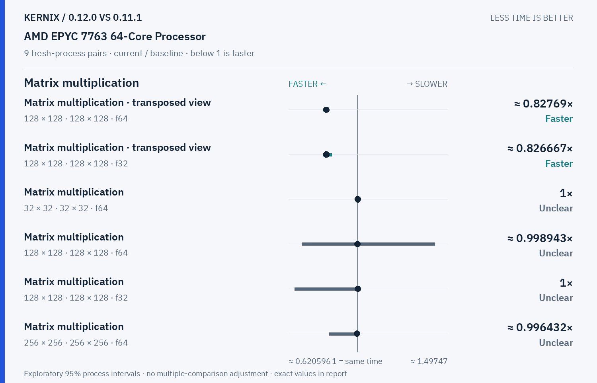
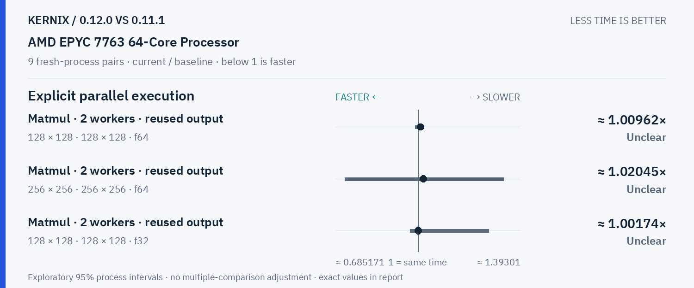
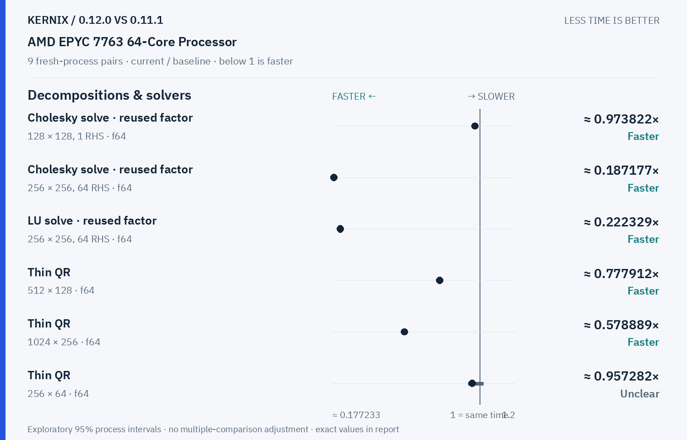
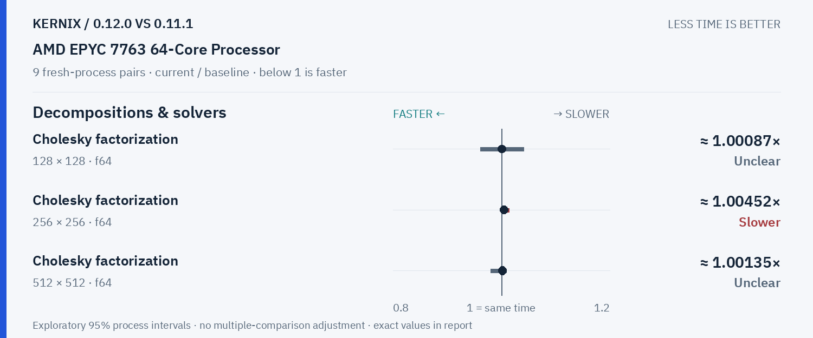

# Kernix 0.12.0 · paired process comparison

9 fresh-process pairs per workload. Ratios below 1 mean less time.

[Interactive HTML (open locally)](report.html) · [Vector PDF](latency.pdf) · [Original process evidence](paired.json)

### Version changes at a glance

The vertical line marks unchanged time. Left is faster; right is slower. Ranges are exploratory 95% intervals over fresh-process pairs. An interval crossing the line leaves direction unclear.

## Exact process ratios

| Workload | Current / baseline [95% interval] | Interpretation |
|---|---:|---|
| Cholesky solve · reused factor · 128 × 128, 1 RHS · f64 | 0.9738219895287958× [0.968421052631579, 0.9738219895287958] | Observed time reduction |
| Cholesky solve · reused factor · 256 × 256, 64 RHS · f64 | 0.18717663909268947× [0.1865605658709107, 0.18858212447356107] | Observed time reduction |
| LU solve · reused factor · 256 × 256, 64 RHS · f64 | 0.22232916265640038× [0.22212072115550346, 0.22289301685586516] | Observed time reduction |
| Thin QR · 512 × 128 · f64 | 0.7779124044095739× [0.7753794875913581, 0.7799979937807202] | Observed time reduction |
| Thin QR · 1024 × 256 · f64 | 0.578889476761995× [0.5775322067599985, 0.5826379763927365] | Observed time reduction |
| Matrix multiplication · transposed view · 128 × 128 · 128 × 128 · f64 | 0.8276896699528504× [0.8116910229645093, 0.8392311052861512] | Observed time reduction |
| Matrix multiplication · transposed view · 128 × 128 · 128 × 128 · f32 | 0.8266666666666667× [0.8089117395029991, 0.8577699736611062] | Observed time reduction |
| Thin QR · 256 × 64 · f64 | 0.9572822465492623× [0.9372616558002215, 1.021105141980046] | Timing direction unclear |
| Matrix multiplication · 32 × 32 · 32 × 32 · f64 | 1× [1, 1] | Timing direction unclear |
| Matrix multiplication · 128 × 128 · 128 × 128 · f64 | 0.9989429175475687× [0.6957478005865103, 1.4261603375527425] | Timing direction unclear |
| Matrix multiplication · 128 × 128 · 128 × 128 · f32 | 1× [0.6532593619972261, 1.0021276595744681] | Timing direction unclear |
| Matrix multiplication · 256 × 256 · 256 × 256 · f64 | 0.9964324917672887× [0.8442432683379758, 1.0080343537886134] | Timing direction unclear |
| Matrix multiplication · 256 × 256 · 256 × 256 · f32 | 0.9974604966139955× [0.843441466854725, 1.0025359256128488] | Timing direction unclear |
| Record + backward · sum(A · W), 32 × 16 · 16 × 8 · f64 | 1× [0.9791666666666666, 1.0208333333333333] | Timing direction unclear |
| Independent matrix operands · 128 × 128 · 128 × 128 · f64 | 0.9978308026030369× [0.9956772334293948, 1.032490974729242] | Timing direction unclear |
| Independent matrix operands · 128 × 128 · 128 × 128 · f32 | 0.9919571045576407× [0.908344733242134, 1.0027359781121752] | Timing direction unclear |
| Batched multiplication · 4 × 16 × 32 · 1 × 32 × 16 · f64 | 1× [1, 1.28] | Timing direction unclear |
| Batched multiplication · 4 × 16 × 32 · 1 × 32 × 16 · f32 | 1× [1, 1] | Timing direction unclear |
| Cholesky factorization · 128 × 128 · f64 | 1.0008684324793746× [0.9608865710560626, 1.0411206507004067] | Timing direction unclear |
| Cholesky factorization · 256 × 256 · f64 | 1.0045150014564521× [1.0007302468234263, 1.0139275766016713] | Observed time increase |
| Cholesky factorization · 512 × 512 · f64 | 1.0013484710078733× [0.979931106784484, 1.0090029357399153] | Timing direction unclear |
| Matmul · 2 workers · reused output · 128 × 128 · 128 × 128 · f64 | 1.0096153846153846× [0.9894490035169988, 1.0169491525423728] | Timing direction unclear |
| Matmul · 2 workers · reused output · 256 × 256 · 256 × 256 · f64 | 1.0204508482454102× [0.7212323064113239, 1.3266775017413512] | Timing direction unclear |
| Matmul · 2 workers · reused output · 128 × 128 · 128 × 128 · f32 | 1.0017421602787457× [0.9702797202797203, 1.2707993474714518] | Timing direction unclear |

## Method

95% percentile bootstrap over paired process blocks; 10000 resamples; exploratory, no multiple-comparison adjustment

Current `runner-windows-latest-40270611933`; baseline `baseline-windows-latest-40270611933`. All source ratio digits, paired observations and process ordering are preserved. No absolute peer latencies are inferred.
