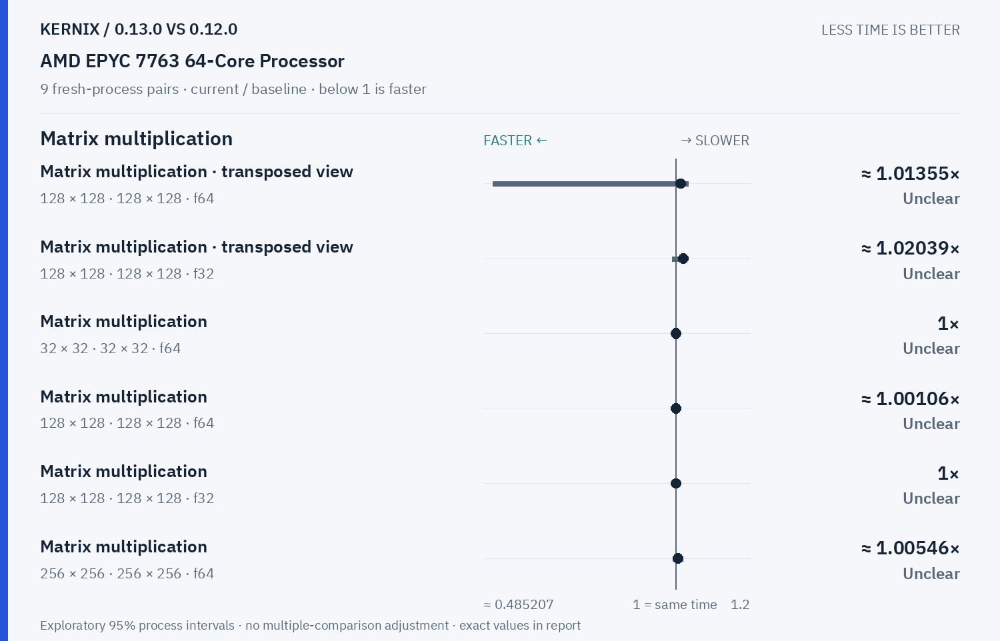

# Kernix 0.13.0 · paired process comparison

9 fresh-process pairs per workload. Ratios below 1 mean less time.

[Interactive HTML (open locally)](report.html) · [Vector PDF](latency.pdf) · [Original process evidence](paired.json)

### Version changes at a glance

The vertical line marks unchanged time. Left is faster; right is slower. Ranges are exploratory 95% intervals over fresh-process pairs. An interval crossing the line leaves direction unclear.

## Exact process ratios

| Workload | Current / baseline [95% interval] | Interpretation |
|---|---:|---|
| Cholesky solve · reused factor · 128 × 128, 1 RHS · f64 | 1× [0.978494623655914, 1] | Timing direction unclear |
| Cholesky solve · reused factor · 256 × 256, 64 RHS · f64 | 1.0877385048482953× [1.0835212691500116, 1.0905533380292713] | Observed time increase |
| LU solve · reused factor · 256 × 256, 64 RHS · f64 | 0.980936403843221× [0.9784331656759641, 0.9852986217457886] | Observed time reduction |
| Thin QR · 512 × 128 · f64 | 0.9980635263938836× [0.9794909809735605, 1.004127710364034] | Timing direction unclear |
| Thin QR · 1024 × 256 · f64 | 0.9930393565603598× [0.9869423490620097, 1.0008656185663485] | Timing direction unclear |
| Matrix multiplication · transposed view · 128 × 128 · 128 × 128 · f64 | 1.0135542168674698× [0.5107446276861569, 1.0339157245632067] | Timing direction unclear |
| Matrix multiplication · transposed view · 128 × 128 · 128 × 128 · f32 | 1.020387359836901× [0.990990990990991, 1.0287769784172662] | Timing direction unclear |
| Thin QR · 256 × 64 · f64 | 1.0235950780159837× [0.9791957376633261, 1.0424158014687264] | Timing direction unclear |
| Matrix multiplication · 32 × 32 · 32 × 32 · f64 | 1× [1, 1] | Timing direction unclear |
| Matrix multiplication · 128 × 128 · 128 × 128 · f64 | 1.0010593220338984× [0.9968354430379747, 1.0031712473572938] | Timing direction unclear |
| Matrix multiplication · 128 × 128 · 128 × 128 · f32 | 1× [0.9957716701902748, 1.0021231422505308] | Timing direction unclear |
| Matrix multiplication · 256 × 256 · 256 × 256 · f64 | 1.0054614964500272× [0.9927105831533477, 1.0194106641721234] | Timing direction unclear |
| Matrix multiplication · 256 × 256 · 256 × 256 · f32 | 0.9974789915966387× [0.8314212128307188, 1.0033670033670035] | Timing direction unclear |
| Record + backward · sum(A · W), 32 × 16 · 16 × 8 · f64 | 0.96× [0.94, 0.9795918367346939] | Observed time reduction |
| Independent matrix operands · 128 × 128 · 128 × 128 · f64 | 0.9978947368421053× [0.9895324494068388, 0.9992997198879552] | Observed time reduction |
| Independent matrix operands · 128 × 128 · 128 × 128 · f32 | 0.9922480620155039× [0.9896507115135834, 1.0025974025974025] | Timing direction unclear |
| Batched multiplication · 4 × 16 × 32 · 1 × 32 × 16 · f64 | 1× [0.9615384615384616, 1.04] | Timing direction unclear |
| Batched multiplication · 4 × 16 × 32 · 1 × 32 × 16 · f32 | 1× [1, 1] | Timing direction unclear |
| Cholesky factorization · 128 × 128 · f64 | 0.9961055819991346× [0.9587852494577006, 1.0378208014407924] | Timing direction unclear |
| Cholesky factorization · 256 × 256 · f64 | 0.9976703552708212× [0.9940622737146995, 1.0071553738317758] | Timing direction unclear |
| Cholesky factorization · 512 × 512 · f64 | 0.999373094965304× [0.9815937955664504, 1.0053508504807065] | Timing direction unclear |
| Matmul · 2 workers · reused output · 128 × 128 · 128 × 128 · f64 | 1.0118906064209274× [0.7700320512820513, 1.256198347107438] | Timing direction unclear |
| Matmul · 2 workers · reused output · 256 × 256 · 256 × 256 · f64 | 0.9625962596259626× [0.6264762427904422, 1.0512041150339022] | Timing direction unclear |
| Matmul · 2 workers · reused output · 128 × 128 · 128 × 128 · f32 | 1× [0.9807383627608346, 1.25705329153605] | Timing direction unclear |

## Method

95% percentile bootstrap over paired process blocks; 10000 resamples; exploratory, no multiple-comparison adjustment

Current `runner-windows-latest-40289723446`; baseline `baseline-windows-latest-40289723446`. All source ratio digits, paired observations and process ordering are preserved. No absolute peer latencies are inferred.
