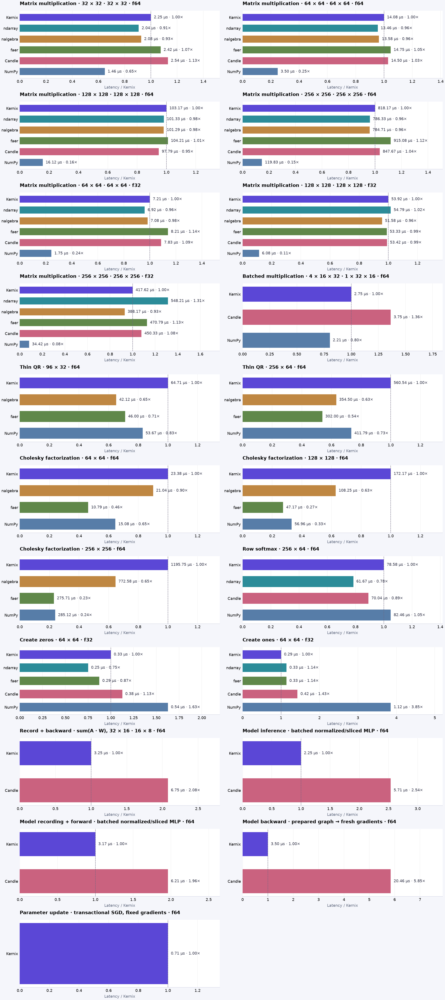

# Kernix 0.8.0 · CPU benchmarks

Apple M1 (Virtual) · one BLAS/Rayon thread · allocation-inclusive · warmed individual calls

**Microseconds per call, median. Lower is faster; bold marks the lowest observed median in each row.**

No previous-version baseline is paired with this view.

| Workload | Kernix | ndarray | nalgebra | faer | Candle | NumPy |
|---|---:|---:|---:|---:|---:|---:|
| Matrix multiplication · 32 × 32 · 32 × 32 · f64 | 2.250 | 2.041 | 2.083 | 2.417 | 2.542 | **1.458** |
| Matrix multiplication · 64 × 64 · 64 × 64 · f64 | 14.083 | 13.459 | 13.583 | 14.750 | 14.500 | **3.500** |
| Matrix multiplication · 128 × 128 · 128 × 128 · f64 | 103.166 | 101.333 | 101.292 | 104.208 | 97.792 | **16.125** |
| Matrix multiplication · 256 × 256 · 256 × 256 · f64 | 818.166 | 786.333 | 784.708 | 915.084 | 847.667 | **119.833** |
| Matrix multiplication · 64 × 64 · 64 × 64 · f32 | 7.208 | 6.917 | 7.084 | 8.208 | 7.833 | **1.750** |
| Matrix multiplication · 128 × 128 · 128 × 128 · f32 | 53.917 | 54.792 | 51.583 | 53.333 | 53.416 | **6.083** |
| Matrix multiplication · 256 × 256 · 256 × 256 · f32 | 417.625 | 548.209 | 388.166 | 470.792 | 450.333 | **34.416** |
| Batched multiplication · 4 × 16 × 32 · 1 × 32 × 16 · f64 | 2.750 | — | — | — | 3.750 | **2.209** |
| Thin QR · 96 × 32 · f64 | 64.708 | — | **42.125** | 46.000 | — | 53.666 |
| Thin QR · 256 × 64 · f64 | 560.541 | — | 354.500 | **302.000** | — | 411.792 |
| Cholesky factorization · 64 × 64 · f64 | 23.375 | — | 21.042 | **10.792** | — | 15.083 |
| Cholesky factorization · 128 × 128 · f64 | 172.166 | — | 108.250 | **47.167** | — | 56.958 |
| Cholesky factorization · 256 × 256 · f64 | 1195.750 | — | 772.584 | **275.708** | — | 285.125 |
| Row softmax · 256 × 64 · f64 | 78.583 | **61.667** | — | — | 70.041 | 82.458 |
| Create zeros · 64 × 64 · f32 | 0.333 | **0.250** | — | 0.291 | 0.375 | 0.542 |
| Create ones · 64 × 64 · f32 | **0.292** | 0.333 | — | 0.333 | 0.417 | 1.125 |
| Record + backward · sum(A · W), 32 × 16 · 16 × 8 · f64 | **3.250** | — | — | — | 6.750 | — |
| Model inference · batched normalized/sliced MLP · f64 | **2.250** | — | — | — | 5.709 | — |
| Model recording + forward · batched normalized/sliced MLP · f64 | **3.167** | — | — | — | 6.208 | — |
| Model backward · prepared graph → fresh gradients · f64 | **3.500** | — | — | — | 20.459 | — |
| Parameter update · transactional SGD, fixed gradients · f64 | **0.709** | — | — | — | — | — |

Each panel has its own scale. Ratios are library / Kernix median; below 1 means the comparator was faster.

## Reading these results

- One shared laptop, one pinned CPU and one BLAS/Rayon thread. Frequency and background load are uncontrolled; these observations establish no universal ranking.
- Timing includes output allocation and destruction. Inputs and imports are prepared outside timing. GEMM inputs are row-major; output layout and validation contracts can differ by library.
- Per-call p95 describes 256 individual warmed calls. The 15 batch means form a separate distribution; neither is a confidence interval.
- Rust allocation probes use a separate instrumented binary. Native engines may retain packing buffers; warmed probes exclude their first-use allocation and retention. NumPy native allocations are unavailable, never zero.

[Interactive report](report.html) · [Detailed measurements and method](DETAILS.md) · [Raw samples and provenance](raw.json) · [Printable chart](latency.pdf)

Measured source `8b1a73ba926709c8c187a18aafe02840f0a4df50`. Run `runner-macos-latest-39720416210`. Rendering does not remeasure or modify raw evidence.
