# Kernix 0.10.0 · performance brief

Apple M1 (Virtual) / macOS

**Per-call median, microseconds per operation. Lower is faster. All recorded digits retained.**

31 workloads · 108 observations

No previous-version baseline attached. Sequential run changes are descriptive; paired process evidence is shown separately.

[Interactive HTML (open locally)](report.html) · [Vector PDF](latency.pdf) · [Raw measurements](raw.json)

[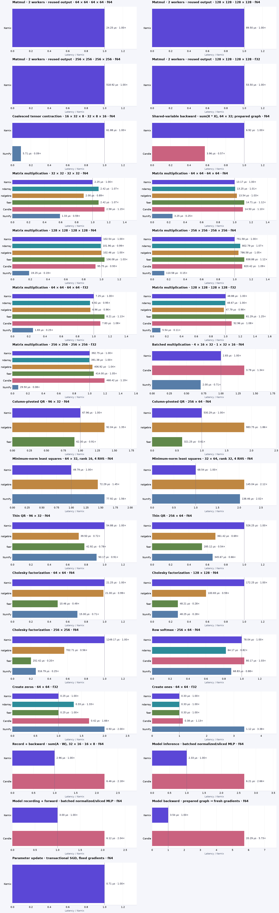](latency.pdf)

## Charts by workload

**Shorter bars mean less time.** Blue is Kernix; grey is another library; teal is an explicitly selected Kernix backend. Entries are sorted by the recorded median, with a separate zero-based scale per chart. These point observations do not establish a statistical ranking.

Expand a group to see every chart here on GitHub. Click a chart to enlarge it. The exact table below keeps every source digit.

Matrix multiplication · 8 workloads

**Matrix multiplication · 32 × 32 · 32 × 32 · f64**

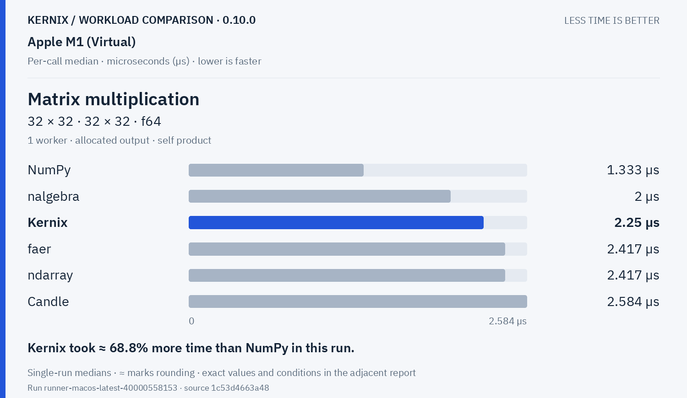

Kernix: **2.25 µs**. Kernix took ≈ 68.8% more time than NumPy in this run.

**Matrix multiplication · 64 × 64 · 64 × 64 · f64**

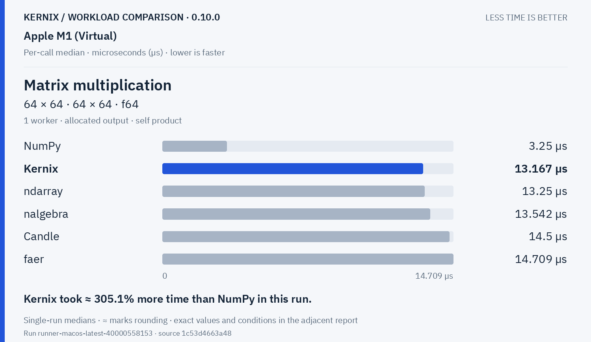

Kernix: **13.167 µs**. Kernix took ≈ 305.1% more time than NumPy in this run.

**Matrix multiplication · 128 × 128 · 128 × 128 · f64**

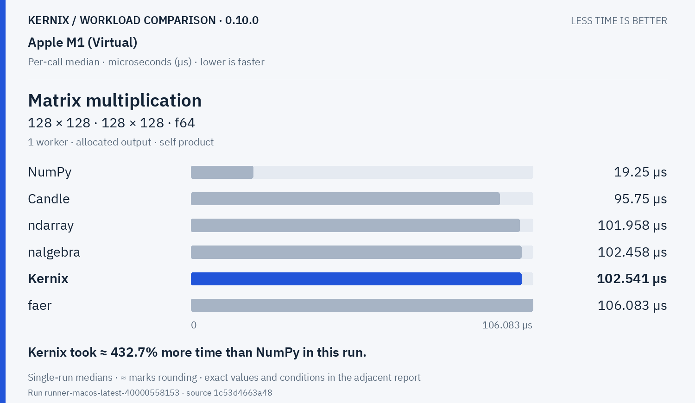

Kernix: **102.541 µs**. Kernix took ≈ 432.7% more time than NumPy in this run.

**Matrix multiplication · 256 × 256 · 256 × 256 · f64**

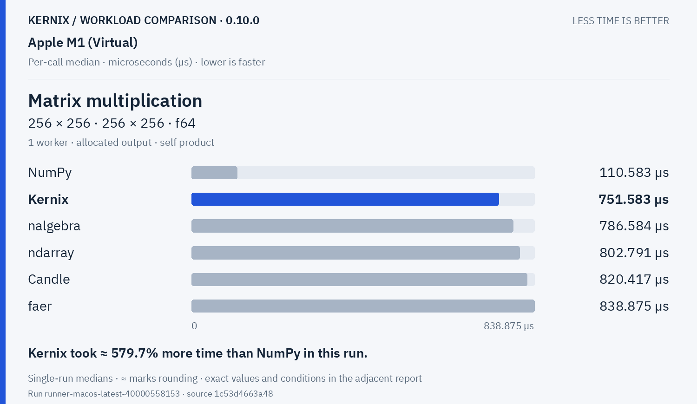

Kernix: **751.583 µs**. Kernix took ≈ 579.7% more time than NumPy in this run.

**Matrix multiplication · 64 × 64 · 64 × 64 · f32**

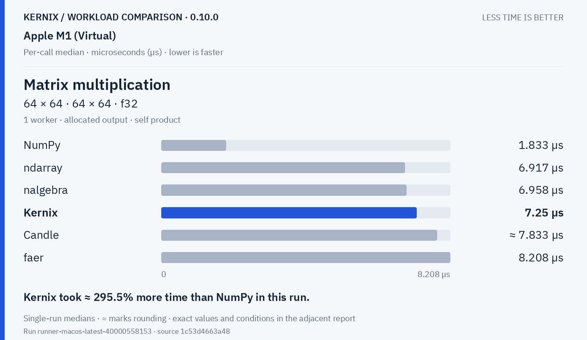

Kernix: **7.25 µs**. Kernix took ≈ 295.5% more time than NumPy in this run.

**Matrix multiplication · 128 × 128 · 128 × 128 · f32**

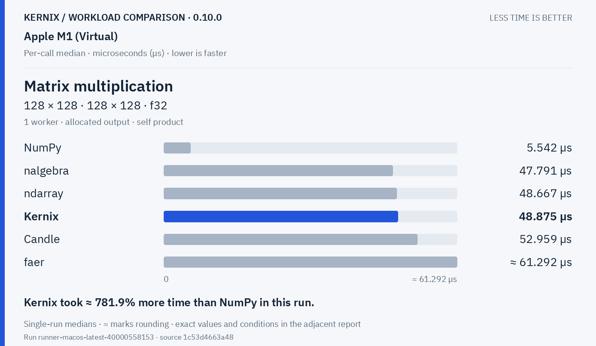

Kernix: **48.875 µs**. Kernix took ≈ 781.9% more time than NumPy in this run.

**Matrix multiplication · 256 × 256 · 256 × 256 · f32**

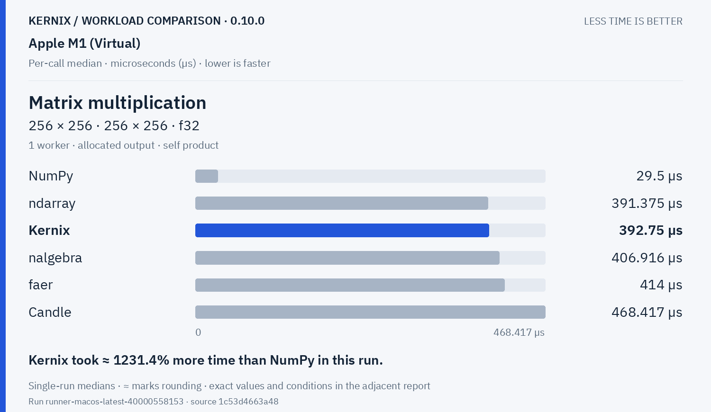

Kernix: **392.75 µs**. Kernix took ≈ 1231.4% more time than NumPy in this run.

**Batched multiplication · 4 × 16 × 32 · 1 × 32 × 16 · f64**

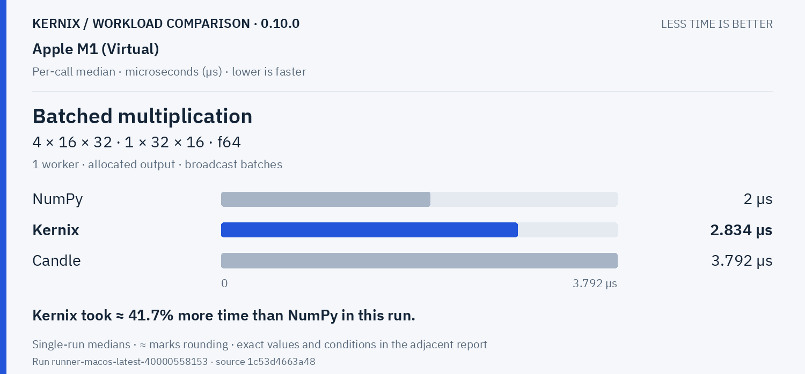

Kernix: **2.834 µs**. Kernix took ≈ 41.7% more time than NumPy in this run.

Explicit parallel execution · 4 workloads

**Matmul · 2 workers · reused output · 64 × 64 · 64 × 64 · f64**

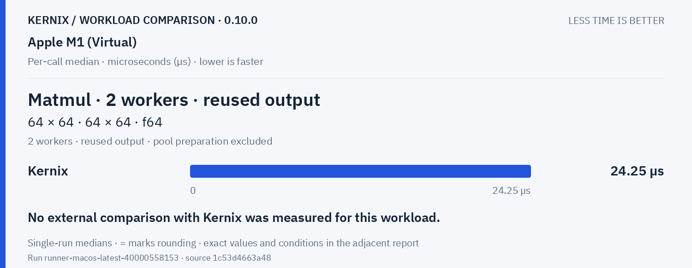

Kernix: **24.25 µs**. No external comparison with Kernix was measured for this workload.

**Matmul · 2 workers · reused output · 128 × 128 · 128 × 128 · f64**

Kernix: **89.5 µs**. No external comparison with Kernix was measured for this workload.

**Matmul · 2 workers · reused output · 256 × 256 · 256 × 256 · f64**

Kernix: **518.91700000000006 µs**. No external comparison with Kernix was measured for this workload.

**Matmul · 2 workers · reused output · 128 × 128 · 128 × 128 · f32**

Kernix: **53.5 µs**. No external comparison with Kernix was measured for this workload.

Decompositions & solvers · 9 workloads

**Column-pivoted QR · 96 × 32 · f64**

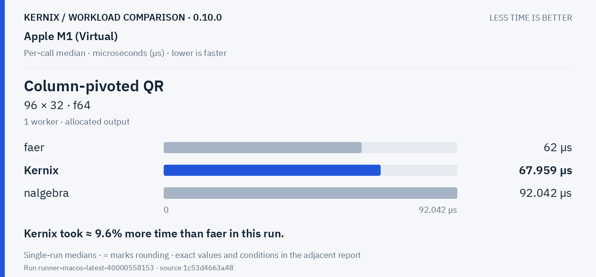

Kernix: **67.959 µs**. Kernix took ≈ 9.6% more time than faer in this run.

**Column-pivoted QR · 256 × 64 · f64**

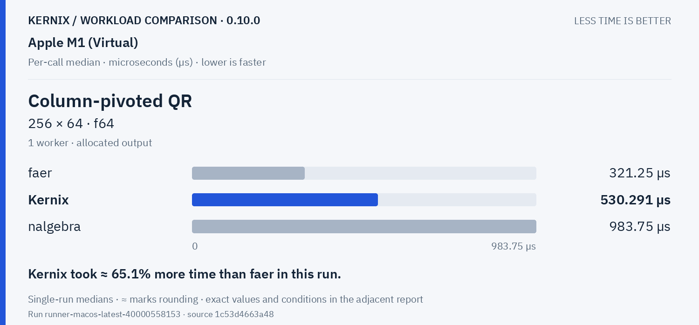

Kernix: **530.291 µs**. Kernix took ≈ 65.1% more time than faer in this run.

**Minimum-norm least squares · 64 × 32, rank 16, 4 RHS · f64**

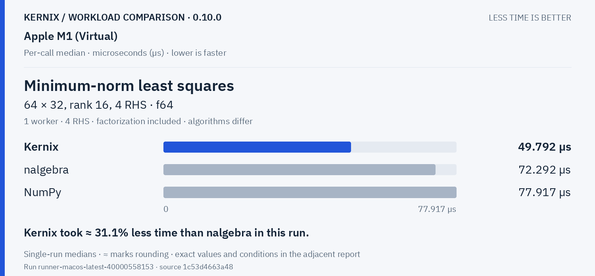

Kernix: **49.792 µs**. Kernix took ≈ 31.1% less time than nalgebra in this run.

**Minimum-norm least squares · 32 × 64, rank 32, 4 RHS · f64**

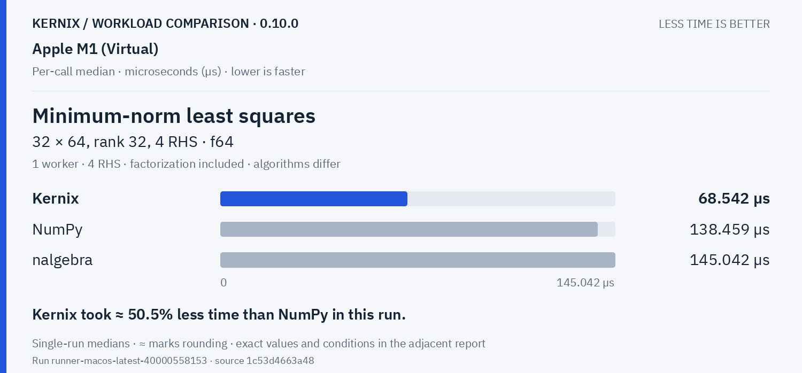

Kernix: **68.542 µs**. Kernix took ≈ 50.5% less time than NumPy in this run.

**Thin QR · 96 × 32 · f64**

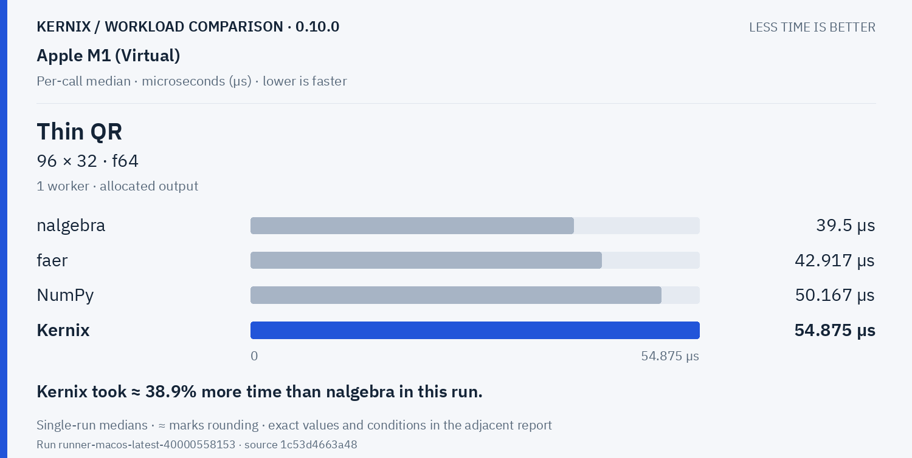

Kernix: **54.875 µs**. Kernix took ≈ 38.9% more time than nalgebra in this run.

**Thin QR · 256 × 64 · f64**

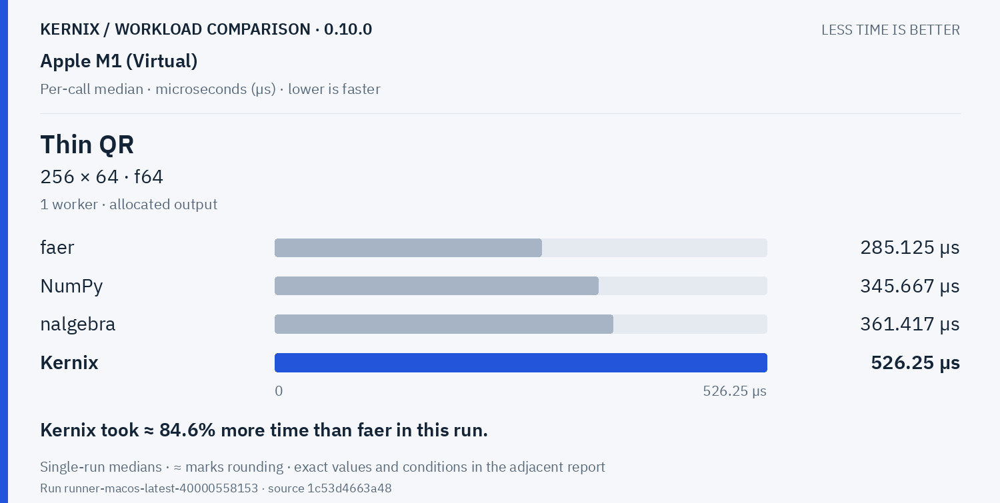

Kernix: **526.25 µs**. Kernix took ≈ 84.6% more time than faer in this run.

**Cholesky factorization · 64 × 64 · f64**

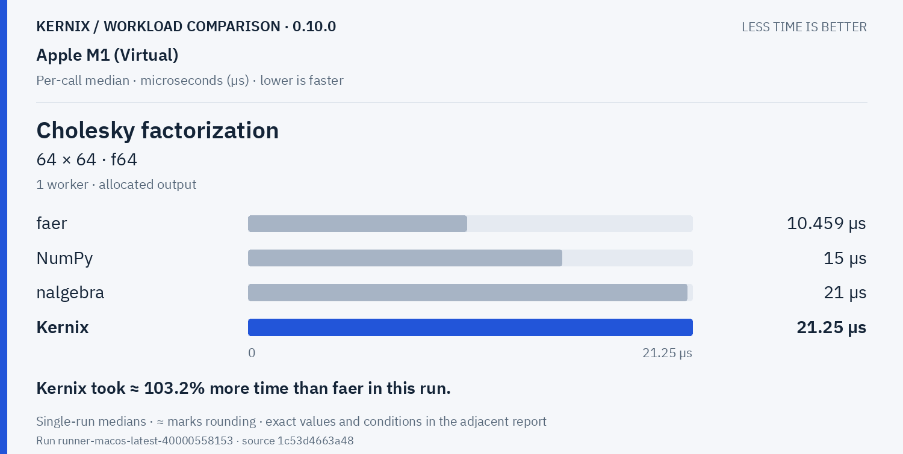

Kernix: **21.25 µs**. Kernix took ≈ 103.2% more time than faer in this run.

**Cholesky factorization · 128 × 128 · f64**

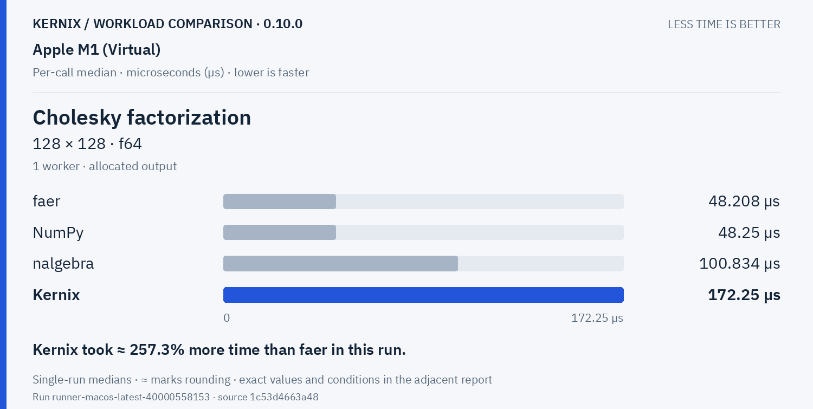

Kernix: **172.25 µs**. Kernix took ≈ 257.3% more time than faer in this run.

**Cholesky factorization · 256 × 256 · f64**

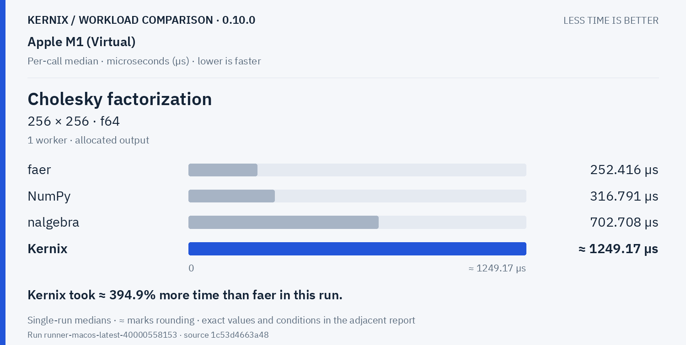

Kernix: **1249.167 µs**. Kernix took ≈ 394.9% more time than faer in this run.

Training & autodiff · 6 workloads

**Shared-variable backward · sum(X * X), 64 × 32; prepared graph · f64**

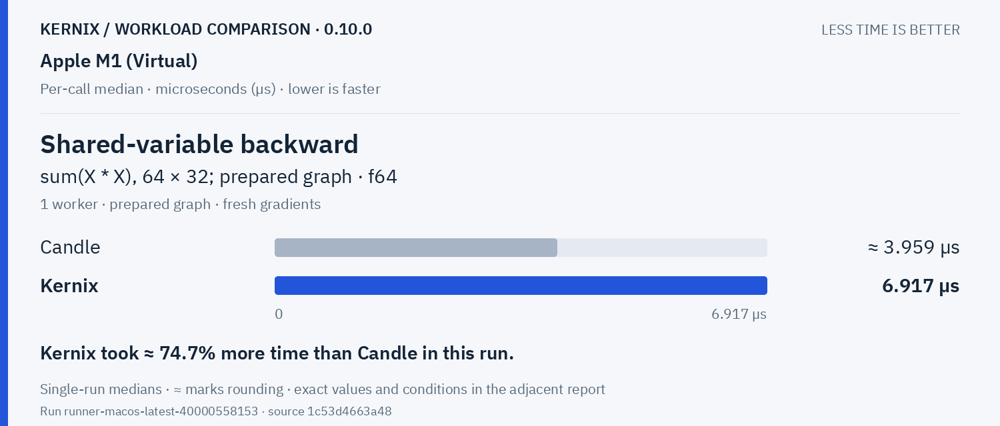

Kernix: **6.917 µs**. Kernix took ≈ 74.7% more time than Candle in this run.

**Record + backward · sum(A · W), 32 × 16 · 16 × 8 · f64**

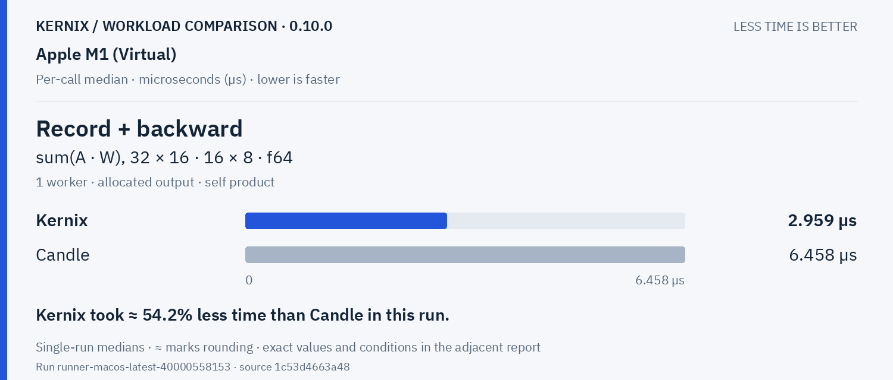

Kernix: **2.959 µs**. Kernix took ≈ 54.2% less time than Candle in this run.

**Model inference · batched normalized/sliced MLP · f64**

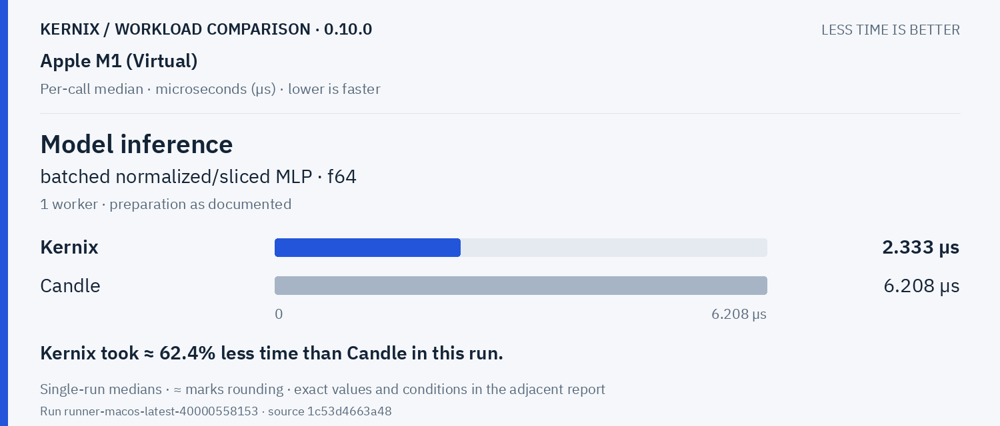

Kernix: **2.333 µs**. Kernix took ≈ 62.4% less time than Candle in this run.

**Model recording + forward · batched normalized/sliced MLP · f64**

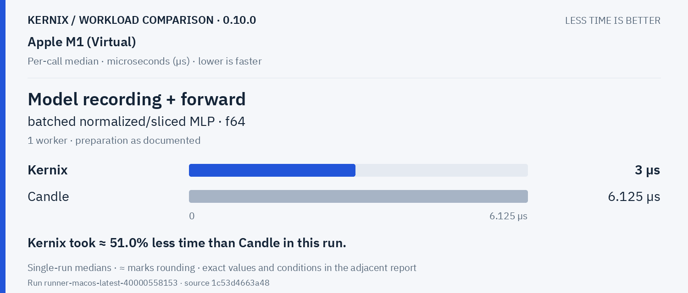

Kernix: **3 µs**. Kernix took ≈ 51.0% less time than Candle in this run.

**Model backward · prepared graph → fresh gradients · f64**

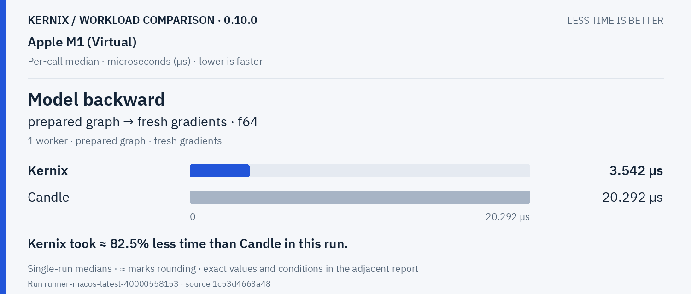

Kernix: **3.542 µs**. Kernix took ≈ 82.5% less time than Candle in this run.

**Parameter update · transactional SGD, fixed gradients · f64**

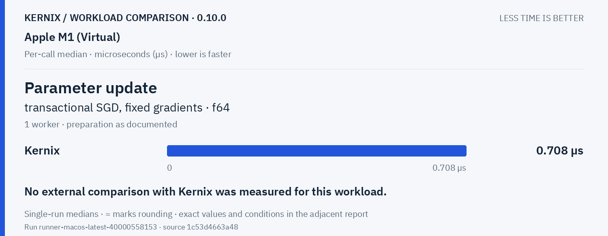

Kernix: **0.708 µs**. No external comparison with Kernix was measured for this workload.

Tensor contractions · 1 workloads

**Coalesced tensor contraction · 16 × 32 × 8 · 32 × 8 × 16 · f64**

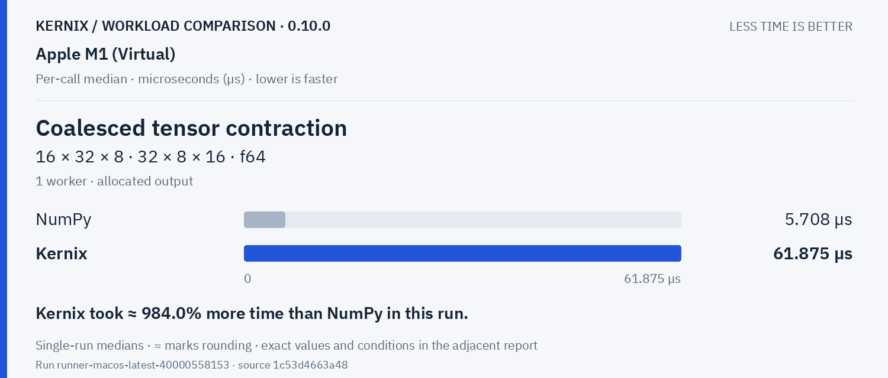

Kernix: **61.875 µs**. Kernix took ≈ 984.0% more time than NumPy in this run.

Statistics & activations · 1 workloads

**Row softmax · 256 × 64 · f64**

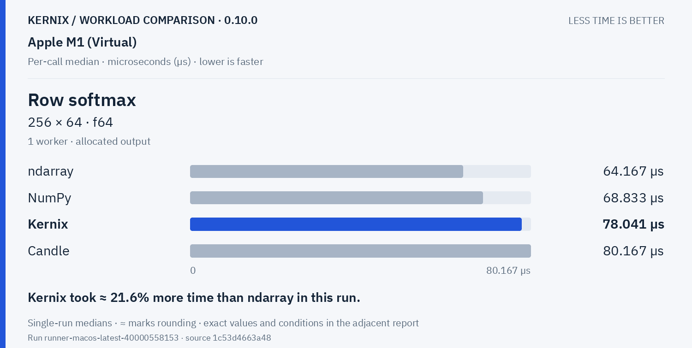

Kernix: **78.041 µs**. Kernix took ≈ 21.6% more time than ndarray in this run.

Tensor construction · 2 workloads

**Create zeros · 64 × 64 · f32**

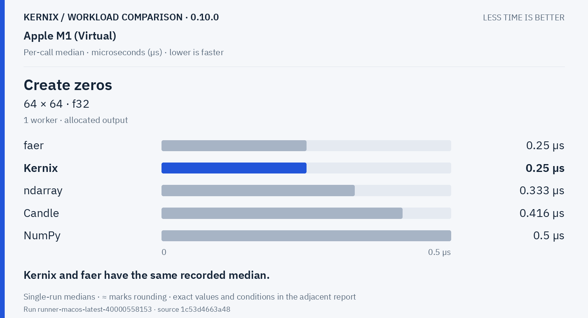

Kernix: **0.25 µs**. Kernix and faer have the same recorded median.

**Create ones · 64 × 64 · f32**

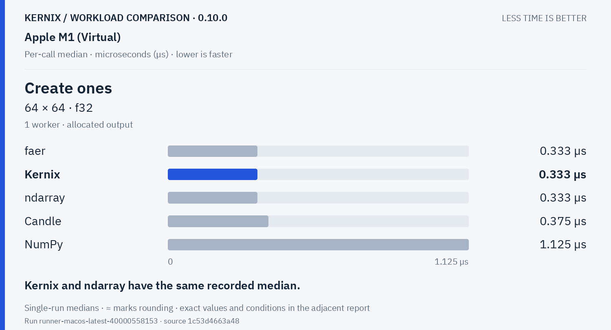

Kernix: **0.333 µs**. Kernix and ndarray have the same recorded median.

## Exact latency table

All values below are microseconds per operation. **Lower is faster.** Missing entries were not measured.

| Workload | Kernix | ndarray | nalgebra | faer | Candle | NumPy |
|---|---:|---:|---:|---:|---:|---:|
| Matrix multiplication · 32 × 32 · 32 × 32 · f64 | 2.25 | 2.417 | 2 | 2.417 | 2.584 | **1.333** |
| Matrix multiplication · 64 × 64 · 64 × 64 · f64 | 13.167 | 13.25 | 13.542 | 14.709 | 14.5 | **3.25** |
| Matrix multiplication · 128 × 128 · 128 × 128 · f64 | 102.541 | 101.958 | 102.458 | 106.083 | 95.75 | **19.25** |
| Matrix multiplication · 256 × 256 · 256 × 256 · f64 | 751.583 | 802.791 | 786.584 | 838.875 | 820.417 | **110.583** |
| Matrix multiplication · 64 × 64 · 64 × 64 · f32 | 7.25 | 6.917 | 6.958 | 8.208 | 7.832999999999999 | **1.833** |
| Matrix multiplication · 128 × 128 · 128 × 128 · f32 | 48.875 | 48.667 | 47.791 | 61.29199999999999 | 52.959 | **5.542** |
| Matrix multiplication · 256 × 256 · 256 × 256 · f32 | 392.75 | 391.375 | 406.916 | 414 | 468.417 | **29.5** |
| Batched multiplication · 4 × 16 × 32 · 1 × 32 × 16 · f64 | 2.834 | — | — | — | 3.792 | **2** |
| Matmul · 2 workers · reused output · 64 × 64 · 64 × 64 · f64 | 24.25 | — | — | — | — | — |
| Matmul · 2 workers · reused output · 128 × 128 · 128 × 128 · f64 | 89.5 | — | — | — | — | — |
| Matmul · 2 workers · reused output · 256 × 256 · 256 × 256 · f64 | 518.91700000000006 | — | — | — | — | — |
| Matmul · 2 workers · reused output · 128 × 128 · 128 × 128 · f32 | 53.5 | — | — | — | — | — |
| Column-pivoted QR · 96 × 32 · f64 | 67.959 | — | 92.042 | **62** | — | — |
| Column-pivoted QR · 256 × 64 · f64 | 530.291 | — | 983.75 | **321.25** | — | — |
| Minimum-norm least squares · 64 × 32, rank 16, 4 RHS · f64 | **49.792** | — | 72.292 | — | — | 77.917 |
| Minimum-norm least squares · 32 × 64, rank 32, 4 RHS · f64 | **68.542** | — | 145.042 | — | — | 138.459 |
| Thin QR · 96 × 32 · f64 | 54.875 | — | **39.5** | 42.917 | — | 50.167 |
| Thin QR · 256 × 64 · f64 | 526.25 | — | 361.417 | **285.125** | — | 345.667 |
| Cholesky factorization · 64 × 64 · f64 | 21.25 | — | 21 | **10.459** | — | 15 |
| Cholesky factorization · 128 × 128 · f64 | 172.25 | — | 100.834 | **48.208** | — | 48.25 |
| Cholesky factorization · 256 × 256 · f64 | 1249.167 | — | 702.708 | **252.416** | — | 316.791 |
| Shared-variable backward · sum(X * X), 64 × 32; prepared graph · f64 | 6.917 | — | — | — | **3.9589999999999995** | — |
| Record + backward · sum(A · W), 32 × 16 · 16 × 8 · f64 | **2.959** | — | — | — | 6.458 | — |
| Model inference · batched normalized/sliced MLP · f64 | **2.333** | — | — | — | 6.208 | — |
| Model recording + forward · batched normalized/sliced MLP · f64 | **3** | — | — | — | 6.125 | — |
| Model backward · prepared graph → fresh gradients · f64 | **3.542** | — | — | — | 20.292 | — |
| Parameter update · transactional SGD, fixed gradients · f64 | 0.708 | — | — | — | — | — |
| Coalesced tensor contraction · 16 × 32 × 8 · 32 × 8 × 16 · f64 | 61.875 | — | — | — | — | **5.708** |
| Row softmax · 256 × 64 · f64 | 78.041 | **64.167** | — | — | 80.167 | 68.833 |
| Create zeros · 64 × 64 · f32 | **0.25** | 0.333 | — | **0.25** | 0.416 | 0.5 |
| Create ones · 64 × 64 · f32 | **0.333** | **0.333** | — | **0.333** | 0.375 | 1.125 |

## Version comparison

0 of 31 workloads have paired evidence. Exploratory 95% intervals resample process pairs, not calls. No multiple-comparison adjustment.

| Workload | Current / baseline [95% interval] | Interpretation |
|---|---:|---|
| Matrix multiplication · 32 × 32 · 32 × 32 · f64 | — | No paired comparison |
| Matrix multiplication · 64 × 64 · 64 × 64 · f64 | — | No paired comparison |
| Matrix multiplication · 128 × 128 · 128 × 128 · f64 | — | No paired comparison |
| Matrix multiplication · 256 × 256 · 256 × 256 · f64 | — | No paired comparison |
| Matrix multiplication · 64 × 64 · 64 × 64 · f32 | — | No paired comparison |
| Matrix multiplication · 128 × 128 · 128 × 128 · f32 | — | No paired comparison |
| Matrix multiplication · 256 × 256 · 256 × 256 · f32 | — | No paired comparison |
| Batched multiplication · 4 × 16 × 32 · 1 × 32 × 16 · f64 | — | No paired comparison |
| Matmul · 2 workers · reused output · 64 × 64 · 64 × 64 · f64 | — | No paired comparison |
| Matmul · 2 workers · reused output · 128 × 128 · 128 × 128 · f64 | — | No paired comparison |
| Matmul · 2 workers · reused output · 256 × 256 · 256 × 256 · f64 | — | No paired comparison |
| Matmul · 2 workers · reused output · 128 × 128 · 128 × 128 · f32 | — | No paired comparison |
| Column-pivoted QR · 96 × 32 · f64 | — | No paired comparison |
| Column-pivoted QR · 256 × 64 · f64 | — | No paired comparison |
| Minimum-norm least squares · 64 × 32, rank 16, 4 RHS · f64 | — | No paired comparison |
| Minimum-norm least squares · 32 × 64, rank 32, 4 RHS · f64 | — | No paired comparison |
| Thin QR · 96 × 32 · f64 | — | No paired comparison |
| Thin QR · 256 × 64 · f64 | — | No paired comparison |
| Cholesky factorization · 64 × 64 · f64 | — | No paired comparison |
| Cholesky factorization · 128 × 128 · f64 | — | No paired comparison |
| Cholesky factorization · 256 × 256 · f64 | — | No paired comparison |
| Shared-variable backward · sum(X * X), 64 × 32; prepared graph · f64 | — | No paired comparison |
| Record + backward · sum(A · W), 32 × 16 · 16 × 8 · f64 | — | No paired comparison |
| Model inference · batched normalized/sliced MLP · f64 | — | No paired comparison |
| Model recording + forward · batched normalized/sliced MLP · f64 | — | No paired comparison |
| Model backward · prepared graph → fresh gradients · f64 | — | No paired comparison |
| Parameter update · transactional SGD, fixed gradients · f64 | — | No paired comparison |
| Coalesced tensor contraction · 16 × 32 × 8 · 32 × 8 × 16 · f64 | — | No paired comparison |
| Row softmax · 256 × 64 · f64 | — | No paired comparison |
| Create zeros · 64 × 64 · f32 | — | No paired comparison |
| Create ones · 64 × 64 · f32 | — | No paired comparison |

## Method and provenance

CPU affinity was not pinned. Frequency and background load are uncontrolled.

Minimum-norm rows use pivoted QR plus scaled implicit RZ in Kernix; NumPy native lstsq; nalgebra native SVD/solve. Algorithm costs and rank policies differ. See original method for thresholds.

Numbers retain source precision; recorded digits do not imply equivalent physical measurement accuracy. Lowest observed medians are bold only when peers were measured. No aggregate winner or universal ranking is inferred.

[Original report and commentary](original-report.txt) · [Raw measurements](raw.json)

Measured source `1c53d4663a48de5a588809c2b69c3a6a5bdad7b2`. Run `runner-macos-latest-40000558153`. Rendering does not change measurements.
