# Kernix 0.11.0 · performance brief

Apple M1 (Virtual) / macOS

**Per-call median, microseconds per operation. Lower is faster. All recorded digits retained.**

34 workloads · 120 observations

Baseline: baseline-macos-latest-40059566395. Sequential run changes are descriptive; paired process evidence is shown separately.

[Interactive HTML (open locally)](report.html) · [Vector PDF](latency.pdf) · [Raw measurements](raw.json)

[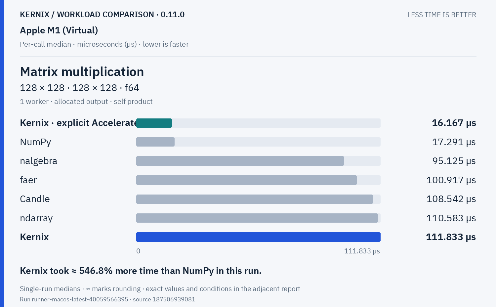](latency.pdf)

## Charts by workload

**Shorter bars mean less time.** Blue is Kernix; grey is a comparison implementation; teal is an explicitly selected Kernix backend. Entries are sorted by the recorded median, with a separate zero-based scale per chart. These point observations do not establish a statistical ranking.

Expand a group to see every chart here on GitHub. Click a chart to enlarge it. The exact table below keeps every source digit.

Matrix multiplication · 10 workloads

**Independent matrix operands · 128 × 128 · 128 × 128 · f64**

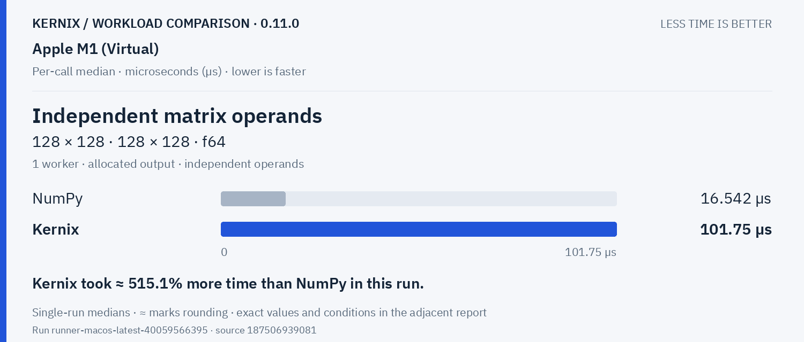

Kernix: **101.75 µs**. Kernix took ≈ 515.1% more time than NumPy in this run.

**Independent matrix operands · 128 × 128 · 128 × 128 · f32**

Kernix: **52.916 µs**. Kernix took ≈ 781.9% more time than NumPy in this run.

**Matrix multiplication · 32 × 32 · 32 × 32 · f64**

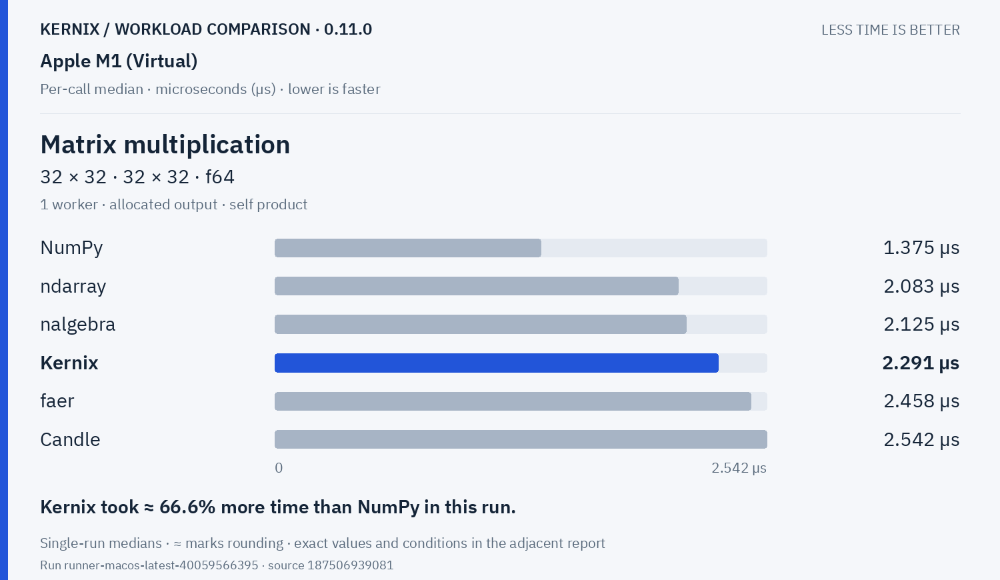

Kernix: **2.291 µs**. Kernix took ≈ 66.6% more time than NumPy in this run.

**Matrix multiplication · 64 × 64 · 64 × 64 · f64**

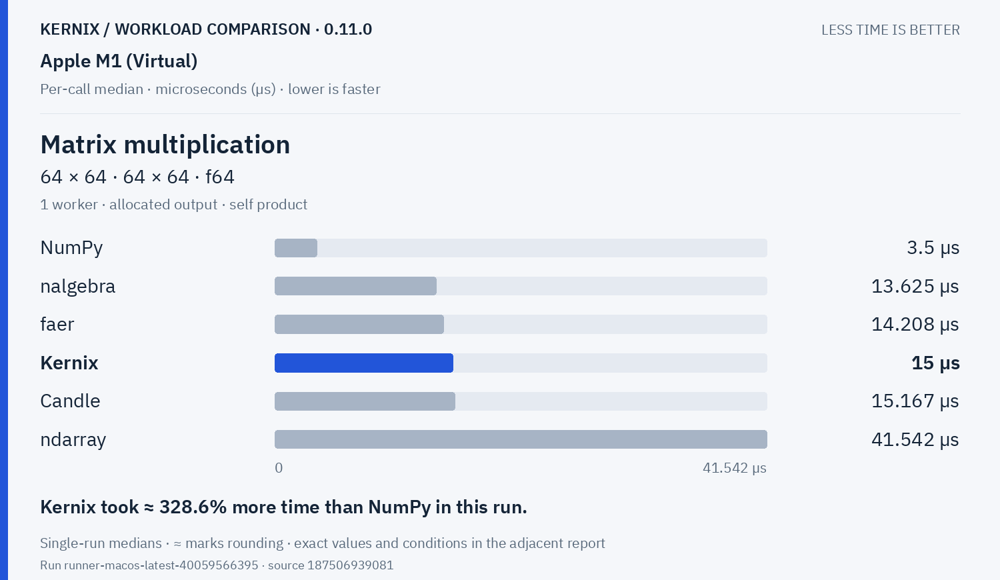

Kernix: **15 µs**. Kernix took ≈ 328.6% more time than NumPy in this run.

**Matrix multiplication · 128 × 128 · 128 × 128 · f64**

Kernix: **111.833 µs**. Kernix took ≈ 546.8% more time than NumPy in this run.

**Matrix multiplication · 256 × 256 · 256 × 256 · f64**

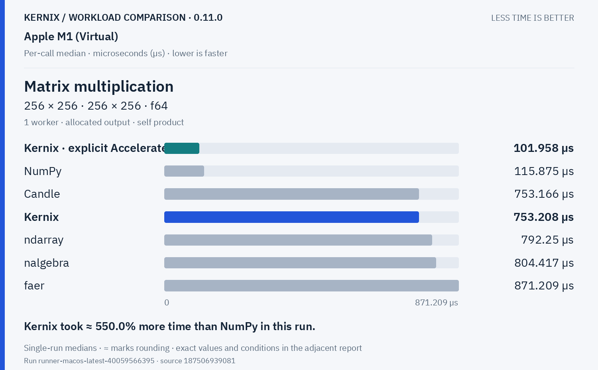

Kernix: **753.208 µs**. Kernix took ≈ 550.0% more time than NumPy in this run.

**Matrix multiplication · 64 × 64 · 64 × 64 · f32**

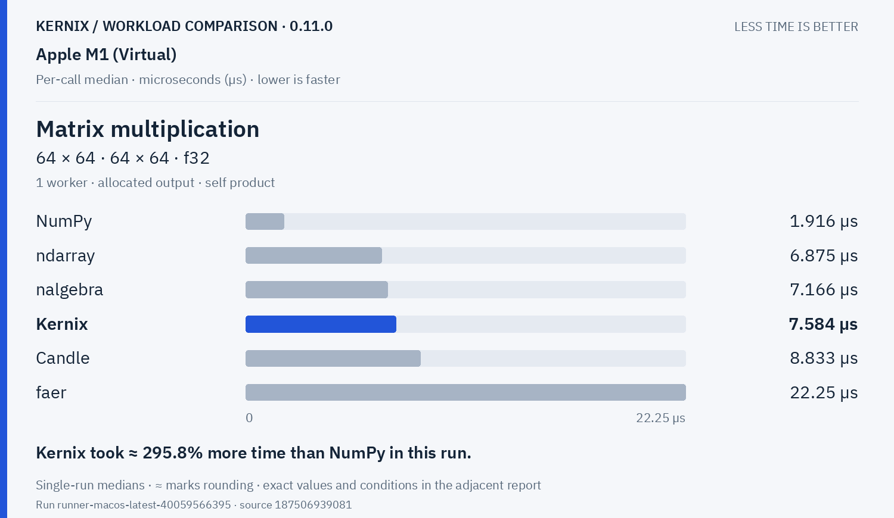

Kernix: **7.584 µs**. Kernix took ≈ 295.8% more time than NumPy in this run.

**Matrix multiplication · 128 × 128 · 128 × 128 · f32**

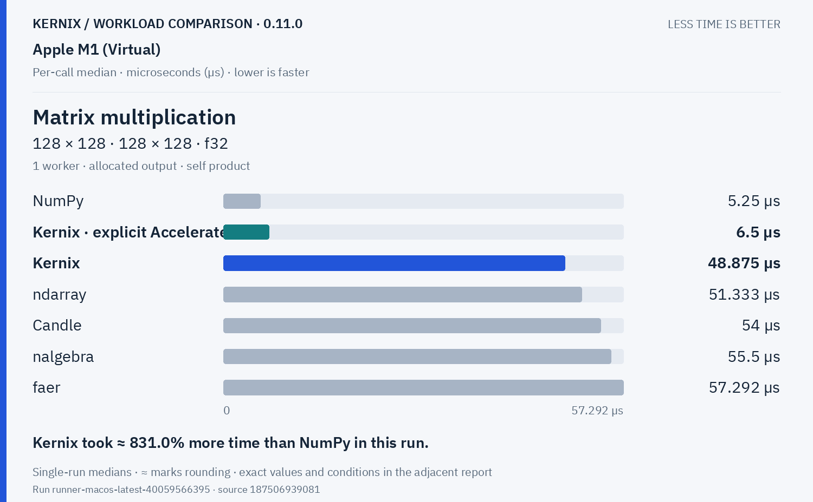

Kernix: **48.875 µs**. Kernix took ≈ 831.0% more time than NumPy in this run.

**Matrix multiplication · 256 × 256 · 256 × 256 · f32**

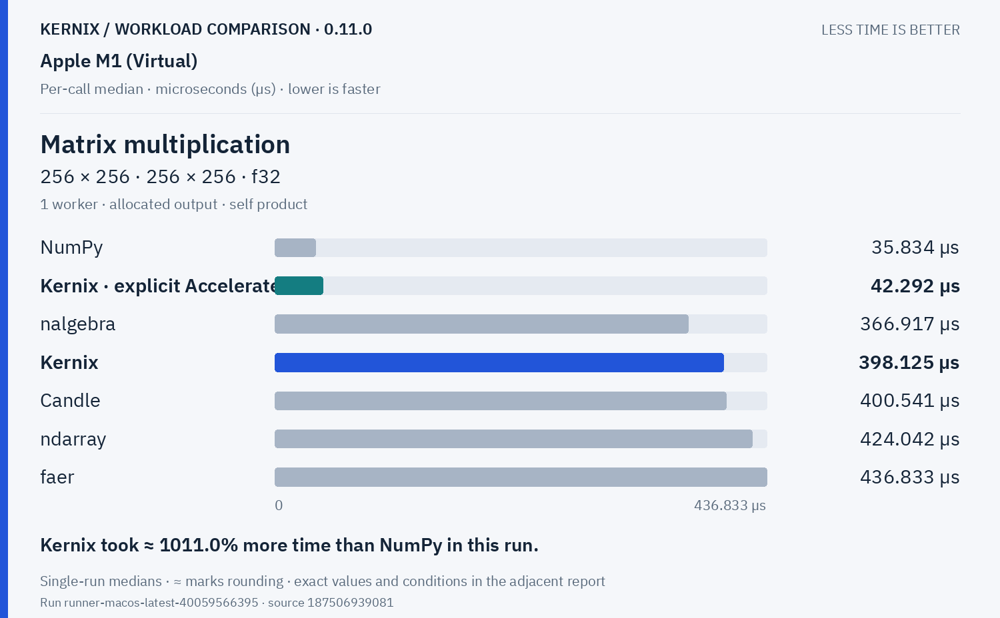

Kernix: **398.125 µs**. Kernix took ≈ 1011.0% more time than NumPy in this run.

**Batched multiplication · 4 × 16 × 32 · 1 × 32 × 16 · f64**

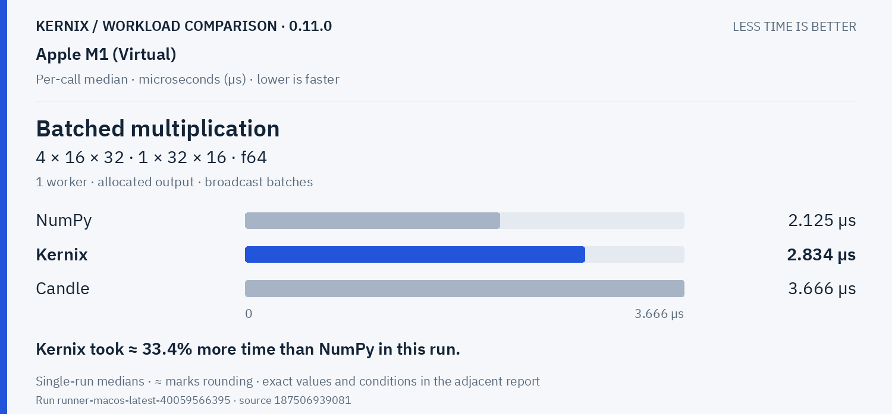

Kernix: **2.834 µs**. Kernix took ≈ 33.4% more time than NumPy in this run.

Explicit parallel execution · 4 workloads

**Matmul · 2 workers · reused output · 64 × 64 · 64 × 64 · f64**

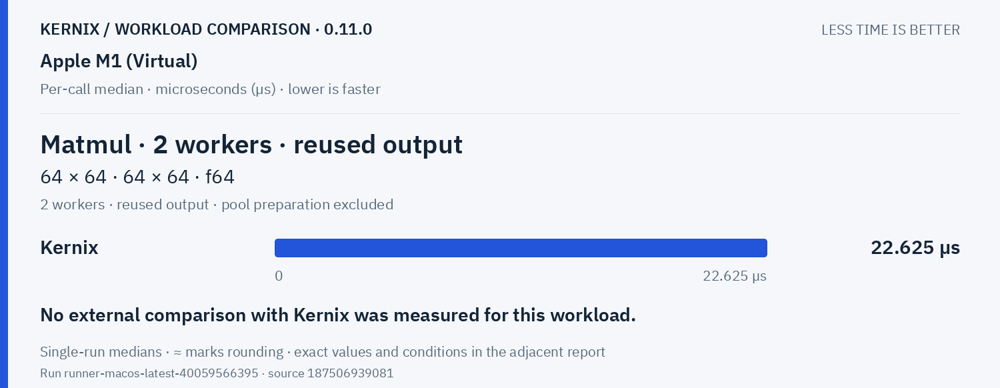

Kernix: **22.625 µs**. No external comparison with Kernix was measured for this workload.

**Matmul · 2 workers · reused output · 128 × 128 · 128 × 128 · f64**

Kernix: **65.666 µs**. No external comparison with Kernix was measured for this workload.

**Matmul · 2 workers · reused output · 256 × 256 · 256 × 256 · f64**

Kernix: **447.583 µs**. No external comparison with Kernix was measured for this workload.

**Matmul · 2 workers · reused output · 128 × 128 · 128 × 128 · f32**

Kernix: **55.291 µs**. No external comparison with Kernix was measured for this workload.

Decompositions & solvers · 10 workloads

**Cholesky factorization · 512 × 512 · f64**

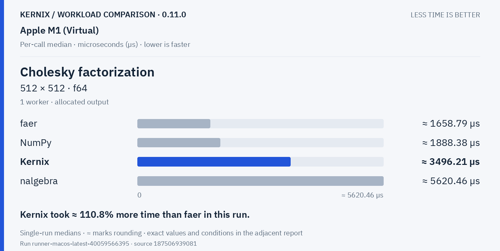

Kernix: **3496.208 µs**. Kernix took ≈ 110.8% more time than faer in this run.

**Column-pivoted QR · 96 × 32 · f64**

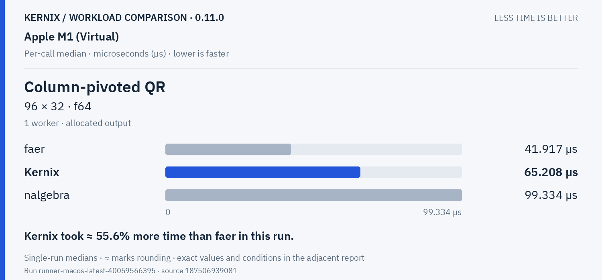

Kernix: **65.208 µs**. Kernix took ≈ 55.6% more time than faer in this run.

**Column-pivoted QR · 256 × 64 · f64**

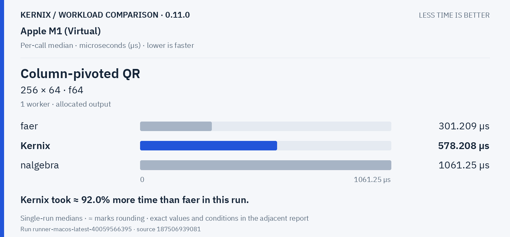

Kernix: **578.208 µs**. Kernix took ≈ 92.0% more time than faer in this run.

**Minimum-norm least squares · 64 × 32, rank 16, 4 RHS · f64**

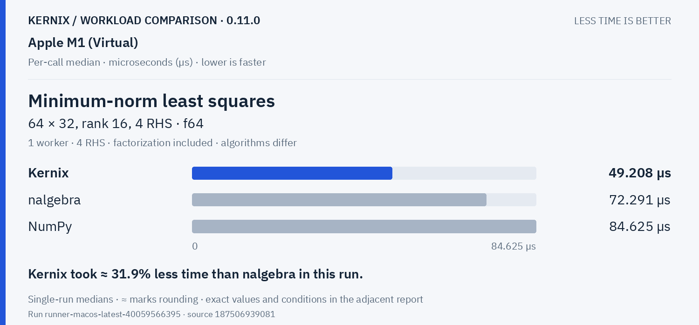

Kernix: **49.208 µs**. Kernix took ≈ 31.9% less time than nalgebra in this run.

**Minimum-norm least squares · 32 × 64, rank 32, 4 RHS · f64**

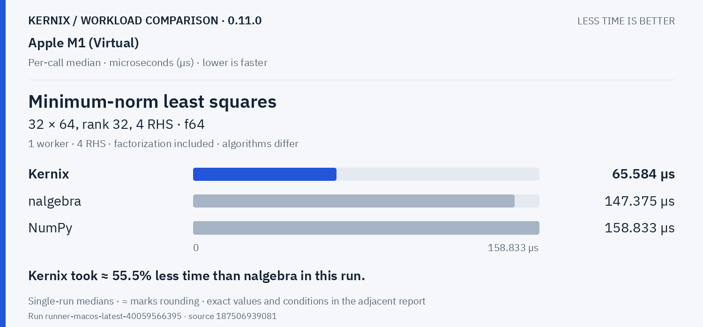

Kernix: **65.584 µs**. Kernix took ≈ 55.5% less time than nalgebra in this run.

**Thin QR · 96 × 32 · f64**

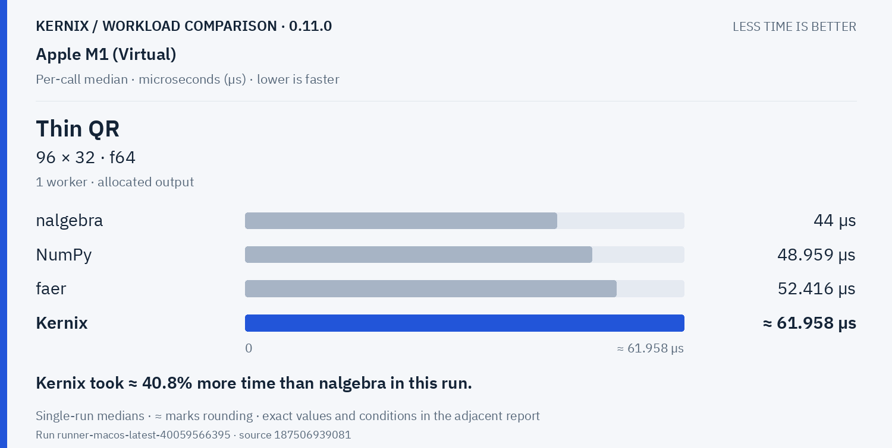

Kernix: **61.95800000000001 µs**. Kernix took ≈ 40.8% more time than nalgebra in this run.

**Thin QR · 256 × 64 · f64**

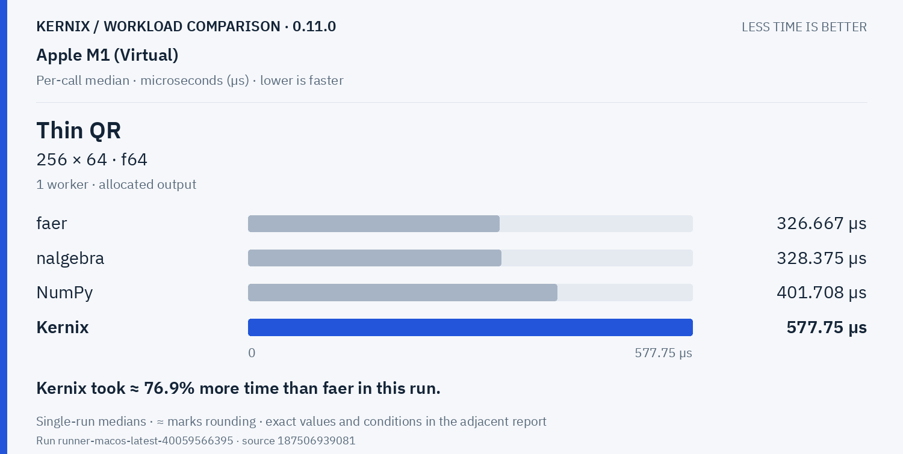

Kernix: **577.75 µs**. Kernix took ≈ 76.9% more time than faer in this run.

**Cholesky factorization · 64 × 64 · f64**

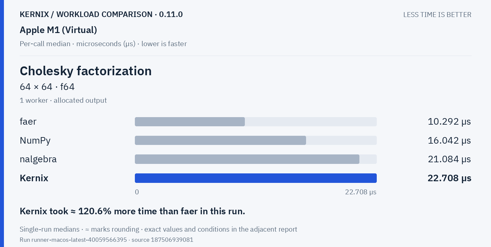

Kernix: **22.708 µs**. Kernix took ≈ 120.6% more time than faer in this run.

**Cholesky factorization · 128 × 128 · f64**

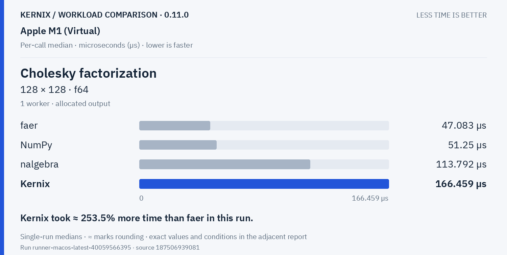

Kernix: **166.459 µs**. Kernix took ≈ 253.5% more time than faer in this run.

**Cholesky factorization · 256 × 256 · f64**

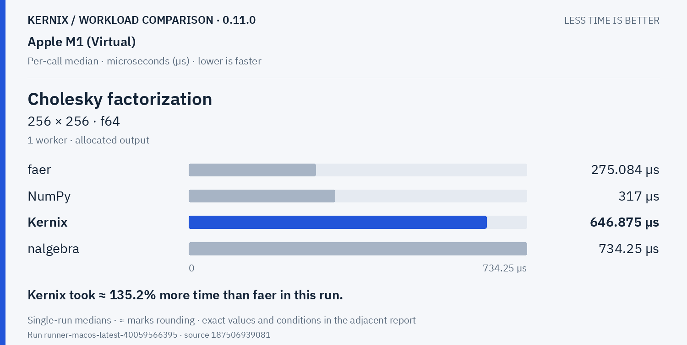

Kernix: **646.875 µs**. Kernix took ≈ 135.2% more time than faer in this run.

Training & autodiff · 6 workloads

**Shared-variable backward · sum(X * X), 64 × 32; prepared graph · f64**

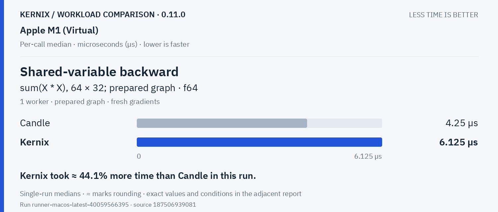

Kernix: **6.125 µs**. Kernix took ≈ 44.1% more time than Candle in this run.

**Record + backward · sum(A · W), 32 × 16 · 16 × 8 · f64**

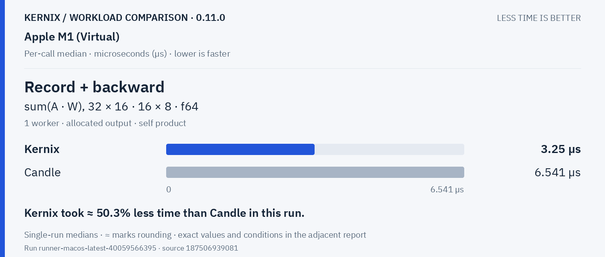

Kernix: **3.25 µs**. Kernix took ≈ 50.3% less time than Candle in this run.

**Model inference · batched normalized/sliced MLP · f64**

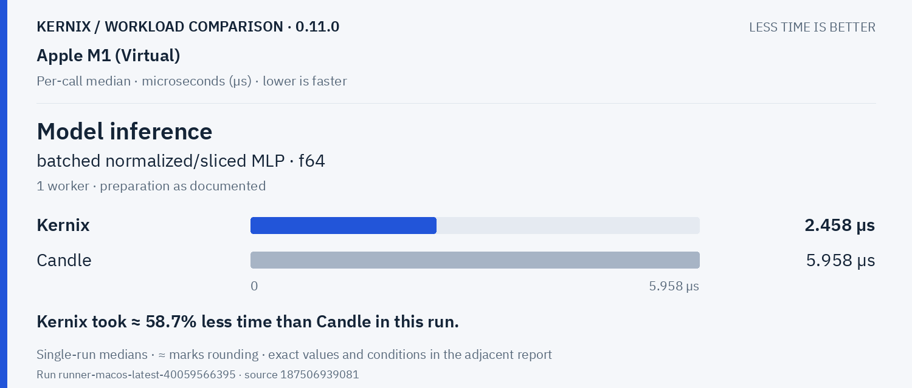

Kernix: **2.458 µs**. Kernix took ≈ 58.7% less time than Candle in this run.

**Model recording + forward · batched normalized/sliced MLP · f64**

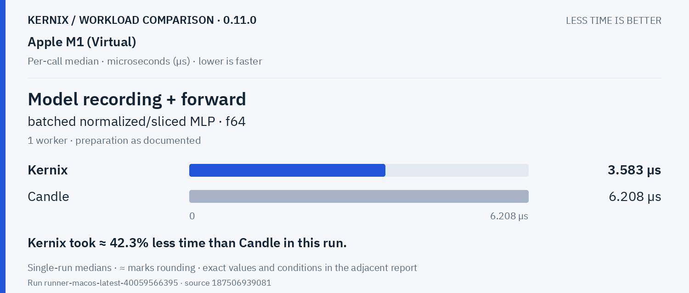

Kernix: **3.583 µs**. Kernix took ≈ 42.3% less time than Candle in this run.

**Model backward · prepared graph → fresh gradients · f64**

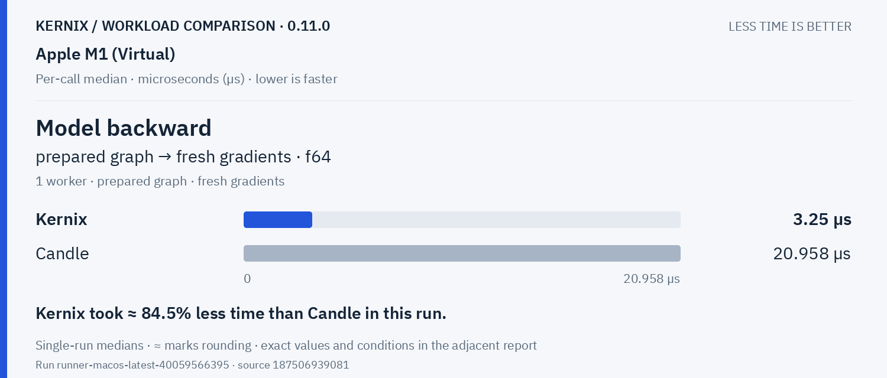

Kernix: **3.25 µs**. Kernix took ≈ 84.5% less time than Candle in this run.

**Parameter update · transactional SGD, fixed gradients · f64**

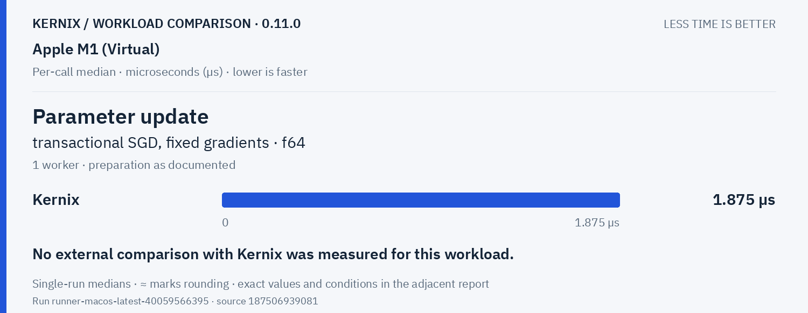

Kernix: **1.875 µs**. No external comparison with Kernix was measured for this workload.

Tensor contractions · 1 workloads

**Coalesced tensor contraction · 16 × 32 × 8 · 32 × 8 × 16 · f64**

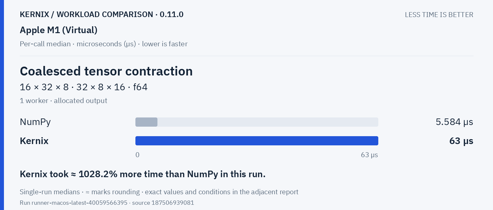

Kernix: **63 µs**. Kernix took ≈ 1028.2% more time than NumPy in this run.

Statistics & activations · 1 workloads

**Row softmax · 256 × 64 · f64**

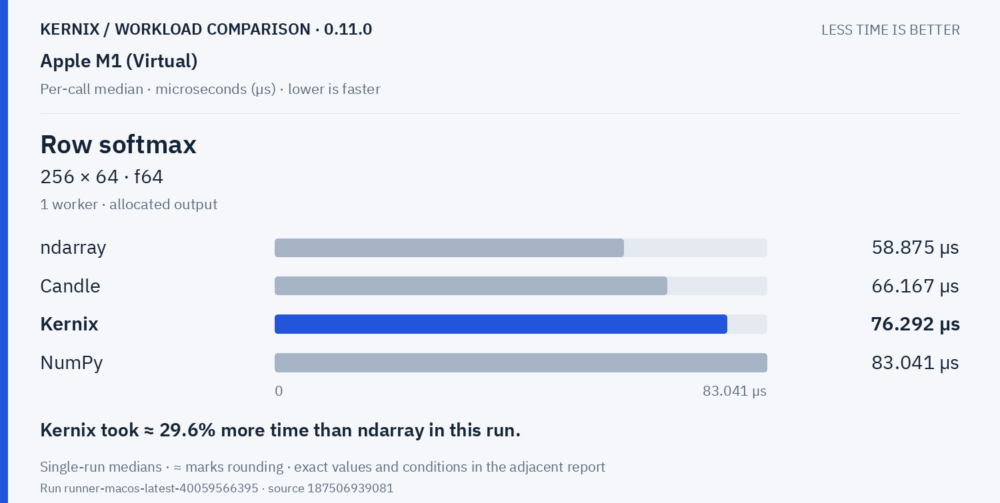

Kernix: **76.292 µs**. Kernix took ≈ 29.6% more time than ndarray in this run.

Tensor construction · 2 workloads

**Create zeros · 64 × 64 · f32**

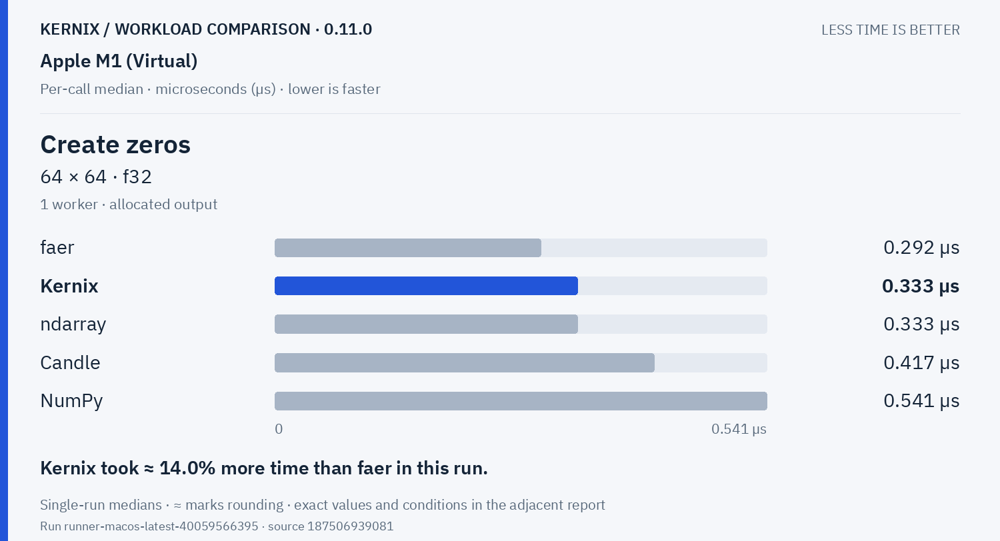

Kernix: **0.333 µs**. Kernix took ≈ 14.0% more time than faer in this run.

**Create ones · 64 × 64 · f32**

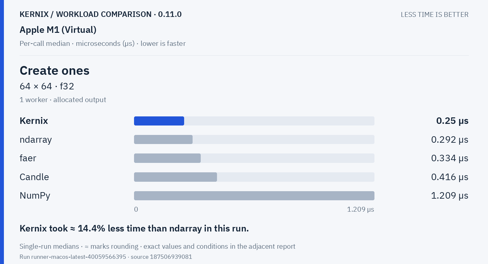

Kernix: **0.25 µs**. Kernix took ≈ 14.4% less time than ndarray in this run.

## Exact latency table

All values below are microseconds per operation. **Lower is faster.** Missing entries were not measured.

| Workload | Kernix | Kernix · explicit Accelerate | ndarray | nalgebra | faer | Candle | NumPy | Sequential run change |
|---|---:|---:|---:|---:|---:|---:|---:|---:|
| Independent matrix operands · 128 × 128 · 128 × 128 · f64 | 101.75 | — | — | — | — | — | **16.542** | +1.3% |
| Independent matrix operands · 128 × 128 · 128 × 128 · f32 | 52.916 | — | — | — | — | — | **6** | -16.5% |
| Matrix multiplication · 32 × 32 · 32 × 32 · f64 | 2.291 | — | 2.083 | 2.125 | 2.458 | 2.542 | **1.375** | -16.7% |
| Matrix multiplication · 64 × 64 · 64 × 64 · f64 | 15 | — | 41.542 | 13.625 | 14.208 | 15.167 | **3.5** | +11.8% |
| Matrix multiplication · 128 × 128 · 128 × 128 · f64 | 111.833 | **16.167** | 110.583 | 95.125 | 100.917 | 108.542 | 17.291 | +16.8% |
| Matrix multiplication · 256 × 256 · 256 × 256 · f64 | 753.208 | **101.958** | 792.25 | 804.417 | 871.209 | 753.166 | 115.875 | -11.9% |
| Matrix multiplication · 64 × 64 · 64 × 64 · f32 | 7.584 | — | 6.875 | 7.166 | 22.25 | 8.833 | **1.916** | +12.4% |
| Matrix multiplication · 128 × 128 · 128 × 128 · f32 | 48.875 | 6.5 | 51.333 | 55.5 | 57.292 | 54 | **5.25** | -3.5% |
| Matrix multiplication · 256 × 256 · 256 × 256 · f32 | 398.125 | 42.292 | 424.042 | 366.917 | 436.833 | 400.541 | **35.834** | -1.9% |
| Batched multiplication · 4 × 16 × 32 · 1 × 32 × 16 · f64 | 2.834 | — | — | — | — | 3.666 | **2.125** | +11.5% |
| Matmul · 2 workers · reused output · 64 × 64 · 64 × 64 · f64 | 22.625 | — | — | — | — | — | — | -40.8% |
| Matmul · 2 workers · reused output · 128 × 128 · 128 × 128 · f64 | 65.666 | — | — | — | — | — | — | -53.5% |
| Matmul · 2 workers · reused output · 256 × 256 · 256 × 256 · f64 | 447.583 | — | — | — | — | — | — | -1.6% |
| Matmul · 2 workers · reused output · 128 × 128 · 128 × 128 · f32 | 55.291 | — | — | — | — | — | — | +5.6% |
| Cholesky factorization · 512 × 512 · f64 | 3496.208 | — | — | 5620.458 | **1658.792** | — | 1888.375 | -62.7% |
| Column-pivoted QR · 96 × 32 · f64 | 65.208 | — | — | 99.334 | **41.917** | — | — | -5.3% |
| Column-pivoted QR · 256 × 64 · f64 | 578.208 | — | — | 1061.25 | **301.209** | — | — | -3.2% |
| Minimum-norm least squares · 64 × 32, rank 16, 4 RHS · f64 | **49.208** | — | — | 72.291 | — | — | 84.625 | +7.6% |
| Minimum-norm least squares · 32 × 64, rank 32, 4 RHS · f64 | **65.584** | — | — | 147.375 | — | — | 158.833 | -1.2% |
| Thin QR · 96 × 32 · f64 | 61.95800000000001 | — | — | **44** | 52.416 | — | 48.959 | +7.9% |
| Thin QR · 256 × 64 · f64 | 577.75 | — | — | 328.375 | **326.667** | — | 401.708 | +3.6% |
| Cholesky factorization · 64 × 64 · f64 | 22.708 | — | — | 21.084 | **10.292** | — | 16.042 | +12.6% |
| Cholesky factorization · 128 × 128 · f64 | 166.459 | — | — | 113.792 | **47.083** | — | 51.25 | -15.6% |
| Cholesky factorization · 256 × 256 · f64 | 646.875 | — | — | 734.25 | **275.084** | — | 317 | -42.1% |
| Shared-variable backward · sum(X * X), 64 × 32; prepared graph · f64 | 6.125 | — | — | — | — | **4.25** | — | -23.4% |
| Record + backward · sum(A · W), 32 × 16 · 16 × 8 · f64 | **3.25** | — | — | — | — | 6.541 | — | -1.3% |
| Model inference · batched normalized/sliced MLP · f64 | **2.458** | — | — | — | — | 5.958 | — | +1.7% |
| Model recording + forward · batched normalized/sliced MLP · f64 | **3.583** | — | — | — | — | 6.208 | — | +11.7% |
| Model backward · prepared graph → fresh gradients · f64 | **3.25** | — | — | — | — | 20.958 | — | +1.3% |
| Parameter update · transactional SGD, fixed gradients · f64 | 1.875 | — | — | — | — | — | — | +164.8% |
| Coalesced tensor contraction · 16 × 32 × 8 · 32 × 8 × 16 · f64 | 63 | — | — | — | — | — | **5.584** | +0.6% |
| Row softmax · 256 × 64 · f64 | 76.292 | — | **58.875** | — | — | 66.167 | 83.041 | -11.2% |
| Create zeros · 64 × 64 · f32 | 0.333 | — | 0.333 | — | **0.292** | 0.417 | 0.541 | +14.0% |
| Create ones · 64 × 64 · f32 | **0.25** | — | 0.292 | — | 0.334 | 0.416 | 1.209 | -24.9% |

## Version comparison

12 of 34 workloads have paired evidence. Exploratory 95% intervals resample process pairs, not calls. No multiple-comparison adjustment.

### Version changes at a glance

The vertical line marks unchanged time. Left is faster; right is slower. Ranges are exploratory 95% intervals over fresh-process pairs. An interval crossing the line leaves direction unclear.

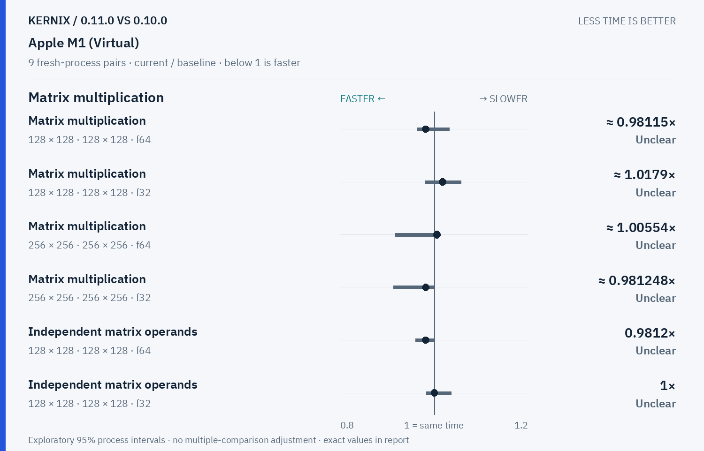

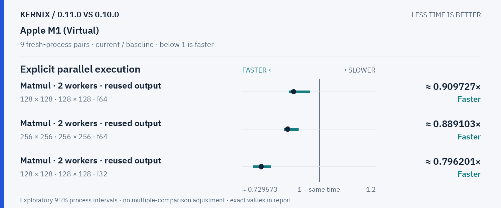

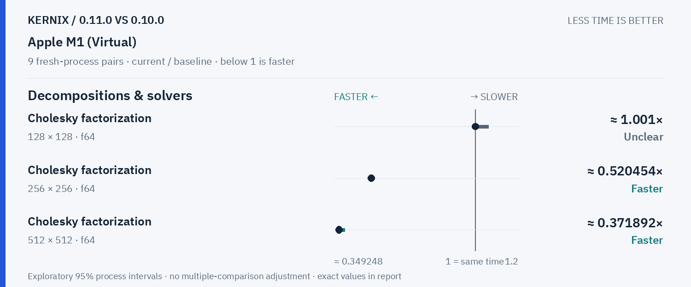

| Workload | Current / baseline [95% interval] | Interpretation |
|---|---:|---|
| Independent matrix operands · 128 × 128 · 128 × 128 · f64 | 0.9812× [0.9602777248236628, 1.0004283818658641] | Timing direction unclear |
| Independent matrix operands · 128 × 128 · 128 × 128 · f32 | 1× [0.9825582554268742, 1.0363957812595257] | Timing direction unclear |
| Matrix multiplication · 32 × 32 · 32 × 32 · f64 | — | No paired comparison |
| Matrix multiplication · 64 × 64 · 64 × 64 · f64 | — | No paired comparison |
| Matrix multiplication · 128 × 128 · 128 × 128 · f64 | 0.9811495292521482× [0.9640939796747162, 1.0317623762376238] | Timing direction unclear |
| Matrix multiplication · 256 × 256 · 256 × 256 · f64 | 1.0055372096965587× [0.9167619146578, 1.0116898335997095] | Timing direction unclear |
| Matrix multiplication · 64 × 64 · 64 × 64 · f32 | — | No paired comparison |
| Matrix multiplication · 128 × 128 · 128 × 128 · f32 | 1.0179028132992327× [0.9799530431641683, 1.057152803374698] | Timing direction unclear |
| Matrix multiplication · 256 × 256 · 256 × 256 · f32 | 0.9812478690760313× [0.9126053787548315, 1.0005781117979278] | Timing direction unclear |
| Batched multiplication · 4 × 16 × 32 · 1 × 32 × 16 · f64 | — | No paired comparison |
| Matmul · 2 workers · reused output · 64 × 64 · 64 × 64 · f64 | — | No paired comparison |
| Matmul · 2 workers · reused output · 128 × 128 · 128 × 128 · f64 | 0.9097270142703359× [0.8939063004846527, 0.9683136560953355] | Observed time reduction |
| Matmul · 2 workers · reused output · 256 × 256 · 256 × 256 · f64 | 0.8891034482758621× [0.8764368128463624, 0.9266004415011038] | Observed time reduction |
| Matmul · 2 workers · reused output · 128 × 128 · 128 × 128 · f32 | 0.7962008346079043× [0.7679718133772803, 0.8294814814814815] | Observed time reduction |
| Cholesky factorization · 512 × 512 · f64 | 0.3718924151845818× [0.3676295604130526, 0.39798777381558836] | Observed time reduction |
| Column-pivoted QR · 96 × 32 · f64 | — | No paired comparison |
| Column-pivoted QR · 256 × 64 · f64 | — | No paired comparison |
| Minimum-norm least squares · 64 × 32, rank 16, 4 RHS · f64 | — | No paired comparison |
| Minimum-norm least squares · 32 × 64, rank 32, 4 RHS · f64 | — | No paired comparison |
| Thin QR · 96 × 32 · f64 | — | No paired comparison |
| Thin QR · 256 × 64 · f64 | — | No paired comparison |
| Cholesky factorization · 64 × 64 · f64 | — | No paired comparison |
| Cholesky factorization · 128 × 128 · f64 | 1.0010035092779541× [0.9997475582268971, 1.0615615615615615] | Timing direction unclear |
| Cholesky factorization · 256 × 256 · f64 | 0.520454357259916× [0.5096753203342619, 0.521812129502964] | Observed time reduction |
| Shared-variable backward · sum(X * X), 64 × 32; prepared graph · f64 | — | No paired comparison |
| Record + backward · sum(A · W), 32 × 16 · 16 × 8 · f64 | — | No paired comparison |
| Model inference · batched normalized/sliced MLP · f64 | — | No paired comparison |
| Model recording + forward · batched normalized/sliced MLP · f64 | — | No paired comparison |
| Model backward · prepared graph → fresh gradients · f64 | — | No paired comparison |
| Parameter update · transactional SGD, fixed gradients · f64 | — | No paired comparison |
| Coalesced tensor contraction · 16 × 32 × 8 · 32 × 8 × 16 · f64 | — | No paired comparison |
| Row softmax · 256 × 64 · f64 | — | No paired comparison |
| Create zeros · 64 × 64 · f32 | — | No paired comparison |
| Create ones · 64 × 64 · f32 | — | No paired comparison |

## Method and provenance

CPU affinity was not pinned. Frequency and background load are uncontrolled.

Minimum-norm rows use pivoted QR plus scaled implicit RZ in Kernix; NumPy native lstsq; nalgebra native SVD/solve. Algorithm costs and rank policies differ. See original method for thresholds.

Numbers retain source precision; recorded digits do not imply equivalent physical measurement accuracy. Lowest observed medians are bold only when peers were measured. No aggregate winner or universal ranking is inferred.

[Original report and commentary](original-report.txt) · [Raw measurements](raw.json)

Measured source `18750693908110110d85d02d0f11af8d58bfae8b`. Run `runner-macos-latest-40059566395`. Rendering does not change measurements.
