# Kernix 0.11.1 · performance brief

Apple M1 (Virtual) / macOS

**Per-call median, microseconds per operation. Lower is faster. All recorded digits retained.**

35 workloads · 123 observations

Baseline: baseline-macos-latest-40161751367. Sequential run changes are descriptive; paired process evidence is shown separately.

[Interactive HTML (open locally)](report.html) · [Vector PDF](latency.pdf) · [Raw measurements](raw.json)

[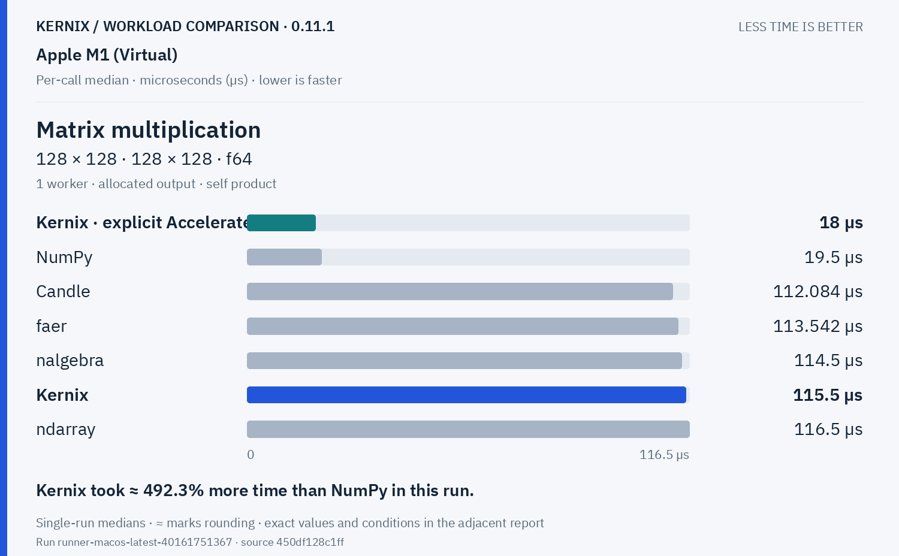](latency.pdf)

## Charts by workload

**Shorter bars mean less time.** Blue is Kernix; grey is another library; teal is an explicitly selected Kernix backend. Entries are sorted by the recorded median, with a separate zero-based scale per chart. These point observations do not establish a statistical ranking.

Expand a group to see every chart here on GitHub. Click a chart to enlarge it. The exact table below keeps every source digit.

Matrix multiplication · 11 workloads

**Independent matrix operands · 128 × 128 · 128 × 128 · f64**

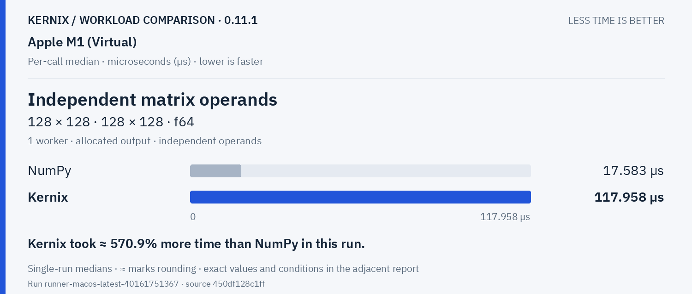

Kernix: **117.958 µs**. Kernix took ≈ 570.9% more time than NumPy in this run.

**Independent matrix operands · 128 × 128 · 128 × 128 · f32**

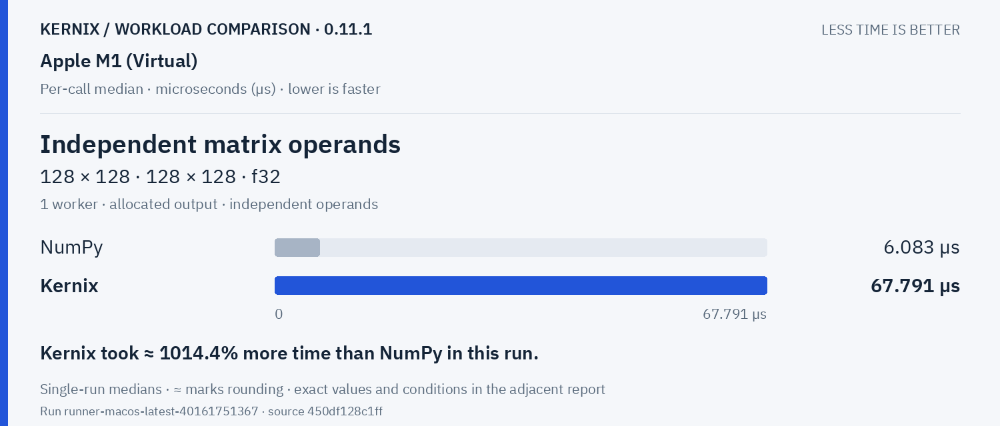

Kernix: **67.791 µs**. Kernix took ≈ 1014.4% more time than NumPy in this run.

**Matrix multiplication · 32 × 32 · 32 × 32 · f64**

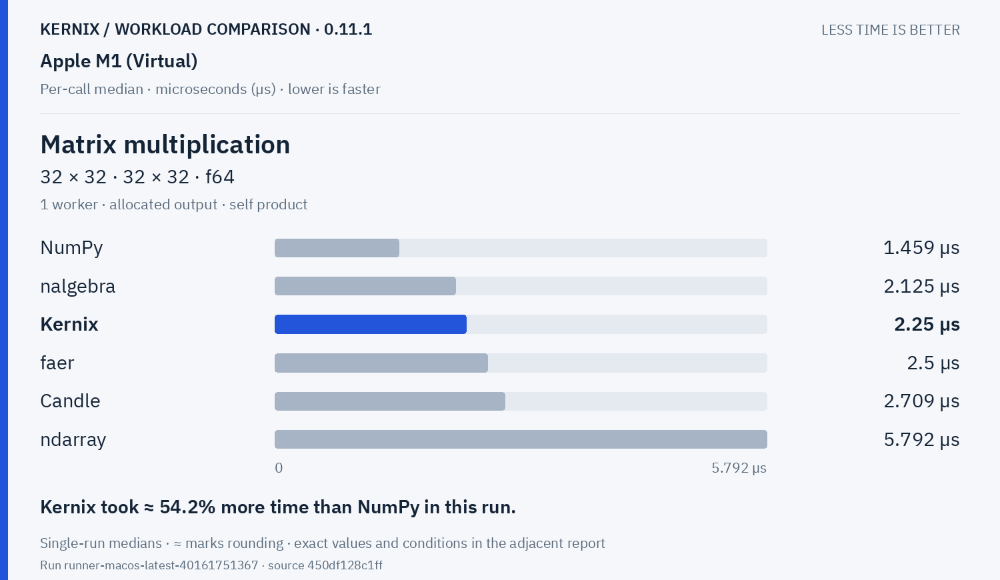

Kernix: **2.25 µs**. Kernix took ≈ 54.2% more time than NumPy in this run.

**Matrix multiplication · 64 × 64 · 64 × 64 · f64**

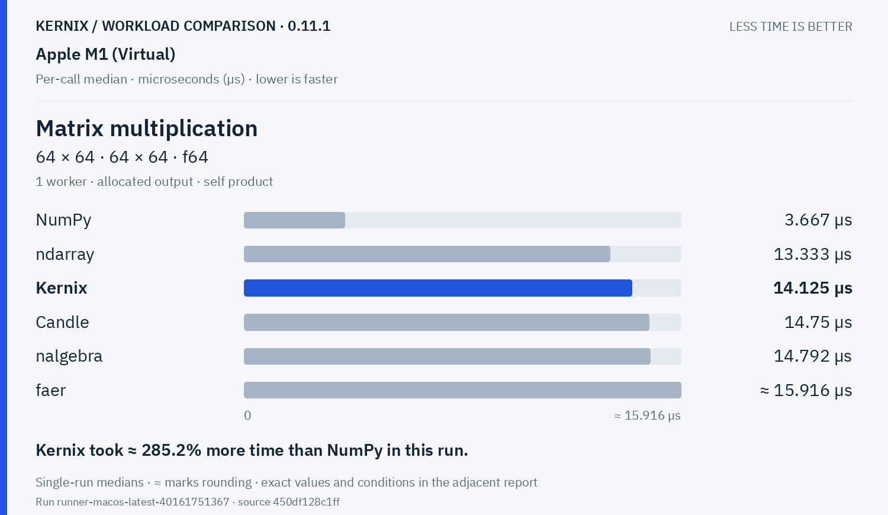

Kernix: **14.125 µs**. Kernix took ≈ 285.2% more time than NumPy in this run.

**Matrix multiplication · 128 × 128 · 128 × 128 · f64**

Kernix: **115.5 µs**. Kernix took ≈ 492.3% more time than NumPy in this run.

**Matrix multiplication · 256 × 256 · 256 × 256 · f64**

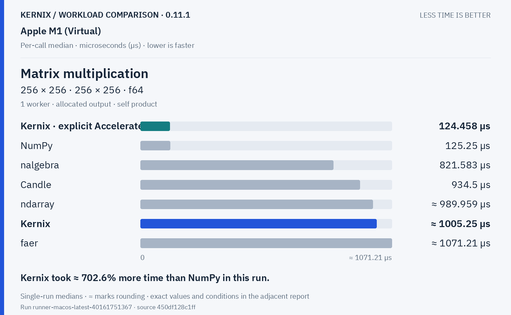

Kernix: **1005.2500000000001 µs**. Kernix took ≈ 702.6% more time than NumPy in this run.

**Matrix multiplication · 64 × 64 · 64 × 64 · f32**

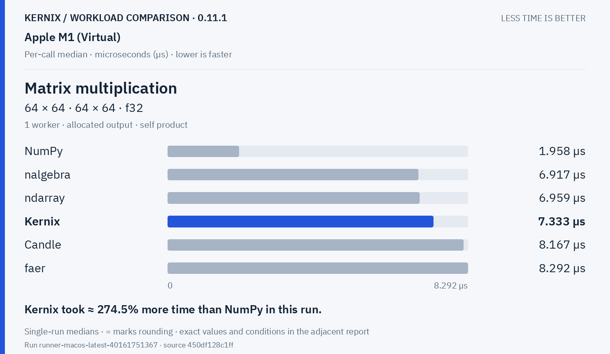

Kernix: **7.333 µs**. Kernix took ≈ 274.5% more time than NumPy in this run.

**Matrix multiplication · 128 × 128 · 128 × 128 · f32**

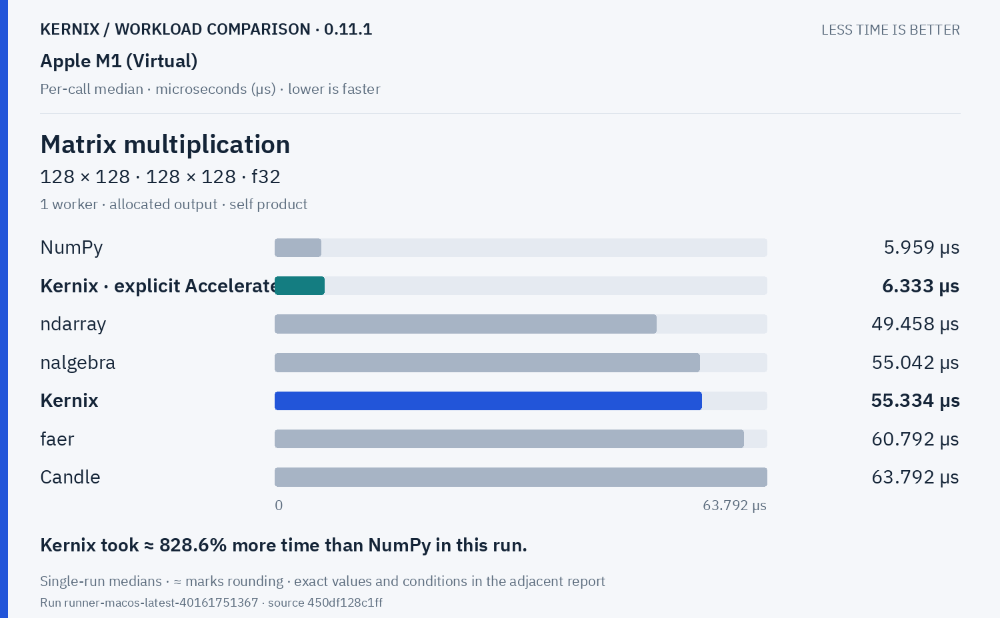

Kernix: **55.334 µs**. Kernix took ≈ 828.6% more time than NumPy in this run.

**Matrix multiplication · 256 × 256 · 256 × 256 · f32**

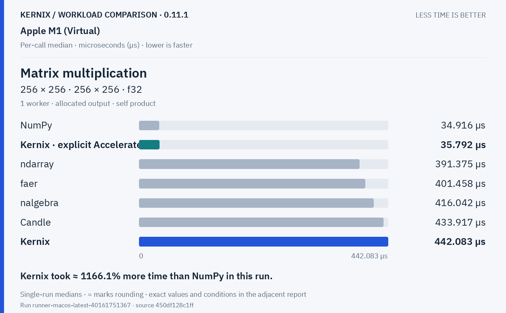

Kernix: **442.083 µs**. Kernix took ≈ 1166.1% more time than NumPy in this run.

**Batched multiplication · 4 × 16 × 32 · 1 × 32 × 16 · f64**

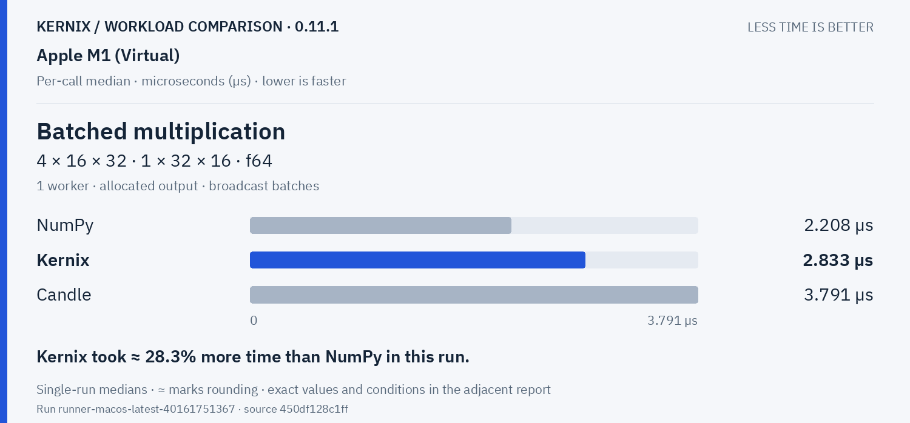

Kernix: **2.833 µs**. Kernix took ≈ 28.3% more time than NumPy in this run.

**Batched multiplication · 4 × 16 × 32 · 1 × 32 × 16 · f32**

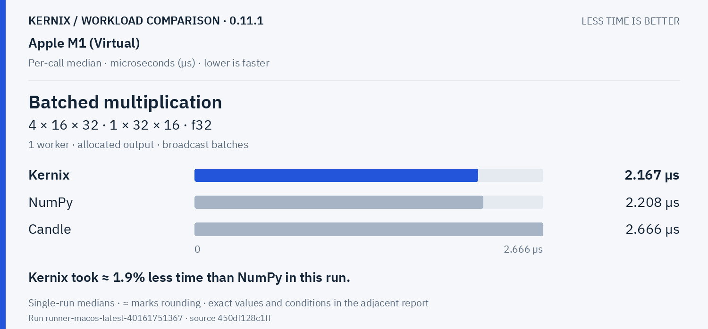

Kernix: **2.167 µs**. Kernix took ≈ 1.9% less time than NumPy in this run.

Explicit parallel execution · 4 workloads

**Matmul · 2 workers · reused output · 64 × 64 · 64 × 64 · f64**

Kernix: **26.708 µs**. No external comparison with Kernix was measured for this workload.

**Matmul · 2 workers · reused output · 128 × 128 · 128 × 128 · f64**

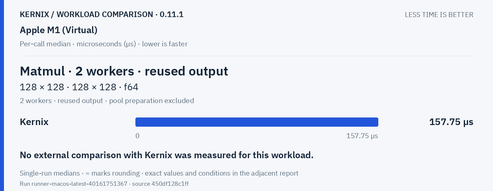

Kernix: **157.75 µs**. No external comparison with Kernix was measured for this workload.

**Matmul · 2 workers · reused output · 256 × 256 · 256 × 256 · f64**

Kernix: **605.917 µs**. No external comparison with Kernix was measured for this workload.

**Matmul · 2 workers · reused output · 128 × 128 · 128 × 128 · f32**

Kernix: **99.541 µs**. No external comparison with Kernix was measured for this workload.

Decompositions & solvers · 10 workloads

**Cholesky factorization · 512 × 512 · f64**

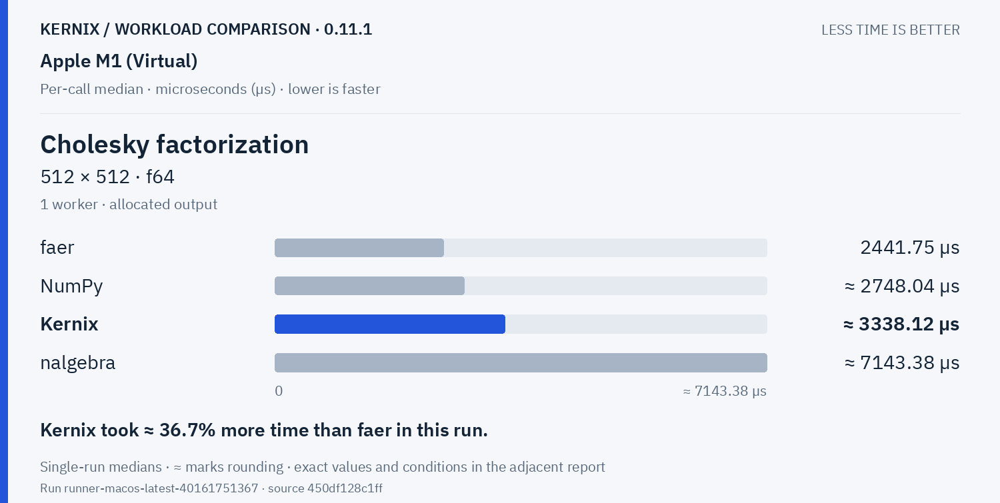

Kernix: **3338.125 µs**. Kernix took ≈ 36.7% more time than faer in this run.

**Column-pivoted QR · 96 × 32 · f64**

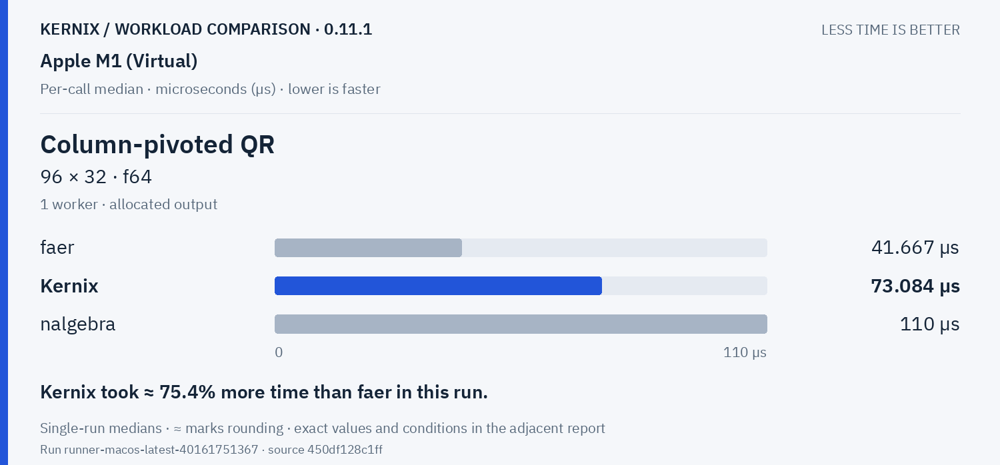

Kernix: **73.084 µs**. Kernix took ≈ 75.4% more time than faer in this run.

**Column-pivoted QR · 256 × 64 · f64**

Kernix: **727.625 µs**. Kernix took ≈ 102.4% more time than faer in this run.

**Minimum-norm least squares · 64 × 32, rank 16, 4 RHS · f64**

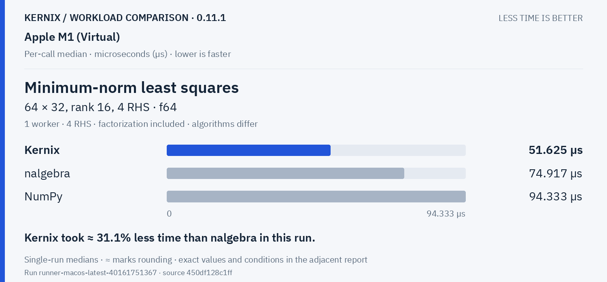

Kernix: **51.625 µs**. Kernix took ≈ 31.1% less time than nalgebra in this run.

**Minimum-norm least squares · 32 × 64, rank 32, 4 RHS · f64**

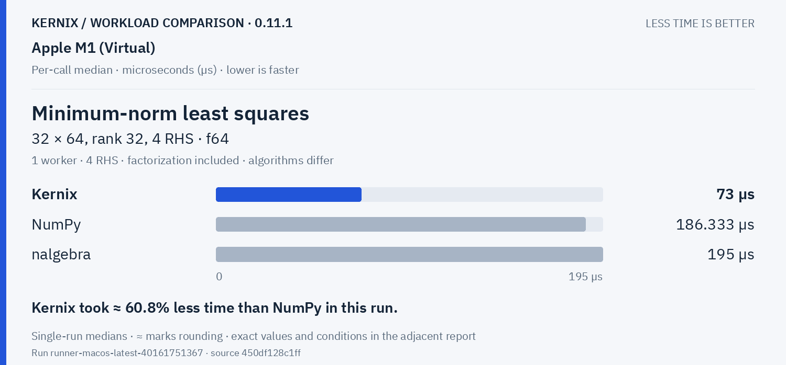

Kernix: **73 µs**. Kernix took ≈ 60.8% less time than NumPy in this run.

**Thin QR · 96 × 32 · f64**

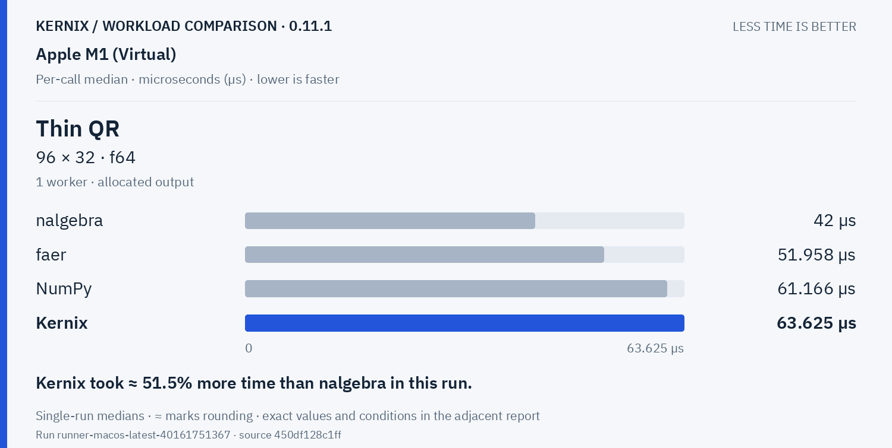

Kernix: **63.625 µs**. Kernix took ≈ 51.5% more time than nalgebra in this run.

**Thin QR · 256 × 64 · f64**

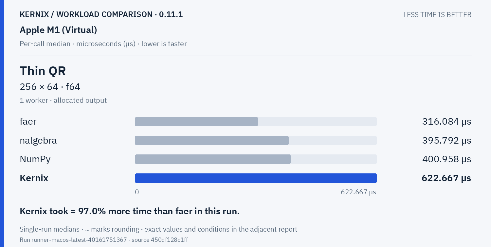

Kernix: **622.667 µs**. Kernix took ≈ 97.0% more time than faer in this run.

**Cholesky factorization · 64 × 64 · f64**

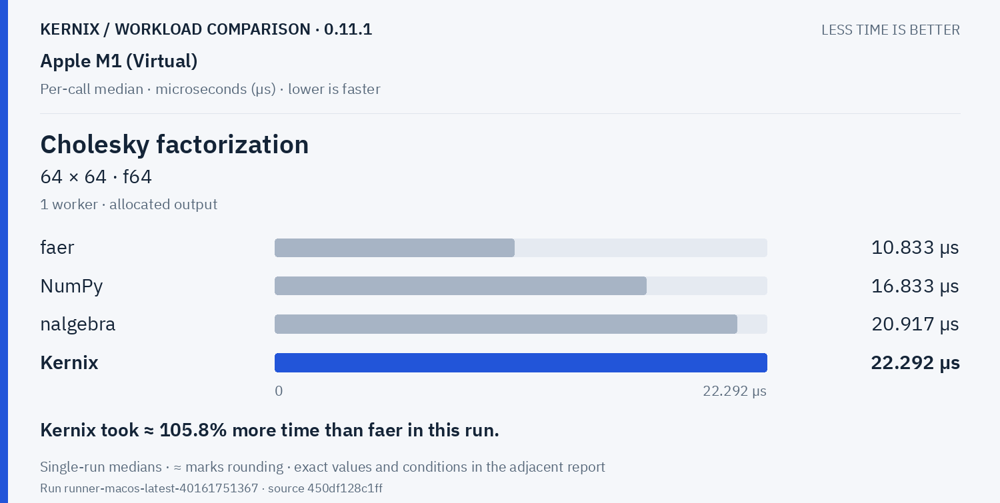

Kernix: **22.292 µs**. Kernix took ≈ 105.8% more time than faer in this run.

**Cholesky factorization · 128 × 128 · f64**

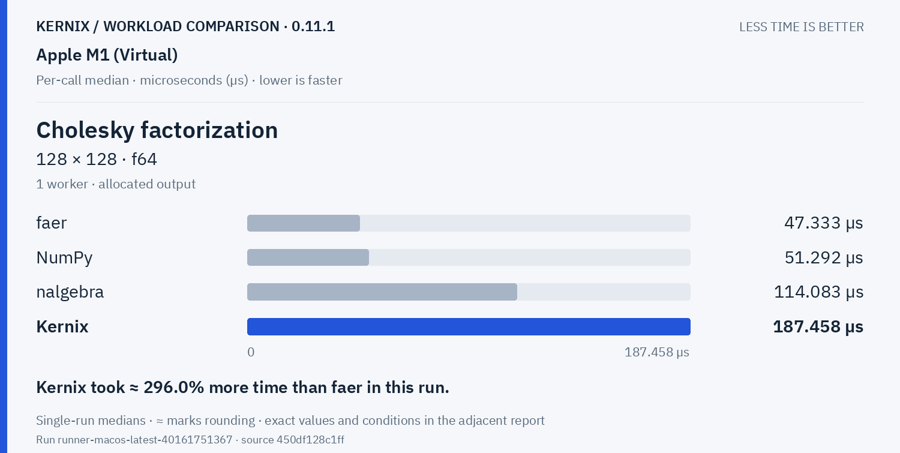

Kernix: **187.458 µs**. Kernix took ≈ 296.0% more time than faer in this run.

**Cholesky factorization · 256 × 256 · f64**

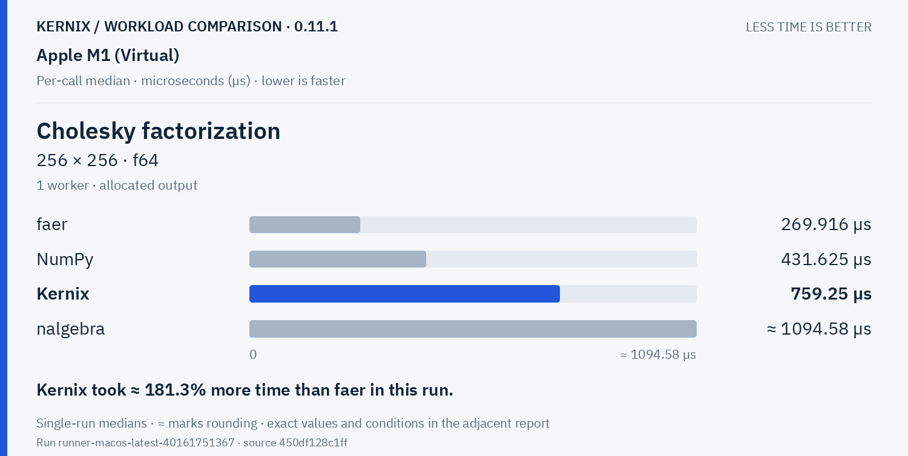

Kernix: **759.25 µs**. Kernix took ≈ 181.3% more time than faer in this run.

Training & autodiff · 6 workloads

**Shared-variable backward · sum(X * X), 64 × 32; prepared graph · f64**

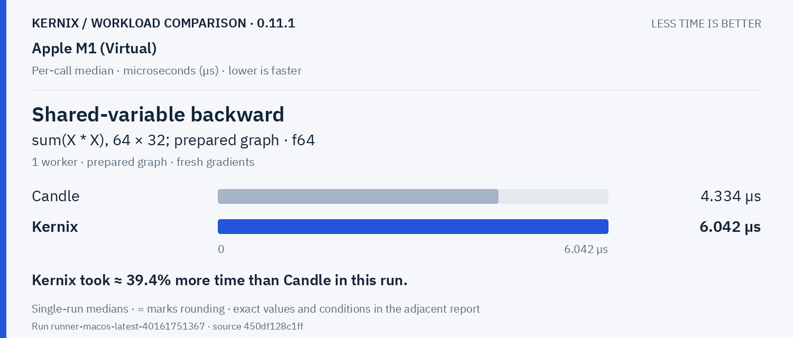

Kernix: **6.042 µs**. Kernix took ≈ 39.4% more time than Candle in this run.

**Record + backward · sum(A · W), 32 × 16 · 16 × 8 · f64**

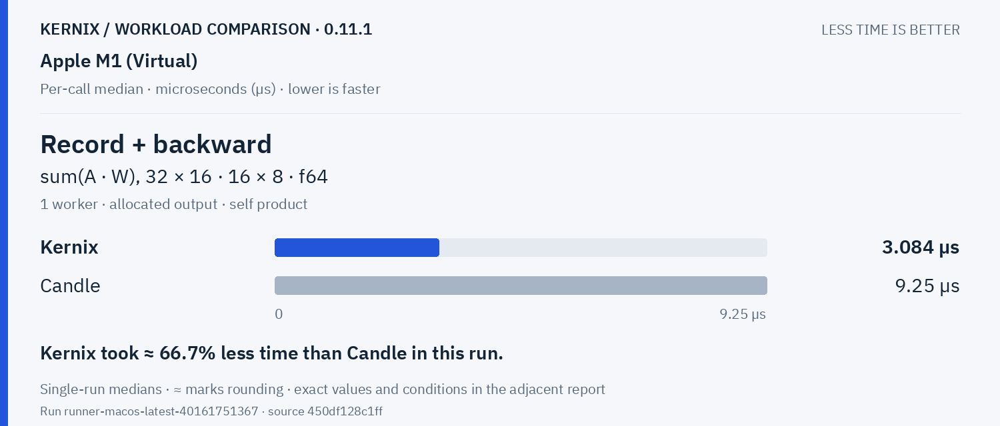

Kernix: **3.084 µs**. Kernix took ≈ 66.7% less time than Candle in this run.

**Model inference · batched normalized/sliced MLP · f64**

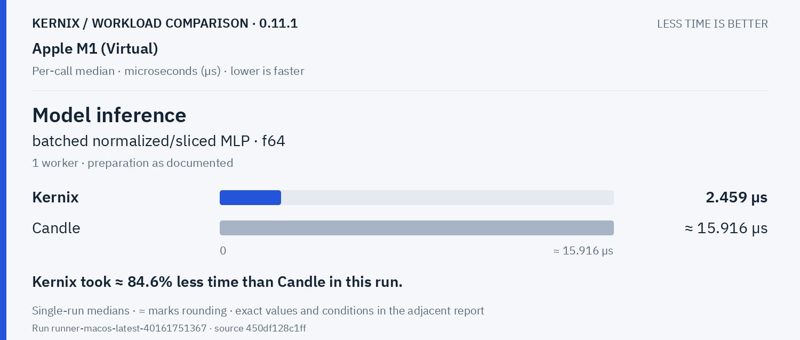

Kernix: **2.459 µs**. Kernix took ≈ 84.6% less time than Candle in this run.

**Model recording + forward · batched normalized/sliced MLP · f64**

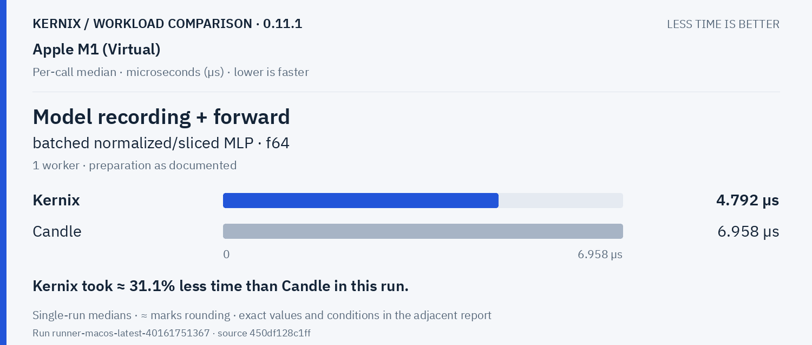

Kernix: **4.792 µs**. Kernix took ≈ 31.1% less time than Candle in this run.

**Model backward · prepared graph → fresh gradients · f64**

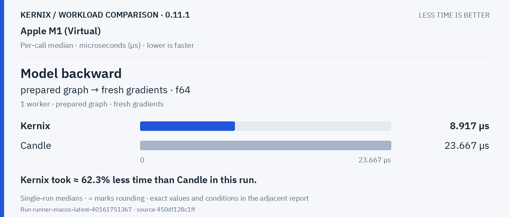

Kernix: **8.917 µs**. Kernix took ≈ 62.3% less time than Candle in this run.

**Parameter update · transactional SGD, fixed gradients · f64**

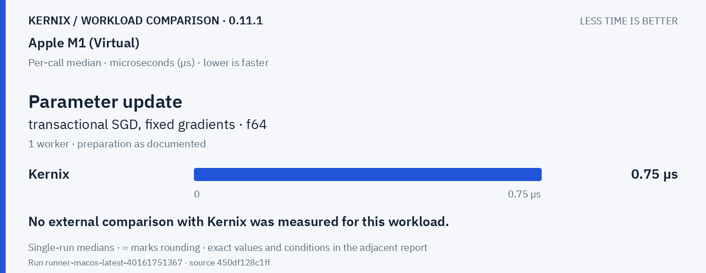

Kernix: **0.75 µs**. No external comparison with Kernix was measured for this workload.

Tensor contractions · 1 workloads

**Coalesced tensor contraction · 16 × 32 × 8 · 32 × 8 × 16 · f64**

Kernix: **69.208 µs**. Kernix took ≈ 1148.8% more time than NumPy in this run.

Statistics & activations · 1 workloads

**Row softmax · 256 × 64 · f64**

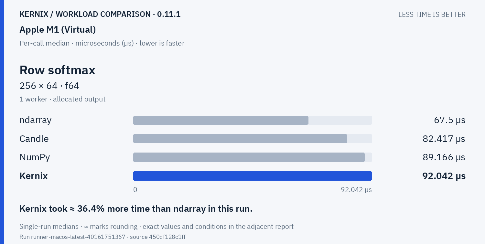

Kernix: **92.042 µs**. Kernix took ≈ 36.4% more time than ndarray in this run.

Tensor construction · 2 workloads

**Create zeros · 64 × 64 · f32**

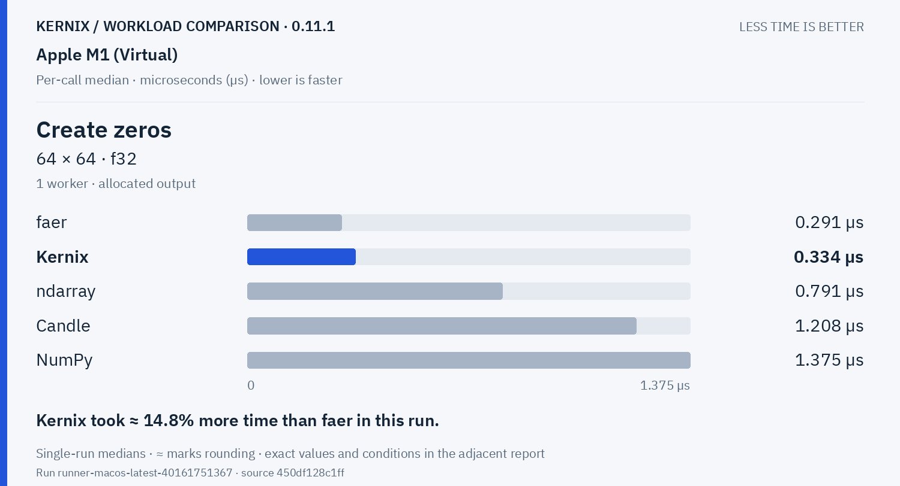

Kernix: **0.334 µs**. Kernix took ≈ 14.8% more time than faer in this run.

**Create ones · 64 × 64 · f32**

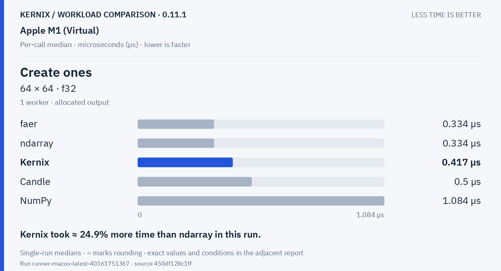

Kernix: **0.417 µs**. Kernix took ≈ 24.9% more time than ndarray in this run.

## Exact latency table

All values below are microseconds per operation. **Lower is faster.** Missing entries were not measured.

| Workload | Kernix | Kernix · explicit Accelerate | ndarray | nalgebra | faer | Candle | NumPy | Sequential run change |
|---|---:|---:|---:|---:|---:|---:|---:|---:|
| Independent matrix operands · 128 × 128 · 128 × 128 · f64 | 117.958 | — | — | — | — | — | **17.583** | +14.0% |
| Independent matrix operands · 128 × 128 · 128 × 128 · f32 | 67.791 | — | — | — | — | — | **6.083** | +28.2% |
| Matrix multiplication · 32 × 32 · 32 × 32 · f64 | 2.25 | — | 5.792 | 2.125 | 2.5 | 2.709 | **1.459** | +0.0% |
| Matrix multiplication · 64 × 64 · 64 × 64 · f64 | 14.125 | — | 13.333 | 14.792 | 15.916000000000002 | 14.75 | **3.667** | +1.8% |
| Matrix multiplication · 128 × 128 · 128 × 128 · f64 | 115.5 | **18** | 116.5 | 114.5 | 113.542 | 112.084 | 19.5 | +11.9% |
| Matrix multiplication · 256 × 256 · 256 × 256 · f64 | 1005.2500000000001 | **124.458** | 989.9590000000001 | 821.583 | 1071.208 | 934.5 | 125.25 | +24.2% |
| Matrix multiplication · 64 × 64 · 64 × 64 · f32 | 7.333 | — | 6.959 | 6.917 | 8.292 | 8.167 | **1.958** | -3.8% |
| Matrix multiplication · 128 × 128 · 128 × 128 · f32 | 55.334 | 6.333 | 49.458 | 55.042 | 60.792 | 63.792 | **5.959** | -2.4% |
| Matrix multiplication · 256 × 256 · 256 × 256 · f32 | 442.083 | 35.792 | 391.375 | 416.042 | 401.458 | 433.917 | **34.916** | +13.6% |
| Batched multiplication · 4 × 16 × 32 · 1 × 32 × 16 · f64 | 2.833 | — | — | — | — | 3.791 | **2.208** | +0.0% |
| Batched multiplication · 4 × 16 × 32 · 1 × 32 × 16 · f32 | **2.167** | — | — | — | — | 2.666 | 2.208 | +23.8% |
| Matmul · 2 workers · reused output · 64 × 64 · 64 × 64 · f64 | 26.708 | — | — | — | — | — | — | +33.3% |
| Matmul · 2 workers · reused output · 128 × 128 · 128 × 128 · f64 | 157.75 | — | — | — | — | — | — | +128.2% |
| Matmul · 2 workers · reused output · 256 × 256 · 256 × 256 · f64 | 605.917 | — | — | — | — | — | — | +44.2% |
| Matmul · 2 workers · reused output · 128 × 128 · 128 × 128 · f32 | 99.541 | — | — | — | — | — | — | +121.2% |
| Cholesky factorization · 512 × 512 · f64 | 3338.125 | — | — | 7143.375 | **2441.75** | — | 2748.042 | -0.5% |
| Column-pivoted QR · 96 × 32 · f64 | 73.084 | — | — | 110 | **41.667** | — | — | +10.4% |
| Column-pivoted QR · 256 × 64 · f64 | 727.625 | — | — | 1057.666 | **359.5** | — | — | +28.1% |
| Minimum-norm least squares · 64 × 32, rank 16, 4 RHS · f64 | **51.625** | — | — | 74.917 | — | — | 94.333 | +4.8% |
| Minimum-norm least squares · 32 × 64, rank 32, 4 RHS · f64 | **73** | — | — | 195 | — | — | 186.333 | +11.7% |
| Thin QR · 96 × 32 · f64 | 63.625 | — | — | **42** | 51.958 | — | 61.166 | +10.5% |
| Thin QR · 256 × 64 · f64 | 622.667 | — | — | 395.792 | **316.084** | — | 400.958 | +19.1% |
| Cholesky factorization · 64 × 64 · f64 | 22.292 | — | — | 20.917 | **10.833** | — | 16.833 | +1.1% |
| Cholesky factorization · 128 × 128 · f64 | 187.458 | — | — | 114.083 | **47.333** | — | 51.292 | -5.0% |
| Cholesky factorization · 256 × 256 · f64 | 759.25 | — | — | 1094.583 | **269.916** | — | 431.625 | +16.4% |
| Shared-variable backward · sum(X * X), 64 × 32; prepared graph · f64 | 6.042 | — | — | — | — | **4.334** | — | +4.3% |
| Record + backward · sum(A · W), 32 × 16 · 16 × 8 · f64 | **3.084** | — | — | — | — | 9.25 | — | -3.9% |
| Model inference · batched normalized/sliced MLP · f64 | **2.459** | — | — | — | — | 15.916000000000002 | — | +3.5% |
| Model recording + forward · batched normalized/sliced MLP · f64 | **4.792** | — | — | — | — | 6.958 | — | +43.8% |
| Model backward · prepared graph → fresh gradients · f64 | **8.917** | — | — | — | — | 23.667 | — | +148.9% |
| Parameter update · transactional SGD, fixed gradients · f64 | 0.75 | — | — | — | — | — | — | +0.0% |
| Coalesced tensor contraction · 16 × 32 × 8 · 32 × 8 × 16 · f64 | 69.208 | — | — | — | — | — | **5.542** | +10.3% |
| Row softmax · 256 × 64 · f64 | 92.042 | — | **67.5** | — | — | 82.417 | 89.166 | +16.3% |
| Create zeros · 64 × 64 · f32 | 0.334 | — | 0.791 | — | **0.291** | 1.208 | 1.375 | +0.3% |
| Create ones · 64 × 64 · f32 | 0.417 | — | **0.334** | — | **0.334** | 0.5 | 1.084 | +42.8% |

## Version comparison

16 of 35 workloads have paired evidence. Exploratory 95% intervals resample process pairs, not calls. No multiple-comparison adjustment.

### Version changes at a glance

The vertical line marks unchanged time. Left is faster; right is slower. Ranges are exploratory 95% intervals over fresh-process pairs. An interval crossing the line leaves direction unclear.

| Workload | Current / baseline [95% interval] | Interpretation |
|---|---:|---|
| Independent matrix operands · 128 × 128 · 128 × 128 · f64 | 0.9936854234101746× [0.9442126930923929, 1.052763970607238] | Timing direction unclear |
| Independent matrix operands · 128 × 128 · 128 × 128 · f32 | 0.9093212885529866× [0.8770501260982082, 0.9883292181069959] | Observed time reduction |
| Matrix multiplication · 32 × 32 · 32 × 32 · f64 | 0.9851747264384045× [0.7713404182379157, 1.0742222222222222] | Timing direction unclear |
| Matrix multiplication · 64 × 64 · 64 × 64 · f64 | — | No paired comparison |
| Matrix multiplication · 128 × 128 · 128 × 128 · f64 | 1.0052673086097617× [0.9046403956437102, 1.0933024369821536] | Timing direction unclear |
| Matrix multiplication · 256 × 256 · 256 × 256 · f64 | 0.9985502367201311× [0.9208476303739065, 1.0949789086950605] | Timing direction unclear |
| Matrix multiplication · 64 × 64 · 64 × 64 · f32 | — | No paired comparison |
| Matrix multiplication · 128 × 128 · 128 × 128 · f32 | 0.9760507399577167× [0.8449660678642713, 1.011104761904762] | Timing direction unclear |
| Matrix multiplication · 256 × 256 · 256 × 256 · f32 | 0.9856326348566568× [0.8686482314018108, 1.0417187028280885] | Timing direction unclear |
| Batched multiplication · 4 × 16 × 32 · 1 × 32 × 16 · f64 | 1× [0.9583333333333334, 1.076] | Timing direction unclear |
| Batched multiplication · 4 × 16 × 32 · 1 × 32 × 16 · f32 | 1× [0.8832, 1.024] | Timing direction unclear |
| Matmul · 2 workers · reused output · 64 × 64 · 64 × 64 · f64 | — | No paired comparison |
| Matmul · 2 workers · reused output · 128 × 128 · 128 × 128 · f64 | 0.9512175381610398× [0.5288740230405842, 1.398729942304536] | Timing direction unclear |
| Matmul · 2 workers · reused output · 256 × 256 · 256 × 256 · f64 | 0.9764277002242503× [0.9081814845657666, 1.4083494301625017] | Timing direction unclear |
| Matmul · 2 workers · reused output · 128 × 128 · 128 × 128 · f32 | 1.0443037974683544× [0.5116346525718706, 1.2821479846572525] | Timing direction unclear |
| Cholesky factorization · 512 × 512 · f64 | 1.0711008243106563× [0.9638131954788399, 1.282426526539142] | Timing direction unclear |
| Column-pivoted QR · 96 × 32 · f64 | — | No paired comparison |
| Column-pivoted QR · 256 × 64 · f64 | — | No paired comparison |
| Minimum-norm least squares · 64 × 32, rank 16, 4 RHS · f64 | — | No paired comparison |
| Minimum-norm least squares · 32 × 64, rank 32, 4 RHS · f64 | — | No paired comparison |
| Thin QR · 96 × 32 · f64 | — | No paired comparison |
| Thin QR · 256 × 64 · f64 | — | No paired comparison |
| Cholesky factorization · 64 × 64 · f64 | — | No paired comparison |
| Cholesky factorization · 128 × 128 · f64 | 0.9997944119201927× [0.9500575602961868, 1.0822704081632653] | Timing direction unclear |
| Cholesky factorization · 256 × 256 · f64 | 1.0057055889993636× [0.9257904545228178, 1.1766056170546626] | Timing direction unclear |
| Shared-variable backward · sum(X * X), 64 × 32; prepared graph · f64 | — | No paired comparison |
| Record + backward · sum(A · W), 32 × 16 · 16 × 8 · f64 | 0.9230769230769231× [0.7752203721841332, 1.2563076923076921] | Timing direction unclear |
| Model inference · batched normalized/sliced MLP · f64 | — | No paired comparison |
| Model recording + forward · batched normalized/sliced MLP · f64 | — | No paired comparison |
| Model backward · prepared graph → fresh gradients · f64 | — | No paired comparison |
| Parameter update · transactional SGD, fixed gradients · f64 | — | No paired comparison |
| Coalesced tensor contraction · 16 × 32 × 8 · 32 × 8 × 16 · f64 | — | No paired comparison |
| Row softmax · 256 × 64 · f64 | — | No paired comparison |
| Create zeros · 64 × 64 · f32 | — | No paired comparison |
| Create ones · 64 × 64 · f32 | — | No paired comparison |

## Method and provenance

CPU affinity was not pinned. Frequency and background load are uncontrolled.

Minimum-norm rows use pivoted QR plus scaled implicit RZ in Kernix; NumPy native lstsq; nalgebra native SVD/solve. Algorithm costs and rank policies differ. See original method for thresholds.

Numbers retain source precision; recorded digits do not imply equivalent physical measurement accuracy. Lowest observed medians are bold only when peers were measured. No aggregate winner or universal ranking is inferred.

[Original report and commentary](original-report.txt) · [Raw measurements](raw.json)

Measured source `450df128c1ffb55a9a861230edb6b9a5ac3ef5b4`. Run `runner-macos-latest-40161751367`. Rendering does not change measurements.
