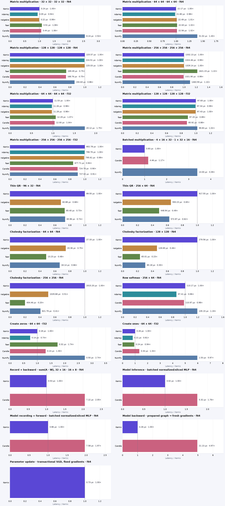

# Kernix 0.8.0 · CPU benchmarks

Neoverse-N2 · one BLAS/Rayon thread · allocation-inclusive · warmed individual calls

**Microseconds per call, median. Lower is faster; bold marks the lowest observed median in each row.**

No previous-version baseline is paired with this view.

| Workload | Kernix | ndarray | nalgebra | faer | Candle | NumPy |
|---|---:|---:|---:|---:|---:|---:|
| Matrix multiplication · 32 × 32 · 32 × 32 · f64 | 3.240 | **3.048** | 3.216 | 3.511 | 3.440 | 8.239 |
| Matrix multiplication · 64 × 64 · 64 × 64 · f64 | 22.174 | **21.799** | 22.486 | 22.630 | 22.559 | 31.022 |
| Matrix multiplication · 128 × 128 · 128 × 128 · f64 | 225.569 | 224.513 | 225.025 | 169.485 | **168.765** | 194.635 |
| Matrix multiplication · 256 × 256 · 256 × 256 · f64 | 1332.135 | 1324.464 | 1329.142 | 1621.235 | **1321.904** | 1463.590 |
| Matrix multiplication · 64 × 64 · 64 × 64 · f32 | 11.528 | **11.263** | 11.280 | 12.287 | 12.000 | 20.118 |
| Matrix multiplication · 128 × 128 · 128 × 128 · f32 | 97.833 | 97.337 | 97.426 | 87.203 | **85.922** | 99.833 |
| Matrix multiplication · 256 × 256 · 256 × 256 · f32 | 802.778 | 799.795 | 795.611 | **677.707** | 724.783 | 727.023 |
| Batched multiplication · 4 × 16 × 32 · 1 × 32 × 16 · f64 | **3.831** | — | — | — | 4.464 | 12.999 |
| Thin QR · 96 × 32 · f64 | 89.546 | — | **60.876** | 65.395 | — | 65.963 |
| Thin QR · 256 × 64 · f64 | 917.547 | — | 593.232 | **448.938** | — | 572.866 |
| Cholesky factorization · 64 × 64 · f64 | 27.326 | — | 20.359 | **13.231** | — | 18.143 |
| Cholesky factorization · 128 × 128 · f64 | 279.557 | — | 128.695 | **65.012** | — | 85.178 |
| Cholesky factorization · 256 × 256 · f64 | 2015.201 | — | 1029.683 | **404.461** | — | 821.793 |
| Row softmax · 256 × 64 · f64 | 113.168 | **97.410** | — | — | 110.969 | 135.151 |
| Create zeros · 64 × 64 · f32 | 0.184 | **0.136** | — | 0.320 | 0.240 | 0.504 |
| Create ones · 64 × 64 · f32 | 0.256 | **0.208** | — | 0.240 | 0.344 | 1.528 |
| Record + backward · sum(A · W), 32 × 16 · 16 × 8 · f64 | **3.527** | — | — | — | 7.223 | — |
| Model inference · batched normalized/sliced MLP · f64 | **3.023** | — | — | — | 5.320 | — |
| Model recording + forward · batched normalized/sliced MLP · f64 | **3.856** | — | — | — | 7.584 | — |
| Model backward · prepared graph → fresh gradients · f64 | **4.256** | — | — | — | 21.134 | — |
| Parameter update · transactional SGD, fixed gradients · f64 | **0.728** | — | — | — | — | — |

Each panel has its own scale. Ratios are library / Kernix median; below 1 means the comparator was faster.

## Reading these results

- One shared laptop, one pinned CPU and one BLAS/Rayon thread. Frequency and background load are uncontrolled; these observations establish no universal ranking.
- Timing includes output allocation and destruction. Inputs and imports are prepared outside timing. GEMM inputs are row-major; output layout and validation contracts can differ by library.
- Per-call p95 describes 256 individual warmed calls. The 15 batch means form a separate distribution; neither is a confidence interval.
- Rust allocation probes use a separate instrumented binary. Native engines may retain packing buffers; warmed probes exclude their first-use allocation and retention. NumPy native allocations are unavailable, never zero.

[Interactive report](report.html) · [Detailed measurements and method](DETAILS.md) · [Raw samples and provenance](raw.json) · [Printable chart](latency.pdf)

Measured source `227f339974f9c31fcf6bd37ccccbda3eedc99591`. Run `runner-ubuntu-24.04-arm-39719312815`. Rendering does not remeasure or modify raw evidence.
