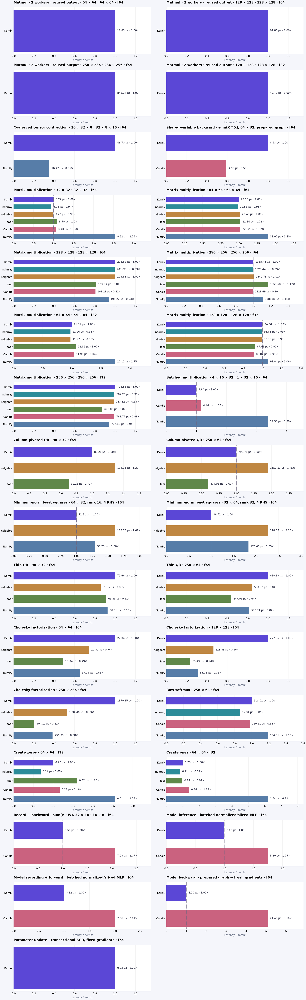

# Kernix 0.10.0 · CPU benchmarks

Neoverse-N2 · one BLAS/Rayon thread · allocating APIs unless marked reused · warmed individual calls · explicit 2-worker rows labelled

**Microseconds per call, median. Lower is faster; bold marks the lowest observed median in each row.**

No previous-version baseline is paired with this view.

| Workload | Kernix | ndarray | nalgebra | faer | Candle | NumPy |
|---|---:|---:|---:|---:|---:|---:|
| Matmul · 2 workers · reused output · 64 × 64 · 64 × 64 · f64 | **16.832** | — | — | — | — | — |
| Matmul · 2 workers · reused output · 128 × 128 · 128 × 128 · f64 | **97.835** | — | — | — | — | — |
| Matmul · 2 workers · reused output · 256 × 256 · 256 × 256 · f64 | **841.275** | — | — | — | — | — |
| Matmul · 2 workers · reused output · 128 × 128 · 128 × 128 · f32 | **49.722** | — | — | — | — | — |
| Coalesced tensor contraction · 16 × 32 × 8 · 32 × 8 × 16 · f64 | 46.698 | — | — | — | — | **16.472** |
| Shared-variable backward · sum(X * X), 64 × 32; prepared graph · f64 | 8.432 | — | — | — | **4.984** | — |
| Matrix multiplication · 32 × 32 · 32 × 32 · f64 | 3.240 | **3.056** | 3.216 | 3.504 | 3.432 | 8.224 |
| Matrix multiplication · 64 × 64 · 64 × 64 · f64 | 22.160 | **21.808** | 22.480 | 22.641 | 22.616 | 31.065 |
| Matrix multiplication · 128 × 128 · 128 × 128 · f64 | 208.887 | 207.823 | 208.679 | 169.742 | **168.285** | 195.222 |
| Matrix multiplication · 256 × 256 · 256 × 256 · f64 | 1335.439 | **1328.439** | 1342.730 | 1559.577 | 1328.690 | 1481.796 |
| Matrix multiplication · 64 × 64 · 64 × 64 · f32 | 11.513 | **11.257** | 11.272 | 12.321 | 11.961 | 20.120 |
| Matrix multiplication · 128 × 128 · 128 × 128 · f32 | 94.356 | 93.875 | 93.755 | 87.011 | **86.067** | 99.836 |
| Matrix multiplication · 256 × 256 · 256 × 256 · f32 | 773.531 | 767.258 | 763.616 | **675.088** | 766.771 | 727.864 |
| Batched multiplication · 4 × 16 × 32 · 1 × 32 × 16 · f64 | **3.840** | — | — | — | 4.441 | 12.984 |
| Column-pivoted QR · 96 × 32 · f64 | 88.260 | — | 114.211 | **62.130** | — | — |
| Column-pivoted QR · 256 × 64 · f64 | 792.708 | — | 1150.531 | **474.078** | — | — |
| Minimum-norm least squares · 64 × 32, rank 16, 4 RHS · f64 | **72.306** | — | 116.779 | — | — | 93.731 |
| Minimum-norm least squares · 32 × 64, rank 32, 4 RHS · f64 | **96.523** | — | 218.351 | — | — | 176.404 |
| Thin QR · 96 × 32 · f64 | 71.659 | — | **61.347** | 65.330 | — | 66.314 |
| Thin QR · 256 × 64 · f64 | 699.895 | — | 590.322 | **447.087** | — | 570.707 |
| Cholesky factorization · 64 × 64 · f64 | 27.337 | — | 20.321 | **13.344** | — | 17.792 |
| Cholesky factorization · 128 × 128 · f64 | 277.953 | — | 128.828 | **65.426** | — | 85.762 |
| Cholesky factorization · 256 × 256 · f64 | 1970.346 | — | 1034.459 | **404.125** | — | 756.351 |
| Row softmax · 256 × 64 · f64 | 113.012 | **97.315** | — | — | 110.508 | 134.508 |
| Create zeros · 64 × 64 · f32 | 0.200 | **0.136** | — | 0.320 | 0.232 | 0.512 |
| Create ones · 64 × 64 · f32 | 0.248 | **0.208** | — | 0.240 | 0.344 | 1.536 |
| Record + backward · sum(A · W), 32 × 16 · 16 × 8 · f64 | **3.496** | — | — | — | 7.232 | — |
| Model inference · batched normalized/sliced MLP · f64 | **3.024** | — | — | — | 5.296 | — |
| Model recording + forward · batched normalized/sliced MLP · f64 | **3.817** | — | — | — | 7.664 | — |
| Model backward · prepared graph → fresh gradients · f64 | **4.200** | — | — | — | 21.400 | — |
| Parameter update · transactional SGD, fixed gradients · f64 | **0.720** | — | — | — | — | — |

Each panel has its own scale. Ratios are library / Kernix median; below 1 means the comparator was faster.

## Reading these results

Minimum-norm rows include factorization and four RHS. Kernix uses pivoted QR plus scaled implicit RZ; NumPy uses native lstsq; nalgebra uses native SVD/solve. Fixtures have a wide rank gap; null-space orthogonality and normal residual are validated independently. Algorithm costs and rank policies differ; see DETAILS.md for thresholds. These are not general SVD comparisons.

- One measured host and one BLAS/Rayon thread. CPU affinity pinned to logical CPU 0. Frequency and background load are uncontrolled; these observations establish no universal ranking. Rows marked 2 workers use a private two-thread executor and reusable output; their recorded CPU affinity can differ. They compare Kernix versions, not single-thread competitors.
- Timing includes output allocation and destruction except rows explicitly marked reused. Inputs and imports are prepared outside timing. GEMM inputs are row-major; output layout and validation contracts can differ by library.
- Per-call p95 describes 256 individual warmed calls. The 15 batch means form a separate distribution; neither is a confidence interval.
- Rust allocation probes use a separate instrumented binary. Native engines may retain packing buffers; warmed probes exclude their first-use allocation and retention. NumPy native allocations are unavailable, never zero.

[Interactive report](report.html) · [Detailed measurements and method](DETAILS.md) · [Raw samples and provenance](raw.json) · [Printable chart](latency.pdf)

Measured source `1c53d4663a48de5a588809c2b69c3a6a5bdad7b2`. Run `runner-ubuntu-24.04-arm-40000558153`. Rendering does not remeasure or modify raw evidence.
