# Kernix 0.10.0 · performance brief

Neoverse-N2 / Linux

**Per-call median, microseconds per operation. Lower is faster. All recorded digits retained.**

31 workloads · 108 observations

No previous-version baseline attached. Sequential run changes are descriptive; paired process evidence is shown separately.

[Interactive HTML (open locally)](report.html) · [Vector PDF](latency.pdf) · [Raw measurements](raw.json)

## Charts by workload

**Shorter bars mean less time.** Blue is Kernix; grey is another library; teal is an explicitly selected Kernix backend. Entries are sorted by the recorded median, with a separate zero-based scale per chart. These point observations do not establish a statistical ranking.

Expand a group to see every chart here on GitHub. Click a chart to enlarge it. The exact table below keeps every source digit.

Matrix multiplication · 8 workloads

**Matrix multiplication · 32 × 32 · 32 × 32 · f64**

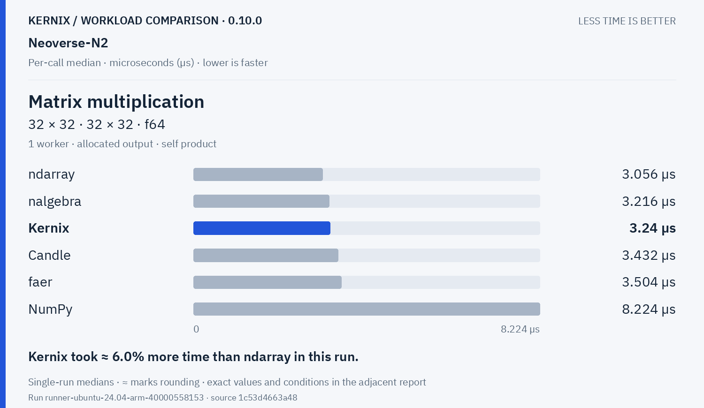

Kernix: **3.24 µs**. Kernix took ≈ 6.0% more time than ndarray in this run.

**Matrix multiplication · 64 × 64 · 64 × 64 · f64**

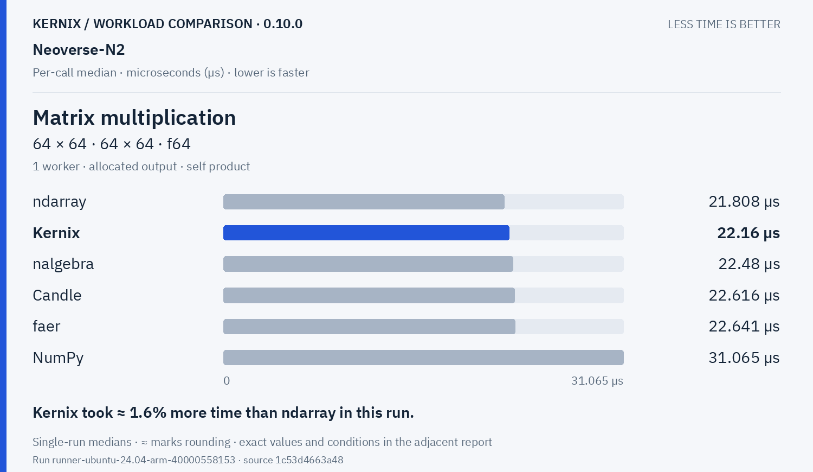

Kernix: **22.16 µs**. Kernix took ≈ 1.6% more time than ndarray in this run.

**Matrix multiplication · 128 × 128 · 128 × 128 · f64**

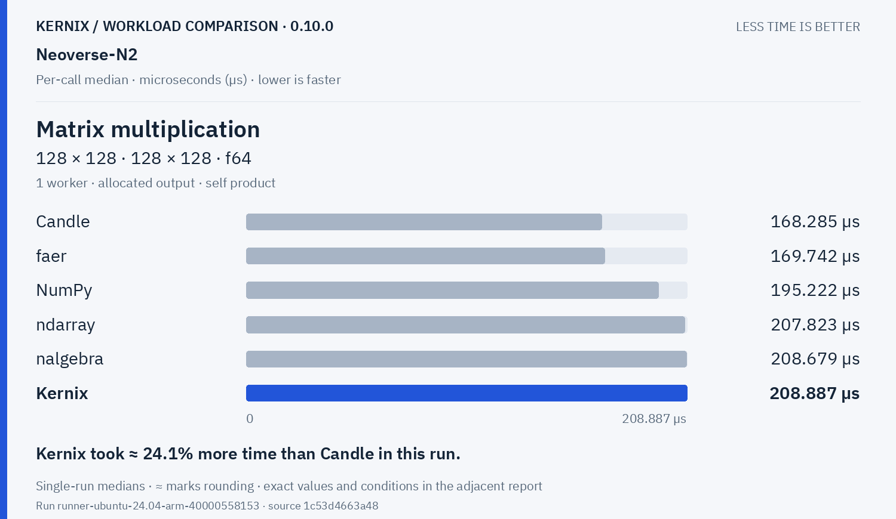

Kernix: **208.887 µs**. Kernix took ≈ 24.1% more time than Candle in this run.

**Matrix multiplication · 256 × 256 · 256 × 256 · f64**

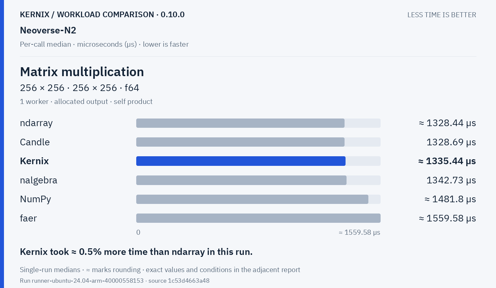

Kernix: **1335.439 µs**. Kernix took ≈ 0.5% more time than ndarray in this run.

**Matrix multiplication · 64 × 64 · 64 × 64 · f32**

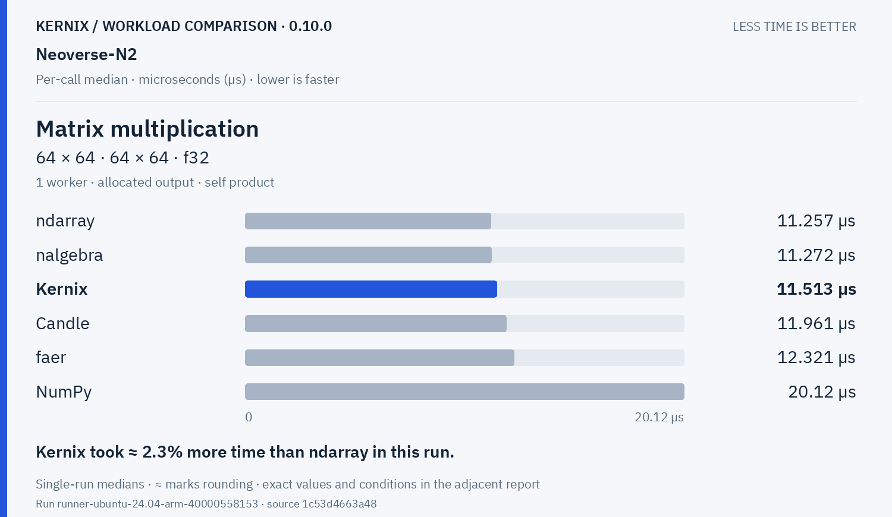

Kernix: **11.513 µs**. Kernix took ≈ 2.3% more time than ndarray in this run.

**Matrix multiplication · 128 × 128 · 128 × 128 · f32**

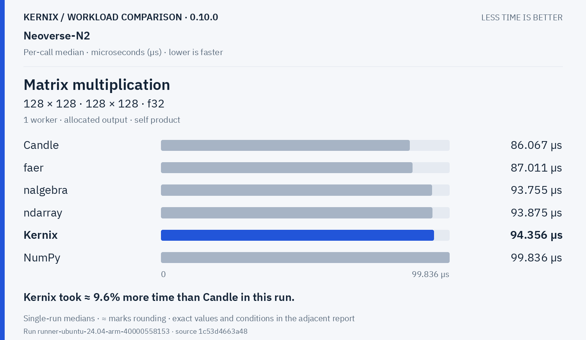

Kernix: **94.356 µs**. Kernix took ≈ 9.6% more time than Candle in this run.

**Matrix multiplication · 256 × 256 · 256 × 256 · f32**

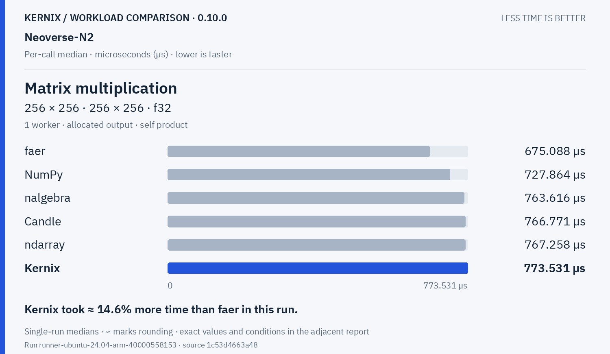

Kernix: **773.531 µs**. Kernix took ≈ 14.6% more time than faer in this run.

**Batched multiplication · 4 × 16 × 32 · 1 × 32 × 16 · f64**

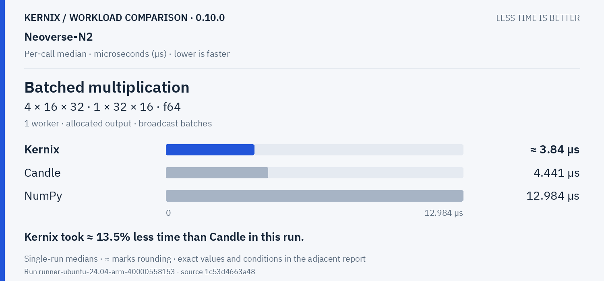

Kernix: **3.8399999999999995 µs**. Kernix took ≈ 13.5% less time than Candle in this run.

Explicit parallel execution · 4 workloads

**Matmul · 2 workers · reused output · 64 × 64 · 64 × 64 · f64**

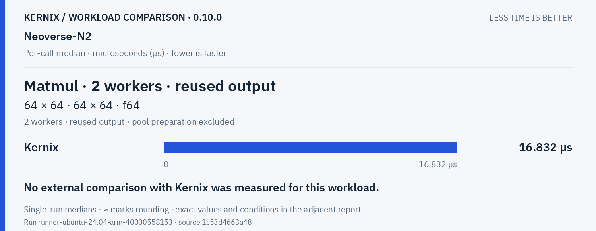

Kernix: **16.832 µs**. No external comparison with Kernix was measured for this workload.

**Matmul · 2 workers · reused output · 128 × 128 · 128 × 128 · f64**

Kernix: **97.835 µs**. No external comparison with Kernix was measured for this workload.

**Matmul · 2 workers · reused output · 256 × 256 · 256 × 256 · f64**

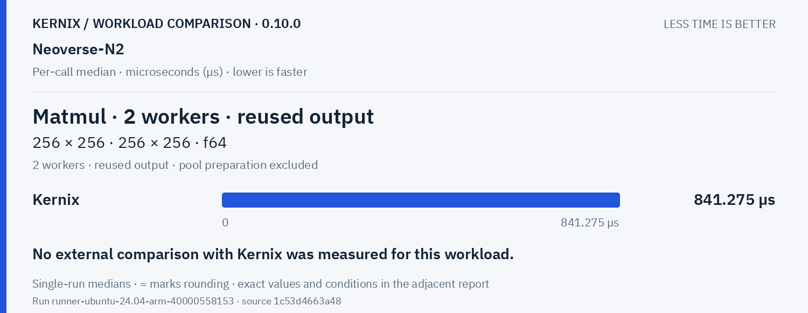

Kernix: **841.275 µs**. No external comparison with Kernix was measured for this workload.

**Matmul · 2 workers · reused output · 128 × 128 · 128 × 128 · f32**

Kernix: **49.722 µs**. No external comparison with Kernix was measured for this workload.

Decompositions & solvers · 9 workloads

**Column-pivoted QR · 96 × 32 · f64**

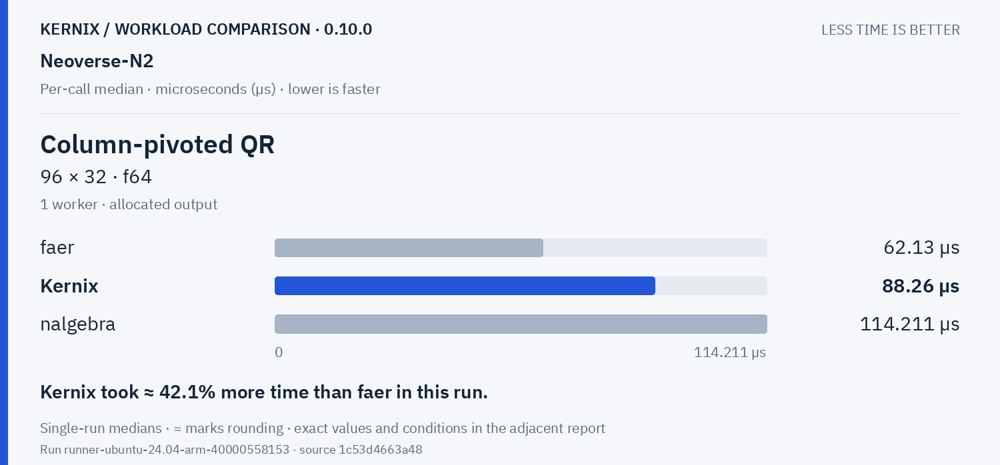

Kernix: **88.26 µs**. Kernix took ≈ 42.1% more time than faer in this run.

**Column-pivoted QR · 256 × 64 · f64**

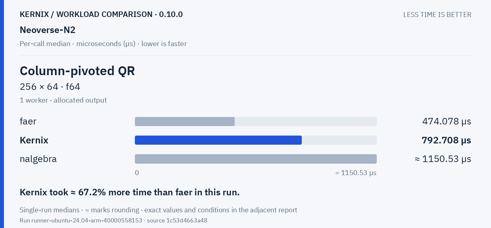

Kernix: **792.708 µs**. Kernix took ≈ 67.2% more time than faer in this run.

**Minimum-norm least squares · 64 × 32, rank 16, 4 RHS · f64**

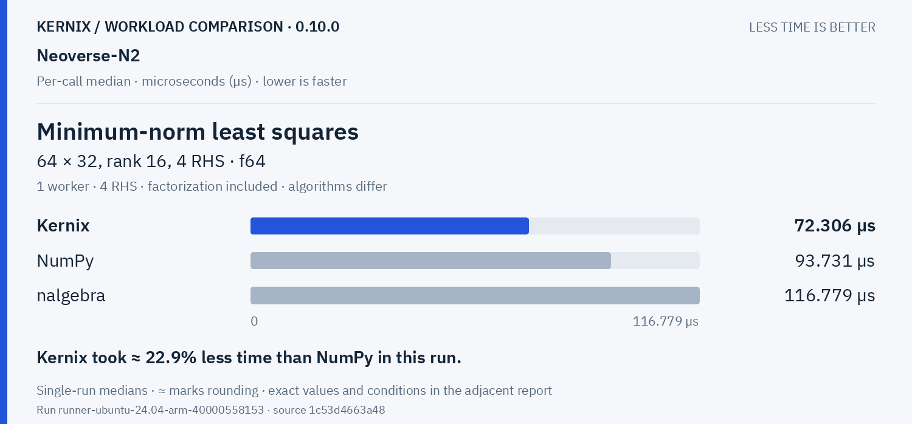

Kernix: **72.306 µs**. Kernix took ≈ 22.9% less time than NumPy in this run.

**Minimum-norm least squares · 32 × 64, rank 32, 4 RHS · f64**

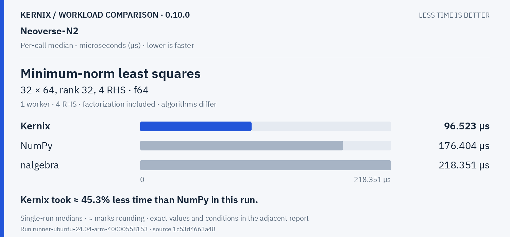

Kernix: **96.523 µs**. Kernix took ≈ 45.3% less time than NumPy in this run.

**Thin QR · 96 × 32 · f64**

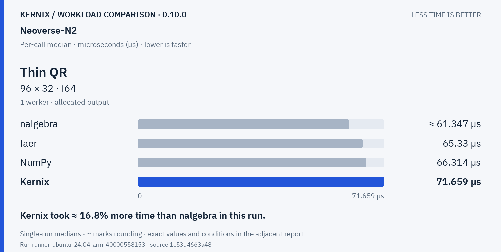

Kernix: **71.659 µs**. Kernix took ≈ 16.8% more time than nalgebra in this run.

**Thin QR · 256 × 64 · f64**

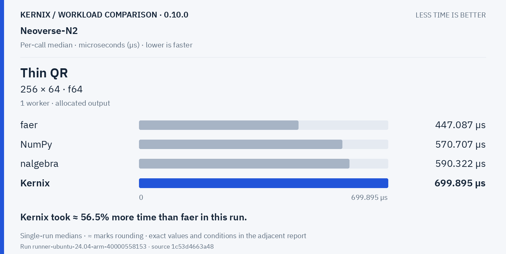

Kernix: **699.895 µs**. Kernix took ≈ 56.5% more time than faer in this run.

**Cholesky factorization · 64 × 64 · f64**

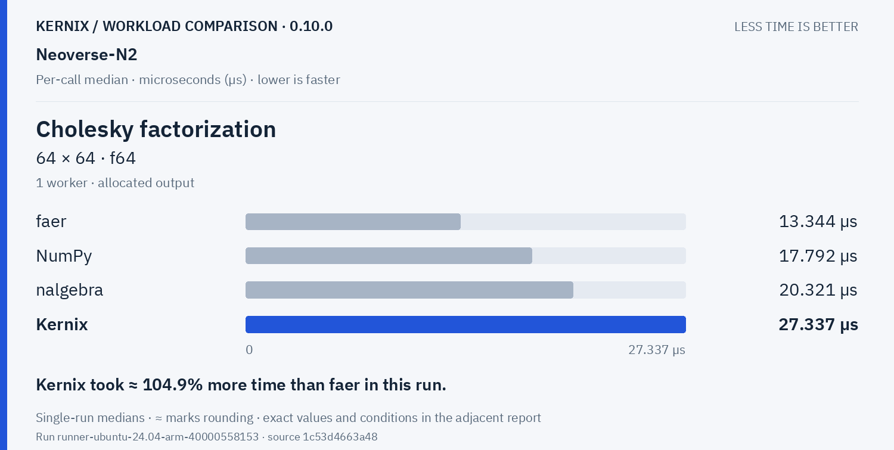

Kernix: **27.337 µs**. Kernix took ≈ 104.9% more time than faer in this run.

**Cholesky factorization · 128 × 128 · f64**

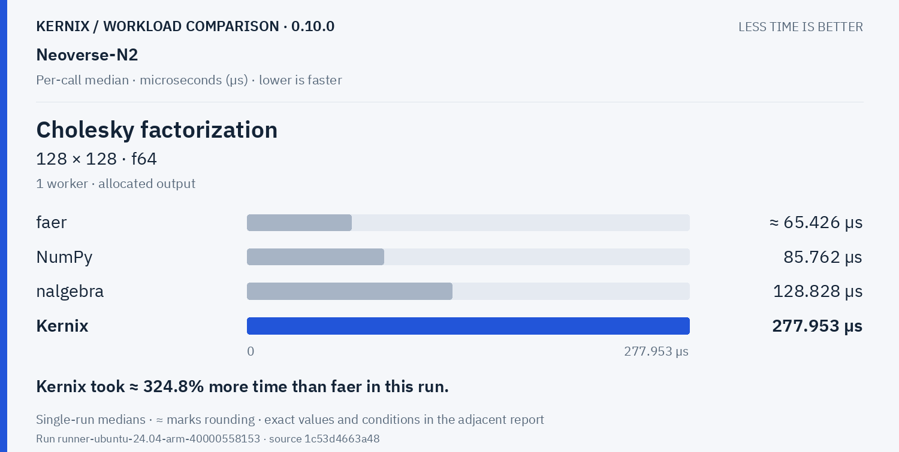

Kernix: **277.953 µs**. Kernix took ≈ 324.8% more time than faer in this run.

**Cholesky factorization · 256 × 256 · f64**

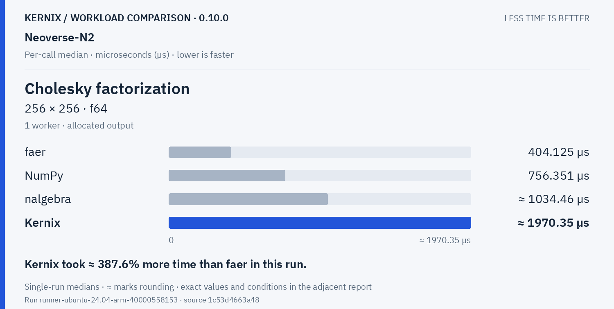

Kernix: **1970.346 µs**. Kernix took ≈ 387.6% more time than faer in this run.

Training & autodiff · 6 workloads

**Shared-variable backward · sum(X * X), 64 × 32; prepared graph · f64**

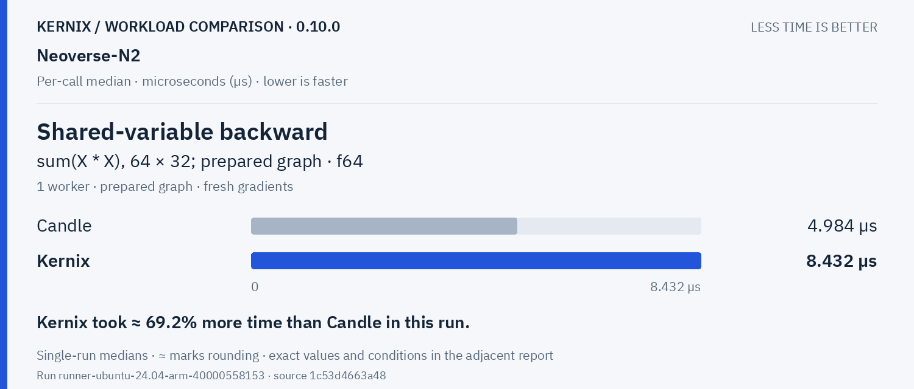

Kernix: **8.432 µs**. Kernix took ≈ 69.2% more time than Candle in this run.

**Record + backward · sum(A · W), 32 × 16 · 16 × 8 · f64**

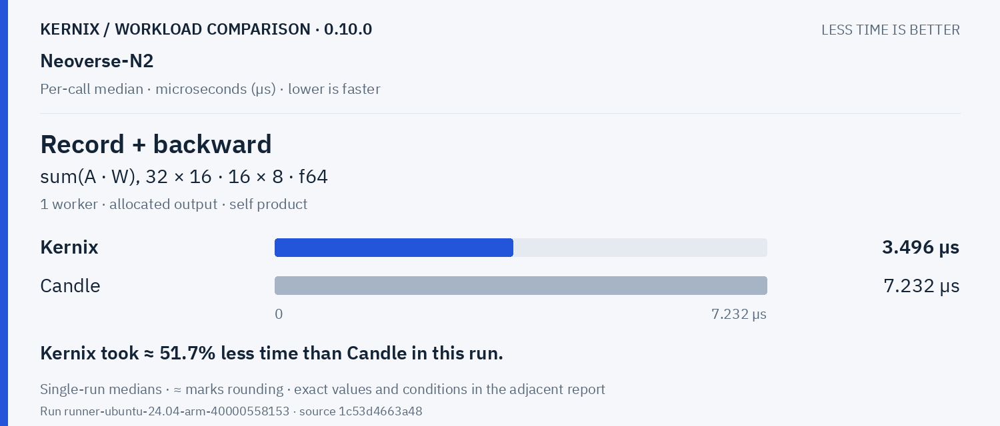

Kernix: **3.496 µs**. Kernix took ≈ 51.7% less time than Candle in this run.

**Model inference · batched normalized/sliced MLP · f64**

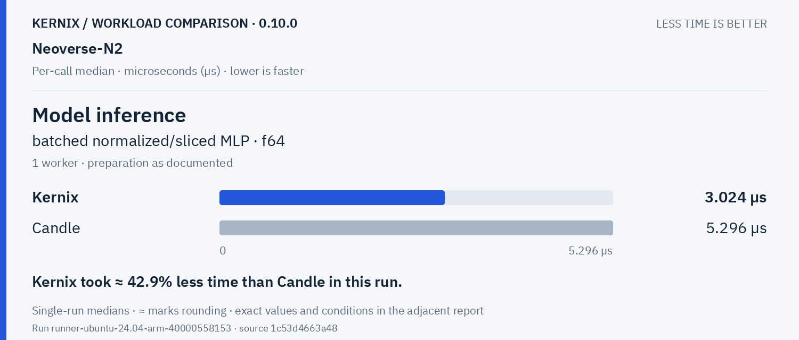

Kernix: **3.024 µs**. Kernix took ≈ 42.9% less time than Candle in this run.

**Model recording + forward · batched normalized/sliced MLP · f64**

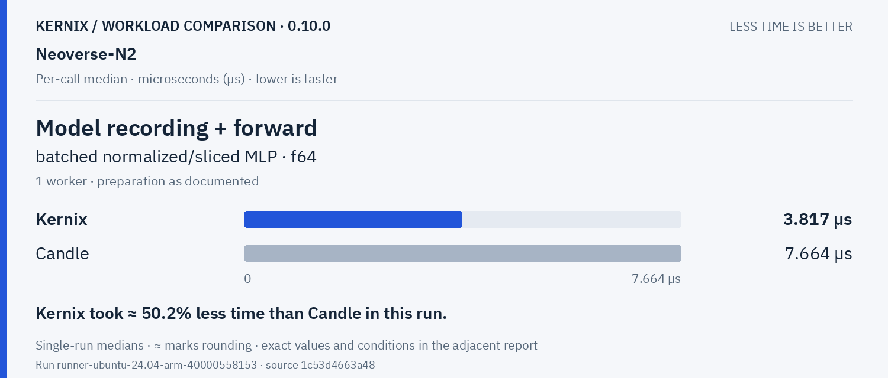

Kernix: **3.817 µs**. Kernix took ≈ 50.2% less time than Candle in this run.

**Model backward · prepared graph → fresh gradients · f64**

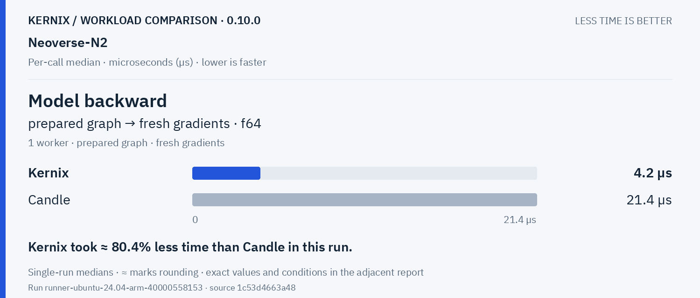

Kernix: **4.2 µs**. Kernix took ≈ 80.4% less time than Candle in this run.

**Parameter update · transactional SGD, fixed gradients · f64**

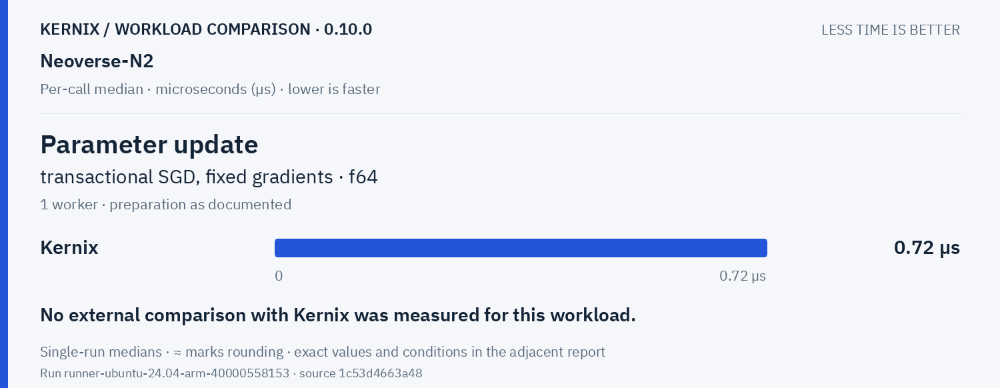

Kernix: **0.72 µs**. No external comparison with Kernix was measured for this workload.

Tensor contractions · 1 workloads

**Coalesced tensor contraction · 16 × 32 × 8 · 32 × 8 × 16 · f64**

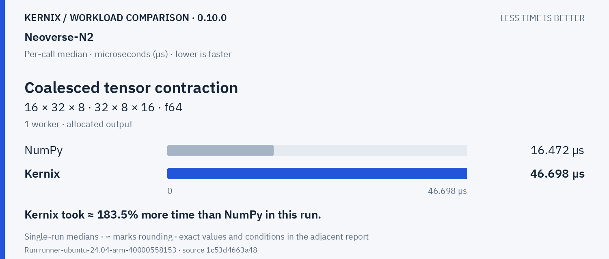

Kernix: **46.698 µs**. Kernix took ≈ 183.5% more time than NumPy in this run.

Statistics & activations · 1 workloads

**Row softmax · 256 × 64 · f64**

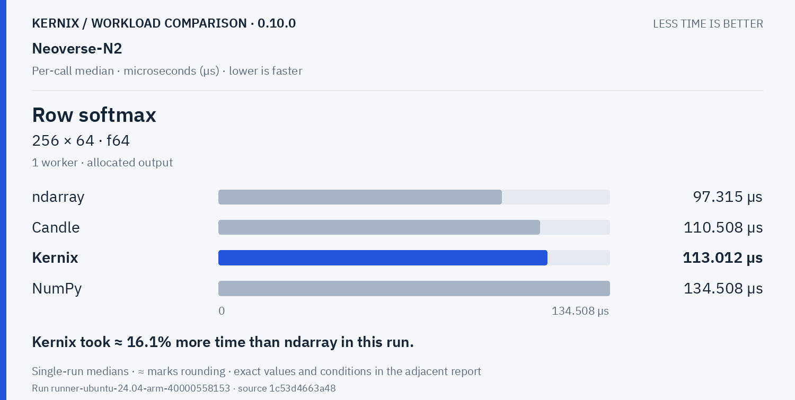

Kernix: **113.012 µs**. Kernix took ≈ 16.1% more time than ndarray in this run.

Tensor construction · 2 workloads

**Create zeros · 64 × 64 · f32**

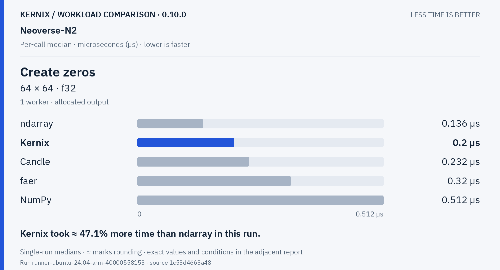

Kernix: **0.2 µs**. Kernix took ≈ 47.1% more time than ndarray in this run.

**Create ones · 64 × 64 · f32**

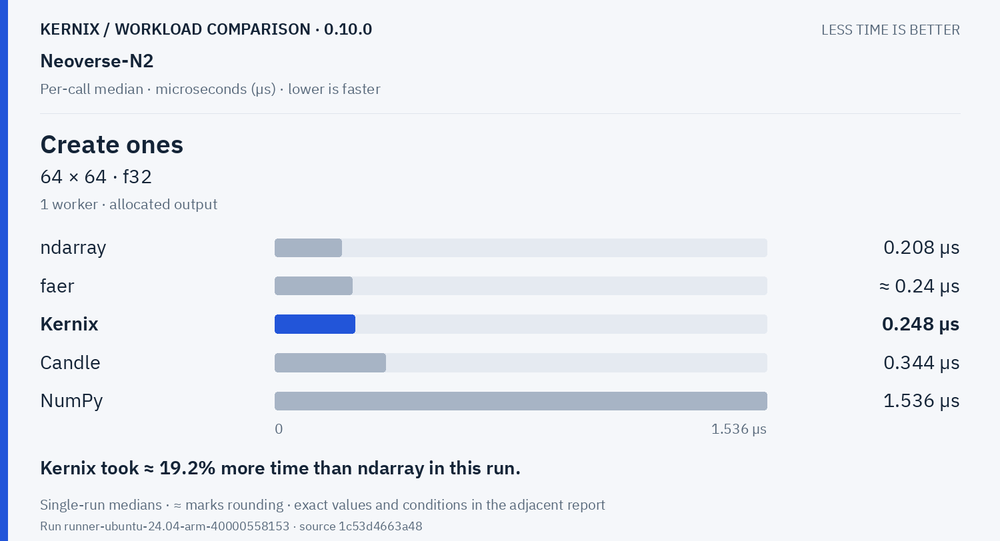

Kernix: **0.248 µs**. Kernix took ≈ 19.2% more time than ndarray in this run.

## Exact latency table

All values below are microseconds per operation. **Lower is faster.** Missing entries were not measured.

| Workload | Kernix | ndarray | nalgebra | faer | Candle | NumPy |
|---|---:|---:|---:|---:|---:|---:|
| Matrix multiplication · 32 × 32 · 32 × 32 · f64 | 3.24 | **3.056** | 3.216 | 3.504 | 3.432 | 8.224 |
| Matrix multiplication · 64 × 64 · 64 × 64 · f64 | 22.16 | **21.808** | 22.48 | 22.641 | 22.616 | 31.065 |
| Matrix multiplication · 128 × 128 · 128 × 128 · f64 | 208.887 | 207.823 | 208.679 | 169.742 | **168.285** | 195.222 |
| Matrix multiplication · 256 × 256 · 256 × 256 · f64 | 1335.439 | **1328.439** | 1342.73 | 1559.577 | 1328.69 | 1481.796 |
| Matrix multiplication · 64 × 64 · 64 × 64 · f32 | 11.513 | **11.257** | 11.272 | 12.321 | 11.961 | 20.12 |
| Matrix multiplication · 128 × 128 · 128 × 128 · f32 | 94.356 | 93.875 | 93.755 | 87.011 | **86.067** | 99.836 |
| Matrix multiplication · 256 × 256 · 256 × 256 · f32 | 773.531 | 767.258 | 763.616 | **675.088** | 766.771 | 727.864 |
| Batched multiplication · 4 × 16 × 32 · 1 × 32 × 16 · f64 | **3.8399999999999995** | — | — | — | 4.441 | 12.984 |
| Matmul · 2 workers · reused output · 64 × 64 · 64 × 64 · f64 | 16.832 | — | — | — | — | — |
| Matmul · 2 workers · reused output · 128 × 128 · 128 × 128 · f64 | 97.835 | — | — | — | — | — |
| Matmul · 2 workers · reused output · 256 × 256 · 256 × 256 · f64 | 841.275 | — | — | — | — | — |
| Matmul · 2 workers · reused output · 128 × 128 · 128 × 128 · f32 | 49.722 | — | — | — | — | — |
| Column-pivoted QR · 96 × 32 · f64 | 88.26 | — | 114.211 | **62.13** | — | — |
| Column-pivoted QR · 256 × 64 · f64 | 792.708 | — | 1150.531 | **474.078** | — | — |
| Minimum-norm least squares · 64 × 32, rank 16, 4 RHS · f64 | **72.306** | — | 116.779 | — | — | 93.731 |
| Minimum-norm least squares · 32 × 64, rank 32, 4 RHS · f64 | **96.523** | — | 218.351 | — | — | 176.404 |
| Thin QR · 96 × 32 · f64 | 71.659 | — | **61.34699999999999** | 65.33 | — | 66.314 |
| Thin QR · 256 × 64 · f64 | 699.895 | — | 590.322 | **447.087** | — | 570.707 |
| Cholesky factorization · 64 × 64 · f64 | 27.337 | — | 20.321 | **13.344** | — | 17.792 |
| Cholesky factorization · 128 × 128 · f64 | 277.953 | — | 128.828 | **65.42599999999999** | — | 85.762 |
| Cholesky factorization · 256 × 256 · f64 | 1970.346 | — | 1034.459 | **404.125** | — | 756.351 |
| Shared-variable backward · sum(X * X), 64 × 32; prepared graph · f64 | 8.432 | — | — | — | **4.984** | — |
| Record + backward · sum(A · W), 32 × 16 · 16 × 8 · f64 | **3.496** | — | — | — | 7.232 | — |
| Model inference · batched normalized/sliced MLP · f64 | **3.024** | — | — | — | 5.296 | — |
| Model recording + forward · batched normalized/sliced MLP · f64 | **3.817** | — | — | — | 7.664 | — |
| Model backward · prepared graph → fresh gradients · f64 | **4.2** | — | — | — | 21.4 | — |
| Parameter update · transactional SGD, fixed gradients · f64 | 0.72 | — | — | — | — | — |
| Coalesced tensor contraction · 16 × 32 × 8 · 32 × 8 × 16 · f64 | 46.698 | — | — | — | — | **16.472** |
| Row softmax · 256 × 64 · f64 | 113.012 | **97.315** | — | — | 110.508 | 134.508 |
| Create zeros · 64 × 64 · f32 | 0.2 | **0.136** | — | 0.32 | 0.232 | 0.512 |
| Create ones · 64 × 64 · f32 | 0.248 | **0.208** | — | 0.23999999999999997 | 0.344 | 1.536 |

## Version comparison

0 of 31 workloads have paired evidence. Exploratory 95% intervals resample process pairs, not calls. No multiple-comparison adjustment.

| Workload | Current / baseline [95% interval] | Interpretation |
|---|---:|---|
| Matrix multiplication · 32 × 32 · 32 × 32 · f64 | — | No paired comparison |
| Matrix multiplication · 64 × 64 · 64 × 64 · f64 | — | No paired comparison |
| Matrix multiplication · 128 × 128 · 128 × 128 · f64 | — | No paired comparison |
| Matrix multiplication · 256 × 256 · 256 × 256 · f64 | — | No paired comparison |
| Matrix multiplication · 64 × 64 · 64 × 64 · f32 | — | No paired comparison |
| Matrix multiplication · 128 × 128 · 128 × 128 · f32 | — | No paired comparison |
| Matrix multiplication · 256 × 256 · 256 × 256 · f32 | — | No paired comparison |
| Batched multiplication · 4 × 16 × 32 · 1 × 32 × 16 · f64 | — | No paired comparison |
| Matmul · 2 workers · reused output · 64 × 64 · 64 × 64 · f64 | — | No paired comparison |
| Matmul · 2 workers · reused output · 128 × 128 · 128 × 128 · f64 | — | No paired comparison |
| Matmul · 2 workers · reused output · 256 × 256 · 256 × 256 · f64 | — | No paired comparison |
| Matmul · 2 workers · reused output · 128 × 128 · 128 × 128 · f32 | — | No paired comparison |
| Column-pivoted QR · 96 × 32 · f64 | — | No paired comparison |
| Column-pivoted QR · 256 × 64 · f64 | — | No paired comparison |
| Minimum-norm least squares · 64 × 32, rank 16, 4 RHS · f64 | — | No paired comparison |
| Minimum-norm least squares · 32 × 64, rank 32, 4 RHS · f64 | — | No paired comparison |
| Thin QR · 96 × 32 · f64 | — | No paired comparison |
| Thin QR · 256 × 64 · f64 | — | No paired comparison |
| Cholesky factorization · 64 × 64 · f64 | — | No paired comparison |
| Cholesky factorization · 128 × 128 · f64 | — | No paired comparison |
| Cholesky factorization · 256 × 256 · f64 | — | No paired comparison |
| Shared-variable backward · sum(X * X), 64 × 32; prepared graph · f64 | — | No paired comparison |
| Record + backward · sum(A · W), 32 × 16 · 16 × 8 · f64 | — | No paired comparison |
| Model inference · batched normalized/sliced MLP · f64 | — | No paired comparison |
| Model recording + forward · batched normalized/sliced MLP · f64 | — | No paired comparison |
| Model backward · prepared graph → fresh gradients · f64 | — | No paired comparison |
| Parameter update · transactional SGD, fixed gradients · f64 | — | No paired comparison |
| Coalesced tensor contraction · 16 × 32 × 8 · 32 × 8 × 16 · f64 | — | No paired comparison |
| Row softmax · 256 × 64 · f64 | — | No paired comparison |
| Create zeros · 64 × 64 · f32 | — | No paired comparison |
| Create ones · 64 × 64 · f32 | — | No paired comparison |

## Method and provenance

CPU affinity pinned to logical CPU 0. Frequency and background load are uncontrolled.

Minimum-norm rows use pivoted QR plus scaled implicit RZ in Kernix; NumPy native lstsq; nalgebra native SVD/solve. Algorithm costs and rank policies differ. See original method for thresholds.

Numbers retain source precision; recorded digits do not imply equivalent physical measurement accuracy. Lowest observed medians are bold only when peers were measured. No aggregate winner or universal ranking is inferred.

[Original report and commentary](original-report.txt) · [Raw measurements](raw.json)

Measured source `1c53d4663a48de5a588809c2b69c3a6a5bdad7b2`. Run `runner-ubuntu-24.04-arm-40000558153`. Rendering does not change measurements.
