# Kernix 0.11.1 · performance brief

Neoverse-N2 / Linux

**Per-call median, microseconds per operation. Lower is faster. All recorded digits retained.**

35 workloads · 119 observations

Baseline: baseline-ubuntu-24.04-arm-40161751367. Sequential run changes are descriptive; paired process evidence is shown separately.

[Interactive HTML (open locally)](report.html) · [Vector PDF](latency.pdf) · [Raw measurements](raw.json)

## Charts by workload

**Shorter bars mean less time.** Blue is Kernix; grey is another library; teal is an explicitly selected Kernix backend. Entries are sorted by the recorded median, with a separate zero-based scale per chart. These point observations do not establish a statistical ranking.

Expand a group to see every chart here on GitHub. Click a chart to enlarge it. The exact table below keeps every source digit.

Matrix multiplication · 11 workloads

**Independent matrix operands · 128 × 128 · 128 × 128 · f64**

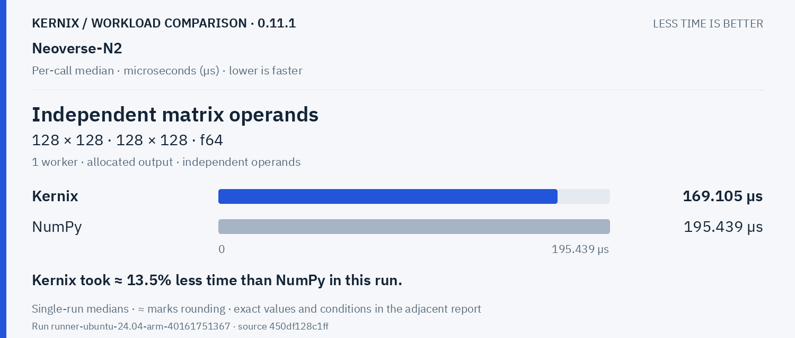

Kernix: **169.105 µs**. Kernix took ≈ 13.5% less time than NumPy in this run.

**Independent matrix operands · 128 × 128 · 128 × 128 · f32**

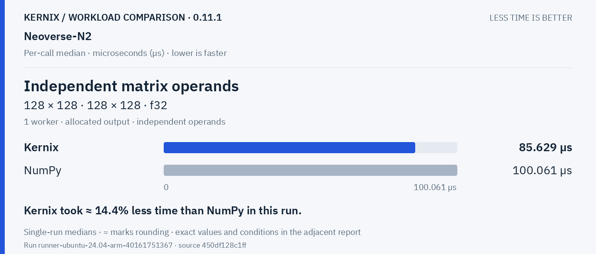

Kernix: **85.629 µs**. Kernix took ≈ 14.4% less time than NumPy in this run.

**Matrix multiplication · 32 × 32 · 32 × 32 · f64**

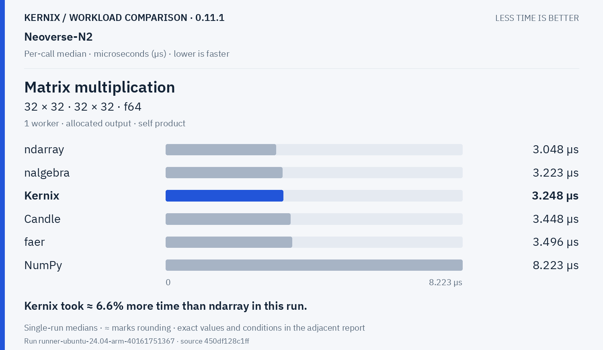

Kernix: **3.248 µs**. Kernix took ≈ 6.6% more time than ndarray in this run.

**Matrix multiplication · 64 × 64 · 64 × 64 · f64**

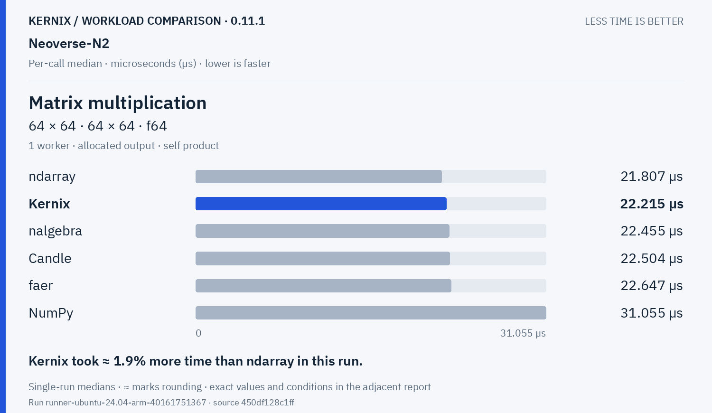

Kernix: **22.215 µs**. Kernix took ≈ 1.9% more time than ndarray in this run.

**Matrix multiplication · 128 × 128 · 128 × 128 · f64**

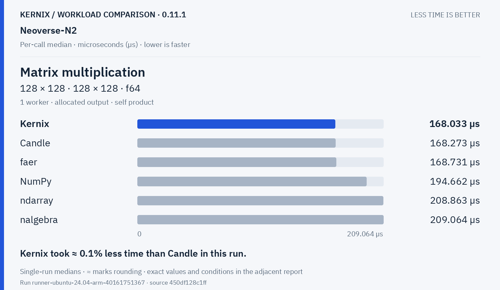

Kernix: **168.033 µs**. Kernix took ≈ 0.1% less time than Candle in this run.

**Matrix multiplication · 256 × 256 · 256 × 256 · f64**

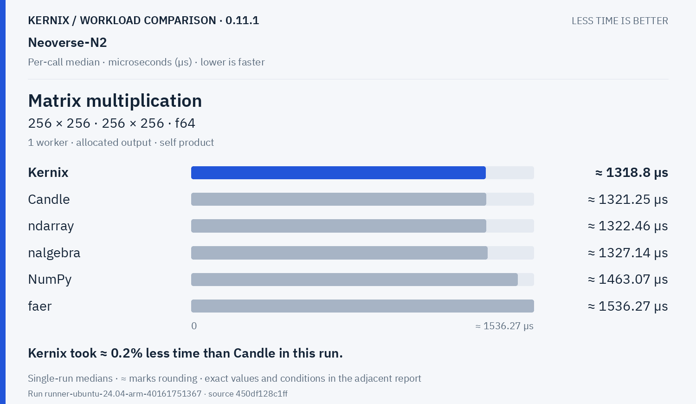

Kernix: **1318.796 µs**. Kernix took ≈ 0.2% less time than Candle in this run.

**Matrix multiplication · 64 × 64 · 64 × 64 · f32**

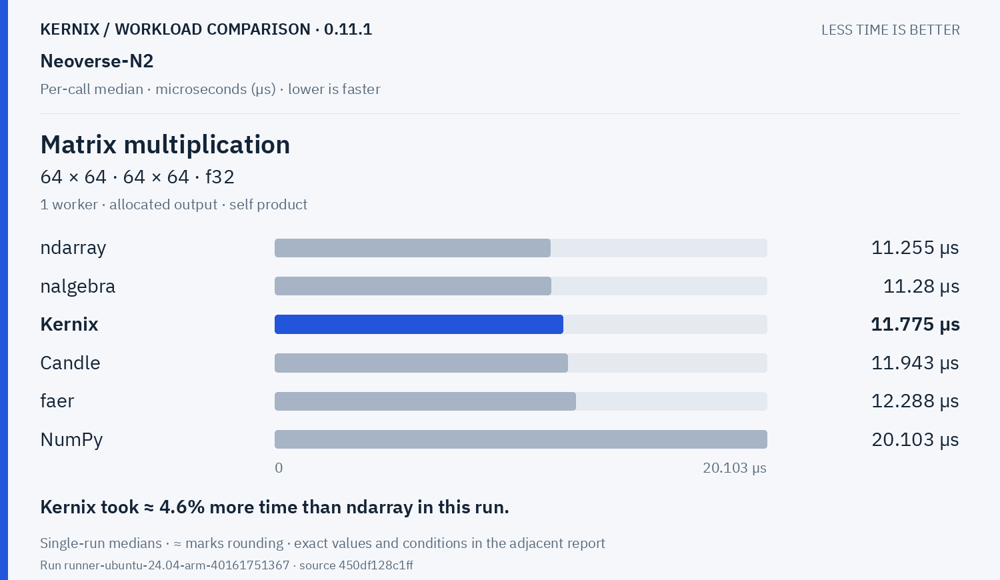

Kernix: **11.775 µs**. Kernix took ≈ 4.6% more time than ndarray in this run.

**Matrix multiplication · 128 × 128 · 128 × 128 · f32**

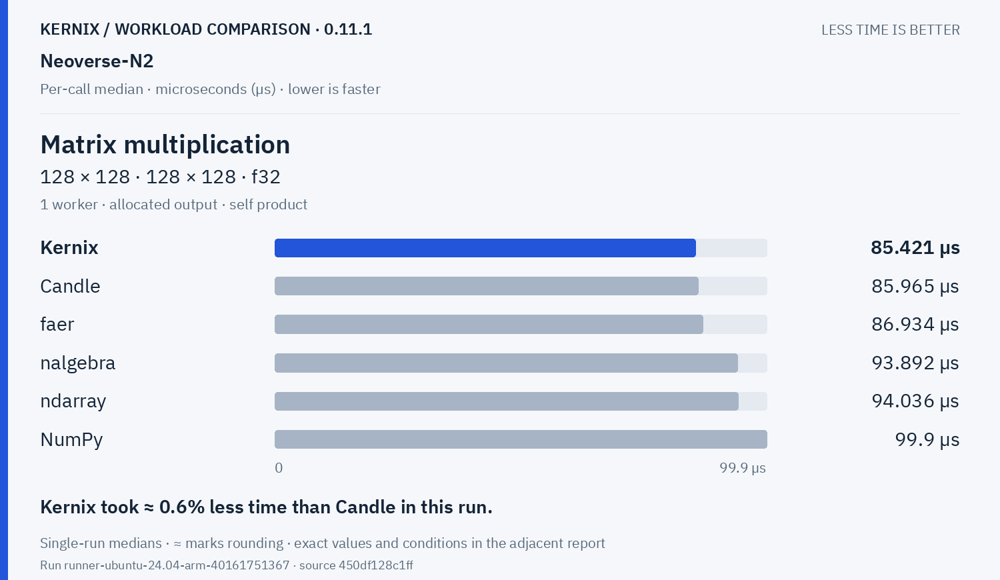

Kernix: **85.421 µs**. Kernix took ≈ 0.6% less time than Candle in this run.

**Matrix multiplication · 256 × 256 · 256 × 256 · f32**

Kernix: **661.83 µs**. Kernix took ≈ 1.8% less time than faer in this run.

**Batched multiplication · 4 × 16 × 32 · 1 × 32 × 16 · f64**

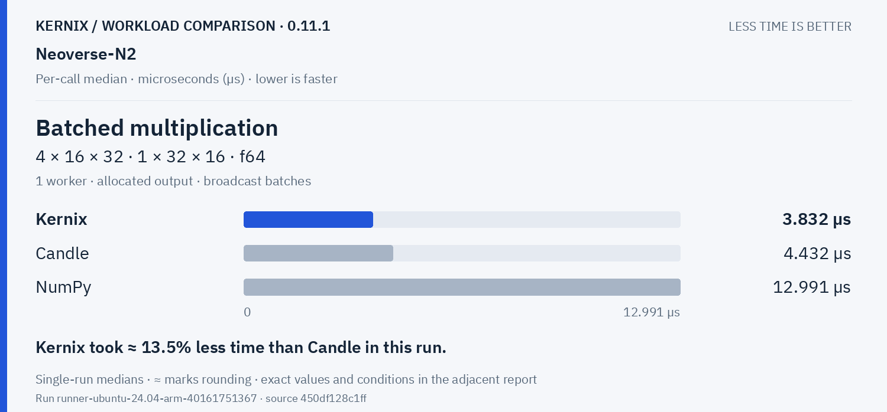

Kernix: **3.832 µs**. Kernix took ≈ 13.5% less time than Candle in this run.

**Batched multiplication · 4 × 16 × 32 · 1 × 32 × 16 · f32**

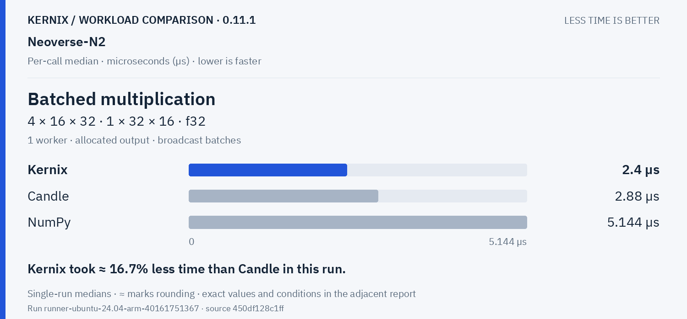

Kernix: **2.4 µs**. Kernix took ≈ 16.7% less time than Candle in this run.

Explicit parallel execution · 4 workloads

**Matmul · 2 workers · reused output · 64 × 64 · 64 × 64 · f64**

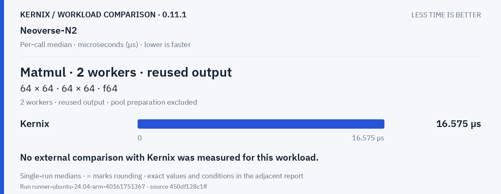

Kernix: **16.575 µs**. No external comparison with Kernix was measured for this workload.

**Matmul · 2 workers · reused output · 128 × 128 · 128 × 128 · f64**

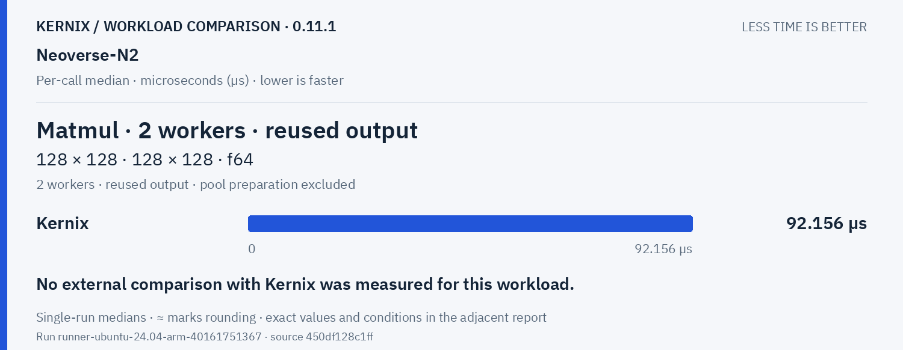

Kernix: **92.156 µs**. No external comparison with Kernix was measured for this workload.

**Matmul · 2 workers · reused output · 256 × 256 · 256 × 256 · f64**

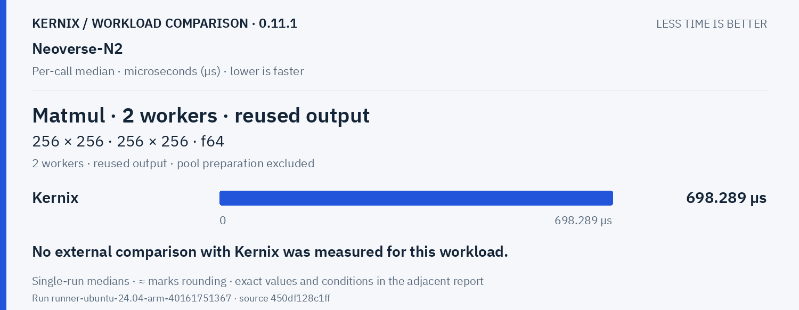

Kernix: **698.289 µs**. No external comparison with Kernix was measured for this workload.

**Matmul · 2 workers · reused output · 128 × 128 · 128 × 128 · f32**

Kernix: **48.67 µs**. No external comparison with Kernix was measured for this workload.

Decompositions & solvers · 10 workloads

**Cholesky factorization · 512 × 512 · f64**

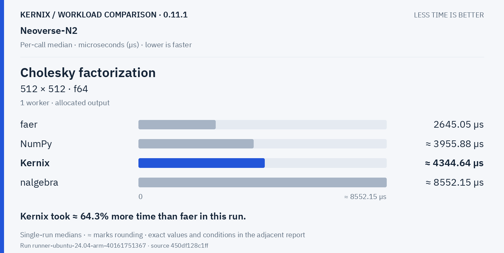

Kernix: **4344.642 µs**. Kernix took ≈ 64.3% more time than faer in this run.

**Column-pivoted QR · 96 × 32 · f64**

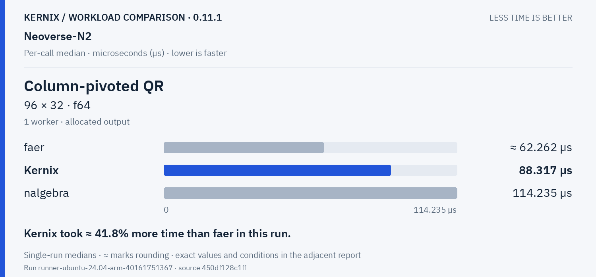

Kernix: **88.317 µs**. Kernix took ≈ 41.8% more time than faer in this run.

**Column-pivoted QR · 256 × 64 · f64**

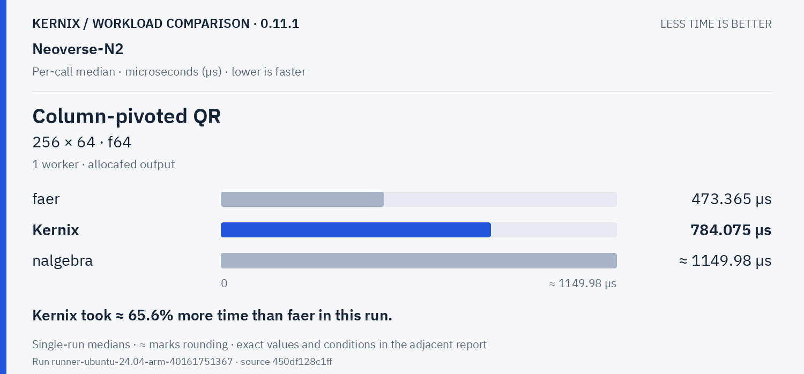

Kernix: **784.075 µs**. Kernix took ≈ 65.6% more time than faer in this run.

**Minimum-norm least squares · 64 × 32, rank 16, 4 RHS · f64**

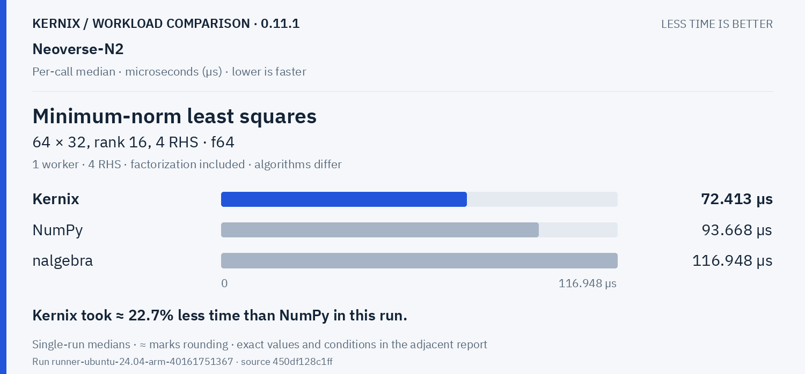

Kernix: **72.413 µs**. Kernix took ≈ 22.7% less time than NumPy in this run.

**Minimum-norm least squares · 32 × 64, rank 32, 4 RHS · f64**

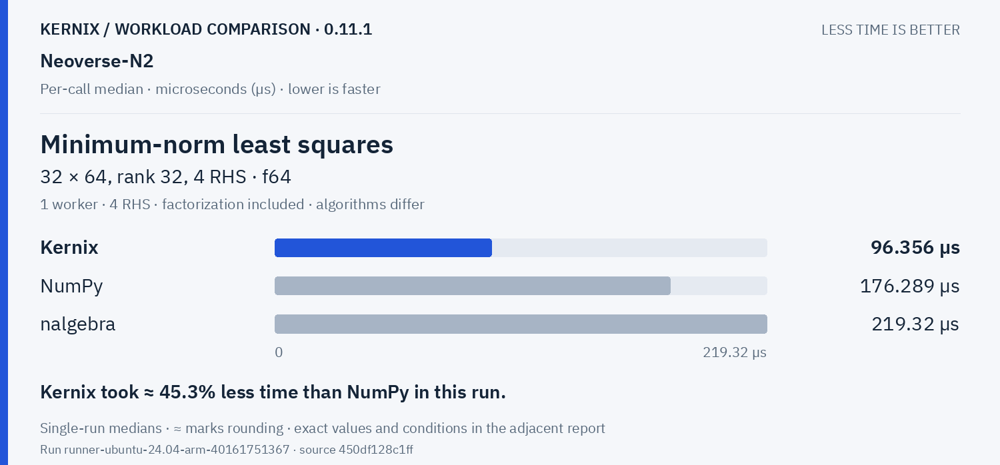

Kernix: **96.356 µs**. Kernix took ≈ 45.3% less time than NumPy in this run.

**Thin QR · 96 × 32 · f64**

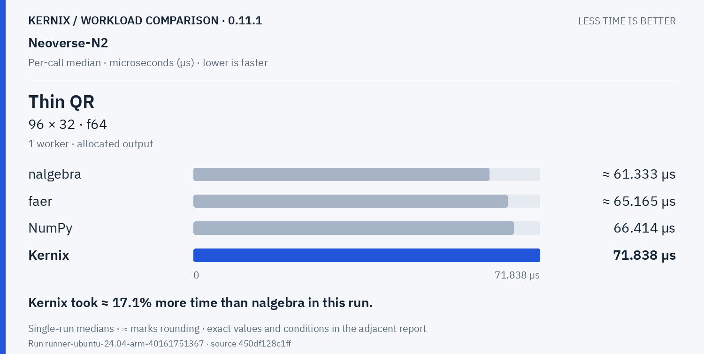

Kernix: **71.838 µs**. Kernix took ≈ 17.1% more time than nalgebra in this run.

**Thin QR · 256 × 64 · f64**

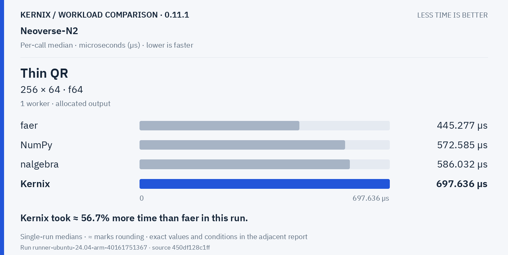

Kernix: **697.636 µs**. Kernix took ≈ 56.7% more time than faer in this run.

**Cholesky factorization · 64 × 64 · f64**

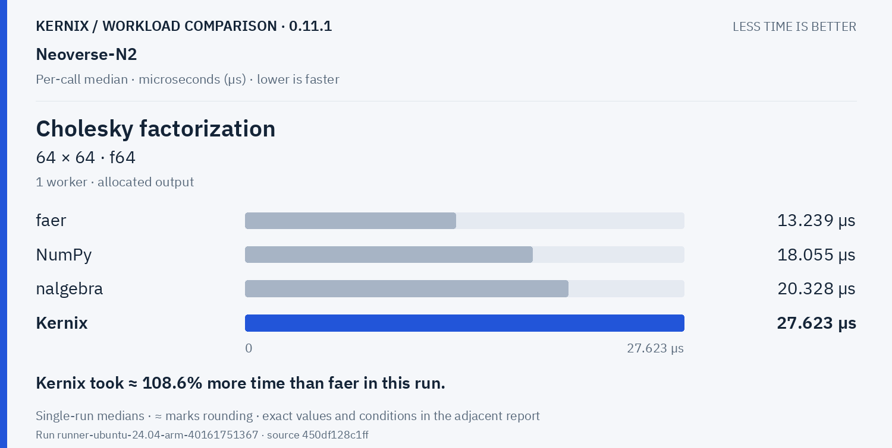

Kernix: **27.623 µs**. Kernix took ≈ 108.6% more time than faer in this run.

**Cholesky factorization · 128 × 128 · f64**

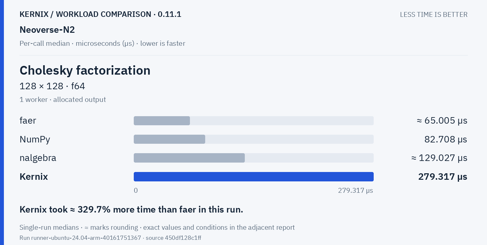

Kernix: **279.317 µs**. Kernix took ≈ 329.7% more time than faer in this run.

**Cholesky factorization · 256 × 256 · f64**

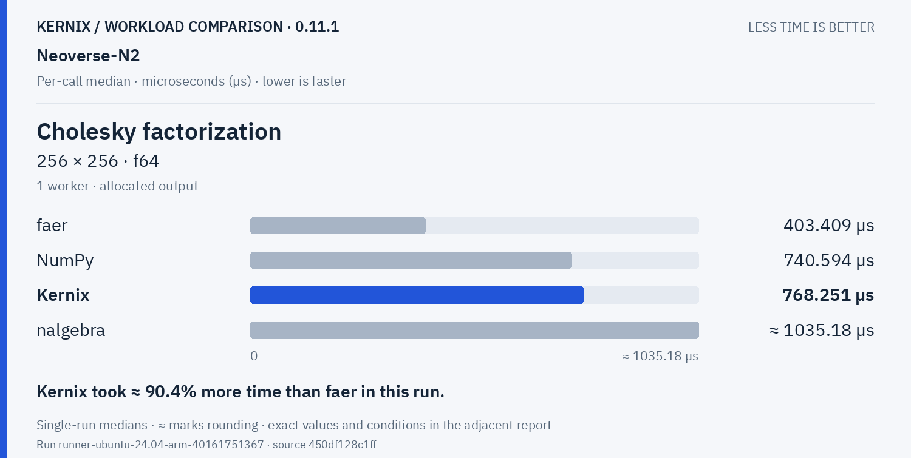

Kernix: **768.251 µs**. Kernix took ≈ 90.4% more time than faer in this run.

Training & autodiff · 6 workloads

**Shared-variable backward · sum(X * X), 64 × 32; prepared graph · f64**

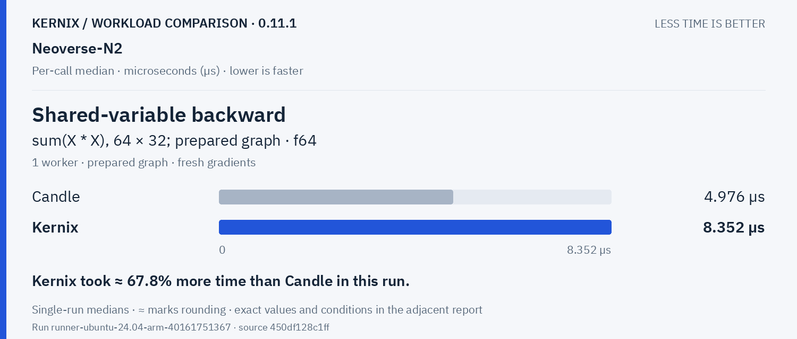

Kernix: **8.352 µs**. Kernix took ≈ 67.8% more time than Candle in this run.

**Record + backward · sum(A · W), 32 × 16 · 16 × 8 · f64**

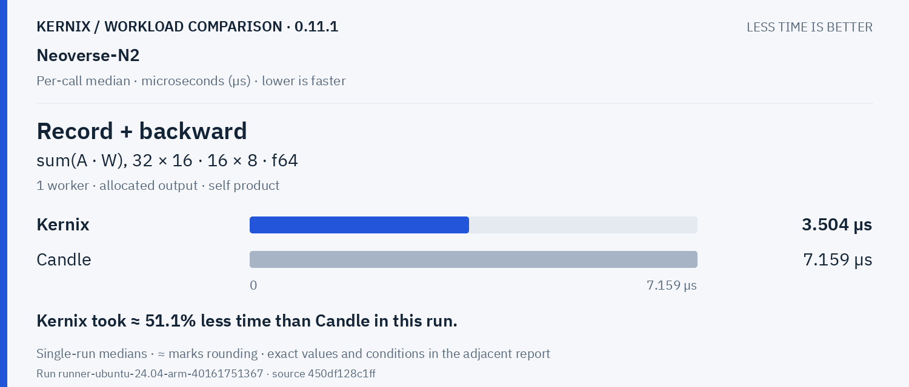

Kernix: **3.504 µs**. Kernix took ≈ 51.1% less time than Candle in this run.

**Model inference · batched normalized/sliced MLP · f64**

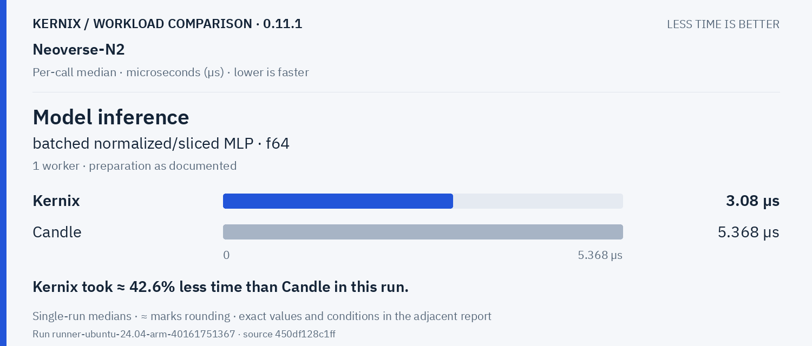

Kernix: **3.08 µs**. Kernix took ≈ 42.6% less time than Candle in this run.

**Model recording + forward · batched normalized/sliced MLP · f64**

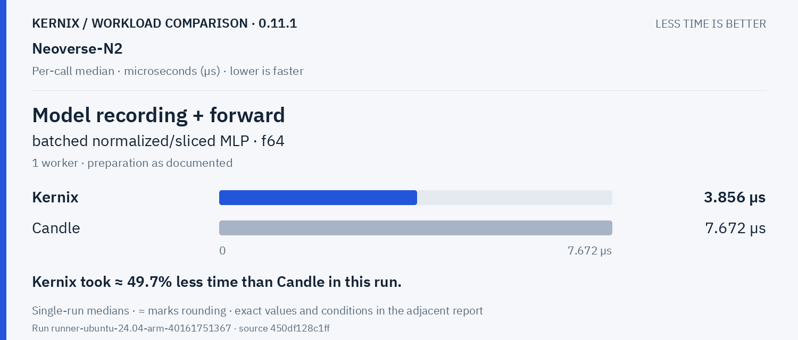

Kernix: **3.856 µs**. Kernix took ≈ 49.7% less time than Candle in this run.

**Model backward · prepared graph → fresh gradients · f64**

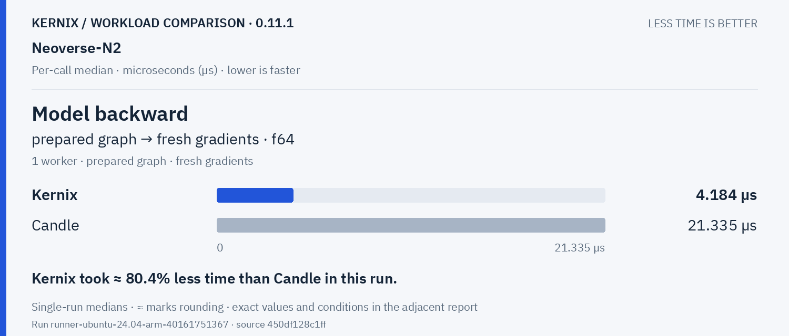

Kernix: **4.184 µs**. Kernix took ≈ 80.4% less time than Candle in this run.

**Parameter update · transactional SGD, fixed gradients · f64**

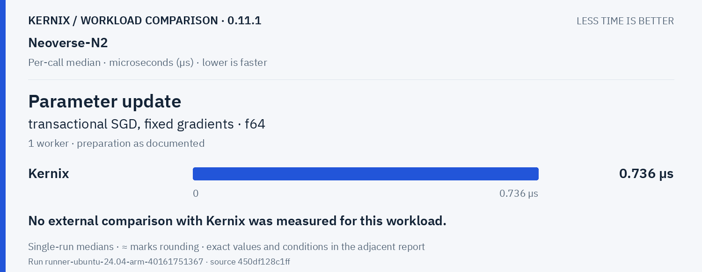

Kernix: **0.736 µs**. No external comparison with Kernix was measured for this workload.

Tensor contractions · 1 workloads

**Coalesced tensor contraction · 16 × 32 × 8 · 32 × 8 × 16 · f64**

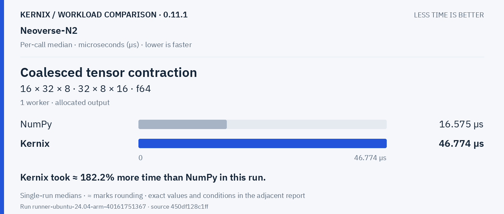

Kernix: **46.774 µs**. Kernix took ≈ 182.2% more time than NumPy in this run.

Statistics & activations · 1 workloads

**Row softmax · 256 × 64 · f64**

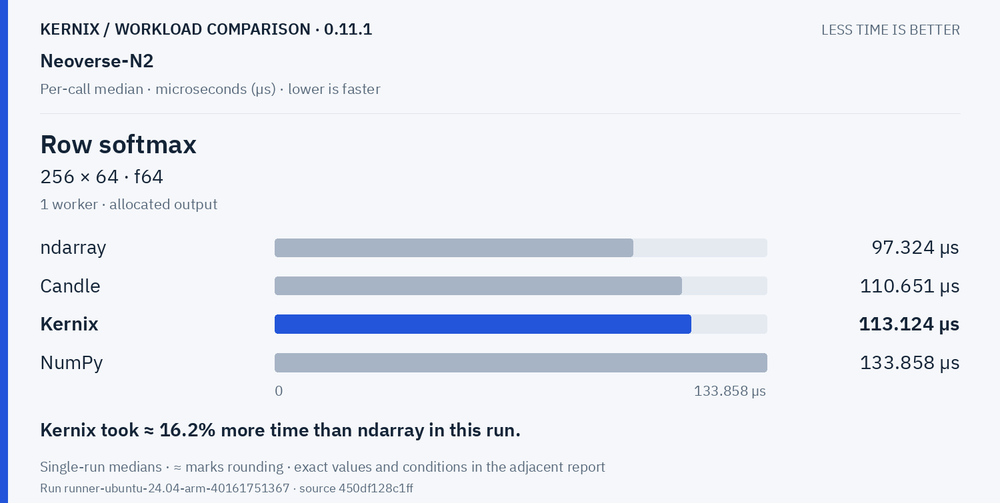

Kernix: **113.124 µs**. Kernix took ≈ 16.2% more time than ndarray in this run.

Tensor construction · 2 workloads

**Create zeros · 64 × 64 · f32**

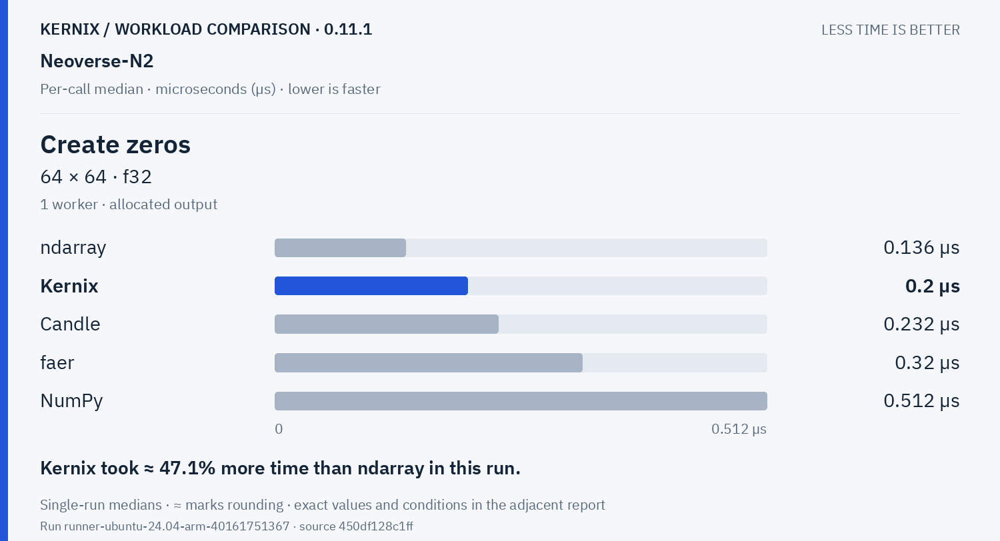

Kernix: **0.2 µs**. Kernix took ≈ 47.1% more time than ndarray in this run.

**Create ones · 64 × 64 · f32**

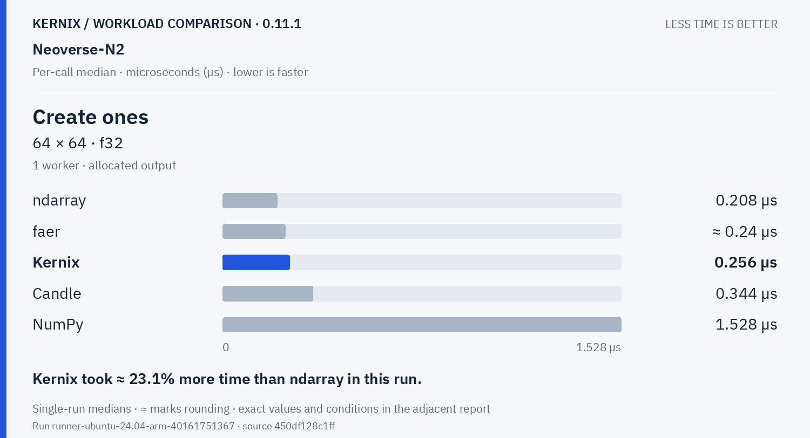

Kernix: **0.256 µs**. Kernix took ≈ 23.1% more time than ndarray in this run.

## Exact latency table

All values below are microseconds per operation. **Lower is faster.** Missing entries were not measured.

| Workload | Kernix | ndarray | nalgebra | faer | Candle | NumPy | Sequential run change |
|---|---:|---:|---:|---:|---:|---:|---:|
| Independent matrix operands · 128 × 128 · 128 × 128 · f64 | **169.105** | — | — | — | — | 195.439 | +0.2% |
| Independent matrix operands · 128 × 128 · 128 × 128 · f32 | **85.629** | — | — | — | — | 100.061 | +0.1% |
| Matrix multiplication · 32 × 32 · 32 × 32 · f64 | 3.248 | **3.048** | 3.223 | 3.496 | 3.448 | 8.223 | +0.5% |
| Matrix multiplication · 64 × 64 · 64 × 64 · f64 | 22.215 | **21.807** | 22.455 | 22.647 | 22.504 | 31.055 | -0.1% |
| Matrix multiplication · 128 × 128 · 128 × 128 · f64 | **168.033** | 208.863 | 209.064 | 168.731 | 168.273 | 194.662 | +0.0% |
| Matrix multiplication · 256 × 256 · 256 × 256 · f64 | **1318.796** | 1322.459 | 1327.137 | 1536.267 | 1321.246 | 1463.074 | -0.1% |
| Matrix multiplication · 64 × 64 · 64 × 64 · f32 | 11.775 | **11.255** | 11.28 | 12.288 | 11.943 | 20.103 | +0.2% |
| Matrix multiplication · 128 × 128 · 128 × 128 · f32 | **85.421** | 94.036 | 93.892 | 86.934 | 85.965 | 99.9 | +0.1% |
| Matrix multiplication · 256 × 256 · 256 × 256 · f32 | **661.83** | 766.241 | 756.525 | 673.781 | 751.156 | 722.591 | +0.2% |
| Batched multiplication · 4 × 16 × 32 · 1 × 32 × 16 · f64 | **3.832** | — | — | — | 4.432 | 12.991 | -0.8% |
| Batched multiplication · 4 × 16 × 32 · 1 × 32 × 16 · f32 | **2.4** | — | — | — | 2.88 | 5.144 | +0.7% |
| Matmul · 2 workers · reused output · 64 × 64 · 64 × 64 · f64 | 16.575 | — | — | — | — | — | +0.6% |
| Matmul · 2 workers · reused output · 128 × 128 · 128 × 128 · f64 | 92.156 | — | — | — | — | — | +0.0% |
| Matmul · 2 workers · reused output · 256 × 256 · 256 × 256 · f64 | 698.289 | — | — | — | — | — | -0.3% |
| Matmul · 2 workers · reused output · 128 × 128 · 128 × 128 · f32 | 48.67 | — | — | — | — | — | -0.5% |
| Cholesky factorization · 512 × 512 · f64 | 4344.642 | — | 8552.152 | **2645.05** | — | 3955.885 | -0.1% |
| Column-pivoted QR · 96 × 32 · f64 | 88.317 | — | 114.235 | **62.26199999999999** | — | — | -0.6% |
| Column-pivoted QR · 256 × 64 · f64 | 784.075 | — | 1149.984 | **473.365** | — | — | -0.3% |
| Minimum-norm least squares · 64 × 32, rank 16, 4 RHS · f64 | **72.413** | — | 116.948 | — | — | 93.668 | -0.2% |
| Minimum-norm least squares · 32 × 64, rank 32, 4 RHS · f64 | **96.356** | — | 219.32 | — | — | 176.289 | -0.0% |
| Thin QR · 96 × 32 · f64 | 71.838 | — | **61.33300000000001** | 65.16500000000001 | — | 66.414 | +0.1% |
| Thin QR · 256 × 64 · f64 | 697.636 | — | 586.032 | **445.277** | — | 572.585 | +0.3% |
| Cholesky factorization · 64 × 64 · f64 | 27.623 | — | 20.328 | **13.239** | — | 18.055 | +1.2% |
| Cholesky factorization · 128 × 128 · f64 | 279.317 | — | 129.02700000000001 | **65.00500000000001** | — | 82.708 | -0.5% |
| Cholesky factorization · 256 × 256 · f64 | 768.251 | — | 1035.177 | **403.409** | — | 740.594 | -0.0% |
| Shared-variable backward · sum(X * X), 64 × 32; prepared graph · f64 | 8.352 | — | — | — | **4.976** | — | -0.7% |
| Record + backward · sum(A · W), 32 × 16 · 16 × 8 · f64 | **3.504** | — | — | — | 7.159 | — | +0.0% |
| Model inference · batched normalized/sliced MLP · f64 | **3.08** | — | — | — | 5.368 | — | +0.3% |
| Model recording + forward · batched normalized/sliced MLP · f64 | **3.856** | — | — | — | 7.672 | — | +0.8% |
| Model backward · prepared graph → fresh gradients · f64 | **4.184** | — | — | — | 21.335 | — | +0.0% |
| Parameter update · transactional SGD, fixed gradients · f64 | 0.736 | — | — | — | — | — | +1.1% |
| Coalesced tensor contraction · 16 × 32 × 8 · 32 × 8 × 16 · f64 | 46.774 | — | — | — | — | **16.575** | +0.0% |
| Row softmax · 256 × 64 · f64 | 113.124 | **97.324** | — | — | 110.651 | 133.858 | +0.0% |
| Create zeros · 64 × 64 · f32 | 0.2 | **0.136** | — | 0.32 | 0.232 | 0.512 | +0.0% |
| Create ones · 64 × 64 · f32 | 0.256 | **0.208** | — | 0.23999999999999997 | 0.344 | 1.528 | +0.0% |

## Version comparison

16 of 35 workloads have paired evidence. Exploratory 95% intervals resample process pairs, not calls. No multiple-comparison adjustment.

### Version changes at a glance

The vertical line marks unchanged time. Left is faster; right is slower. Ranges are exploratory 95% intervals over fresh-process pairs. An interval crossing the line leaves direction unclear.

| Workload | Current / baseline [95% interval] | Interpretation |
|---|---:|---|
| Independent matrix operands · 128 × 128 · 128 × 128 · f64 | 0.9996209159618072× [0.9968862813218238, 1.003373351119016] | Timing direction unclear |
| Independent matrix operands · 128 × 128 · 128 × 128 · f32 | 1.0001749760866014× [0.9966533344216799, 1.0017720987711893] | Timing direction unclear |
| Matrix multiplication · 32 × 32 · 32 × 32 · f64 | 0.9975369458128078× [0.995085995085995, 1.002469135802469] | Timing direction unclear |
| Matrix multiplication · 64 × 64 · 64 × 64 · f64 | — | No paired comparison |
| Matrix multiplication · 128 × 128 · 128 × 128 · f64 | 1.0004237364001505× [0.9950299033165496, 1.0027191413237926] | Timing direction unclear |
| Matrix multiplication · 256 × 256 · 256 × 256 · f64 | 1.0009046751669703× [0.9990133896044252, 1.0019451996064153] | Timing direction unclear |
| Matrix multiplication · 64 × 64 · 64 × 64 · f32 | — | No paired comparison |
| Matrix multiplication · 128 × 128 · 128 × 128 · f32 | 0.9988765885739697× [0.9974782263525346, 1.00074901107132] | Timing direction unclear |
| Matrix multiplication · 256 × 256 · 256 × 256 · f32 | 1.0025442864866585× [0.997745055627488, 1.0037790825210626] | Timing direction unclear |
| Batched multiplication · 4 × 16 × 32 · 1 × 32 × 16 · f64 | 1× [0.9979209979209976, 1.0020876826722338] | Timing direction unclear |
| Batched multiplication · 4 × 16 × 32 · 1 × 32 × 16 · f32 | 1.0066889632107023× [1, 1.0067114093959733] | Timing direction unclear |
| Matmul · 2 workers · reused output · 64 × 64 · 64 × 64 · f64 | — | No paired comparison |
| Matmul · 2 workers · reused output · 128 × 128 · 128 × 128 · f64 | 1.0075606057275983× [0.9775864660039932, 1.0349407616669952] | Timing direction unclear |
| Matmul · 2 workers · reused output · 256 × 256 · 256 × 256 · f64 | 0.9969792279009496× [0.9902385219515536, 1.0019951031910102] | Timing direction unclear |
| Matmul · 2 workers · reused output · 128 × 128 · 128 × 128 · f32 | 1.0001844035569398× [0.9954224992336773, 1.0014575763174642] | Timing direction unclear |
| Cholesky factorization · 512 × 512 · f64 | 0.9949989260086665× [0.9933922773224124, 0.9990776670261271] | Observed time reduction |
| Column-pivoted QR · 96 × 32 · f64 | — | No paired comparison |
| Column-pivoted QR · 256 × 64 · f64 | — | No paired comparison |
| Minimum-norm least squares · 64 × 32, rank 16, 4 RHS · f64 | — | No paired comparison |
| Minimum-norm least squares · 32 × 64, rank 32, 4 RHS · f64 | — | No paired comparison |
| Thin QR · 96 × 32 · f64 | — | No paired comparison |
| Thin QR · 256 × 64 · f64 | — | No paired comparison |
| Cholesky factorization · 64 × 64 · f64 | — | No paired comparison |
| Cholesky factorization · 128 × 128 · f64 | 1.0070253462053007× [1.0043716947147794, 1.010413578148842] | Observed time increase |
| Cholesky factorization · 256 × 256 · f64 | 0.9936900729098042× [0.9904663726385025, 0.9961985447269444] | Observed time reduction |
| Shared-variable backward · sum(X * X), 64 × 32; prepared graph · f64 | — | No paired comparison |
| Record + backward · sum(A · W), 32 × 16 · 16 × 8 · f64 | 1× [0.9977220956719818, 1.0045766590389016] | Timing direction unclear |
| Model inference · batched normalized/sliced MLP · f64 | — | No paired comparison |
| Model recording + forward · batched normalized/sliced MLP · f64 | — | No paired comparison |
| Model backward · prepared graph → fresh gradients · f64 | — | No paired comparison |
| Parameter update · transactional SGD, fixed gradients · f64 | — | No paired comparison |
| Coalesced tensor contraction · 16 × 32 × 8 · 32 × 8 × 16 · f64 | — | No paired comparison |
| Row softmax · 256 × 64 · f64 | — | No paired comparison |
| Create zeros · 64 × 64 · f32 | — | No paired comparison |
| Create ones · 64 × 64 · f32 | — | No paired comparison |

## Method and provenance

CPU affinity pinned to logical CPU 0. Frequency and background load are uncontrolled.

Minimum-norm rows use pivoted QR plus scaled implicit RZ in Kernix; NumPy native lstsq; nalgebra native SVD/solve. Algorithm costs and rank policies differ. See original method for thresholds.

Numbers retain source precision; recorded digits do not imply equivalent physical measurement accuracy. Lowest observed medians are bold only when peers were measured. No aggregate winner or universal ranking is inferred.

[Original report and commentary](original-report.txt) · [Raw measurements](raw.json)

Measured source `450df128c1ffb55a9a861230edb6b9a5ac3ef5b4`. Run `runner-ubuntu-24.04-arm-40161751367`. Rendering does not change measurements.
