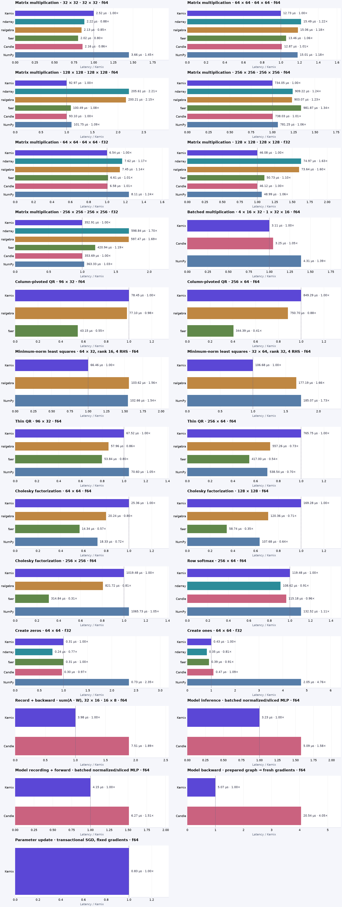

# Kernix 0.9.0 · CPU benchmarks

AMD EPYC 7763 64-Core Processor · one BLAS/Rayon thread · allocation-inclusive · warmed individual calls

**Microseconds per call, median. Lower is faster; bold marks the lowest observed median in each row.**

No previous-version baseline is paired with this view.

| Workload | Kernix | ndarray | nalgebra | faer | Candle | NumPy |
|---|---:|---:|---:|---:|---:|---:|
| Matrix multiplication · 32 × 32 · 32 × 32 · f64 | 2.524 | 2.224 | 2.134 | **2.024** | 2.164 | 3.656 |
| Matrix multiplication · 64 × 64 · 64 × 64 · f64 | **12.734** | 15.489 | 15.058 | 13.455 | 12.874 | 15.008 |
| Matrix multiplication · 128 × 128 · 128 × 128 · f64 | **92.974** | 205.613 | 200.213 | 100.487 | 93.103 | 101.749 |
| Matrix multiplication · 256 × 256 · 256 × 256 · f64 | **734.047** | 909.224 | 903.072 | 981.868 | 738.034 | 781.254 |
| Matrix multiplication · 64 × 64 · 64 × 64 · f32 | **6.543** | 7.624 | 7.453 | 6.612 | 6.583 | 8.105 |
| Matrix multiplication · 128 × 128 · 128 × 128 · f32 | **46.076** | 74.969 | 73.637 | 50.735 | 46.116 | 48.992 |
| Matrix multiplication · 256 × 256 · 256 × 256 · f32 | **352.907** | 598.836 | 597.472 | 420.944 | 353.688 | 363.327 |
| Batched multiplication · 4 × 16 × 32 · 1 × 32 × 16 · f64 | **3.106** | — | — | — | 3.246 | 4.308 |
| Column-pivoted QR · 96 × 32 · f64 | 78.446 | — | 77.104 | **43.151** | — | — |
| Column-pivoted QR · 256 × 64 · f64 | 849.293 | — | 750.699 | **344.391** | — | — |
| Minimum-norm least squares · 64 × 32, rank 16, 4 RHS · f64 | **66.464** | — | 103.623 | — | — | 102.662 |
| Minimum-norm least squares · 32 × 64, rank 32, 4 RHS · f64 | **106.679** | — | 177.190 | — | — | 185.075 |
| Thin QR · 96 × 32 · f64 | 67.516 | — | 57.958 | **53.840** | — | 70.601 |
| Thin QR · 256 × 64 · f64 | 765.747 | — | 557.258 | **416.997** | — | 538.543 |
| Cholesky factorization · 64 × 64 · f64 | 25.357 | — | 20.238 | **14.337** | — | 18.334 |
| Cholesky factorization · 128 × 128 · f64 | 169.285 | — | 120.364 | **58.740** | — | 107.680 |
| Cholesky factorization · 256 × 256 · f64 | 1019.479 | — | 821.720 | **314.836** | — | 1065.726 |
| Row softmax · 256 × 64 · f64 | 119.483 | **108.622** | — | — | 115.184 | 132.517 |
| Create zeros · 64 × 64 · f32 | 0.311 | **0.240** | — | 0.311 | 0.301 | 0.732 |
| Create ones · 64 × 64 · f32 | 0.431 | **0.351** | — | 0.391 | 0.471 | 2.053 |
| Record + backward · sum(A · W), 32 × 16 · 16 × 8 · f64 | **3.977** | — | — | — | 7.514 | — |
| Model inference · batched normalized/sliced MLP · f64 | **3.226** | — | — | — | 5.089 | — |
| Model recording + forward · batched normalized/sliced MLP · f64 | **4.148** | — | — | — | 6.272 | — |
| Model backward · prepared graph → fresh gradients · f64 | **5.069** | — | — | — | 20.538 | — |
| Parameter update · transactional SGD, fixed gradients · f64 | **0.831** | — | — | — | — | — |

Each panel has its own scale. Ratios are library / Kernix median; below 1 means the comparator was faster.

## Reading these results

Minimum-norm rows include factorization and four RHS. Kernix uses pivoted/right QR; NumPy uses native lstsq; nalgebra uses native SVD/solve. Fixtures have a wide rank gap; null-space orthogonality and normal residual are validated independently. Algorithm costs and rank policies differ; see DETAILS.md for thresholds. These are not general SVD comparisons.

- One measured host and one BLAS/Rayon thread. CPU affinity pinned to logical CPU 0. Frequency and background load are uncontrolled; these observations establish no universal ranking.
- Timing includes output allocation and destruction. Inputs and imports are prepared outside timing. GEMM inputs are row-major; output layout and validation contracts can differ by library.
- Per-call p95 describes 256 individual warmed calls. The 15 batch means form a separate distribution; neither is a confidence interval.
- Rust allocation probes use a separate instrumented binary. Native engines may retain packing buffers; warmed probes exclude their first-use allocation and retention. NumPy native allocations are unavailable, never zero.

[Interactive report](report.html) · [Detailed measurements and method](DETAILS.md) · [Raw samples and provenance](raw.json) · [Printable chart](latency.pdf)

Measured source `9b7ef492c99bf2202e7eb3b07a79ef8f108991c7`. Run `runner-ubuntu-latest-39980084433`. Rendering does not remeasure or modify raw evidence.
