# Kernix 0.11.1 · performance brief

AMD EPYC 7763 64-Core Processor / Linux

**Per-call median, microseconds per operation. Lower is faster. All recorded digits retained.**

35 workloads · 119 observations

Baseline: baseline-ubuntu-latest-40161751367. Sequential run changes are descriptive; paired process evidence is shown separately.

[Interactive HTML (open locally)](report.html) · [Vector PDF](latency.pdf) · [Raw measurements](raw.json)

## Charts by workload

**Shorter bars mean less time.** Blue is Kernix; grey is a comparison implementation; teal is an explicitly selected Kernix backend. Entries are sorted by the recorded median, with a separate zero-based scale per chart. These point observations do not establish a statistical ranking.

Expand a group to see every chart here on GitHub. Click a chart to enlarge it. The exact table below keeps every source digit.

Matrix multiplication · 11 workloads

**Independent matrix operands · 128 × 128 · 128 × 128 · f64**

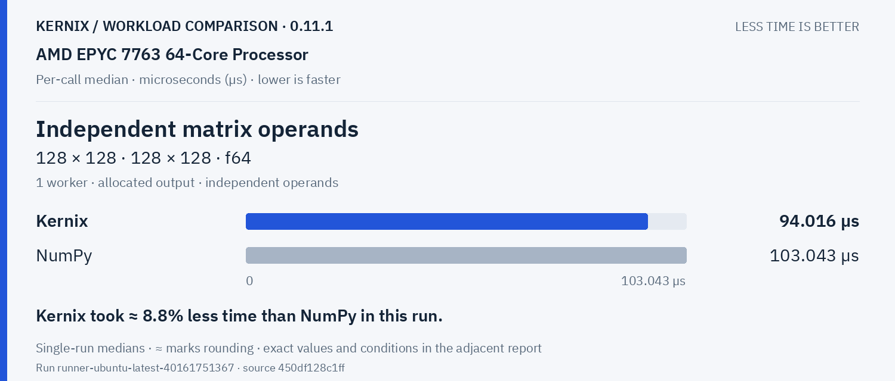

Kernix: **94.016 µs**. Kernix took ≈ 8.8% less time than NumPy in this run.

**Independent matrix operands · 128 × 128 · 128 × 128 · f32**

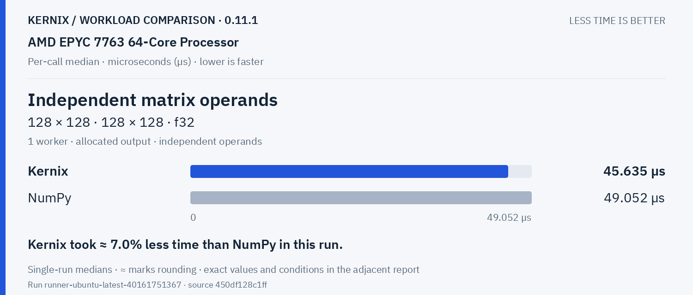

Kernix: **45.635 µs**. Kernix took ≈ 7.0% less time than NumPy in this run.

**Matrix multiplication · 32 × 32 · 32 × 32 · f64**

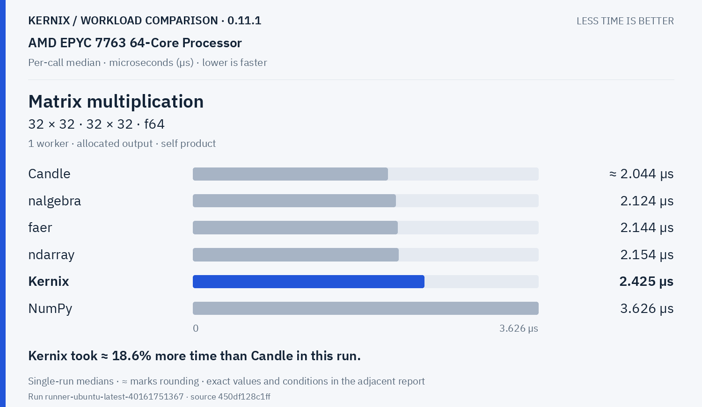

Kernix: **2.425 µs**. Kernix took ≈ 18.6% more time than Candle in this run.

**Matrix multiplication · 64 × 64 · 64 × 64 · f64**

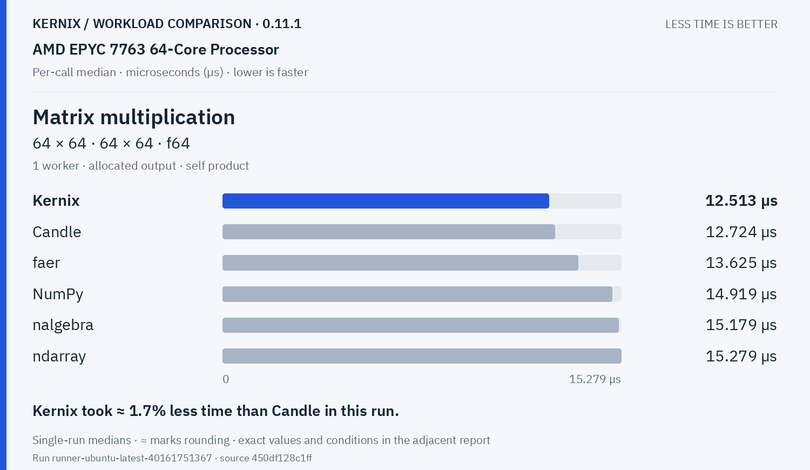

Kernix: **12.513 µs**. Kernix took ≈ 1.7% less time than Candle in this run.

**Matrix multiplication · 128 × 128 · 128 × 128 · f64**

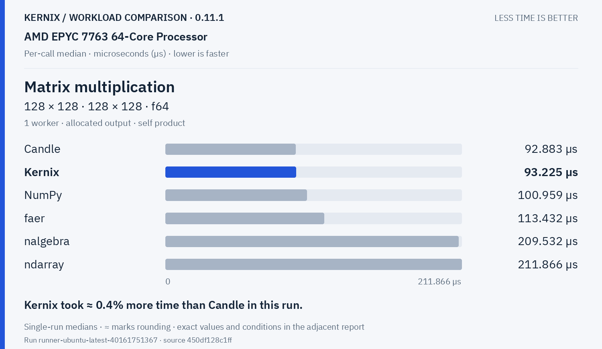

Kernix: **93.225 µs**. Kernix took ≈ 0.4% more time than Candle in this run.

**Matrix multiplication · 256 × 256 · 256 × 256 · f64**

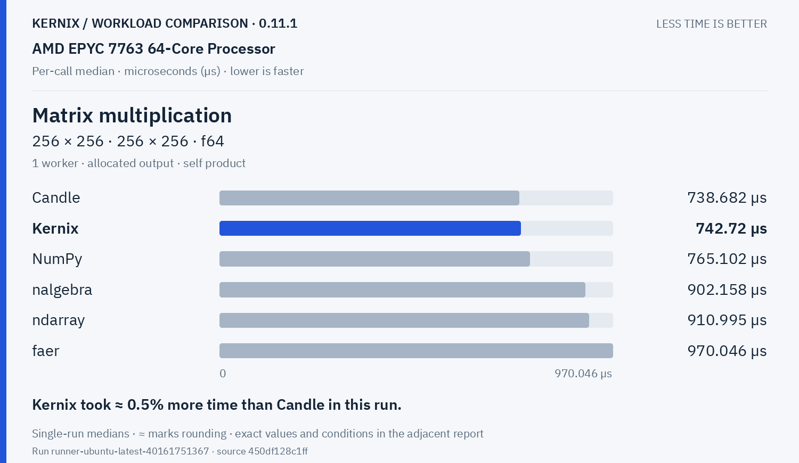

Kernix: **742.72 µs**. Kernix took ≈ 0.5% more time than Candle in this run.

**Matrix multiplication · 64 × 64 · 64 × 64 · f32**

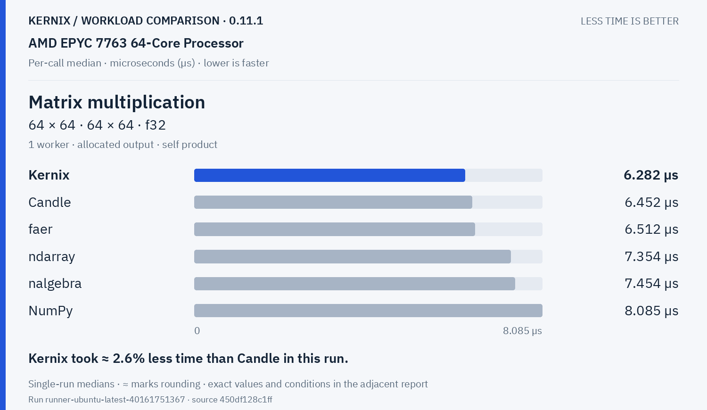

Kernix: **6.282 µs**. Kernix took ≈ 2.6% less time than Candle in this run.

**Matrix multiplication · 128 × 128 · 128 × 128 · f32**

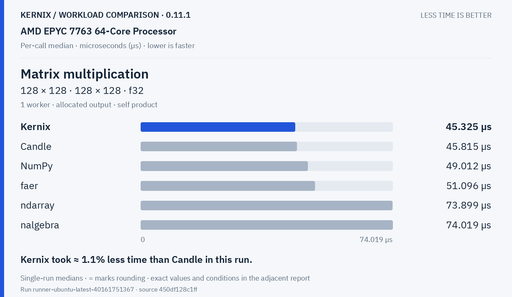

Kernix: **45.325 µs**. Kernix took ≈ 1.1% less time than Candle in this run.

**Matrix multiplication · 256 × 256 · 256 × 256 · f32**

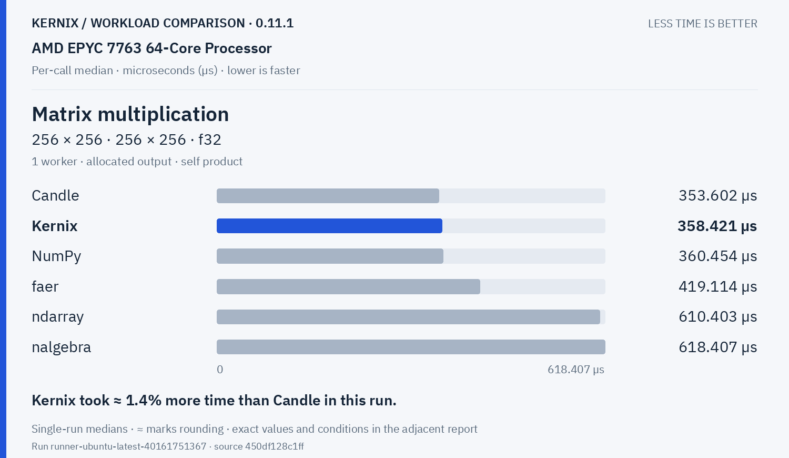

Kernix: **358.421 µs**. Kernix took ≈ 1.4% more time than Candle in this run.

**Batched multiplication · 4 × 16 × 32 · 1 × 32 × 16 · f64**

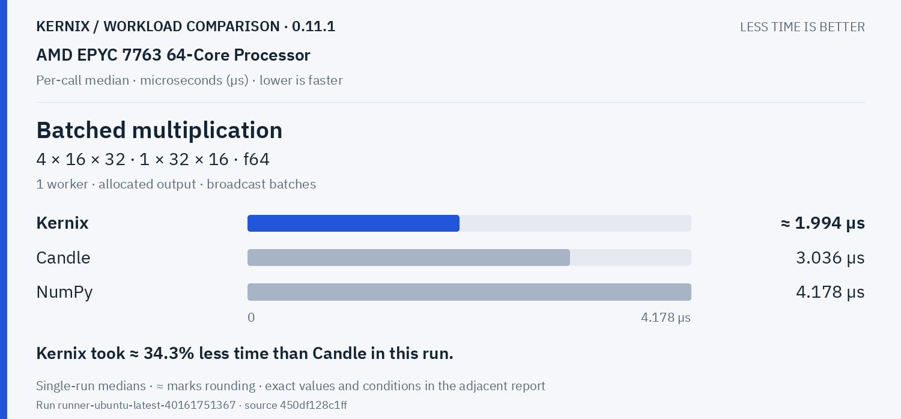

Kernix: **1.9939999999999998 µs**. Kernix took ≈ 34.3% less time than Candle in this run.

**Batched multiplication · 4 × 16 × 32 · 1 × 32 × 16 · f32**

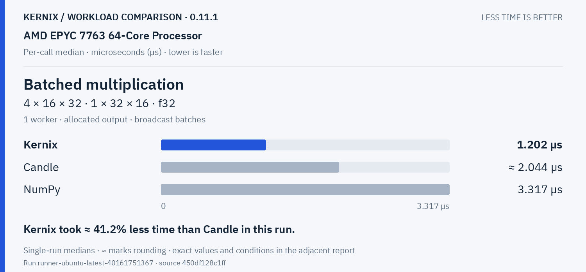

Kernix: **1.202 µs**. Kernix took ≈ 41.2% less time than Candle in this run.

Explicit parallel execution · 4 workloads

**Matmul · 2 workers · reused output · 64 × 64 · 64 × 64 · f64**

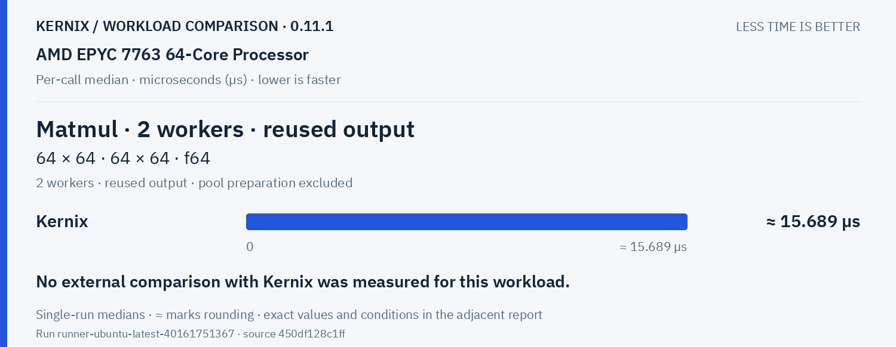

Kernix: **15.688999999999998 µs**. No external comparison with Kernix was measured for this workload.

**Matmul · 2 workers · reused output · 128 × 128 · 128 × 128 · f64**

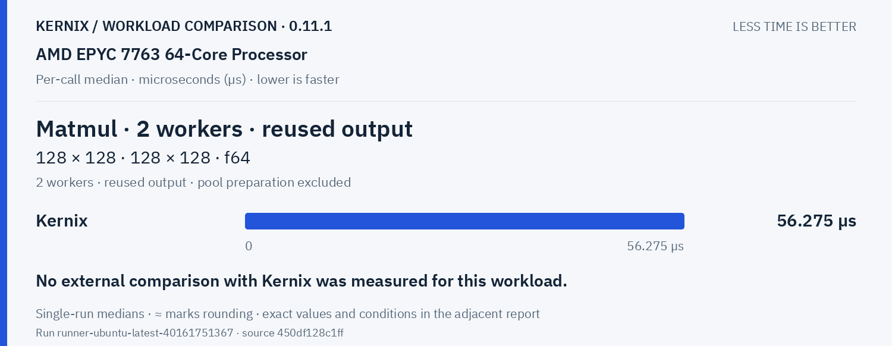

Kernix: **56.275 µs**. No external comparison with Kernix was measured for this workload.

**Matmul · 2 workers · reused output · 256 × 256 · 256 × 256 · f64**

Kernix: **401.331 µs**. No external comparison with Kernix was measured for this workload.

**Matmul · 2 workers · reused output · 128 × 128 · 128 × 128 · f32**

Kernix: **31.167999999999996 µs**. No external comparison with Kernix was measured for this workload.

Decompositions & solvers · 10 workloads

**Cholesky factorization · 512 × 512 · f64**

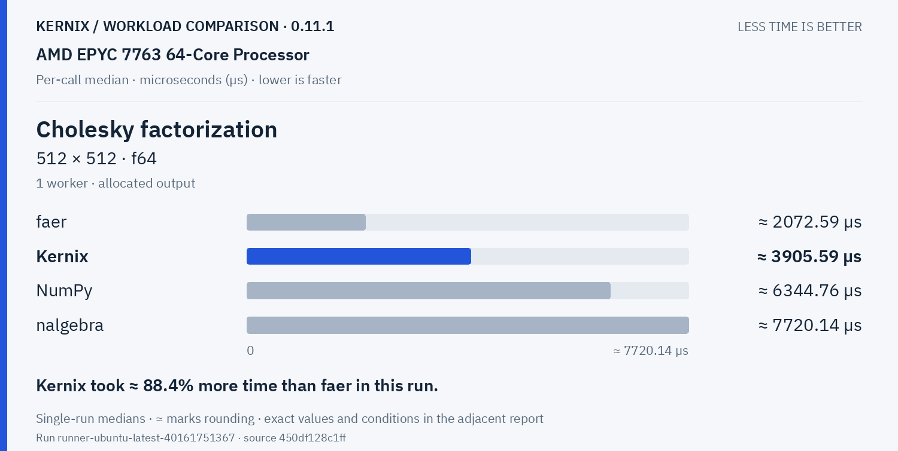

Kernix: **3905.588 µs**. Kernix took ≈ 88.4% more time than faer in this run.

**Column-pivoted QR · 96 × 32 · f64**

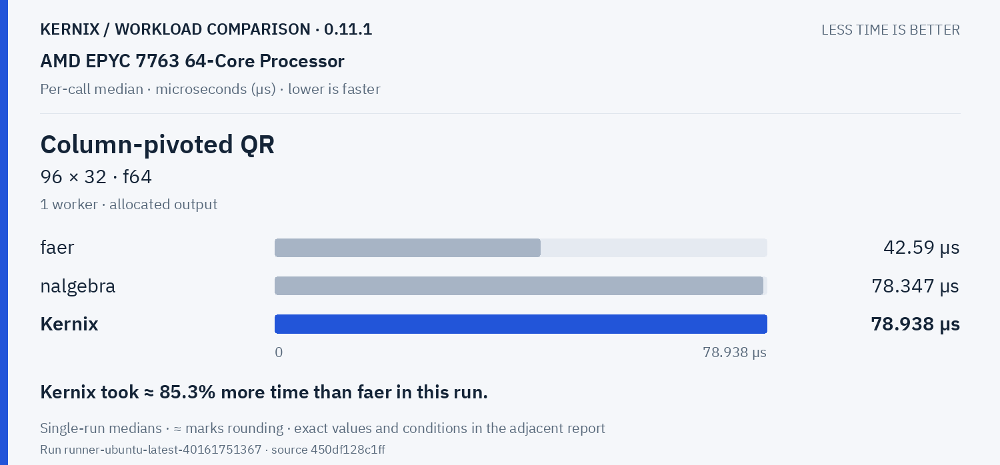

Kernix: **78.938 µs**. Kernix took ≈ 85.3% more time than faer in this run.

**Column-pivoted QR · 256 × 64 · f64**

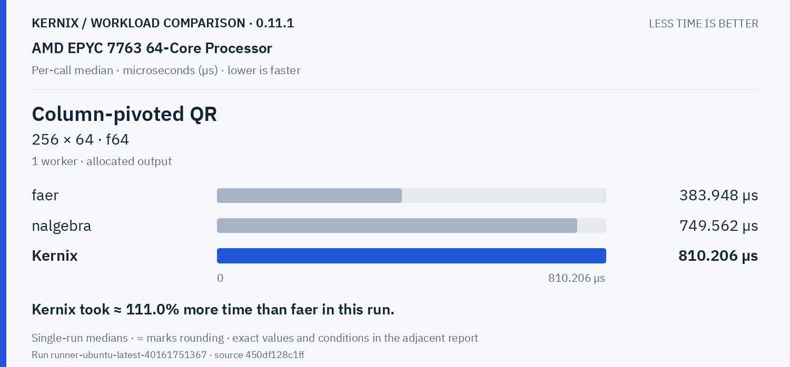

Kernix: **810.206 µs**. Kernix took ≈ 111.0% more time than faer in this run.

**Minimum-norm least squares · 64 × 32, rank 16, 4 RHS · f64**

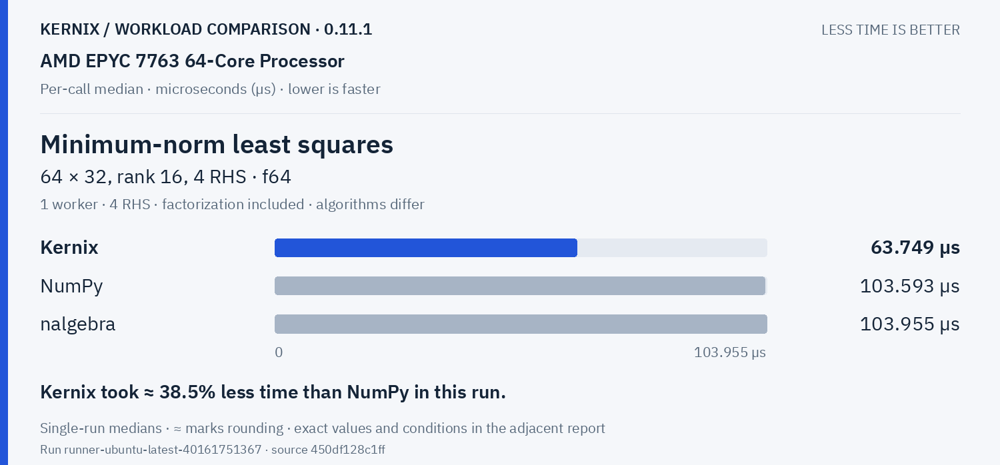

Kernix: **63.749 µs**. Kernix took ≈ 38.5% less time than NumPy in this run.

**Minimum-norm least squares · 32 × 64, rank 32, 4 RHS · f64**

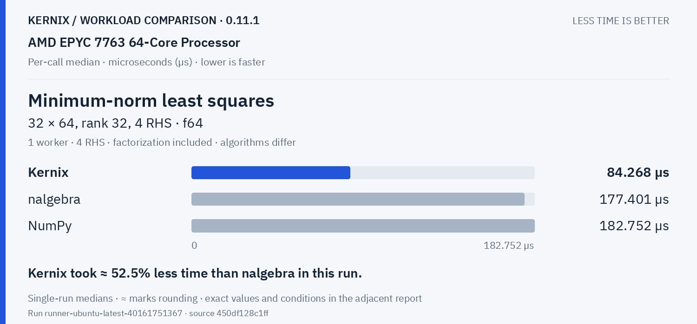

Kernix: **84.268 µs**. Kernix took ≈ 52.5% less time than nalgebra in this run.

**Thin QR · 96 × 32 · f64**

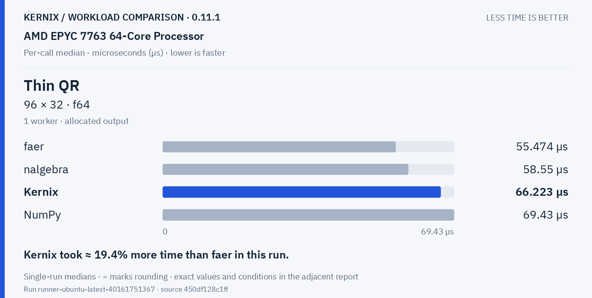

Kernix: **66.223 µs**. Kernix took ≈ 19.4% more time than faer in this run.

**Thin QR · 256 × 64 · f64**

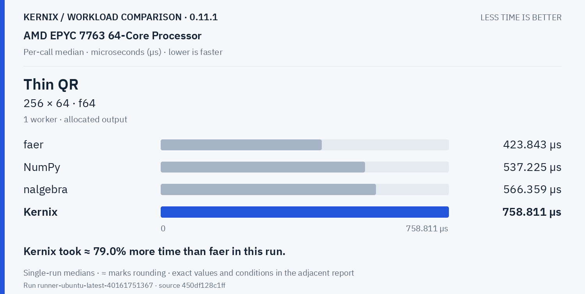

Kernix: **758.811 µs**. Kernix took ≈ 79.0% more time than faer in this run.

**Cholesky factorization · 64 × 64 · f64**

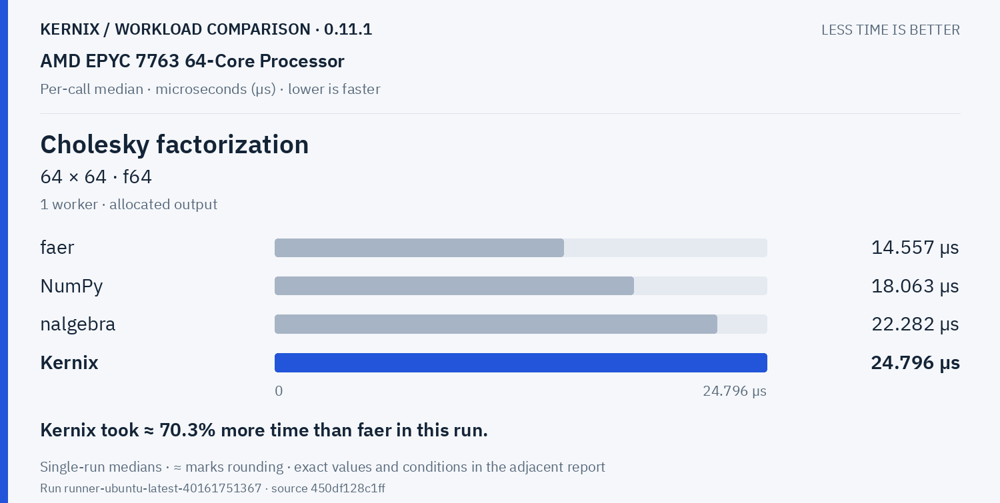

Kernix: **24.796 µs**. Kernix took ≈ 70.3% more time than faer in this run.

**Cholesky factorization · 128 × 128 · f64**

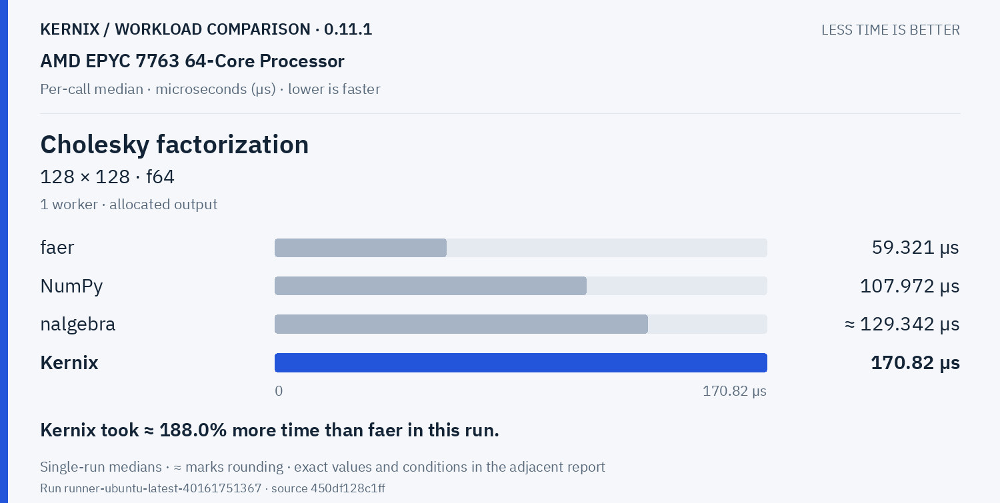

Kernix: **170.82 µs**. Kernix took ≈ 188.0% more time than faer in this run.

**Cholesky factorization · 256 × 256 · f64**

Kernix: **690.612 µs**. Kernix took ≈ 120.9% more time than faer in this run.

Training & autodiff · 6 workloads

**Shared-variable backward · sum(X * X), 64 × 32; prepared graph · f64**

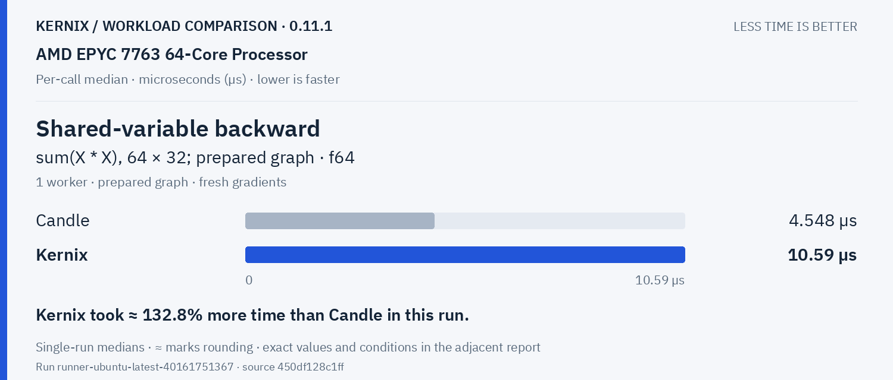

Kernix: **10.59 µs**. Kernix took ≈ 132.8% more time than Candle in this run.

**Record + backward · sum(A · W), 32 × 16 · 16 × 8 · f64**

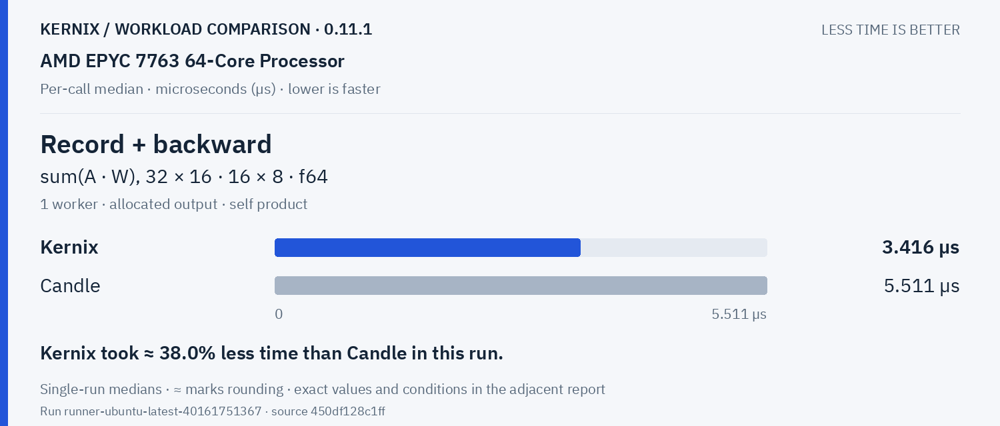

Kernix: **3.416 µs**. Kernix took ≈ 38.0% less time than Candle in this run.

**Model inference · batched normalized/sliced MLP · f64**

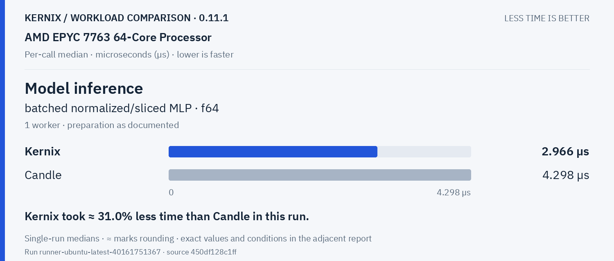

Kernix: **2.966 µs**. Kernix took ≈ 31.0% less time than Candle in this run.

**Model recording + forward · batched normalized/sliced MLP · f64**

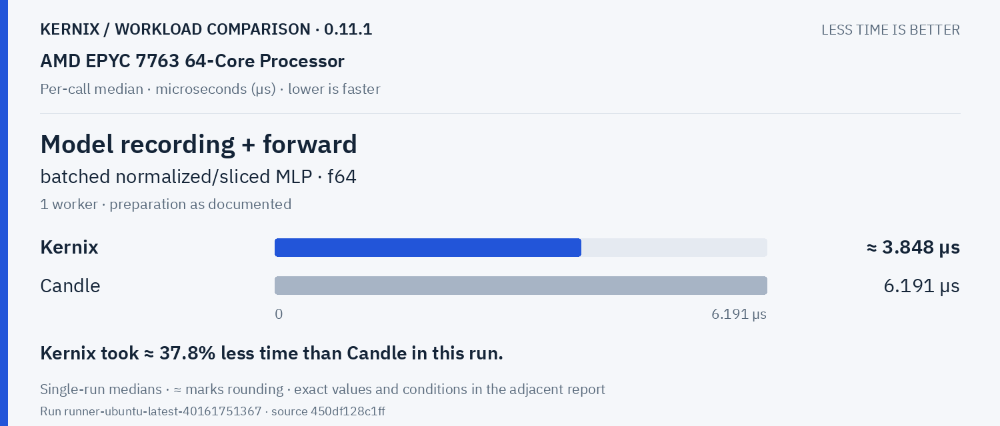

Kernix: **3.8480000000000005 µs**. Kernix took ≈ 37.8% less time than Candle in this run.

**Model backward · prepared graph → fresh gradients · f64**

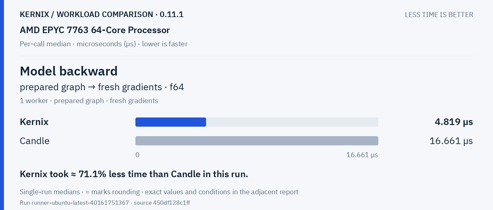

Kernix: **4.819 µs**. Kernix took ≈ 71.1% less time than Candle in this run.

**Parameter update · transactional SGD, fixed gradients · f64**

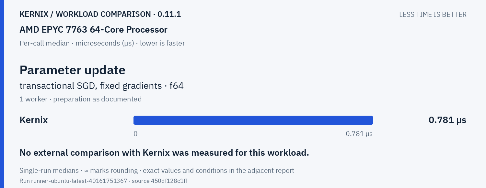

Kernix: **0.781 µs**. No external comparison with Kernix was measured for this workload.

Tensor contractions · 1 workloads

**Coalesced tensor contraction · 16 × 32 × 8 · 32 × 8 × 16 · f64**

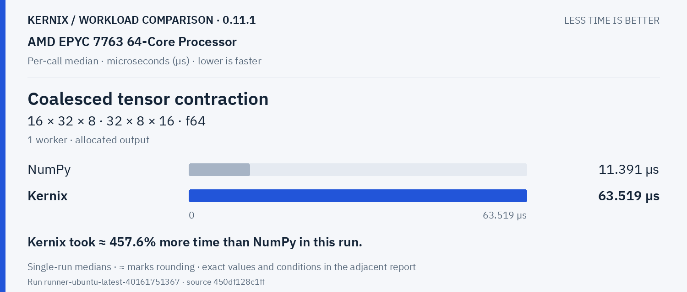

Kernix: **63.519 µs**. Kernix took ≈ 457.6% more time than NumPy in this run.

Statistics & activations · 1 workloads

**Row softmax · 256 × 64 · f64**

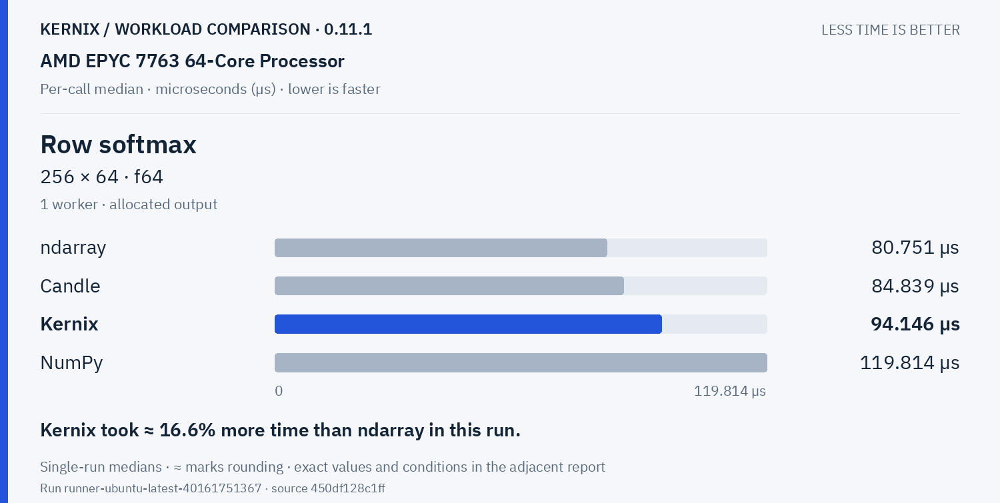

Kernix: **94.146 µs**. Kernix took ≈ 16.6% more time than ndarray in this run.

Tensor construction · 2 workloads

**Create zeros · 64 × 64 · f32**

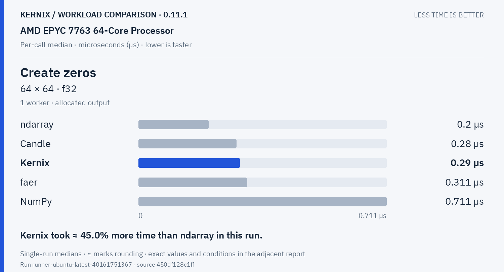

Kernix: **0.29 µs**. Kernix took ≈ 45.0% more time than ndarray in this run.

**Create ones · 64 × 64 · f32**

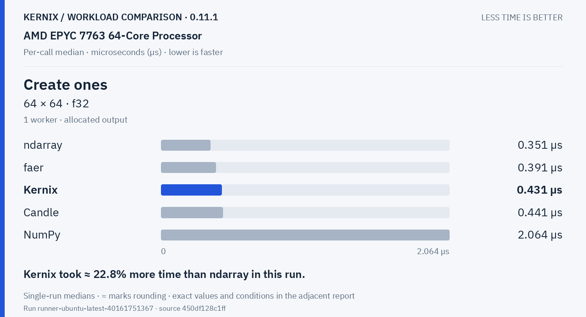

Kernix: **0.431 µs**. Kernix took ≈ 22.8% more time than ndarray in this run.

## Exact latency table

All values below are microseconds per operation. **Lower is faster.** Missing entries were not measured.

| Workload | Kernix | ndarray | nalgebra | faer | Candle | NumPy | Sequential run change |
|---|---:|---:|---:|---:|---:|---:|---:|
| Independent matrix operands · 128 × 128 · 128 × 128 · f64 | **94.016** | — | — | — | — | 103.043 | +0.6% |
| Independent matrix operands · 128 × 128 · 128 × 128 · f32 | **45.635** | — | — | — | — | 49.052 | +0.3% |
| Matrix multiplication · 32 × 32 · 32 × 32 · f64 | 2.425 | 2.154 | 2.124 | 2.144 | **2.0439999999999998** | 3.626 | -0.8% |
| Matrix multiplication · 64 × 64 · 64 × 64 · f64 | **12.513** | 15.279 | 15.179 | 13.625 | 12.724 | 14.919 | -0.3% |
| Matrix multiplication · 128 × 128 · 128 × 128 · f64 | 93.225 | 211.866 | 209.532 | 113.432 | **92.883** | 100.959 | +1.2% |
| Matrix multiplication · 256 × 256 · 256 × 256 · f64 | 742.72 | 910.995 | 902.158 | 970.046 | **738.682** | 765.102 | +1.1% |
| Matrix multiplication · 64 × 64 · 64 × 64 · f32 | **6.282** | 7.354 | 7.454 | 6.512 | 6.452 | 8.085 | +0.0% |
| Matrix multiplication · 128 × 128 · 128 × 128 · f32 | **45.325** | 73.899 | 74.019 | 51.096 | 45.815 | 49.012 | +0.0% |
| Matrix multiplication · 256 × 256 · 256 × 256 · f32 | 358.421 | 610.403 | 618.407 | 419.114 | **353.602** | 360.454 | +1.4% |
| Batched multiplication · 4 × 16 × 32 · 1 × 32 × 16 · f64 | **1.9939999999999998** | — | — | — | 3.036 | 4.178 | -34.5% |
| Batched multiplication · 4 × 16 × 32 · 1 × 32 × 16 · f32 | **1.202** | — | — | — | 2.0439999999999998 | 3.317 | -41.8% |
| Matmul · 2 workers · reused output · 64 × 64 · 64 × 64 · f64 | 15.688999999999998 | — | — | — | — | — | -2.7% |
| Matmul · 2 workers · reused output · 128 × 128 · 128 × 128 · f64 | 56.275 | — | — | — | — | — | +0.5% |
| Matmul · 2 workers · reused output · 256 × 256 · 256 × 256 · f64 | 401.331 | — | — | — | — | — | +2.5% |
| Matmul · 2 workers · reused output · 128 × 128 · 128 × 128 · f32 | 31.167999999999996 | — | — | — | — | — | -0.1% |
| Cholesky factorization · 512 × 512 · f64 | 3905.588 | — | 7720.137 | **2072.5880000000002** | — | 6344.763 | -0.3% |
| Column-pivoted QR · 96 × 32 · f64 | 78.938 | — | 78.347 | **42.59** | — | — | +0.4% |
| Column-pivoted QR · 256 × 64 · f64 | 810.206 | — | 749.562 | **383.948** | — | — | +1.3% |
| Minimum-norm least squares · 64 × 32, rank 16, 4 RHS · f64 | **63.749** | — | 103.955 | — | — | 103.593 | +2.0% |
| Minimum-norm least squares · 32 × 64, rank 32, 4 RHS · f64 | **84.268** | — | 177.401 | — | — | 182.752 | +0.3% |
| Thin QR · 96 × 32 · f64 | 66.223 | — | 58.55 | **55.474** | — | 69.43 | -2.4% |
| Thin QR · 256 × 64 · f64 | 758.811 | — | 566.359 | **423.843** | — | 537.225 | +0.3% |
| Cholesky factorization · 64 × 64 · f64 | 24.796 | — | 22.282 | **14.557** | — | 18.063 | -1.7% |
| Cholesky factorization · 128 × 128 · f64 | 170.82 | — | 129.34200000000001 | **59.321** | — | 107.972 | +1.0% |
| Cholesky factorization · 256 × 256 · f64 | 690.612 | — | 895.356 | **312.645** | — | 1119.364 | +0.1% |
| Shared-variable backward · sum(X * X), 64 × 32; prepared graph · f64 | 10.59 | — | — | — | **4.548** | — | +2.8% |
| Record + backward · sum(A · W), 32 × 16 · 16 × 8 · f64 | **3.416** | — | — | — | 5.511 | — | -7.1% |
| Model inference · batched normalized/sliced MLP · f64 | **2.966** | — | — | — | 4.298 | — | +1.0% |
| Model recording + forward · batched normalized/sliced MLP · f64 | **3.8480000000000005** | — | — | — | 6.191 | — | +1.3% |
| Model backward · prepared graph → fresh gradients · f64 | **4.819** | — | — | — | 16.661 | — | +1.9% |
| Parameter update · transactional SGD, fixed gradients · f64 | 0.781 | — | — | — | — | — | -1.4% |
| Coalesced tensor contraction · 16 × 32 × 8 · 32 × 8 × 16 · f64 | 63.519 | — | — | — | — | **11.391** | +0.3% |
| Row softmax · 256 × 64 · f64 | 94.146 | **80.751** | — | — | 84.839 | 119.814 | +0.8% |
| Create zeros · 64 × 64 · f32 | 0.29 | **0.2** | — | 0.311 | 0.28 | 0.711 | +0.0% |
| Create ones · 64 × 64 · f32 | 0.431 | **0.351** | — | 0.391 | 0.441 | 2.064 | +0.2% |

## Version comparison

16 of 35 workloads have paired evidence. Exploratory 95% intervals resample process pairs, not calls. No multiple-comparison adjustment.

### Version changes at a glance

The vertical line marks unchanged time. Left is faster; right is slower. Ranges are exploratory 95% intervals over fresh-process pairs. An interval crossing the line leaves direction unclear.

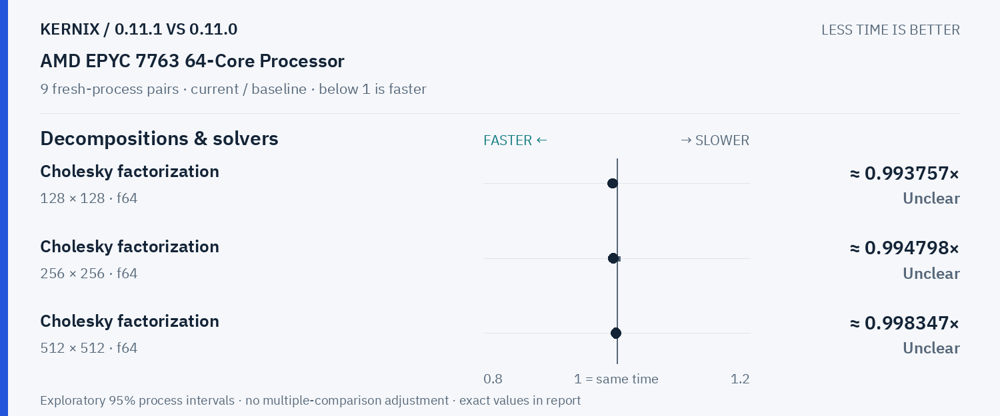

| Workload | Current / baseline [95% interval] | Interpretation |
|---|---:|---|
| Independent matrix operands · 128 × 128 · 128 × 128 · f64 | 1.0073907695598696× [1.0036293584230918, 1.0111569141817014] | Observed time increase |
| Independent matrix operands · 128 × 128 · 128 × 128 · f32 | 1.0028731220528566× [0.9951774102038144, 1.0099328267811916] | Timing direction unclear |
| Matrix multiplication · 32 × 32 · 32 × 32 · f64 | 1.0041407867494825× [1, 1.0045379537953796] | Timing direction unclear |
| Matrix multiplication · 64 × 64 · 64 × 64 · f64 | — | No paired comparison |
| Matrix multiplication · 128 × 128 · 128 × 128 · f64 | 1.0099791109716103× [1.0052981990439502, 1.0114145589878802] | Observed time increase |
| Matrix multiplication · 256 × 256 · 256 × 256 · f64 | 1.006558129554634× [1.0040813729657436, 1.0097556013671134] | Observed time increase |
| Matrix multiplication · 64 × 64 · 64 × 64 · f32 | — | No paired comparison |
| Matrix multiplication · 128 × 128 · 128 × 128 · f32 | 1.000220482857458× [0.9982380795066622, 1.0015236833388539] | Timing direction unclear |
| Matrix multiplication · 256 × 256 · 256 × 256 · f32 | 1.0022646283129366× [1.0001415744780857, 1.0036768129396727] | Observed time increase |
| Batched multiplication · 4 × 16 × 32 · 1 × 32 × 16 · f64 | 0.659749670619236× [0.6589557171183079, 0.6666666666666666] | Observed time reduction |
| Batched multiplication · 4 × 16 × 32 · 1 × 32 × 16 · f32 | 0.5811209439528023× [0.5733855185909981, 0.5885518590998043] | Observed time reduction |
| Matmul · 2 workers · reused output · 64 × 64 · 64 × 64 · f64 | — | No paired comparison |
| Matmul · 2 workers · reused output · 128 × 128 · 128 × 128 · f64 | 1.0052951143744704× [0.9939748392112516, 1.0154761476794765] | Timing direction unclear |
| Matmul · 2 workers · reused output · 256 × 256 · 256 × 256 · f64 | 1.009035905294692× [1.0026501946355793, 1.0426416803806298] | Observed time increase |
| Matmul · 2 workers · reused output · 128 × 128 · 128 × 128 · f32 | 0.9993552131020697× [0.9974357330598115, 1.0067443286327409] | Timing direction unclear |
| Cholesky factorization · 512 × 512 · f64 | 0.9983466021802162× [0.9966300720587722, 1.002325631779009] | Timing direction unclear |
| Column-pivoted QR · 96 × 32 · f64 | — | No paired comparison |
| Column-pivoted QR · 256 × 64 · f64 | — | No paired comparison |
| Minimum-norm least squares · 64 × 32, rank 16, 4 RHS · f64 | — | No paired comparison |
| Minimum-norm least squares · 32 × 64, rank 32, 4 RHS · f64 | — | No paired comparison |
| Thin QR · 96 × 32 · f64 | — | No paired comparison |
| Thin QR · 256 × 64 · f64 | — | No paired comparison |
| Cholesky factorization · 64 × 64 · f64 | — | No paired comparison |
| Cholesky factorization · 128 × 128 · f64 | 0.9937565403473292× [0.9928150613248039, 1.0013695787507781] | Timing direction unclear |
| Cholesky factorization · 256 × 256 · f64 | 0.994797745689799× [0.9879273217853035, 1.0047720257365078] | Timing direction unclear |
| Shared-variable backward · sum(X * X), 64 × 32; prepared graph · f64 | — | No paired comparison |
| Record + backward · sum(A · W), 32 × 16 · 16 × 8 · f64 | 0.9219211161792327× [0.9046610169491526, 0.9351600651112317] | Observed time reduction |
| Model inference · batched normalized/sliced MLP · f64 | — | No paired comparison |
| Model recording + forward · batched normalized/sliced MLP · f64 | — | No paired comparison |
| Model backward · prepared graph → fresh gradients · f64 | — | No paired comparison |
| Parameter update · transactional SGD, fixed gradients · f64 | — | No paired comparison |
| Coalesced tensor contraction · 16 × 32 × 8 · 32 × 8 × 16 · f64 | — | No paired comparison |
| Row softmax · 256 × 64 · f64 | — | No paired comparison |
| Create zeros · 64 × 64 · f32 | — | No paired comparison |
| Create ones · 64 × 64 · f32 | — | No paired comparison |

## Method and provenance

CPU affinity pinned to logical CPU 0. Frequency and background load are uncontrolled.

Minimum-norm rows use pivoted QR plus scaled implicit RZ in Kernix; NumPy native lstsq; nalgebra native SVD/solve. Algorithm costs and rank policies differ. See original method for thresholds.

Numbers retain source precision; recorded digits do not imply equivalent physical measurement accuracy. Lowest observed medians are bold only when peers were measured. No aggregate winner or universal ranking is inferred.

[Original report and commentary](original-report.txt) · [Raw measurements](raw.json)

Measured source `450df128c1ffb55a9a861230edb6b9a5ac3ef5b4`. Run `runner-ubuntu-latest-40161751367`. Rendering does not change measurements.
