# Kernix 0.12.0 · performance brief

AMD EPYC 9V45 96-Core Processor / Linux

**Per-call median, microseconds per operation. Lower is faster. All recorded digits retained.**

46 workloads · 152 observations

Baseline: baseline-ubuntu-latest-40270611933. Sequential run changes are descriptive; paired process evidence is shown separately.

[Interactive HTML (open locally)](report.html) · [Vector PDF](latency.pdf) · [Raw measurements](raw.json)

[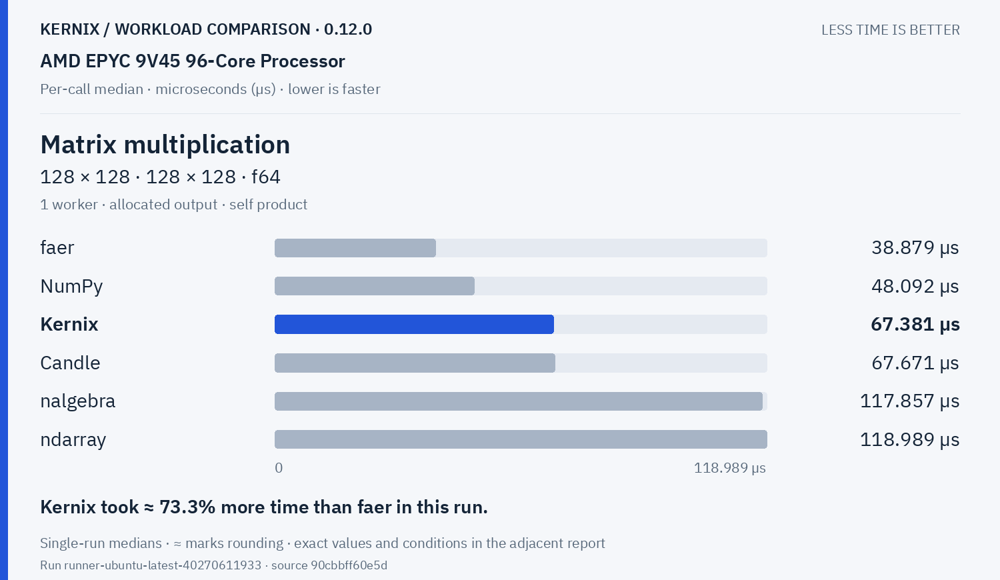](latency.pdf)

## Charts by workload

**Shorter bars mean less time.** Blue is Kernix; grey is a comparison implementation; teal is an explicitly selected Kernix backend. Entries are sorted by the recorded median, with a separate zero-based scale per chart. These point observations do not establish a statistical ranking.

Expand a group to see every chart here on GitHub. Click a chart to enlarge it. The exact table below keeps every source digit.

Matrix multiplication · 13 workloads

**Matrix multiplication · transposed view · 128 × 128 · 128 × 128 · f64**

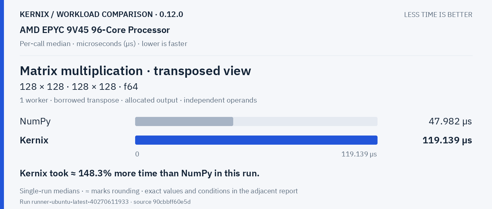

Kernix: **119.139 µs**. Kernix took ≈ 148.3% more time than NumPy in this run.

**Matrix multiplication · transposed view · 128 × 128 · 128 × 128 · f32**

Kernix: **37.456 µs**. Kernix took ≈ 76.8% more time than NumPy in this run.

**Independent matrix operands · 128 × 128 · 128 × 128 · f64**

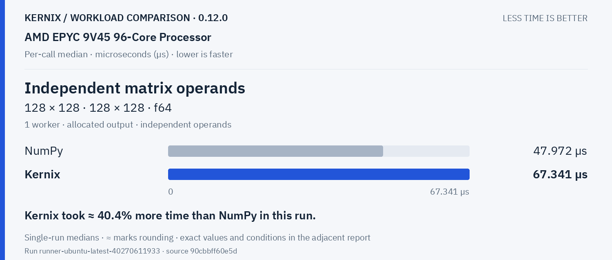

Kernix: **67.341 µs**. Kernix took ≈ 40.4% more time than NumPy in this run.

**Independent matrix operands · 128 × 128 · 128 × 128 · f32**

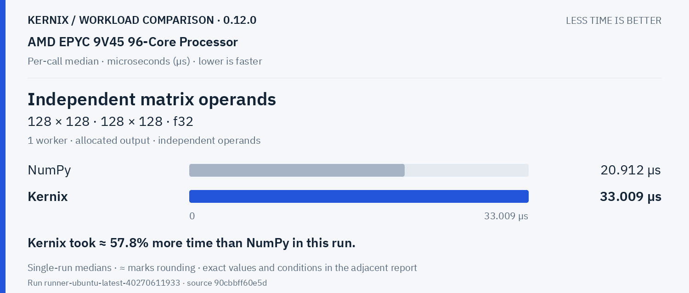

Kernix: **33.009 µs**. Kernix took ≈ 57.8% more time than NumPy in this run.

**Matrix multiplication · 32 × 32 · 32 × 32 · f64**

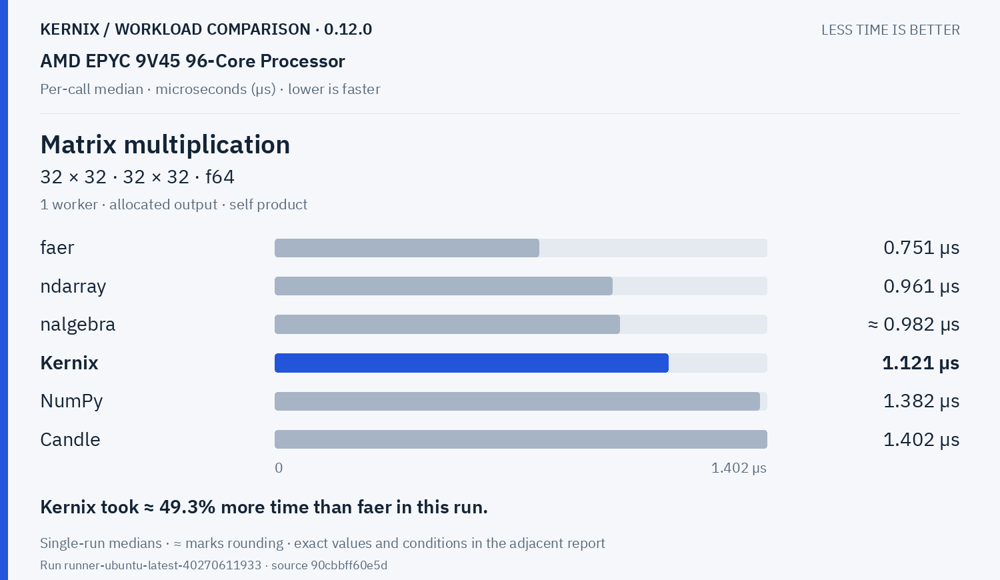

Kernix: **1.121 µs**. Kernix took ≈ 49.3% more time than faer in this run.

**Matrix multiplication · 64 × 64 · 64 × 64 · f64**

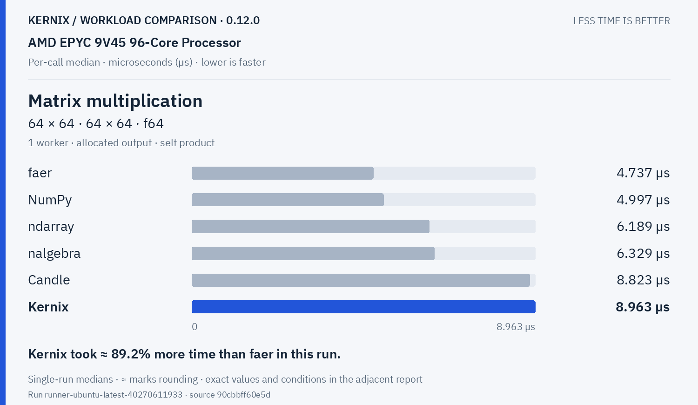

Kernix: **8.963 µs**. Kernix took ≈ 89.2% more time than faer in this run.

**Matrix multiplication · 128 × 128 · 128 × 128 · f64**

Kernix: **67.381 µs**. Kernix took ≈ 73.3% more time than faer in this run.

**Matrix multiplication · 256 × 256 · 256 × 256 · f64**

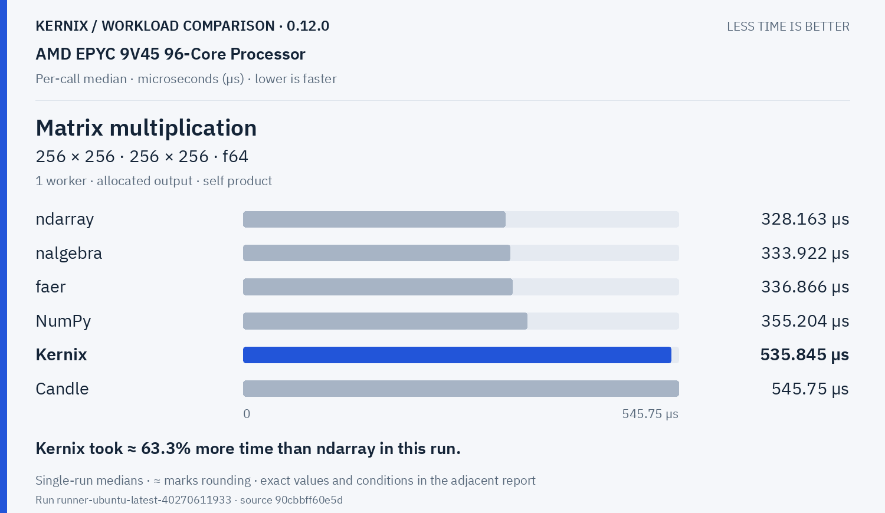

Kernix: **535.845 µs**. Kernix took ≈ 63.3% more time than ndarray in this run.

**Matrix multiplication · 64 × 64 · 64 × 64 · f32**

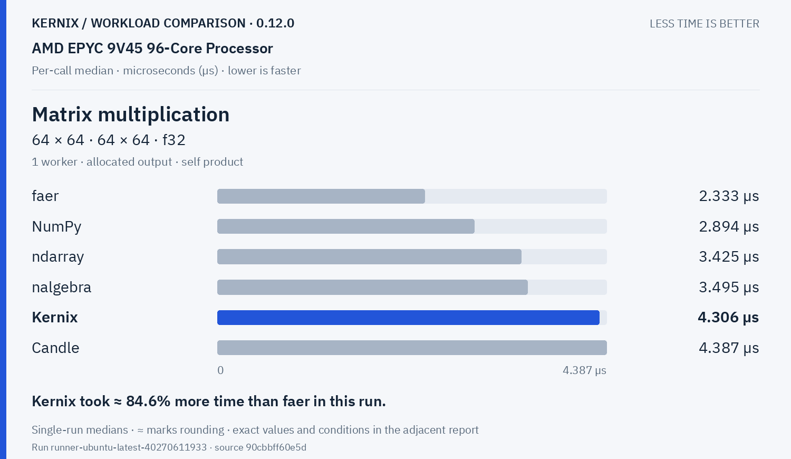

Kernix: **4.306 µs**. Kernix took ≈ 84.6% more time than faer in this run.

**Matrix multiplication · 128 × 128 · 128 × 128 · f32**

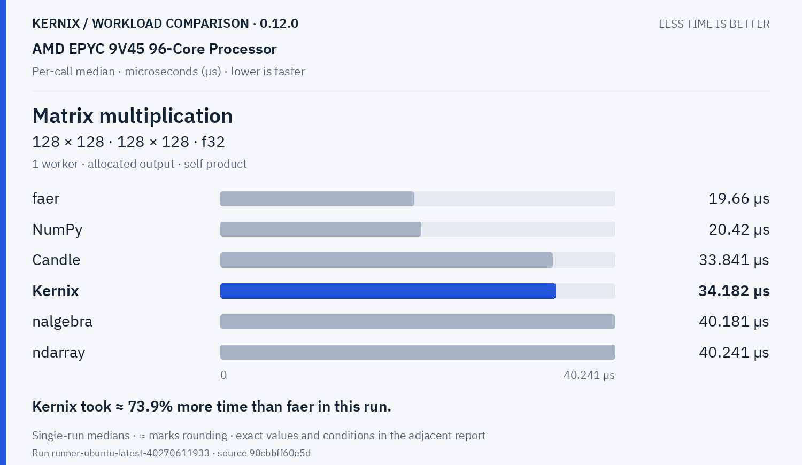

Kernix: **34.182 µs**. Kernix took ≈ 73.9% more time than faer in this run.

**Matrix multiplication · 256 × 256 · 256 × 256 · f32**

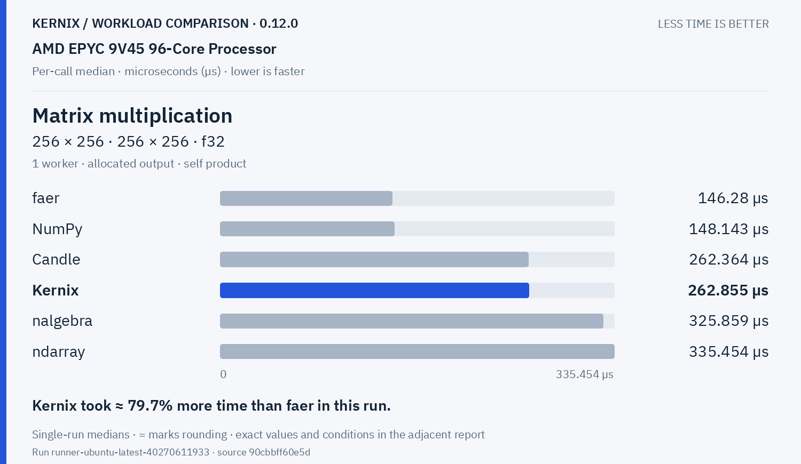

Kernix: **262.855 µs**. Kernix took ≈ 79.7% more time than faer in this run.

**Batched multiplication · 4 × 16 × 32 · 1 × 32 × 16 · f64**

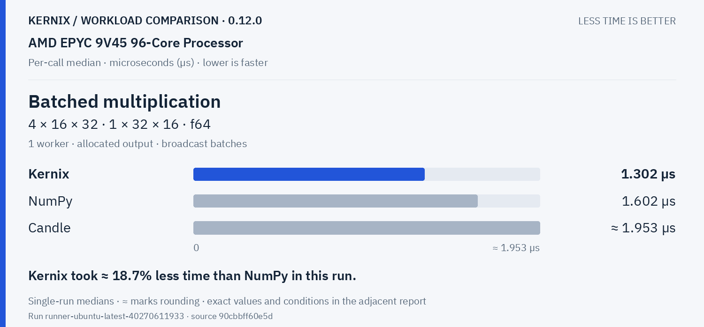

Kernix: **1.302 µs**. Kernix took ≈ 18.7% less time than NumPy in this run.

**Batched multiplication · 4 × 16 × 32 · 1 × 32 × 16 · f32**

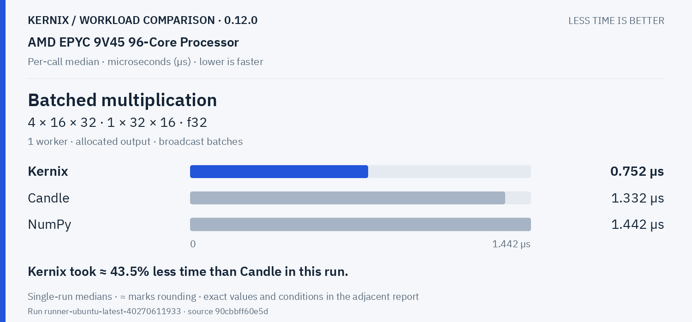

Kernix: **0.752 µs**. Kernix took ≈ 43.5% less time than Candle in this run.

Explicit parallel execution · 4 workloads

**Matmul · 2 workers · reused output · 64 × 64 · 64 × 64 · f64**

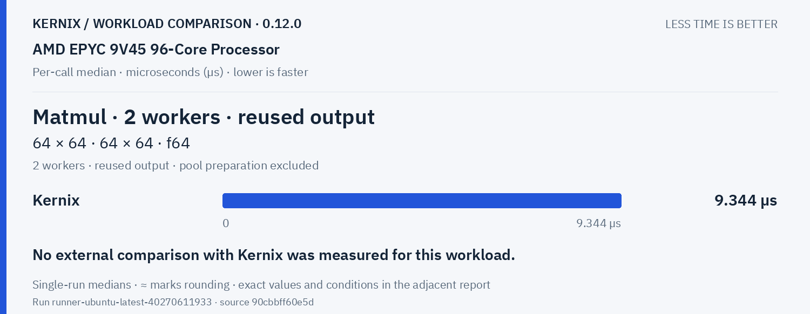

Kernix: **9.344 µs**. No external comparison with Kernix was measured for this workload.

**Matmul · 2 workers · reused output · 128 × 128 · 128 × 128 · f64**

Kernix: **43.585 µs**. No external comparison with Kernix was measured for this workload.

**Matmul · 2 workers · reused output · 256 × 256 · 256 × 256 · f64**

Kernix: **283.426 µs**. No external comparison with Kernix was measured for this workload.

**Matmul · 2 workers · reused output · 128 × 128 · 128 × 128 · f32**

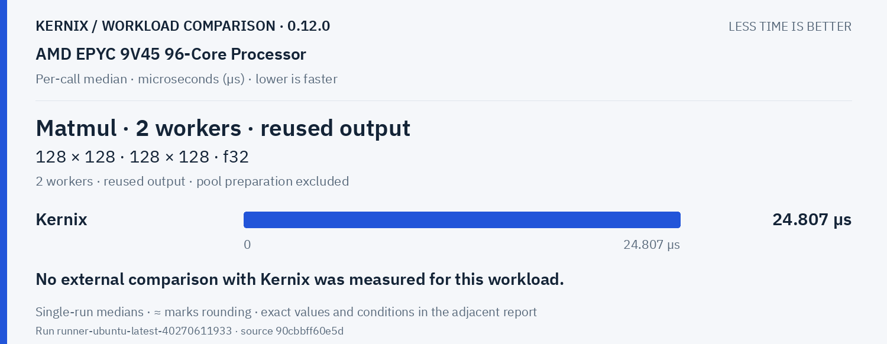

Kernix: **24.807 µs**. No external comparison with Kernix was measured for this workload.

Decompositions & solvers · 19 workloads

**Cholesky solve · reused factor · 128 × 128, 1 RHS · f64**

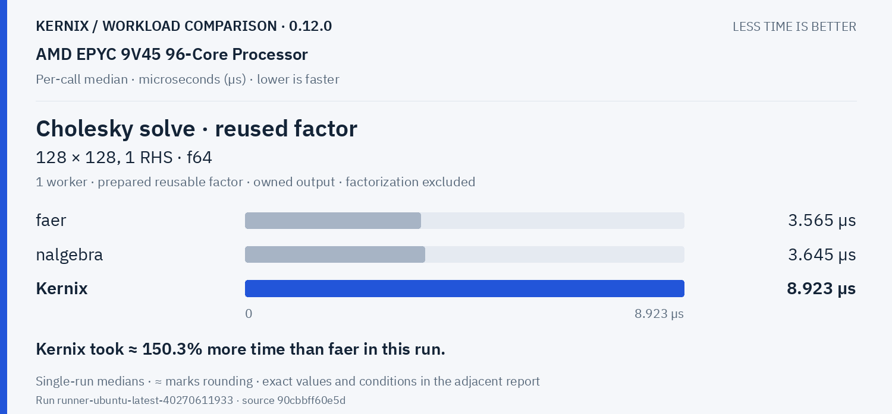

Kernix: **8.923 µs**. Kernix took ≈ 150.3% more time than faer in this run.

**Cholesky solve · reused factor · 256 × 256, 64 RHS · f64**

Kernix: **853.993 µs**. Kernix took ≈ 597.8% more time than faer in this run.

**Cholesky solve · reused factor · 512 × 512, 128 RHS · f64**

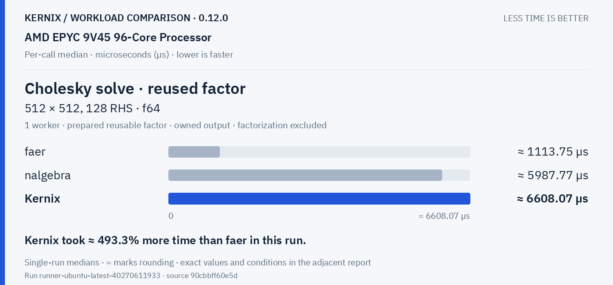

Kernix: **6608.068 µs**. Kernix took ≈ 493.3% more time than faer in this run.

**LU solve · reused factor · 256 × 256, 64 RHS · f64**

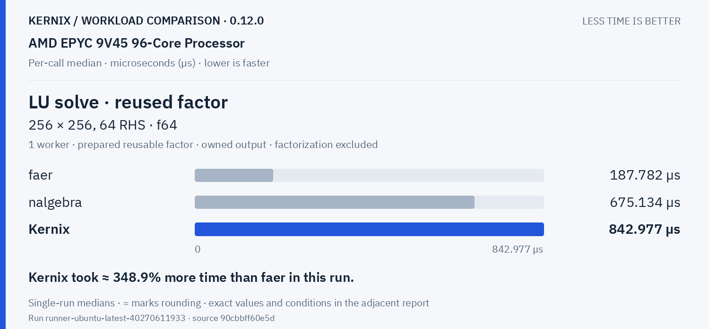

Kernix: **842.977 µs**. Kernix took ≈ 348.9% more time than faer in this run.

**Cholesky rank-one update · 256 × 256 · f64**

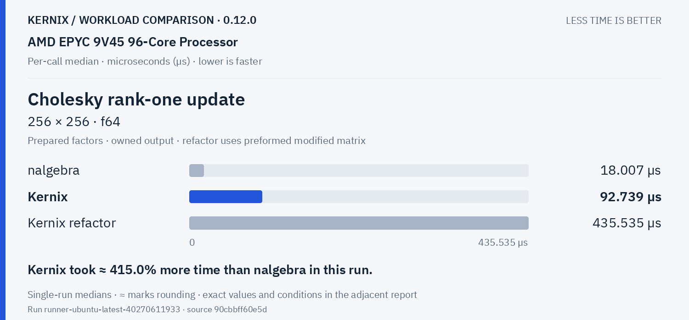

Kernix: **92.739 µs**. Kernix took ≈ 415.0% more time than nalgebra in this run.

**Cholesky rank-one downdate · 256 × 256 · f64**

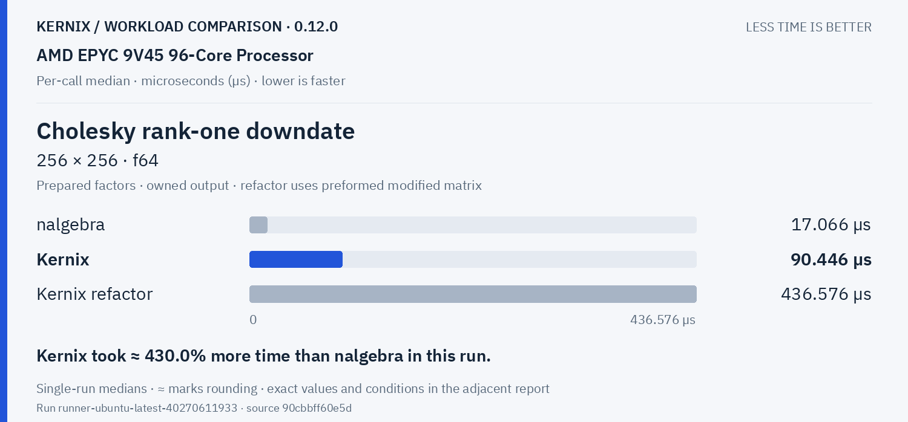

Kernix: **90.446 µs**. Kernix took ≈ 430.0% more time than nalgebra in this run.

**Cholesky rank-one update · 512 × 512 · f64**

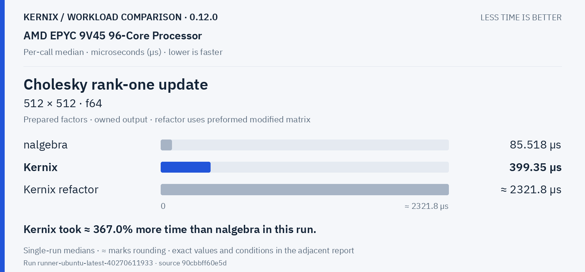

Kernix: **399.35 µs**. Kernix took ≈ 367.0% more time than nalgebra in this run.

**Thin QR · 512 × 128 · f64**

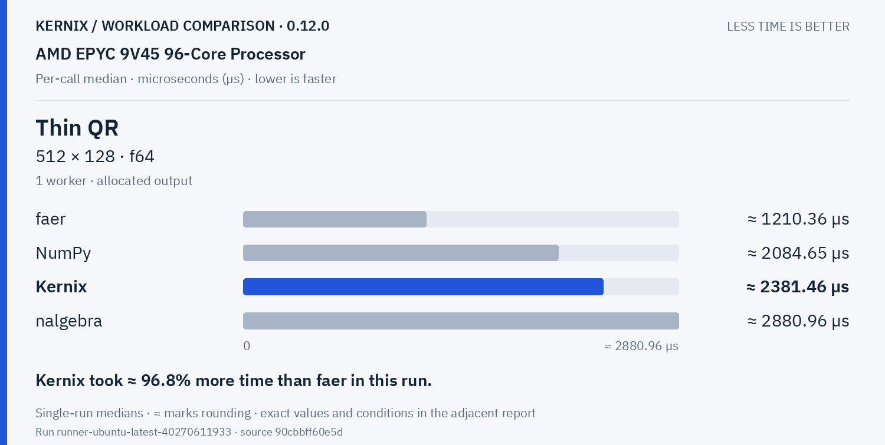

Kernix: **2381.458 µs**. Kernix took ≈ 96.8% more time than faer in this run.

**Thin QR · 1024 × 256 · f64**

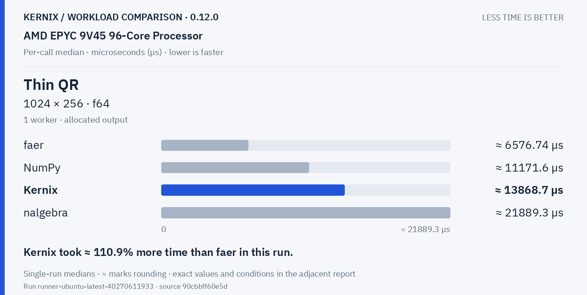

Kernix: **13868.677 µs**. Kernix took ≈ 110.9% more time than faer in this run.

**Cholesky factorization · 512 × 512 · f64**

Kernix: **2326.847 µs**. Kernix took ≈ 158.2% more time than faer in this run.

**Column-pivoted QR · 96 × 32 · f64**

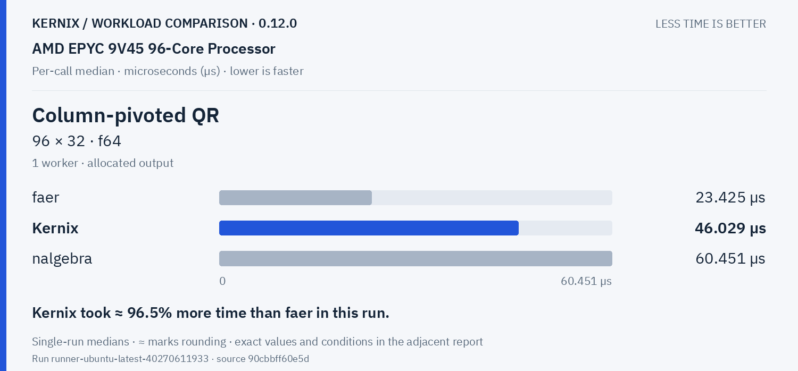

Kernix: **46.029 µs**. Kernix took ≈ 96.5% more time than faer in this run.

**Column-pivoted QR · 256 × 64 · f64**

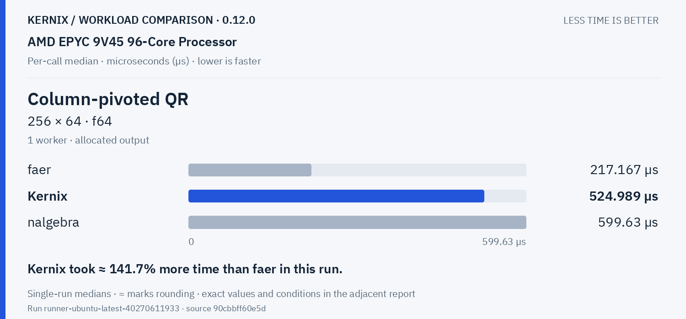

Kernix: **524.989 µs**. Kernix took ≈ 141.7% more time than faer in this run.

**Minimum-norm least squares · 64 × 32, rank 16, 4 RHS · f64**

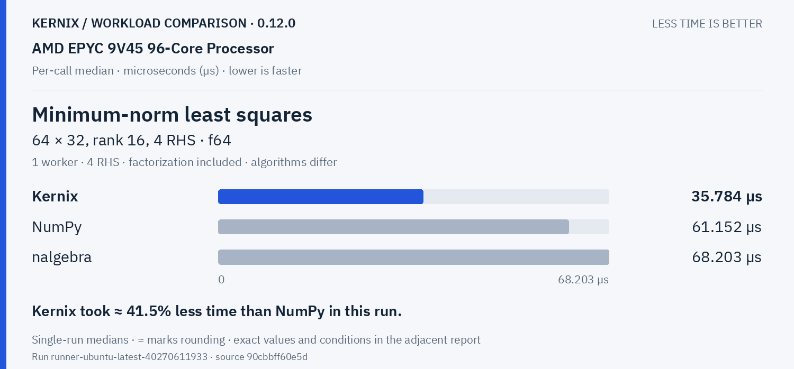

Kernix: **35.784 µs**. Kernix took ≈ 41.5% less time than NumPy in this run.

**Minimum-norm least squares · 32 × 64, rank 32, 4 RHS · f64**

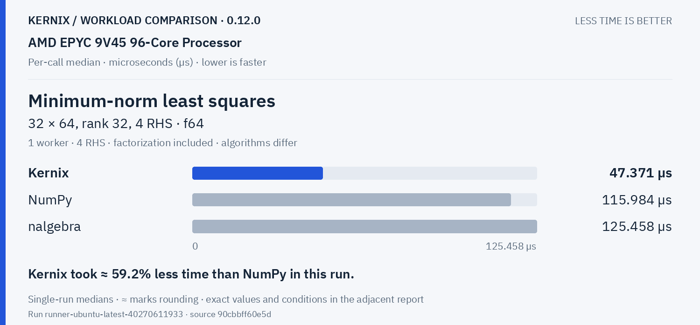

Kernix: **47.371 µs**. Kernix took ≈ 59.2% less time than NumPy in this run.

**Thin QR · 96 × 32 · f64**

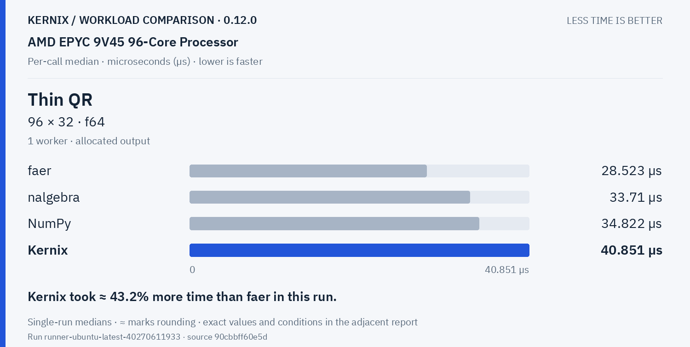

Kernix: **40.851 µs**. Kernix took ≈ 43.2% more time than faer in this run.

**Thin QR · 256 × 64 · f64**

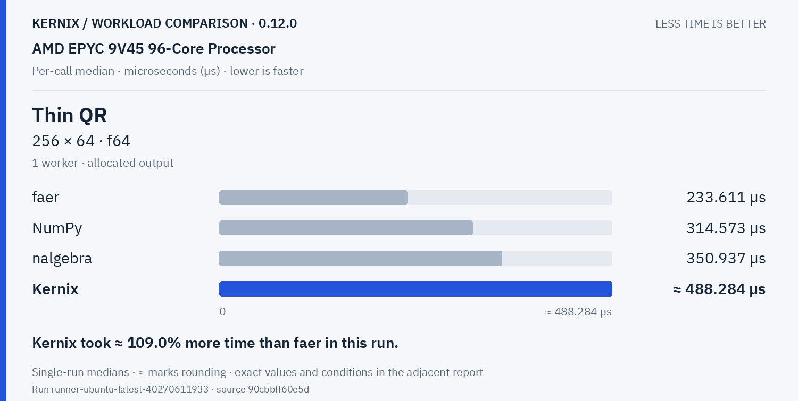

Kernix: **488.28399999999994 µs**. Kernix took ≈ 109.0% more time than faer in this run.

**Cholesky factorization · 64 × 64 · f64**

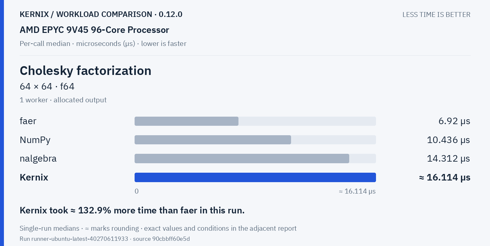

Kernix: **16.113999999999998 µs**. Kernix took ≈ 132.9% more time than faer in this run.

**Cholesky factorization · 128 × 128 · f64**

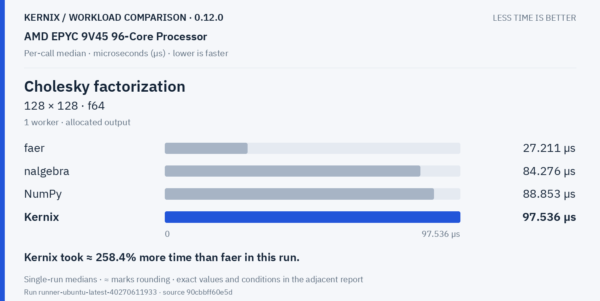

Kernix: **97.536 µs**. Kernix took ≈ 258.4% more time than faer in this run.

**Cholesky factorization · 256 × 256 · f64**

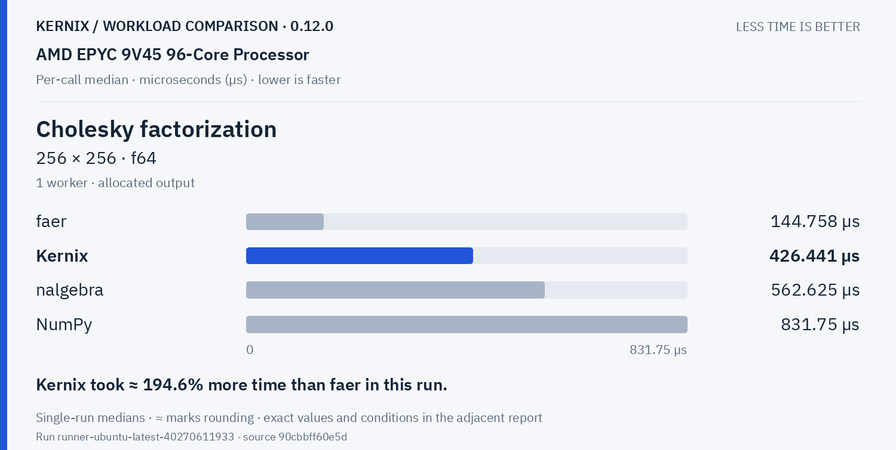

Kernix: **426.441 µs**. Kernix took ≈ 194.6% more time than faer in this run.

Training & autodiff · 6 workloads

**Shared-variable backward · sum(X * X), 64 × 32; prepared graph · f64**

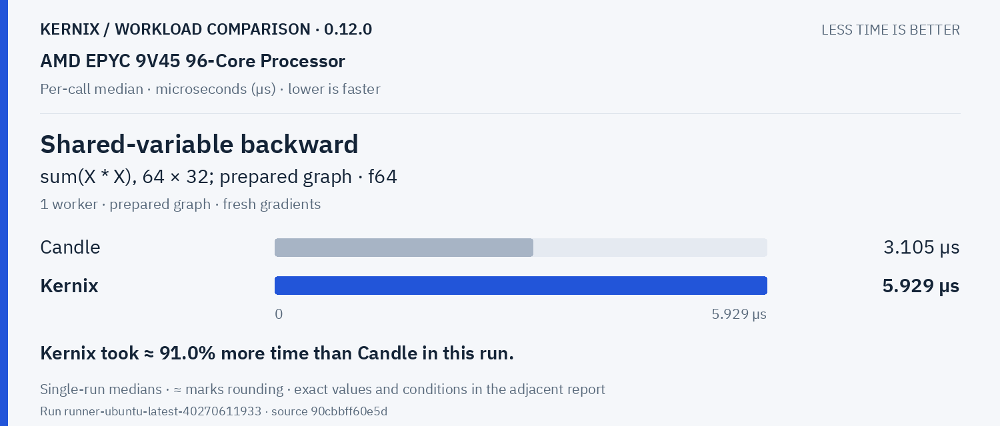

Kernix: **5.929 µs**. Kernix took ≈ 91.0% more time than Candle in this run.

**Record + backward · sum(A · W), 32 × 16 · 16 × 8 · f64**

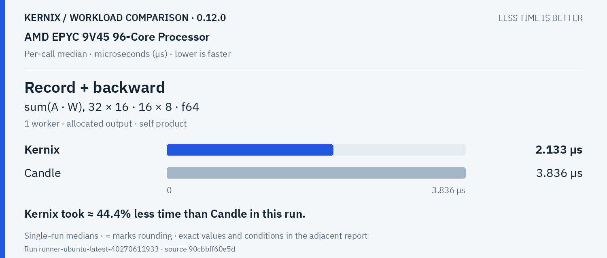

Kernix: **2.133 µs**. Kernix took ≈ 44.4% less time than Candle in this run.

**Model inference · batched normalized/sliced MLP · f64**

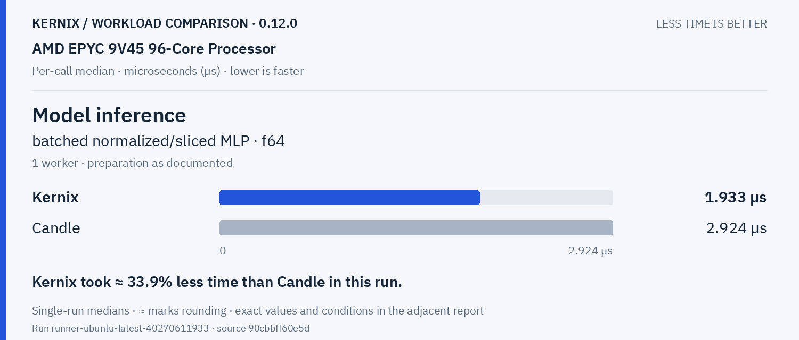

Kernix: **1.933 µs**. Kernix took ≈ 33.9% less time than Candle in this run.

**Model recording + forward · batched normalized/sliced MLP · f64**

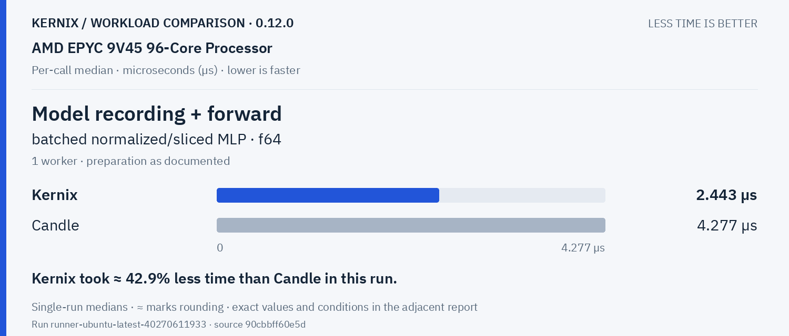

Kernix: **2.443 µs**. Kernix took ≈ 42.9% less time than Candle in this run.

**Model backward · prepared graph → fresh gradients · f64**

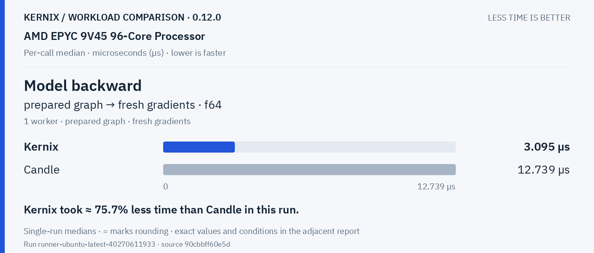

Kernix: **3.095 µs**. Kernix took ≈ 75.7% less time than Candle in this run.

**Parameter update · transactional SGD, fixed gradients · f64**

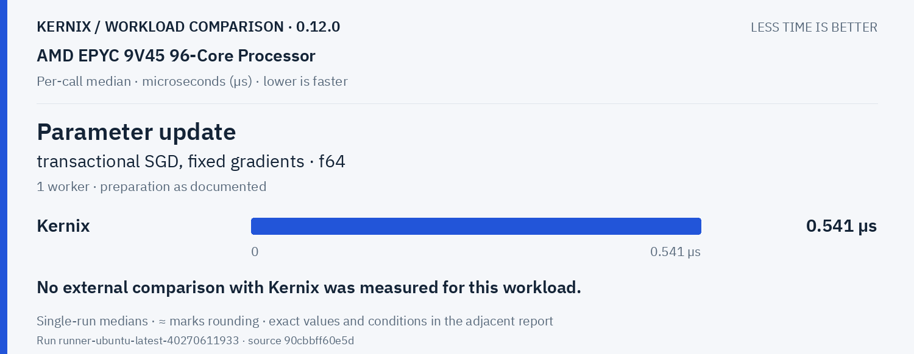

Kernix: **0.541 µs**. No external comparison with Kernix was measured for this workload.

Tensor contractions · 1 workloads

**Coalesced tensor contraction · 16 × 32 × 8 · 32 × 8 × 16 · f64**

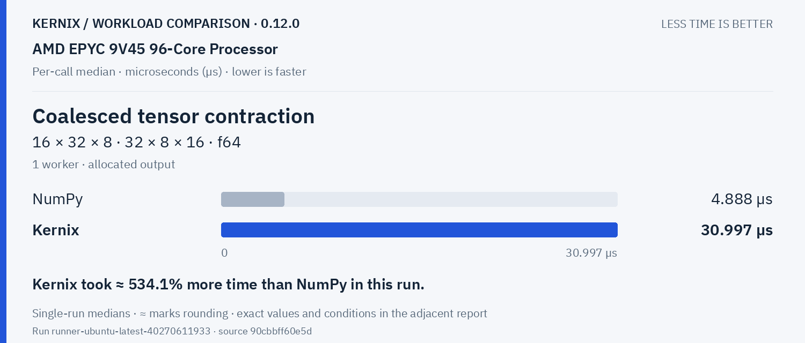

Kernix: **30.997 µs**. Kernix took ≈ 534.1% more time than NumPy in this run.

Statistics & activations · 1 workloads

**Row softmax · 256 × 64 · f64**

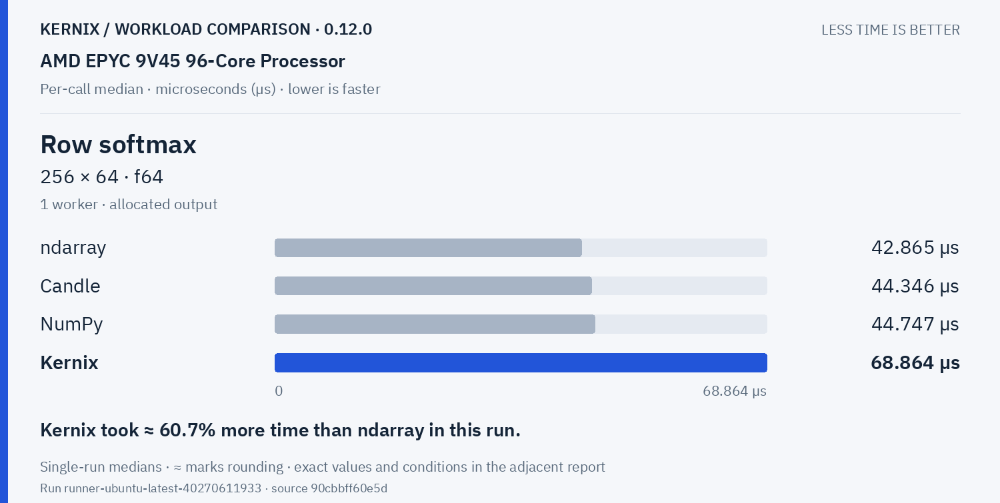

Kernix: **68.864 µs**. Kernix took ≈ 60.7% more time than ndarray in this run.

Tensor construction · 2 workloads

**Create zeros · 64 × 64 · f32**

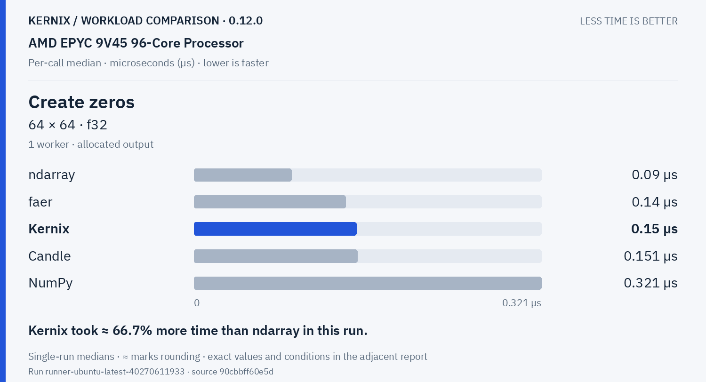

Kernix: **0.15 µs**. Kernix took ≈ 66.7% more time than ndarray in this run.

**Create ones · 64 × 64 · f32**

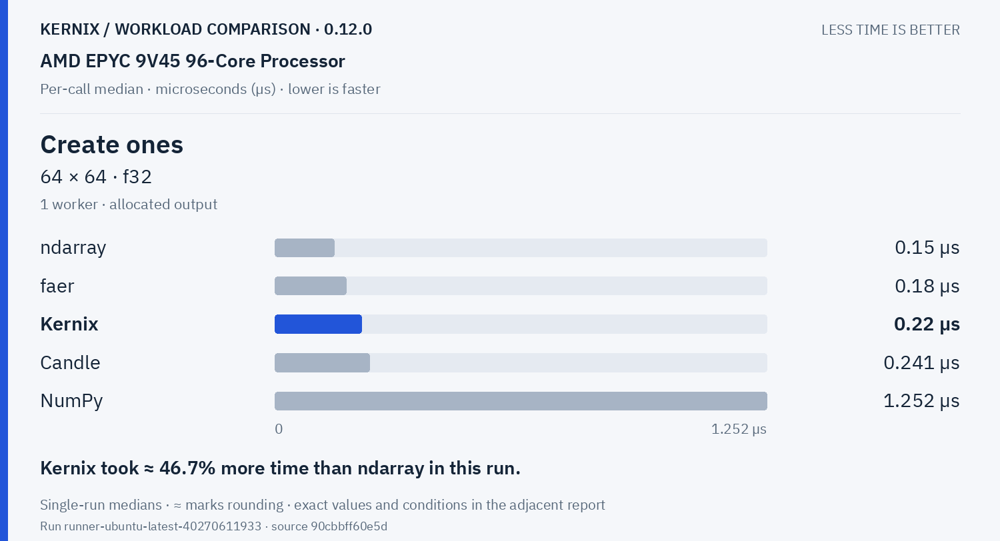

Kernix: **0.22 µs**. Kernix took ≈ 46.7% more time than ndarray in this run.

## Exact latency table

All values below are microseconds per operation. **Lower is faster.** Missing entries were not measured.

| Workload | Kernix | ndarray | nalgebra | faer | Candle | NumPy | Kernix refactor | Sequential run change |
|---|---:|---:|---:|---:|---:|---:|---:|---:|
| Matrix multiplication · transposed view · 128 × 128 · 128 × 128 · f64 | 119.139 | — | — | — | — | **47.982** | — | -0.5% |
| Matrix multiplication · transposed view · 128 × 128 · 128 × 128 · f32 | 37.456 | — | — | — | — | **21.182** | — | -2.4% |
| Independent matrix operands · 128 × 128 · 128 × 128 · f64 | 67.341 | — | — | — | — | **47.972** | — | -2.8% |
| Independent matrix operands · 128 × 128 · 128 × 128 · f32 | 33.009 | — | — | — | — | **20.912** | — | -2.8% |
| Matrix multiplication · 32 × 32 · 32 × 32 · f64 | 1.121 | 0.961 | 0.9820000000000001 | **0.751** | 1.402 | 1.382 | — | +0.8% |
| Matrix multiplication · 64 × 64 · 64 × 64 · f64 | 8.963 | 6.189 | 6.329 | **4.737** | 8.823 | 4.997 | — | -0.5% |
| Matrix multiplication · 128 × 128 · 128 × 128 · f64 | 67.381 | 118.989 | 117.857 | **38.879** | 67.671 | 48.092 | — | -2.2% |
| Matrix multiplication · 256 × 256 · 256 × 256 · f64 | 535.845 | **328.163** | 333.922 | 336.866 | 545.75 | 355.204 | — | -0.8% |
| Matrix multiplication · 64 × 64 · 64 × 64 · f32 | 4.306 | 3.425 | 3.495 | **2.333** | 4.387 | 2.894 | — | -3.2% |
| Matrix multiplication · 128 × 128 · 128 × 128 · f32 | 34.182 | 40.241 | 40.181 | **19.66** | 33.841 | 20.42 | — | -0.4% |
| Matrix multiplication · 256 × 256 · 256 × 256 · f32 | 262.855 | 335.454 | 325.859 | **146.28** | 262.364 | 148.143 | — | -1.4% |
| Batched multiplication · 4 × 16 × 32 · 1 × 32 × 16 · f64 | **1.302** | — | — | — | 1.9530000000000002 | 1.602 | — | -3.7% |
| Batched multiplication · 4 × 16 × 32 · 1 × 32 × 16 · f32 | **0.752** | — | — | — | 1.332 | 1.442 | — | +0.1% |
| Matmul · 2 workers · reused output · 64 × 64 · 64 × 64 · f64 | 9.344 | — | — | — | — | — | — | -7.9% |
| Matmul · 2 workers · reused output · 128 × 128 · 128 × 128 · f64 | 43.585 | — | — | — | — | — | — | +2.5% |
| Matmul · 2 workers · reused output · 256 × 256 · 256 × 256 · f64 | 283.426 | — | — | — | — | — | — | -1.5% |
| Matmul · 2 workers · reused output · 128 × 128 · 128 × 128 · f32 | 24.807 | — | — | — | — | — | — | +0.5% |
| Cholesky solve · reused factor · 128 × 128, 1 RHS · f64 | 8.923 | — | 3.645 | **3.565** | — | — | — | -4.2% |
| Cholesky solve · reused factor · 256 × 256, 64 RHS · f64 | 853.993 | — | 725.109 | **122.38400000000001** | — | — | — | -77.8% |
| Cholesky solve · reused factor · 512 × 512, 128 RHS · f64 | 6608.068 | — | 5987.768 | **1113.754** | — | — | — | -84.6% |
| LU solve · reused factor · 256 × 256, 64 RHS · f64 | 842.977 | — | 675.134 | **187.782** | — | — | — | -69.1% |
| Cholesky rank-one update · 256 × 256 · f64 | 92.739 | — | **18.007** | — | — | — | 435.535 | — |
| Cholesky rank-one downdate · 256 × 256 · f64 | 90.446 | — | **17.066** | — | — | — | 436.576 | — |
| Cholesky rank-one update · 512 × 512 · f64 | 399.35 | — | **85.518** | — | — | — | 2321.798 | — |
| Thin QR · 512 × 128 · f64 | 2381.458 | — | 2880.959 | **1210.359** | — | 2084.652 | — | -32.2% |
| Thin QR · 1024 × 256 · f64 | 13868.677 | — | 21889.282 | **6576.743** | — | 11171.564 | — | -45.7% |
| Cholesky factorization · 512 × 512 · f64 | 2326.847 | — | 4206.351 | **901.274** | — | 4302.975 | — | -0.3% |
| Column-pivoted QR · 96 × 32 · f64 | 46.029 | — | 60.451 | **23.425** | — | — | — | +0.0% |
| Column-pivoted QR · 256 × 64 · f64 | 524.989 | — | 599.63 | **217.167** | — | — | — | -1.2% |
| Minimum-norm least squares · 64 × 32, rank 16, 4 RHS · f64 | **35.784** | — | 68.203 | — | — | 61.152 | — | -1.4% |
| Minimum-norm least squares · 32 × 64, rank 32, 4 RHS · f64 | **47.371** | — | 125.458 | — | — | 115.984 | — | -1.0% |
| Thin QR · 96 × 32 · f64 | 40.851 | — | 33.71 | **28.523** | — | 34.822 | — | +2.6% |
| Thin QR · 256 × 64 · f64 | 488.28399999999994 | — | 350.937 | **233.611** | — | 314.573 | — | -3.8% |
| Cholesky factorization · 64 × 64 · f64 | 16.113999999999998 | — | 14.312 | **6.92** | — | 10.436 | — | +0.1% |
| Cholesky factorization · 128 × 128 · f64 | 97.536 | — | 84.276 | **27.211** | — | 88.853 | — | +0.3% |
| Cholesky factorization · 256 × 256 · f64 | 426.441 | — | 562.625 | **144.758** | — | 831.75 | — | -1.6% |
| Shared-variable backward · sum(X * X), 64 × 32; prepared graph · f64 | 5.929 | — | — | — | **3.105** | — | — | +19.1% |
| Record + backward · sum(A · W), 32 × 16 · 16 × 8 · f64 | **2.133** | — | — | — | 3.836 | — | — | +3.9% |
| Model inference · batched normalized/sliced MLP · f64 | **1.933** | — | — | — | 2.924 | — | — | +2.1% |
| Model recording + forward · batched normalized/sliced MLP · f64 | **2.443** | — | — | — | 4.277 | — | — | +0.8% |
| Model backward · prepared graph → fresh gradients · f64 | **3.095** | — | — | — | 12.739 | — | — | +2.0% |
| Parameter update · transactional SGD, fixed gradients · f64 | 0.541 | — | — | — | — | — | — | +1.9% |
| Coalesced tensor contraction · 16 × 32 × 8 · 32 × 8 × 16 · f64 | 30.997 | — | — | — | — | **4.888** | — | -2.0% |
| Row softmax · 256 × 64 · f64 | 68.864 | **42.865** | — | — | 44.346 | 44.747 | — | -0.5% |
| Create zeros · 64 × 64 · f32 | 0.15 | **0.09** | — | 0.14 | 0.151 | 0.321 | — | -0.7% |
| Create ones · 64 × 64 · f32 | 0.22 | **0.15** | — | 0.18 | 0.241 | 1.252 | — | -4.3% |

## Version comparison

24 of 46 workloads have paired evidence. Exploratory 95% intervals resample process pairs, not calls. No multiple-comparison adjustment.

### Version changes at a glance

The vertical line marks unchanged time. Left is faster; right is slower. Ranges are exploratory 95% intervals over fresh-process pairs. An interval crossing the line leaves direction unclear.

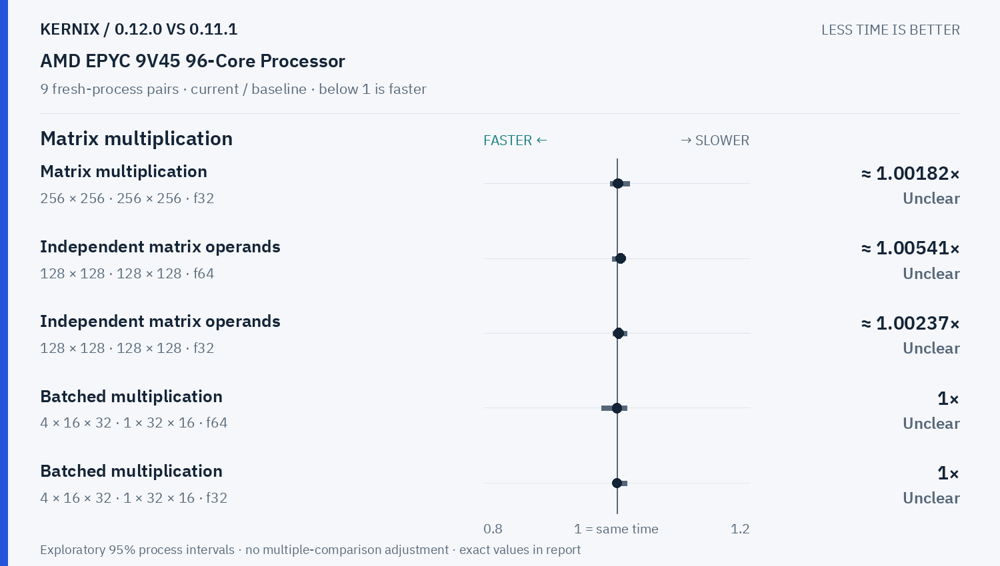

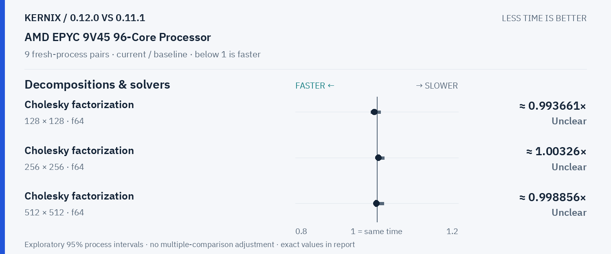

| Workload | Current / baseline [95% interval] | Interpretation |
|---|---:|---|
| Matrix multiplication · transposed view · 128 × 128 · 128 × 128 · f64 | 0.9961673082199184× [0.9935358919393151, 1.0091649948805888] | Timing direction unclear |
| Matrix multiplication · transposed view · 128 × 128 · 128 × 128 · f32 | 1.0005362505362505× [0.9877411308939422, 1.0212528876206006] | Timing direction unclear |
| Independent matrix operands · 128 × 128 · 128 × 128 · f64 | 1.0054114825363514× [0.9929526907242172, 1.008696674109766] | Timing direction unclear |
| Independent matrix operands · 128 × 128 · 128 × 128 · f32 | 1.002366793881838× [0.9940516705631677, 1.0146177023358491] | Timing direction unclear |
| Matrix multiplication · 32 × 32 · 32 × 32 · f64 | 1.0008920606601248× [0.9812834224598931, 1.0268022181146026] | Timing direction unclear |
| Matrix multiplication · 64 × 64 · 64 × 64 · f64 | — | No paired comparison |
| Matrix multiplication · 128 × 128 · 128 × 128 · f64 | 0.9982135475107777× [0.991413560752696, 1.0239473217976731] | Timing direction unclear |
| Matrix multiplication · 256 × 256 · 256 × 256 · f64 | 1.0012324316956442× [0.9986771773084744, 1.0135525631939524] | Timing direction unclear |
| Matrix multiplication · 64 × 64 · 64 × 64 · f32 | — | No paired comparison |
| Matrix multiplication · 128 × 128 · 128 × 128 · f32 | 1.0035971223021583× [0.9870526408502392, 1.0125065441219243] | Timing direction unclear |
| Matrix multiplication · 256 × 256 · 256 × 256 · f32 | 1.001817487237072× [0.9901220464195274, 1.0192704641580272] | Timing direction unclear |
| Batched multiplication · 4 × 16 × 32 · 1 × 32 × 16 · f64 | 1× [0.9773071104387292, 1.0152439024390243] | Timing direction unclear |
| Batched multiplication · 4 × 16 × 32 · 1 × 32 × 16 · f32 | 1× [0.9986522911051213, 1.015047879616963] | Timing direction unclear |
| Matmul · 2 workers · reused output · 64 × 64 · 64 × 64 · f64 | — | No paired comparison |
| Matmul · 2 workers · reused output · 128 × 128 · 128 × 128 · f64 | 1.0118995686103436× [0.9831246342890579, 1.029130116094862] | Timing direction unclear |
| Matmul · 2 workers · reused output · 256 × 256 · 256 × 256 · f64 | 1.0039262481234843× [0.987681647914046, 1.0154321417140948] | Timing direction unclear |
| Matmul · 2 workers · reused output · 128 × 128 · 128 × 128 · f32 | 1.0041587746026517× [0.9931137845829789, 1.0251479289940828] | Timing direction unclear |
| Cholesky solve · reused factor · 128 × 128, 1 RHS · f64 | 1.0053625053625053× [0.9724108658743633, 1.0274227029389271] | Timing direction unclear |
| Cholesky solve · reused factor · 256 × 256, 64 RHS · f64 | 0.22349955049075287× [0.21900384782544965, 0.22888203630554305] | Observed time reduction |
| Cholesky solve · reused factor · 512 × 512, 128 RHS · f64 | — | No paired comparison |
| LU solve · reused factor · 256 × 256, 64 RHS · f64 | 0.3114620050231865× [0.30519189639903604, 0.31553349932267266] | Observed time reduction |
| Cholesky rank-one update · 256 × 256 · f64 | — | No paired comparison |
| Cholesky rank-one downdate · 256 × 256 · f64 | — | No paired comparison |
| Cholesky rank-one update · 512 × 512 · f64 | — | No paired comparison |
| Thin QR · 512 × 128 · f64 | 0.6757057230163083× [0.6720568966832867, 0.6879233649014185] | Observed time reduction |
| Thin QR · 1024 × 256 · f64 | 0.5529138855671462× [0.5445555682362697, 0.556903078560186] | Observed time reduction |
| Cholesky factorization · 512 × 512 · f64 | 0.9988555053724515× [0.9935237240137919, 1.0168522189687361] | Timing direction unclear |
| Column-pivoted QR · 96 × 32 · f64 | — | No paired comparison |
| Column-pivoted QR · 256 × 64 · f64 | — | No paired comparison |
| Minimum-norm least squares · 64 × 32, rank 16, 4 RHS · f64 | — | No paired comparison |
| Minimum-norm least squares · 32 × 64, rank 32, 4 RHS · f64 | — | No paired comparison |
| Thin QR · 96 × 32 · f64 | — | No paired comparison |
| Thin QR · 256 × 64 · f64 | 0.9590911843475237× [0.9536949327442831, 0.9682737393033156] | Observed time reduction |
| Cholesky factorization · 64 × 64 · f64 | — | No paired comparison |
| Cholesky factorization · 128 × 128 · f64 | 0.9936608393422213× [0.9854601575826497, 1.009468378111521] | Timing direction unclear |
| Cholesky factorization · 256 × 256 · f64 | 1.0032612891221793× [0.9983964429344863, 1.0177890307996873] | Timing direction unclear |
| Shared-variable backward · sum(X * X), 64 × 32; prepared graph · f64 | — | No paired comparison |
| Record + backward · sum(A · W), 32 × 16 · 16 × 8 · f64 | 1.0530631934394596× [1.0391581008321096, 1.0794833581718828] | Observed time increase |
| Model inference · batched normalized/sliced MLP · f64 | — | No paired comparison |
| Model recording + forward · batched normalized/sliced MLP · f64 | — | No paired comparison |
| Model backward · prepared graph → fresh gradients · f64 | — | No paired comparison |
| Parameter update · transactional SGD, fixed gradients · f64 | — | No paired comparison |
| Coalesced tensor contraction · 16 × 32 × 8 · 32 × 8 × 16 · f64 | — | No paired comparison |
| Row softmax · 256 × 64 · f64 | — | No paired comparison |
| Create zeros · 64 × 64 · f32 | — | No paired comparison |
| Create ones · 64 × 64 · f32 | — | No paired comparison |

## Method and provenance

CPU affinity pinned to logical CPU 0. Frequency and background load are uncontrolled.

Minimum-norm rows use pivoted QR plus scaled implicit RZ in Kernix; NumPy native lstsq; nalgebra native SVD/solve. Algorithm costs and rank policies differ. See original method for thresholds. Kernix/nalgebra: prepared base factor, owned modified factor; refactor: same Kernix version, full factorization of preformed modified matrix; base setup and matrix formation excluded

Numbers retain source precision; recorded digits do not imply equivalent physical measurement accuracy. Lowest observed medians are bold only when peers were measured. No aggregate winner or universal ranking is inferred.

[Original report and commentary](original-report.txt) · [Raw measurements](raw.json)

Measured source `90cbbff60e5d7458ef9f89918c99a6cca94b51d1`. Run `runner-ubuntu-latest-40270611933`. Rendering does not change measurements.
