# Kernix 0.13.0 · performance brief

AMD EPYC 7763 64-Core Processor / Linux

**Per-call median, microseconds per operation. Lower is faster. All recorded digits retained.**

51 workloads · 175 observations

Baseline: baseline-ubuntu-latest-40289723446. Sequential run changes are descriptive; paired process evidence is shown separately.

[Interactive HTML (open locally)](report.html) · [Vector PDF](latency.pdf) · [Raw measurements](raw.json)

## Charts by workload

**Shorter bars mean less time.** Blue is Kernix; grey is a comparison implementation; teal is an explicitly selected Kernix backend. Entries are sorted by the recorded median, with a separate zero-based scale per chart. These point observations do not establish a statistical ranking.

Expand a group to see every chart here on GitHub. Click a chart to enlarge it. The exact table below keeps every source digit.

Sparse matrices & memory · 5 workloads

**Sparse matrix × vector · 2048 × 2048 · five diagonals · f64**

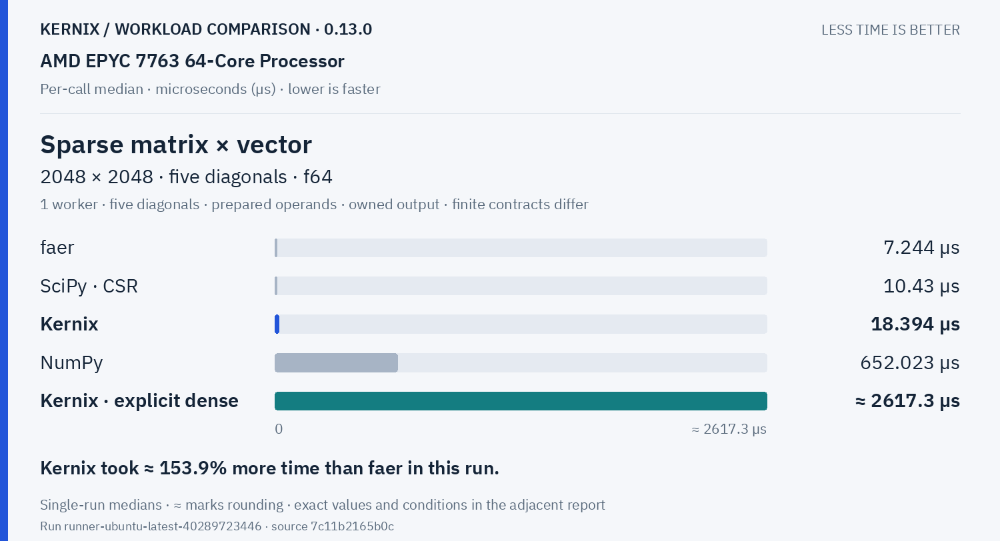

Kernix: **18.394 µs**. Kernix took ≈ 153.9% more time than faer in this run.

**Sparse × dense matrix · 512 × 512 · 32 RHS · five diagonals · f64**

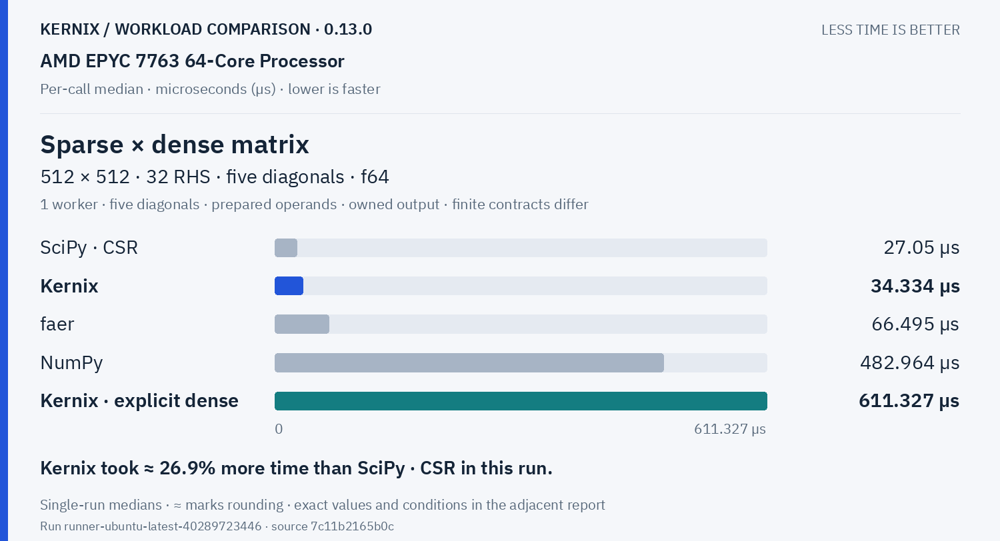

Kernix: **34.334 µs**. Kernix took ≈ 26.9% more time than SciPy · CSR in this run.

**Sparse × dense matrix · 512 × 512 · 32 RHS · five diagonals · f32**

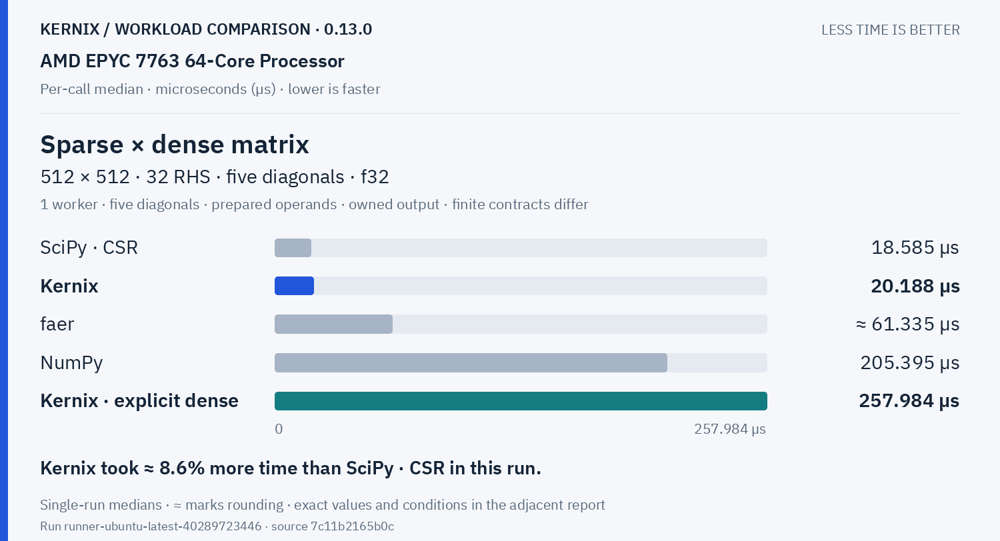

Kernix: **20.188 µs**. Kernix took ≈ 8.6% more time than SciPy · CSR in this run.

**Sparse × sparse matrix · 256 × 256 · five diagonals each · f64**

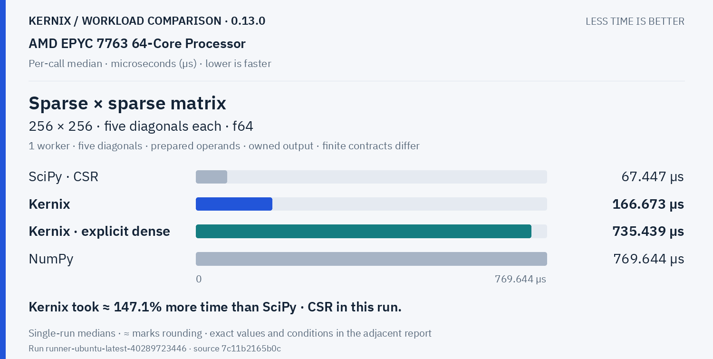

Kernix: **166.673 µs**. Kernix took ≈ 147.1% more time than SciPy · CSR in this run.

**Automatic CSR construction · 512 × 512 · clone + scan + compress · f64**

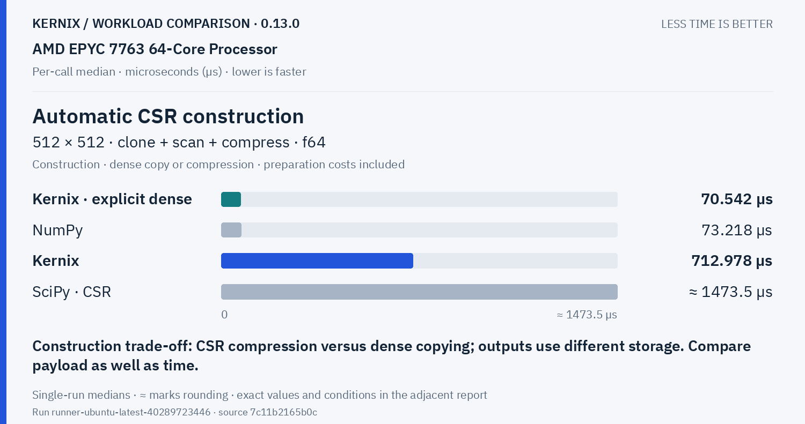

Kernix: **712.978 µs**. Construction trade-off: CSR compression versus dense copying; outputs use different storage. Compare payload as well as time.

Matrix multiplication · 13 workloads

**Matrix multiplication · transposed view · 128 × 128 · 128 × 128 · f64**

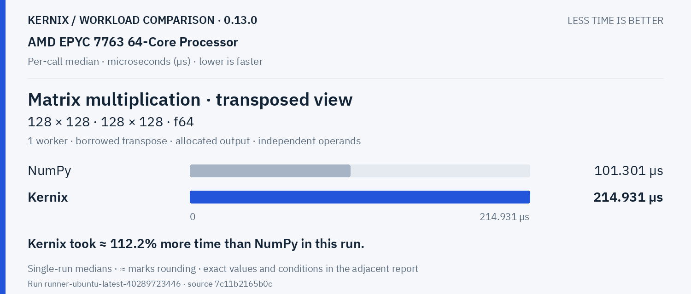

Kernix: **214.931 µs**. Kernix took ≈ 112.2% more time than NumPy in this run.

**Matrix multiplication · transposed view · 128 × 128 · 128 × 128 · f32**

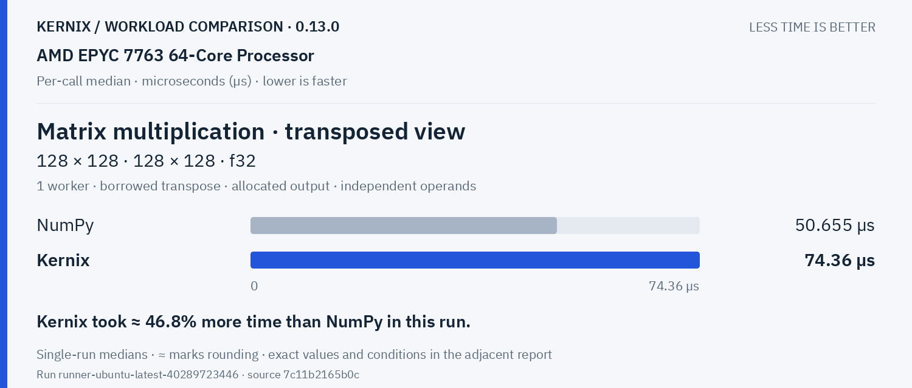

Kernix: **74.36 µs**. Kernix took ≈ 46.8% more time than NumPy in this run.

**Independent matrix operands · 128 × 128 · 128 × 128 · f64**

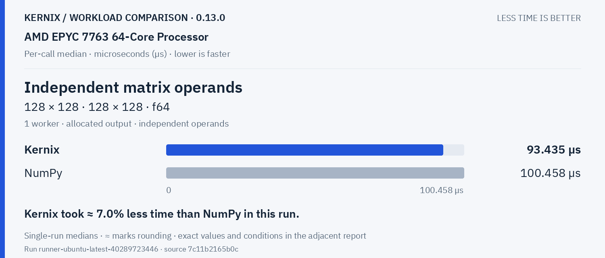

Kernix: **93.435 µs**. Kernix took ≈ 7.0% less time than NumPy in this run.

**Independent matrix operands · 128 × 128 · 128 × 128 · f32**

Kernix: **45.695 µs**. Kernix took ≈ 7.0% less time than NumPy in this run.

**Matrix multiplication · 32 × 32 · 32 × 32 · f64**

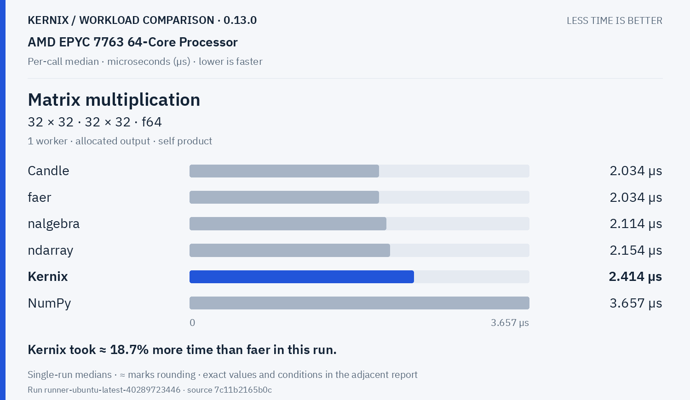

Kernix: **2.414 µs**. Kernix took ≈ 18.7% more time than faer in this run.

**Matrix multiplication · 64 × 64 · 64 × 64 · f64**

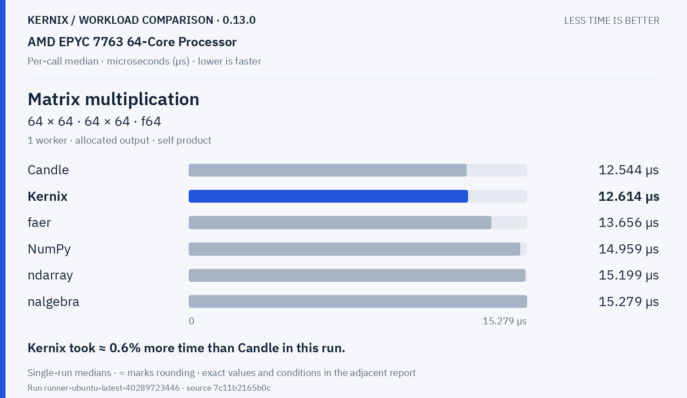

Kernix: **12.614 µs**. Kernix took ≈ 0.6% more time than Candle in this run.

**Matrix multiplication · 128 × 128 · 128 × 128 · f64**

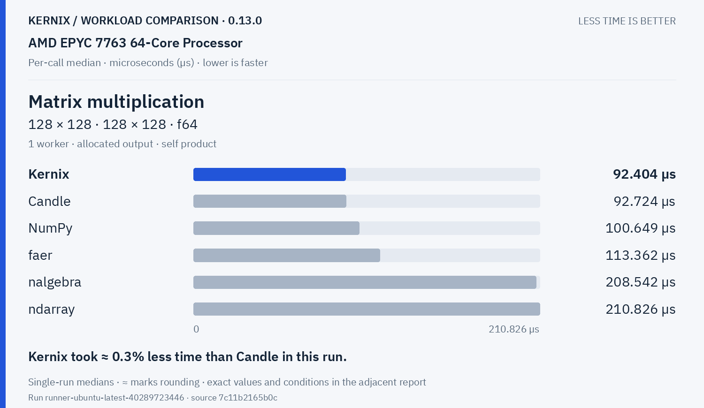

Kernix: **92.404 µs**. Kernix took ≈ 0.3% less time than Candle in this run.

**Matrix multiplication · 256 × 256 · 256 × 256 · f64**

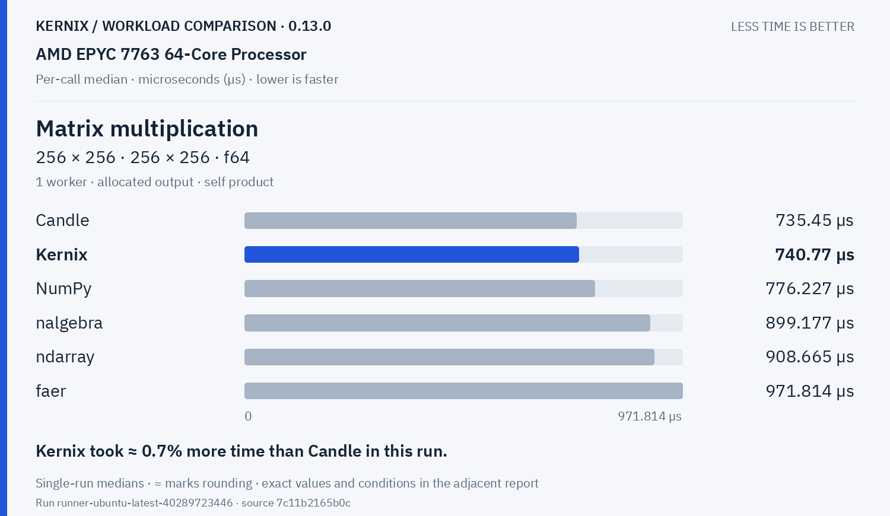

Kernix: **740.77 µs**. Kernix took ≈ 0.7% more time than Candle in this run.

**Matrix multiplication · 64 × 64 · 64 × 64 · f32**

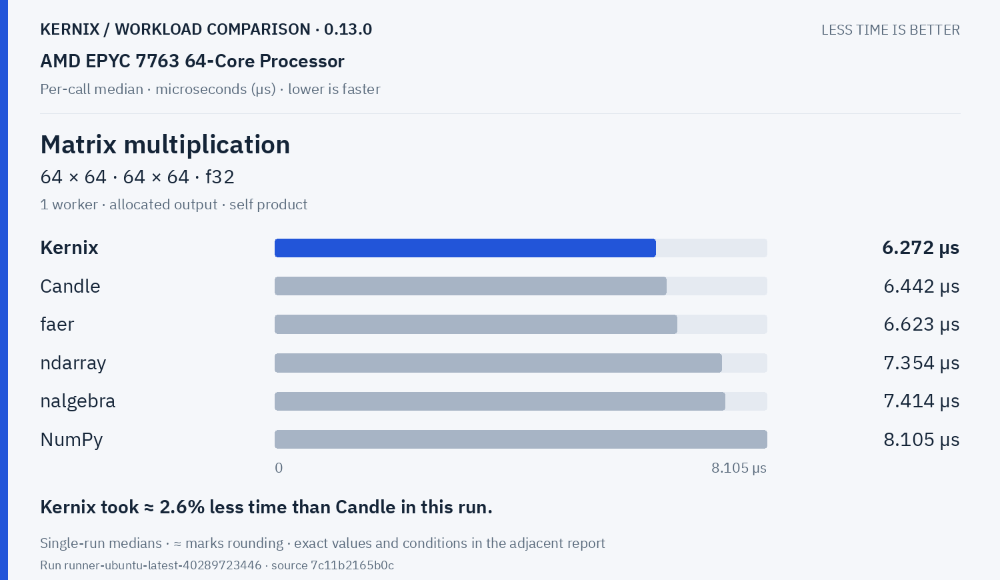

Kernix: **6.272 µs**. Kernix took ≈ 2.6% less time than Candle in this run.

**Matrix multiplication · 128 × 128 · 128 × 128 · f32**

Kernix: **45.435 µs**. Kernix took ≈ 0.5% less time than Candle in this run.

**Matrix multiplication · 256 × 256 · 256 × 256 · f32**

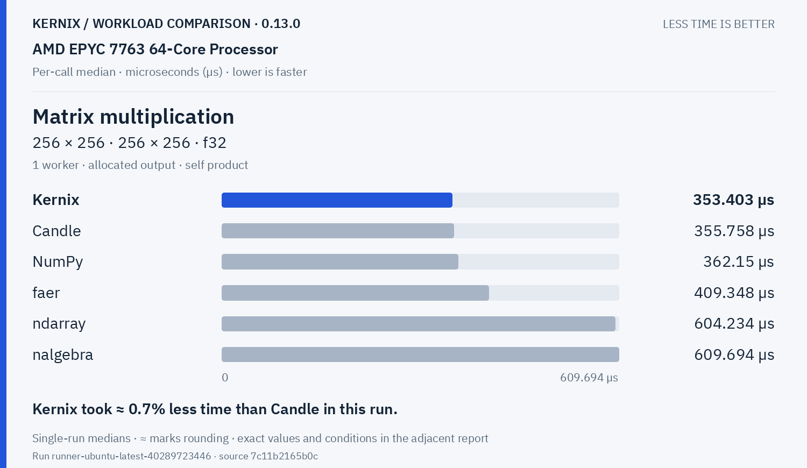

Kernix: **353.403 µs**. Kernix took ≈ 0.7% less time than Candle in this run.

**Batched multiplication · 4 × 16 × 32 · 1 × 32 × 16 · f64**

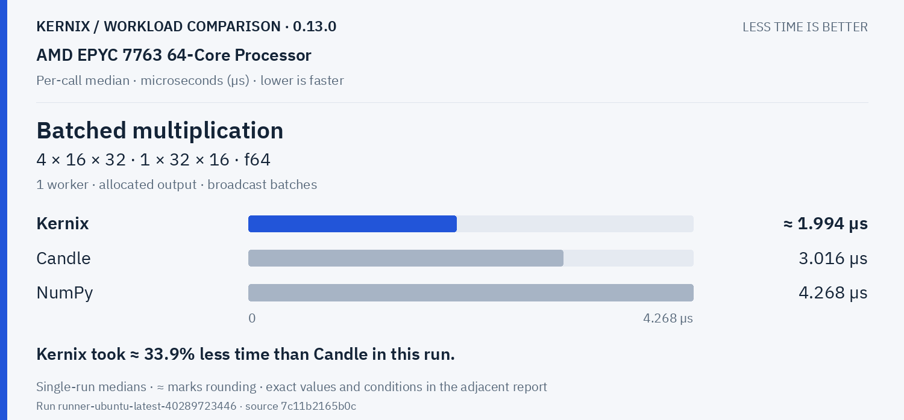

Kernix: **1.9939999999999998 µs**. Kernix took ≈ 33.9% less time than Candle in this run.

**Batched multiplication · 4 × 16 × 32 · 1 × 32 × 16 · f32**

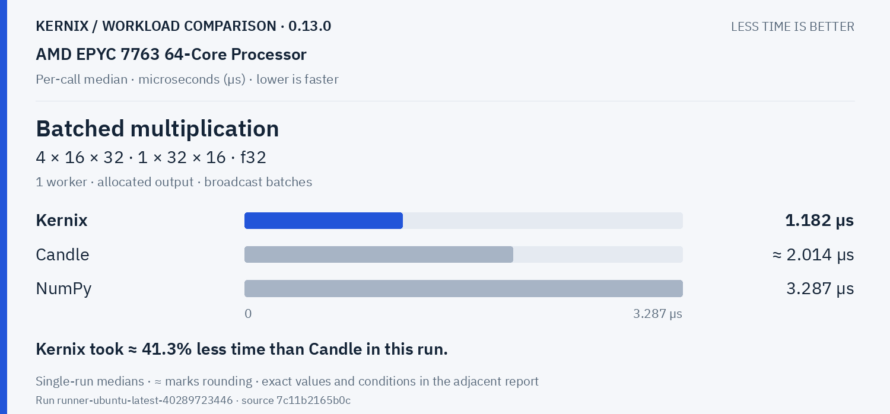

Kernix: **1.182 µs**. Kernix took ≈ 41.3% less time than Candle in this run.

Explicit parallel execution · 4 workloads

**Matmul · 2 workers · reused output · 64 × 64 · 64 × 64 · f64**

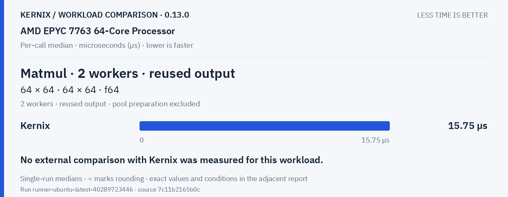

Kernix: **15.75 µs**. No external comparison with Kernix was measured for this workload.

**Matmul · 2 workers · reused output · 128 × 128 · 128 × 128 · f64**

Kernix: **56.135 µs**. No external comparison with Kernix was measured for this workload.

**Matmul · 2 workers · reused output · 256 × 256 · 256 × 256 · f64**

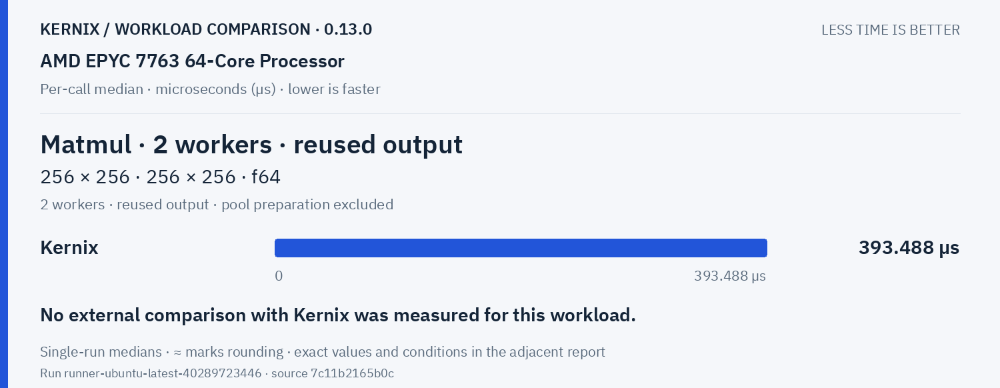

Kernix: **393.488 µs**. No external comparison with Kernix was measured for this workload.

**Matmul · 2 workers · reused output · 128 × 128 · 128 × 128 · f32**

Kernix: **31.218 µs**. No external comparison with Kernix was measured for this workload.

Decompositions & solvers · 19 workloads

**Cholesky solve · reused factor · 128 × 128, 1 RHS · f64**

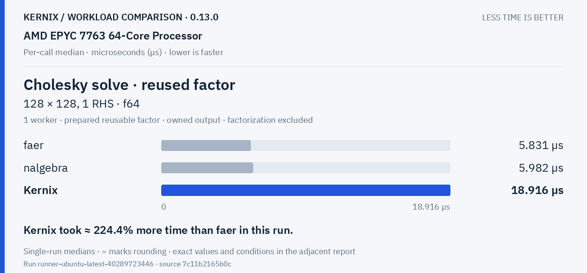

Kernix: **18.916 µs**. Kernix took ≈ 224.4% more time than faer in this run.

**Cholesky solve · reused factor · 256 × 256, 64 RHS · f64**

Kernix: **1322.281 µs**. Kernix took ≈ 379.1% more time than faer in this run.

**Cholesky solve · reused factor · 512 × 512, 128 RHS · f64**

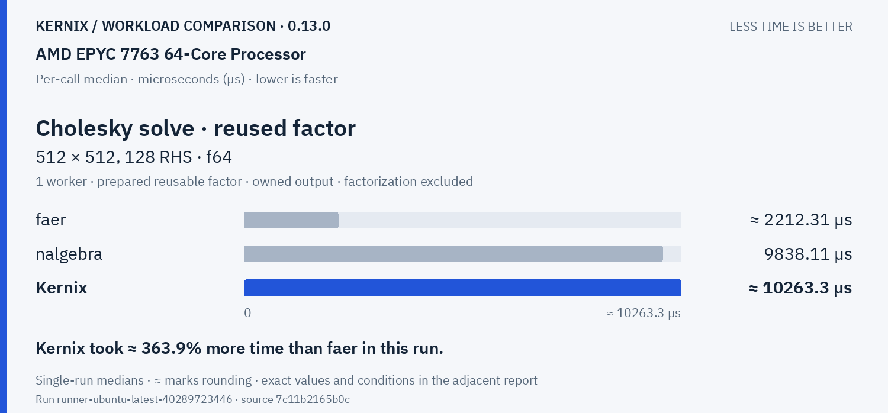

Kernix: **10263.337 µs**. Kernix took ≈ 363.9% more time than faer in this run.

**LU solve · reused factor · 256 × 256, 64 RHS · f64**

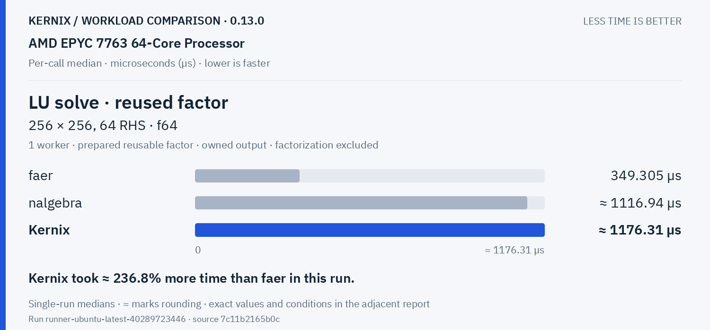

Kernix: **1176.307 µs**. Kernix took ≈ 236.8% more time than faer in this run.

**Cholesky rank-one update · 256 × 256 · f64**

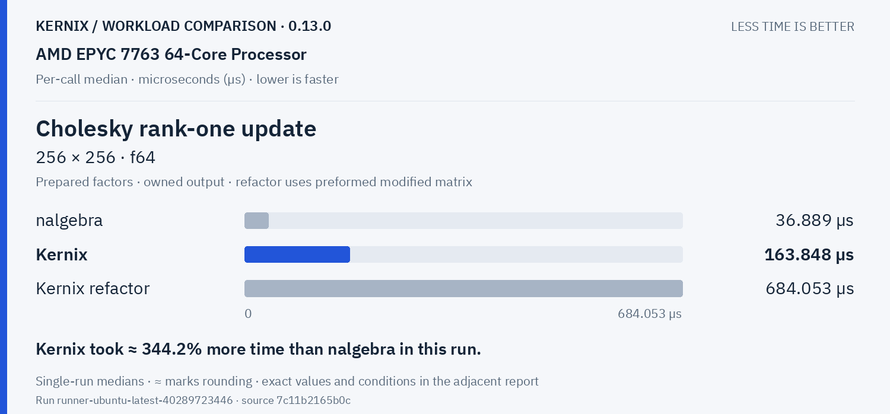

Kernix: **163.848 µs**. Kernix took ≈ 344.2% more time than nalgebra in this run.

**Cholesky rank-one downdate · 256 × 256 · f64**

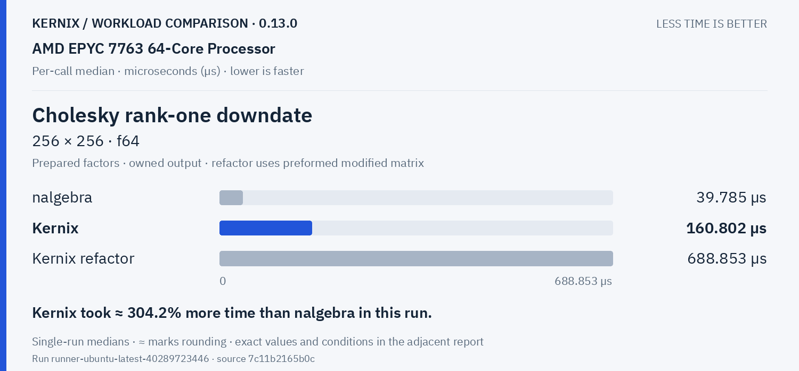

Kernix: **160.802 µs**. Kernix took ≈ 304.2% more time than nalgebra in this run.

**Cholesky rank-one update · 512 × 512 · f64**

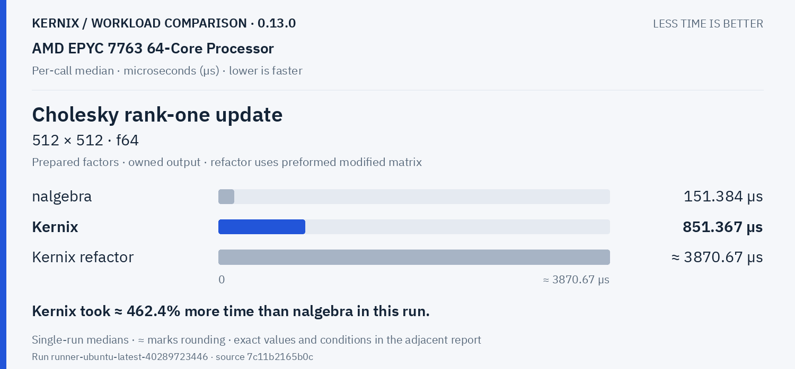

Kernix: **851.367 µs**. Kernix took ≈ 462.4% more time than nalgebra in this run.

**Thin QR · 512 × 128 · f64**

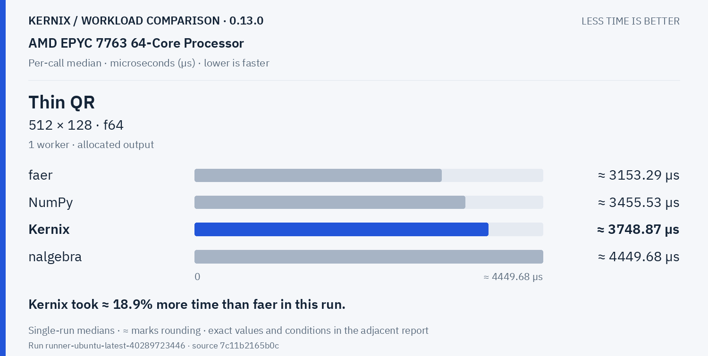

Kernix: **3748.874 µs**. Kernix took ≈ 18.9% more time than faer in this run.

**Thin QR · 1024 × 256 · f64**

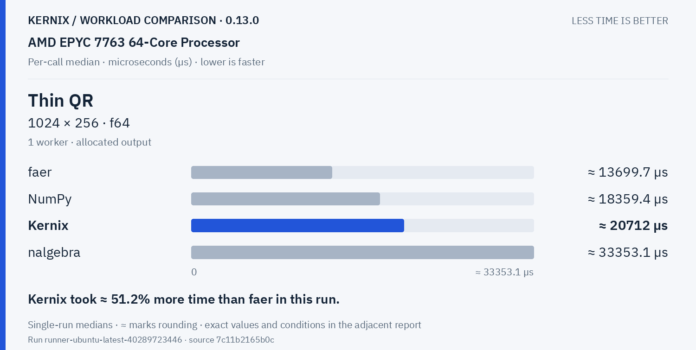

Kernix: **20711.954 µs**. Kernix took ≈ 51.2% more time than faer in this run.

**Cholesky factorization · 512 × 512 · f64**

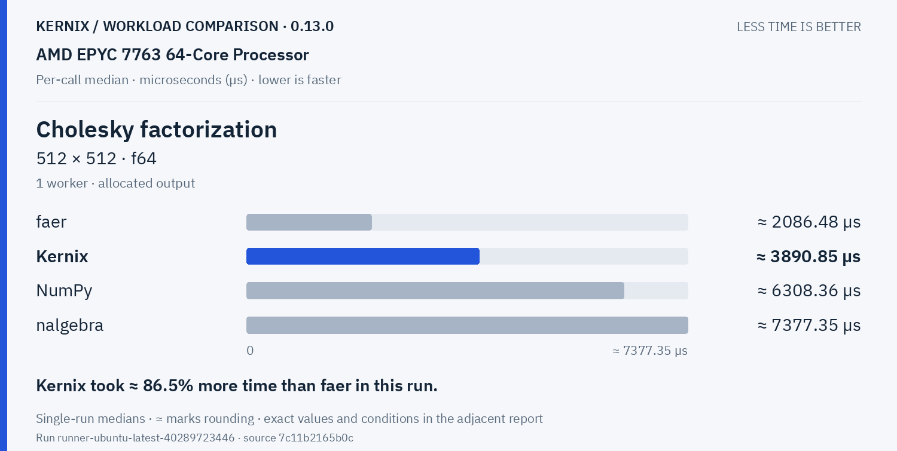

Kernix: **3890.852 µs**. Kernix took ≈ 86.5% more time than faer in this run.

**Column-pivoted QR · 96 × 32 · f64**

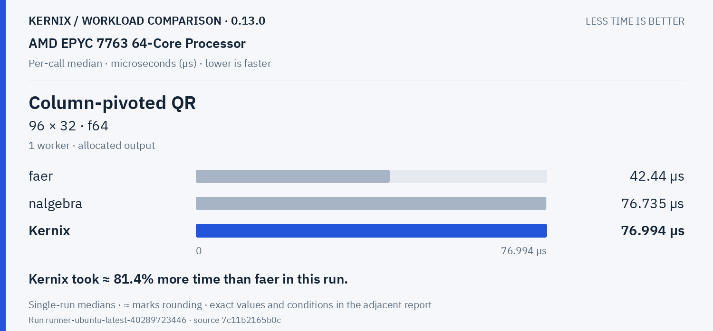

Kernix: **76.994 µs**. Kernix took ≈ 81.4% more time than faer in this run.

**Column-pivoted QR · 256 × 64 · f64**

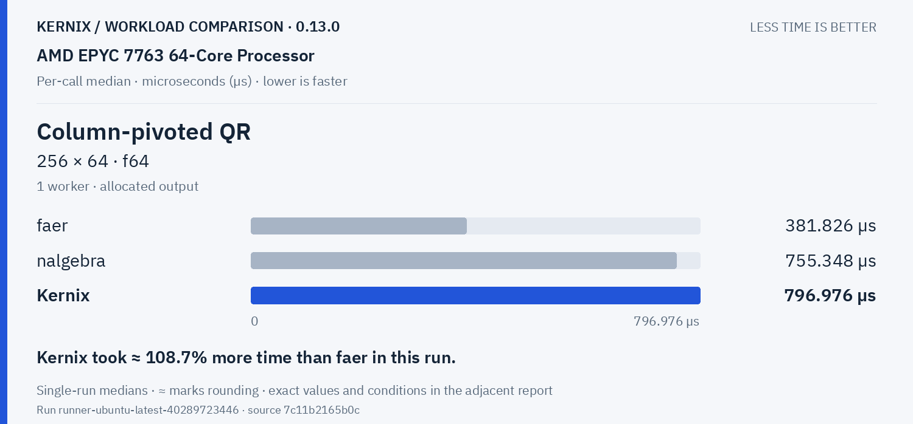

Kernix: **796.976 µs**. Kernix took ≈ 108.7% more time than faer in this run.

**Minimum-norm least squares · 64 × 32, rank 16, 4 RHS · f64**

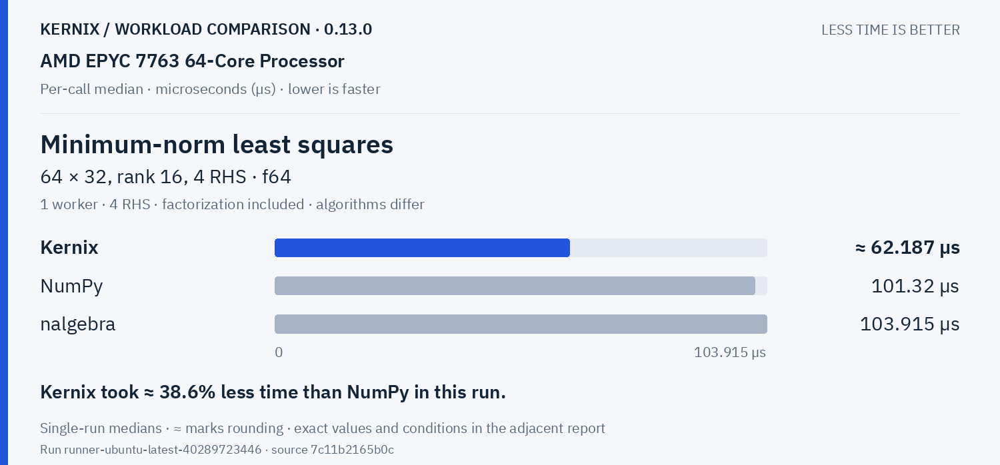

Kernix: **62.18700000000001 µs**. Kernix took ≈ 38.6% less time than NumPy in this run.

**Minimum-norm least squares · 32 × 64, rank 32, 4 RHS · f64**

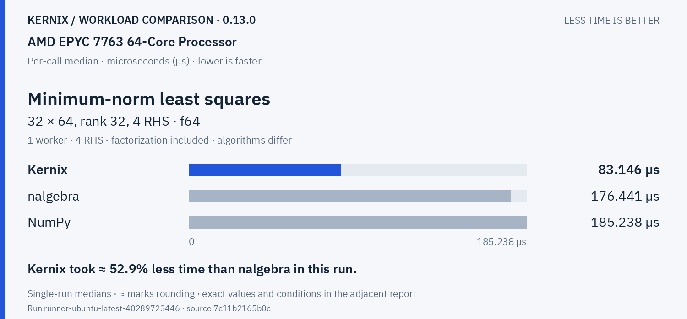

Kernix: **83.146 µs**. Kernix took ≈ 52.9% less time than nalgebra in this run.

**Thin QR · 96 × 32 · f64**

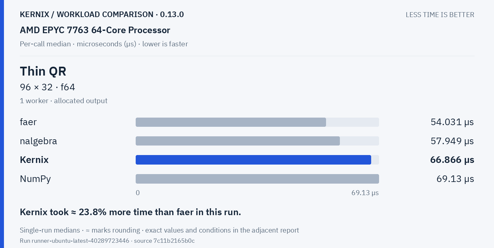

Kernix: **66.866 µs**. Kernix took ≈ 23.8% more time than faer in this run.

**Thin QR · 256 × 64 · f64**

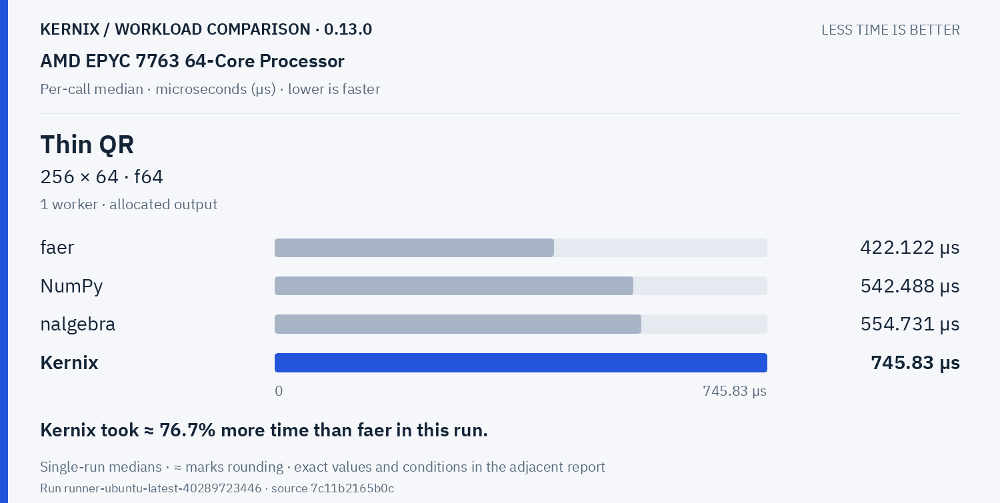

Kernix: **745.83 µs**. Kernix took ≈ 76.7% more time than faer in this run.

**Cholesky factorization · 64 × 64 · f64**

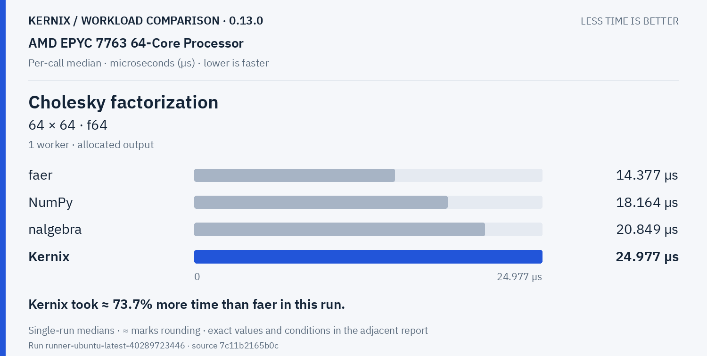

Kernix: **24.977 µs**. Kernix took ≈ 73.7% more time than faer in this run.

**Cholesky factorization · 128 × 128 · f64**

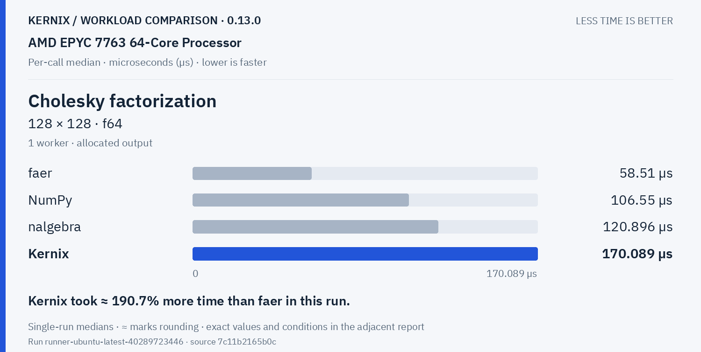

Kernix: **170.089 µs**. Kernix took ≈ 190.7% more time than faer in this run.

**Cholesky factorization · 256 × 256 · f64**

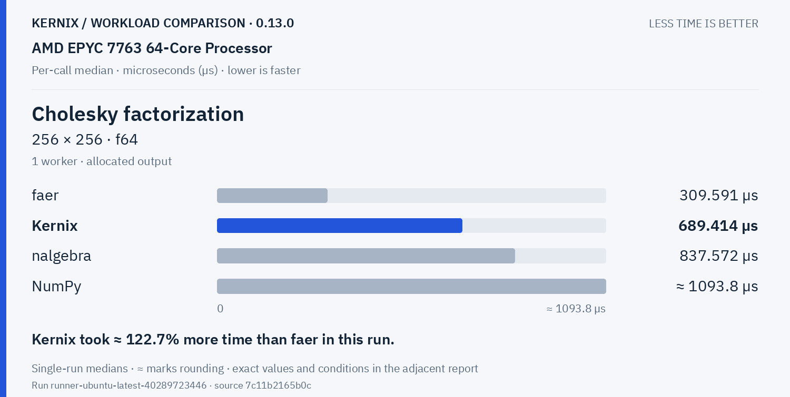

Kernix: **689.414 µs**. Kernix took ≈ 122.7% more time than faer in this run.

Training & autodiff · 6 workloads

**Shared-variable backward · sum(X * X), 64 × 32; prepared graph · f64**

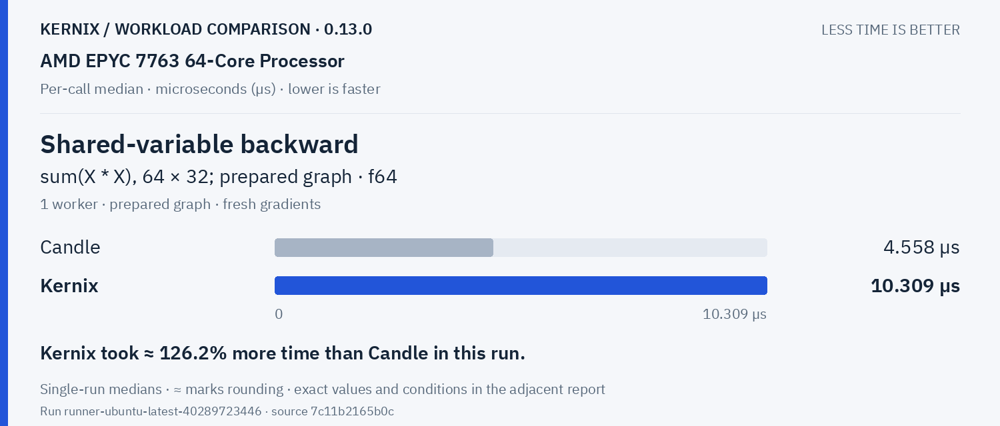

Kernix: **10.309 µs**. Kernix took ≈ 126.2% more time than Candle in this run.

**Record + backward · sum(A · W), 32 × 16 · 16 × 8 · f64**

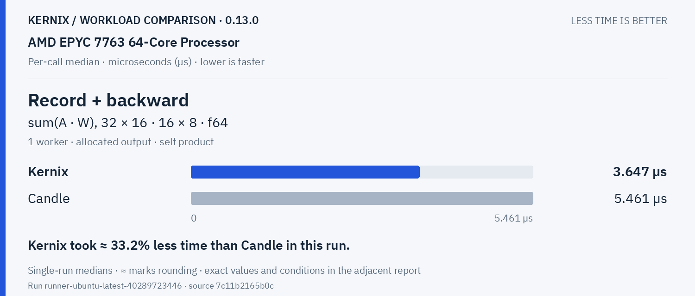

Kernix: **3.647 µs**. Kernix took ≈ 33.2% less time than Candle in this run.

**Model inference · batched normalized/sliced MLP · f64**

Kernix: **2.985 µs**. Kernix took ≈ 32.1% less time than Candle in this run.

**Model recording + forward · batched normalized/sliced MLP · f64**

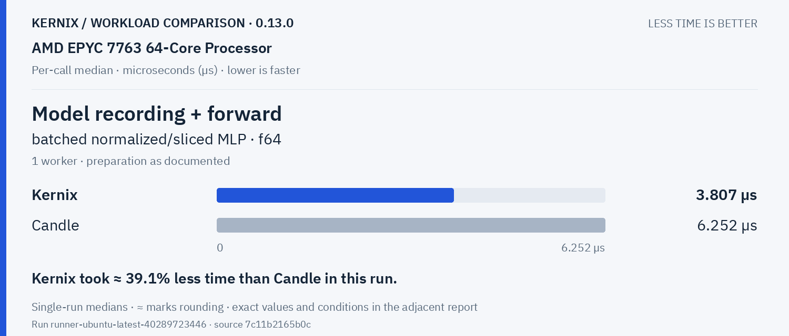

Kernix: **3.807 µs**. Kernix took ≈ 39.1% less time than Candle in this run.

**Model backward · prepared graph → fresh gradients · f64**

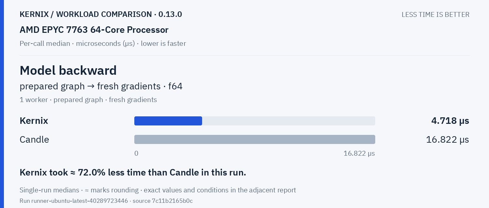

Kernix: **4.718 µs**. Kernix took ≈ 72.0% less time than Candle in this run.

**Parameter update · transactional SGD, fixed gradients · f64**

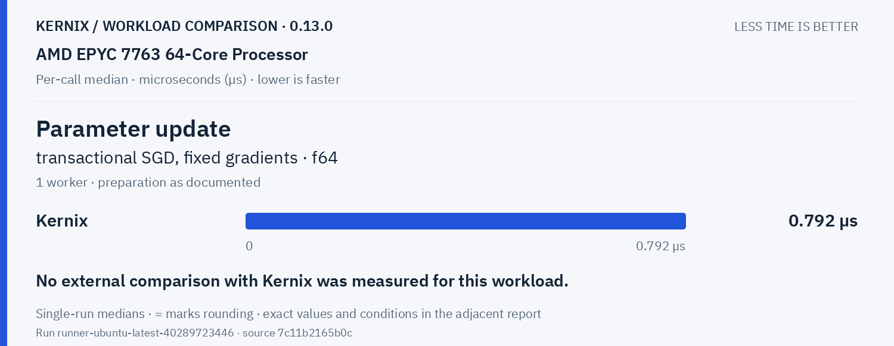

Kernix: **0.792 µs**. No external comparison with Kernix was measured for this workload.

Tensor contractions · 1 workloads

**Coalesced tensor contraction · 16 × 32 × 8 · 32 × 8 × 16 · f64**

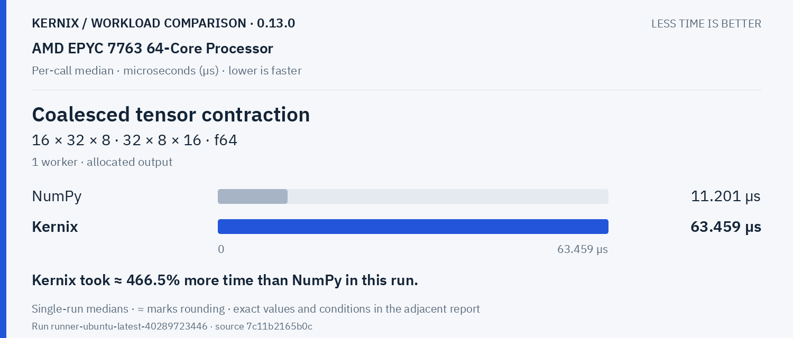

Kernix: **63.459 µs**. Kernix took ≈ 466.5% more time than NumPy in this run.

Statistics & activations · 1 workloads

**Row softmax · 256 × 64 · f64**

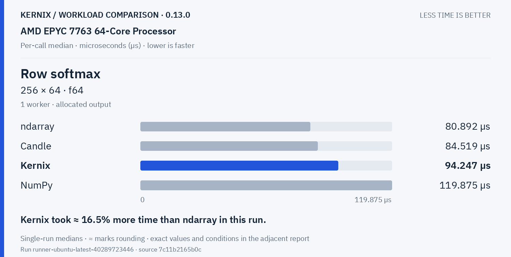

Kernix: **94.247 µs**. Kernix took ≈ 16.5% more time than ndarray in this run.

Tensor construction · 2 workloads

**Create zeros · 64 × 64 · f32**

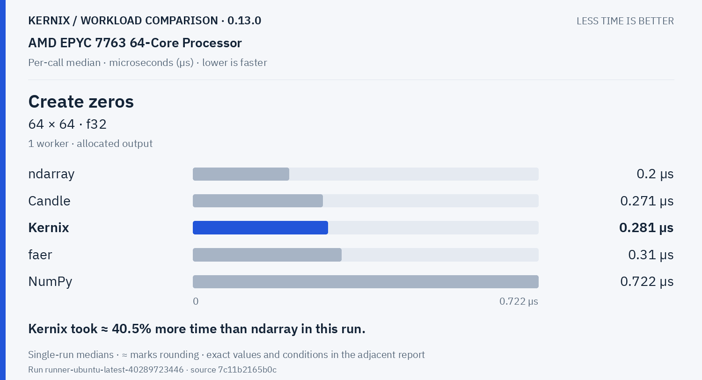

Kernix: **0.281 µs**. Kernix took ≈ 40.5% more time than ndarray in this run.

**Create ones · 64 × 64 · f32**

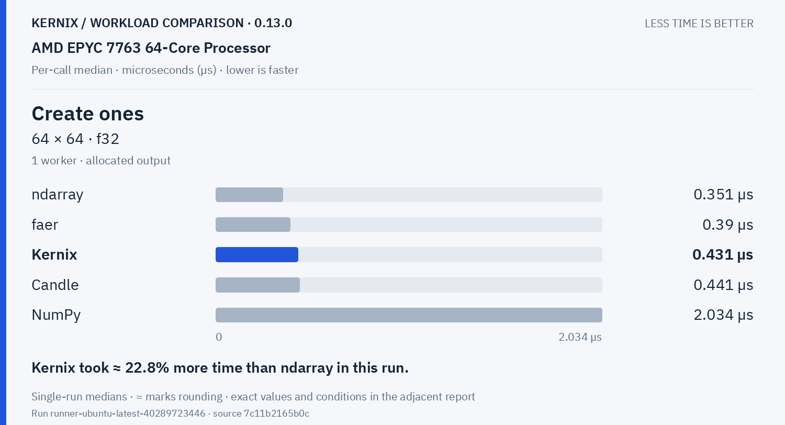

Kernix: **0.431 µs**. Kernix took ≈ 22.8% more time than ndarray in this run.

## Exact latency table

All values below are microseconds per operation. **Lower is faster.** Missing entries were not measured.

| Workload | Kernix | ndarray | nalgebra | faer | Candle | NumPy | Kernix refactor | Kernix · explicit dense | SciPy · CSR | Sequential run change |
|---|---:|---:|---:|---:|---:|---:|---:|---:|---:|---:|
| Sparse matrix × vector · 2048 × 2048 · five diagonals · f64 | 18.394 | — | — | **7.244** | — | 652.023 | — | 2617.301 | 10.43 | — |
| Sparse × dense matrix · 512 × 512 · 32 RHS · five diagonals · f64 | 34.334 | — | — | 66.495 | — | 482.964 | — | 611.327 | **27.05** | — |
| Sparse × dense matrix · 512 × 512 · 32 RHS · five diagonals · f32 | 20.188 | — | — | 61.33499999999999 | — | 205.395 | — | 257.984 | **18.585** | — |
| Sparse × sparse matrix · 256 × 256 · five diagonals each · f64 | 166.673 | — | — | — | — | 769.644 | — | 735.439 | **67.447** | — |
| Automatic CSR construction · 512 × 512 · clone + scan + compress · f64 | 712.978 | — | — | — | — | 73.218 | — | **70.542** | 1473.505 | — |
| Matrix multiplication · transposed view · 128 × 128 · 128 × 128 · f64 | 214.931 | — | — | — | — | **101.301** | — | — | — | +0.4% |
| Matrix multiplication · transposed view · 128 × 128 · 128 × 128 · f32 | 74.36 | — | — | — | — | **50.655** | — | — | — | +0.3% |
| Independent matrix operands · 128 × 128 · 128 × 128 · f64 | **93.435** | — | — | — | — | 100.458 | — | — | — | +0.5% |
| Independent matrix operands · 128 × 128 · 128 × 128 · f32 | **45.695** | — | — | — | — | 49.152 | — | — | — | +0.2% |
| Matrix multiplication · 32 × 32 · 32 × 32 · f64 | 2.414 | 2.154 | 2.114 | **2.034** | **2.034** | 3.657 | — | — | — | +0.8% |
| Matrix multiplication · 64 × 64 · 64 × 64 · f64 | 12.614 | 15.199 | 15.279 | 13.656 | **12.544** | 14.959 | — | — | — | +1.6% |
| Matrix multiplication · 128 × 128 · 128 × 128 · f64 | **92.404** | 210.826 | 208.542 | 113.362 | 92.724 | 100.649 | — | — | — | -0.4% |
| Matrix multiplication · 256 × 256 · 256 × 256 · f64 | 740.77 | 908.665 | 899.177 | 971.814 | **735.45** | 776.227 | — | — | — | +0.8% |
| Matrix multiplication · 64 × 64 · 64 × 64 · f32 | **6.272** | 7.354 | 7.414 | 6.623 | 6.442 | 8.105 | — | — | — | +0.0% |
| Matrix multiplication · 128 × 128 · 128 × 128 · f32 | **45.435** | 73.708 | 75.252 | 49.834 | 45.686 | 49.001 | — | — | — | -0.1% |
| Matrix multiplication · 256 × 256 · 256 × 256 · f32 | **353.403** | 604.234 | 609.694 | 409.348 | 355.758 | 362.15 | — | — | — | +0.3% |
| Batched multiplication · 4 × 16 × 32 · 1 × 32 × 16 · f64 | **1.9939999999999998** | — | — | — | 3.016 | 4.268 | — | — | — | -2.9% |
| Batched multiplication · 4 × 16 × 32 · 1 × 32 × 16 · f32 | **1.182** | — | — | — | 2.0140000000000002 | 3.287 | — | — | — | +0.0% |
| Matmul · 2 workers · reused output · 64 × 64 · 64 × 64 · f64 | 15.75 | — | — | — | — | — | — | — | — | +0.2% |
| Matmul · 2 workers · reused output · 128 × 128 · 128 × 128 · f64 | 56.135 | — | — | — | — | — | — | — | — | -0.2% |
| Matmul · 2 workers · reused output · 256 × 256 · 256 × 256 · f64 | 393.488 | — | — | — | — | — | — | — | — | +0.5% |
| Matmul · 2 workers · reused output · 128 × 128 · 128 × 128 · f32 | 31.218 | — | — | — | — | — | — | — | — | +0.8% |
| Cholesky solve · reused factor · 128 × 128, 1 RHS · f64 | 18.916 | — | 5.982 | **5.831** | — | — | — | — | — | +0.2% |
| Cholesky solve · reused factor · 256 × 256, 64 RHS · f64 | 1322.281 | — | 1276.014 | **275.997** | — | — | — | — | — | +8.4% |
| Cholesky solve · reused factor · 512 × 512, 128 RHS · f64 | 10263.337 | — | 9838.11 | **2212.311** | — | — | — | — | — | +6.8% |
| LU solve · reused factor · 256 × 256, 64 RHS · f64 | 1176.307 | — | 1116.935 | **349.305** | — | — | — | — | — | -0.5% |
| Cholesky rank-one update · 256 × 256 · f64 | 163.848 | — | **36.889** | — | — | — | 684.053 | — | — | -4.4% |
| Cholesky rank-one downdate · 256 × 256 · f64 | 160.802 | — | **39.785** | — | — | — | 688.853 | — | — | -5.4% |
| Cholesky rank-one update · 512 × 512 · f64 | 851.367 | — | **151.384** | — | — | — | 3870.674 | — | — | -4.6% |
| Thin QR · 512 × 128 · f64 | 3748.874 | — | 4449.678 | **3153.292** | — | 3455.533 | — | — | — | +0.5% |
| Thin QR · 1024 × 256 · f64 | 20711.954 | — | 33353.110999999996 | **13699.713** | — | 18359.428 | — | — | — | +0.2% |
| Cholesky factorization · 512 × 512 · f64 | 3890.852 | — | 7377.353 | **2086.485** | — | 6308.358 | — | — | — | +1.5% |
| Column-pivoted QR · 96 × 32 · f64 | 76.994 | — | 76.735 | **42.44** | — | — | — | — | — | -2.6% |
| Column-pivoted QR · 256 × 64 · f64 | 796.976 | — | 755.348 | **381.826** | — | — | — | — | — | +0.6% |
| Minimum-norm least squares · 64 × 32, rank 16, 4 RHS · f64 | **62.18700000000001** | — | 103.915 | — | — | 101.32 | — | — | — | -1.2% |
| Minimum-norm least squares · 32 × 64, rank 32, 4 RHS · f64 | **83.146** | — | 176.441 | — | — | 185.238 | — | — | — | -1.1% |
| Thin QR · 96 × 32 · f64 | 66.866 | — | 57.949 | **54.031** | — | 69.13 | — | — | — | +0.1% |
| Thin QR · 256 × 64 · f64 | 745.83 | — | 554.731 | **422.122** | — | 542.488 | — | — | — | -0.6% |
| Cholesky factorization · 64 × 64 · f64 | 24.977 | — | 20.849 | **14.377** | — | 18.164 | — | — | — | -0.2% |
| Cholesky factorization · 128 × 128 · f64 | 170.089 | — | 120.896 | **58.51** | — | 106.55 | — | — | — | -0.1% |
| Cholesky factorization · 256 × 256 · f64 | 689.414 | — | 837.572 | **309.591** | — | 1093.802 | — | — | — | +1.3% |
| Shared-variable backward · sum(X * X), 64 × 32; prepared graph · f64 | 10.309 | — | — | — | **4.558** | — | — | — | — | -0.0% |
| Record + backward · sum(A · W), 32 × 16 · 16 × 8 · f64 | **3.647** | — | — | — | 5.461 | — | — | — | — | +0.0% |
| Model inference · batched normalized/sliced MLP · f64 | **2.985** | — | — | — | 4.399 | — | — | — | — | -1.4% |
| Model recording + forward · batched normalized/sliced MLP · f64 | **3.807** | — | — | — | 6.252 | — | — | — | — | -1.8% |
| Model backward · prepared graph → fresh gradients · f64 | **4.718** | — | — | — | 16.822 | — | — | — | — | -1.1% |
| Parameter update · transactional SGD, fixed gradients · f64 | 0.792 | — | — | — | — | — | — | — | — | -7.0% |
| Coalesced tensor contraction · 16 × 32 × 8 · 32 × 8 × 16 · f64 | 63.459 | — | — | — | — | **11.201** | — | — | — | +0.1% |
| Row softmax · 256 × 64 · f64 | 94.247 | **80.892** | — | — | 84.519 | 119.875 | — | — | — | +0.2% |
| Create zeros · 64 × 64 · f32 | 0.281 | **0.2** | — | 0.31 | 0.271 | 0.722 | — | — | — | +0.0% |
| Create ones · 64 × 64 · f32 | 0.431 | **0.351** | — | 0.39 | 0.441 | 2.034 | — | — | — | +0.0% |

## Matrix memory

Initialized input payload bytes, including sparse indices/offsets. Excludes capacity, object metadata, allocator overhead and construction peak. Same five-diagonal values; SciPy index width is measured rather than assumed.

| Workload | Implementation | Stored entries | Payload bytes | Dense bytes | Index bytes |
|---|---|---:|---:|---:|---:|
| Sparse matrix × vector · 2048 × 2048 · five diagonals · f64 | faer | 10240 | 180232 | 33554432 | 8 |
| Sparse matrix × vector · 2048 × 2048 · five diagonals · f64 | SciPy · CSR | 10240 | 131076 | 33554432 | 4 |
| Sparse matrix × vector · 2048 × 2048 · five diagonals · f64 | NumPy | 10240 | 33554432 | 33554432 | 0 |
| Sparse matrix × vector · 2048 × 2048 · five diagonals · f64 | Kernix · explicit dense | 10240 | 33554432 | 33554432 | 0 |
| Sparse matrix × vector · 2048 × 2048 · five diagonals · f64 | Kernix | 10240 | 180232 | 33554432 | 8 |
| Sparse × dense matrix · 512 × 512 · 32 RHS · five diagonals · f64 | SciPy · CSR | 2560 | 32772 | 2097152 | 4 |
| Sparse × dense matrix · 512 × 512 · 32 RHS · five diagonals · f64 | Kernix · explicit dense | 2560 | 2097152 | 2097152 | 0 |
| Sparse × dense matrix · 512 × 512 · 32 RHS · five diagonals · f64 | NumPy | 2560 | 2097152 | 2097152 | 0 |
| Sparse × dense matrix · 512 × 512 · 32 RHS · five diagonals · f64 | faer | 2560 | 45064 | 2097152 | 8 |
| Sparse × dense matrix · 512 × 512 · 32 RHS · five diagonals · f64 | Kernix | 2560 | 45064 | 2097152 | 8 |
| Sparse × dense matrix · 512 × 512 · 32 RHS · five diagonals · f32 | SciPy · CSR | 2560 | 22532 | 1048576 | 4 |
| Sparse × dense matrix · 512 × 512 · 32 RHS · five diagonals · f32 | Kernix | 2560 | 34824 | 1048576 | 8 |
| Sparse × dense matrix · 512 × 512 · 32 RHS · five diagonals · f32 | Kernix · explicit dense | 2560 | 1048576 | 1048576 | 0 |
| Sparse × dense matrix · 512 × 512 · 32 RHS · five diagonals · f32 | NumPy | 2560 | 1048576 | 1048576 | 0 |
| Sparse × dense matrix · 512 × 512 · 32 RHS · five diagonals · f32 | faer | 2560 | 34824 | 1048576 | 8 |
| Sparse × sparse matrix · 256 × 256 · five diagonals each · f64 | NumPy | 1280 | 524288 | 524288 | 0 |
| Sparse × sparse matrix · 256 × 256 · five diagonals each · f64 | SciPy · CSR | 1280 | 16388 | 524288 | 4 |
| Sparse × sparse matrix · 256 × 256 · five diagonals each · f64 | Kernix · explicit dense | 1280 | 524288 | 524288 | 0 |
| Sparse × sparse matrix · 256 × 256 · five diagonals each · f64 | Kernix | 1280 | 22536 | 524288 | 8 |
| Automatic CSR construction · 512 × 512 · clone + scan + compress · f64 | Kernix | 2560 | 45064 | 2097152 | 8 |
| Automatic CSR construction · 512 × 512 · clone + scan + compress · f64 | SciPy · CSR | 2560 | 32772 | 2097152 | 4 |
| Automatic CSR construction · 512 × 512 · clone + scan + compress · f64 | Kernix · explicit dense | 2560 | 2097152 | 2097152 | 0 |
| Automatic CSR construction · 512 × 512 · clone + scan + compress · f64 | NumPy | 2560 | 2097152 | 2097152 | 0 |

## Version comparison

24 of 51 workloads have paired evidence. Exploratory 95% intervals resample process pairs, not calls. No multiple-comparison adjustment.

### Version changes at a glance

The vertical line marks unchanged time. Left is faster; right is slower. Ranges are exploratory 95% intervals over fresh-process pairs. An interval crossing the line leaves direction unclear.

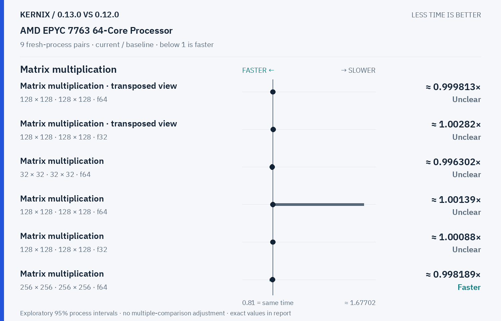

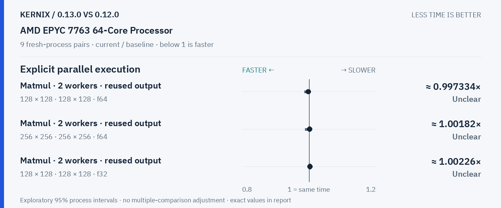

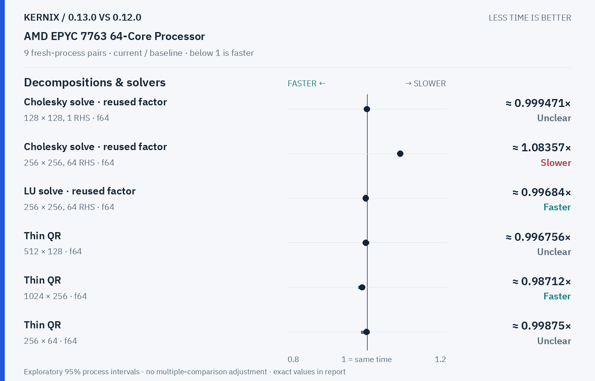

| Workload | Current / baseline [95% interval] | Interpretation |
|---|---:|---|
| Sparse matrix × vector · 2048 × 2048 · five diagonals · f64 | — | No paired comparison |
| Sparse × dense matrix · 512 × 512 · 32 RHS · five diagonals · f64 | — | No paired comparison |
| Sparse × dense matrix · 512 × 512 · 32 RHS · five diagonals · f32 | — | No paired comparison |
| Sparse × sparse matrix · 256 × 256 · five diagonals each · f64 | — | No paired comparison |
| Automatic CSR construction · 512 × 512 · clone + scan + compress · f64 | — | No paired comparison |
| Matrix multiplication · transposed view · 128 × 128 · 128 × 128 · f64 | 0.9998129801151108× [0.9957627512381872, 1.0028547266517467] | Timing direction unclear |
| Matrix multiplication · transposed view · 128 × 128 · 128 × 128 · f32 | 1.0028165236051503× [0.9960981496379726, 1.0098207241763921] | Timing direction unclear |
| Independent matrix operands · 128 × 128 · 128 × 128 · f64 | 1.0011809544258952× [0.994669793721017, 1.0053511348464619] | Timing direction unclear |
| Independent matrix operands · 128 × 128 · 128 × 128 · f32 | 1.000462300495322× [0.9910861814070788, 1.0065968862696808] | Timing direction unclear |
| Matrix multiplication · 32 × 32 · 32 × 32 · f64 | 0.9963023829087921× [0.9837728194726166, 1.0041597337770383] | Timing direction unclear |
| Matrix multiplication · 64 × 64 · 64 × 64 · f64 | — | No paired comparison |
| Matrix multiplication · 128 × 128 · 128 × 128 · f64 | 1.0013946850606525× [0.9919242970052153, 1.597163381838276] | Timing direction unclear |
| Matrix multiplication · 256 × 256 · 256 × 256 · f64 | 0.9981894802135081× [0.9808812825940344, 0.9992079677625157] | Observed time reduction |
| Matrix multiplication · 64 × 64 · 64 × 64 · f32 | — | No paired comparison |
| Matrix multiplication · 128 × 128 · 128 × 128 · f32 | 1.000878445152081× [0.9969261170271161, 1.0062039122179538] | Timing direction unclear |
| Matrix multiplication · 256 × 256 · 256 × 256 · f32 | 1.0007649743733584× [0.996856598178352, 1.001591439699754] | Timing direction unclear |
| Batched multiplication · 4 × 16 × 32 · 1 × 32 × 16 · f64 | 1.0049407114624507× [0.9856648541769648, 1.009930486593843] | Timing direction unclear |
| Batched multiplication · 4 × 16 × 32 · 1 × 32 × 16 · f32 | 0.9916805324459235× [0.9916107382550335, 1.007607776838546] | Timing direction unclear |
| Matmul · 2 workers · reused output · 64 × 64 · 64 × 64 · f64 | — | No paired comparison |
| Matmul · 2 workers · reused output · 128 × 128 · 128 × 128 · f64 | 0.9973336177474402× [0.9863506001487095, 1.0044559308439533] | Timing direction unclear |
| Matmul · 2 workers · reused output · 256 × 256 · 256 × 256 · f64 | 1.00182105104314× [0.9877555854589073, 1.0068579077147009] | Timing direction unclear |
| Matmul · 2 workers · reused output · 128 × 128 · 128 × 128 · f32 | 1.0022567541427556× [0.9981015509363537, 1.004204377687913] | Timing direction unclear |
| Cholesky solve · reused factor · 128 × 128, 1 RHS · f64 | 0.999471067386015× [0.9973565952947396, 1.0020628371945415] | Timing direction unclear |
| Cholesky solve · reused factor · 256 × 256, 64 RHS · f64 | 1.083568245363017× [1.0802557742871344, 1.08517793042905] | Observed time increase |
| Cholesky solve · reused factor · 512 × 512, 128 RHS · f64 | — | No paired comparison |
| LU solve · reused factor · 256 × 256, 64 RHS · f64 | 0.996840299031319× [0.9959151607706278, 0.9975877328672669] | Observed time reduction |
| Cholesky rank-one update · 256 × 256 · f64 | — | No paired comparison |
| Cholesky rank-one downdate · 256 × 256 · f64 | — | No paired comparison |
| Cholesky rank-one update · 512 × 512 · f64 | — | No paired comparison |
| Thin QR · 512 × 128 · f64 | 0.9967563158814609× [0.9918963979065318, 1.0046826330122811] | Timing direction unclear |
| Thin QR · 1024 × 256 · f64 | 0.9871204439911031× [0.9779744047084407, 0.9891396504940139] | Observed time reduction |
| Cholesky factorization · 512 × 512 · f64 | 1.009350517607689× [1.0043837900899306, 1.0151540833691663] | Observed time increase |
| Column-pivoted QR · 96 × 32 · f64 | — | No paired comparison |
| Column-pivoted QR · 256 × 64 · f64 | — | No paired comparison |
| Minimum-norm least squares · 64 × 32, rank 16, 4 RHS · f64 | — | No paired comparison |
| Minimum-norm least squares · 32 × 64, rank 32, 4 RHS · f64 | — | No paired comparison |
| Thin QR · 96 × 32 · f64 | — | No paired comparison |
| Thin QR · 256 × 64 · f64 | 0.9987499230413007× [0.9846317345901487, 1.0057244869354816] | Timing direction unclear |
| Cholesky factorization · 64 × 64 · f64 | — | No paired comparison |
| Cholesky factorization · 128 × 128 · f64 | 1.000831230693046× [0.9978279884237653, 1.004733574143589] | Timing direction unclear |
| Cholesky factorization · 256 × 256 · f64 | 1.0035265993610598× [0.9962365833107335, 1.0075267678861823] | Timing direction unclear |
| Shared-variable backward · sum(X * X), 64 × 32; prepared graph · f64 | — | No paired comparison |
| Record + backward · sum(A · W), 32 × 16 · 16 × 8 · f64 | 0.9972580202906498× [0.9864755206924534, 1.0137098985467508] | Timing direction unclear |
| Model inference · batched normalized/sliced MLP · f64 | — | No paired comparison |
| Model recording + forward · batched normalized/sliced MLP · f64 | — | No paired comparison |
| Model backward · prepared graph → fresh gradients · f64 | — | No paired comparison |
| Parameter update · transactional SGD, fixed gradients · f64 | — | No paired comparison |
| Coalesced tensor contraction · 16 × 32 × 8 · 32 × 8 × 16 · f64 | — | No paired comparison |
| Row softmax · 256 × 64 · f64 | — | No paired comparison |
| Create zeros · 64 × 64 · f32 | — | No paired comparison |
| Create ones · 64 × 64 · f32 | — | No paired comparison |

## Method and provenance

CPU affinity pinned to logical CPU 0. Frequency and background load are uncontrolled.

Minimum-norm rows use pivoted QR plus scaled implicit RZ in Kernix; NumPy native lstsq; nalgebra native SVD/solve. Algorithm costs and rank policies differ. See original method for thresholds. Kernix/nalgebra: prepared base factor, owned modified factor; refactor: same Kernix version, full factorization of preformed modified matrix; base setup and matrix formation excluded Rank two; cyclic five diagonals; exact dyadic values; 1 worker; owned output; prepared operands except auto construction. Kernix Matrix finite checks vs peer IEEE policies; payload excludes capacity, metadata and allocator overhead. CSR indices usize in Kernix/faer and actual recorded SciPy width. SpGEMM heap merge vs SciPy column accumulator; fill-in depends on pattern. Construction: Kernix clones a Vec then validates/scans/compresses; SciPy borrows dense input and allocates CSR output; NumPy/dense Kernix copy only. Construction compares API trade-offs, not identical algorithms. No universal sparse speed or density threshold claim.

Numbers retain source precision; recorded digits do not imply equivalent physical measurement accuracy. Lowest observed medians are bold only when peers were measured. No aggregate winner or universal ranking is inferred.

[Original report and commentary](original-report.txt) · [Raw measurements](raw.json)

Measured source `7c11b2165b0cb7b523db4d938a36f1396396a138`. Run `runner-ubuntu-latest-40289723446`. Rendering does not change measurements.
