# Kernix 0.8.0 · performance brief

AMD EPYC 7763 64-Core Processor / Windows

**Per-call median, microseconds per operation. Lower is faster. All recorded digits retained.**

21 workloads · 88 observations

No previous-version baseline attached. Sequential run changes are descriptive; paired process evidence is shown separately.

[Interactive HTML (open locally)](report.html) · [Vector PDF](latency.pdf) · [Raw measurements](raw.json)

[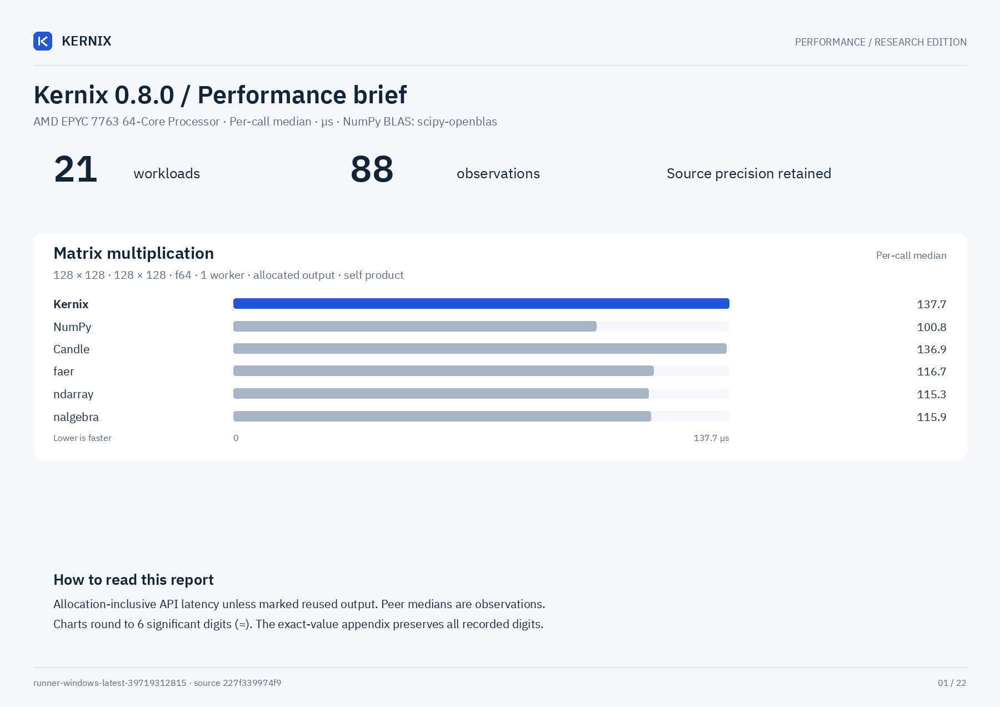](latency.pdf)

## Charts by workload

**Shorter bars mean less time.** Blue is Kernix; grey is a comparison implementation; teal is an explicitly selected Kernix backend. Entries are sorted by the recorded median, with a separate zero-based scale per chart. These point observations do not establish a statistical ranking.

Expand a group to see every chart here on GitHub. Click a chart to enlarge it. The exact table below keeps every source digit.

Matrix multiplication · 8 workloads

**Matrix multiplication · 32 × 32 · 32 × 32 · f64**

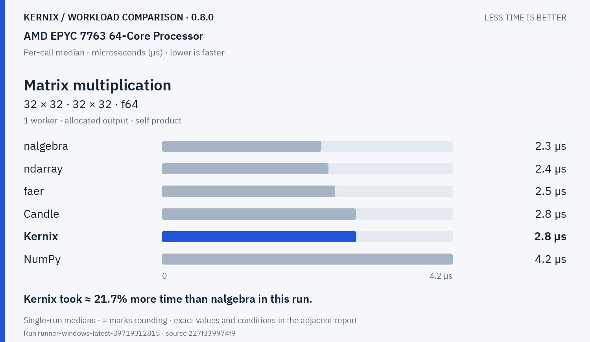

Kernix: **2.8 µs**. Kernix took ≈ 21.7% more time than nalgebra in this run.

**Matrix multiplication · 64 × 64 · 64 × 64 · f64**

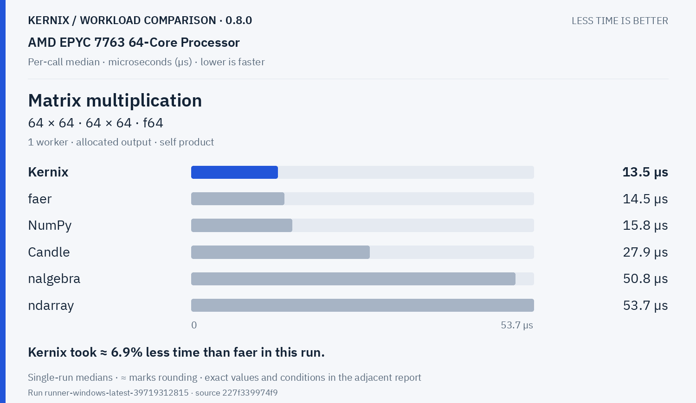

Kernix: **13.5 µs**. Kernix took ≈ 6.9% less time than faer in this run.

**Matrix multiplication · 128 × 128 · 128 × 128 · f64**

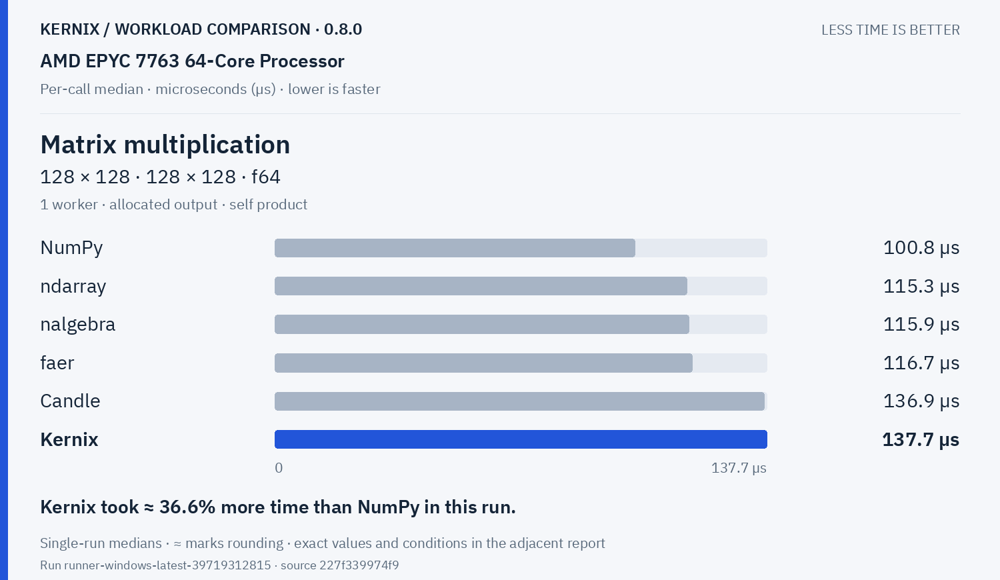

Kernix: **137.7 µs**. Kernix took ≈ 36.6% more time than NumPy in this run.

**Matrix multiplication · 256 × 256 · 256 × 256 · f64**

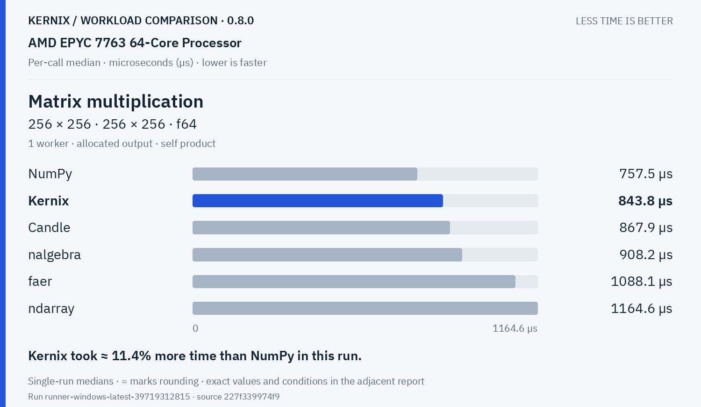

Kernix: **843.8 µs**. Kernix took ≈ 11.4% more time than NumPy in this run.

**Matrix multiplication · 64 × 64 · 64 × 64 · f32**

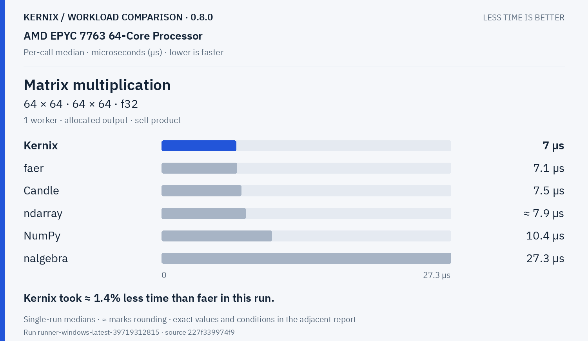

Kernix: **7 µs**. Kernix took ≈ 1.4% less time than faer in this run.

**Matrix multiplication · 128 × 128 · 128 × 128 · f32**

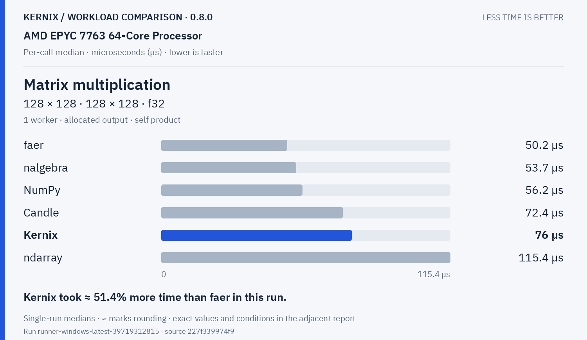

Kernix: **76 µs**. Kernix took ≈ 51.4% more time than faer in this run.

**Matrix multiplication · 256 × 256 · 256 × 256 · f32**

Kernix: **440.4 µs**. Kernix took ≈ 12.5% more time than NumPy in this run.

**Batched multiplication · 4 × 16 × 32 · 1 × 32 × 16 · f64**

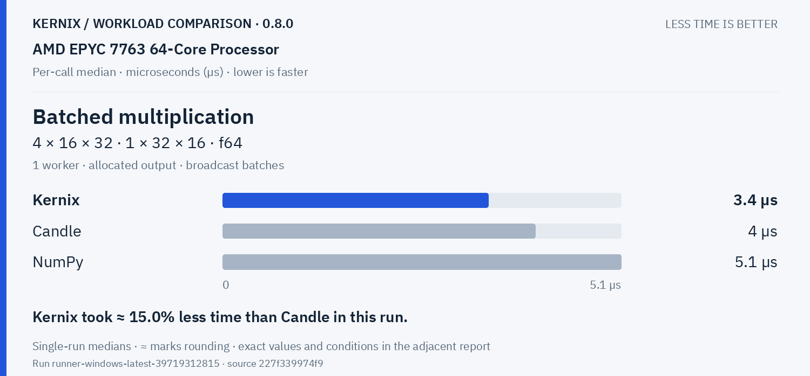

Kernix: **3.4 µs**. Kernix took ≈ 15.0% less time than Candle in this run.

Decompositions & solvers · 5 workloads

**Thin QR · 96 × 32 · f64**

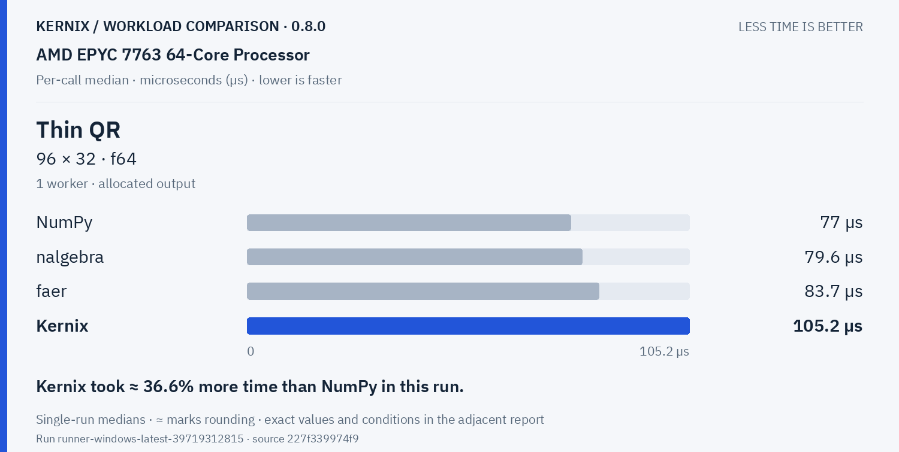

Kernix: **105.2 µs**. Kernix took ≈ 36.6% more time than NumPy in this run.

**Thin QR · 256 × 64 · f64**

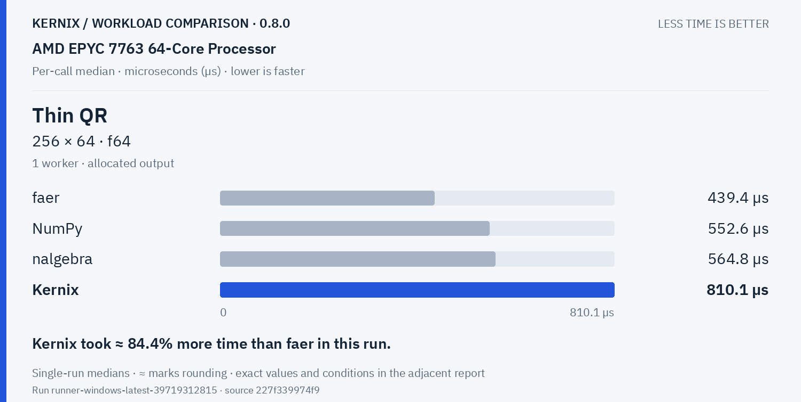

Kernix: **810.1 µs**. Kernix took ≈ 84.4% more time than faer in this run.

**Cholesky factorization · 64 × 64 · f64**

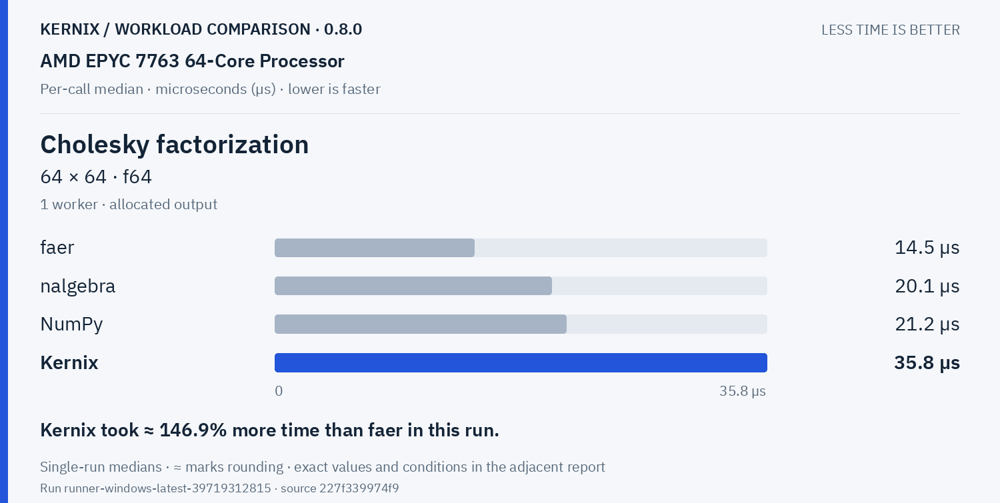

Kernix: **35.8 µs**. Kernix took ≈ 146.9% more time than faer in this run.

**Cholesky factorization · 128 × 128 · f64**

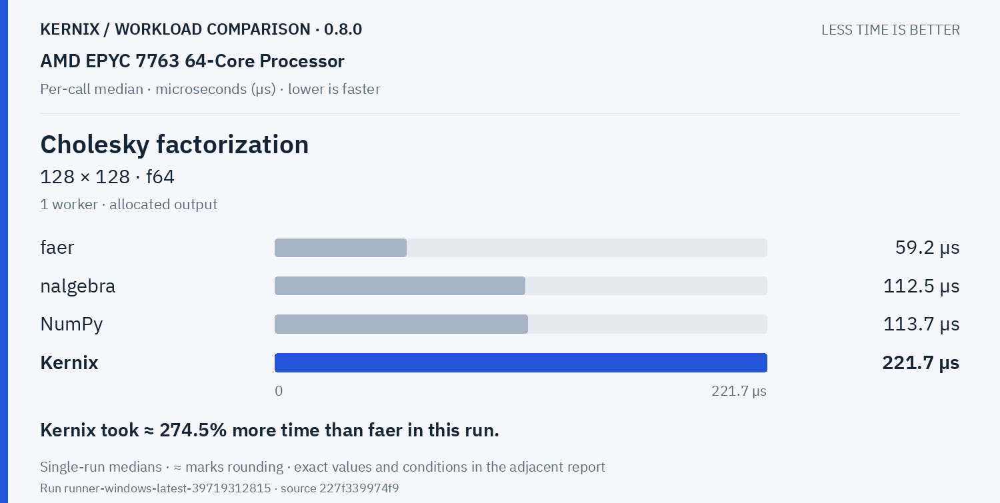

Kernix: **221.7 µs**. Kernix took ≈ 274.5% more time than faer in this run.

**Cholesky factorization · 256 × 256 · f64**

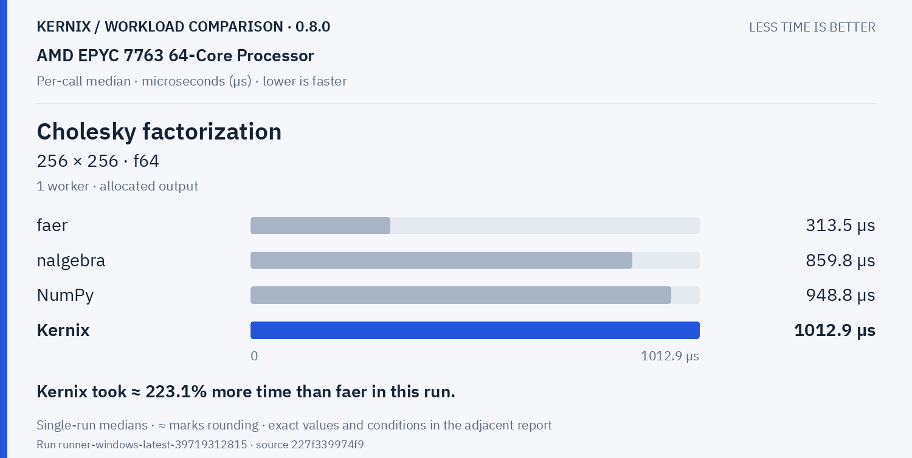

Kernix: **1012.9 µs**. Kernix took ≈ 223.1% more time than faer in this run.

Training & autodiff · 5 workloads

**Record + backward · sum(A · W), 32 × 16 · 16 × 8 · f64**

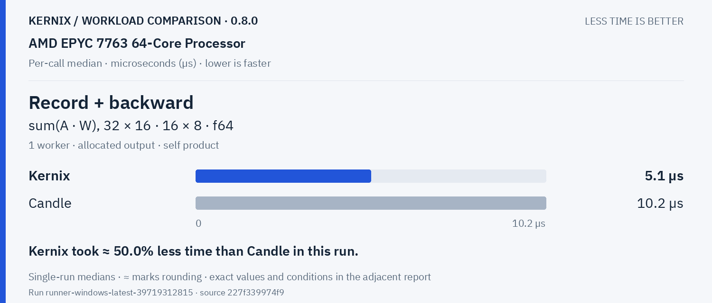

Kernix: **5.1 µs**. Kernix took ≈ 50.0% less time than Candle in this run.

**Model inference · batched normalized/sliced MLP · f64**

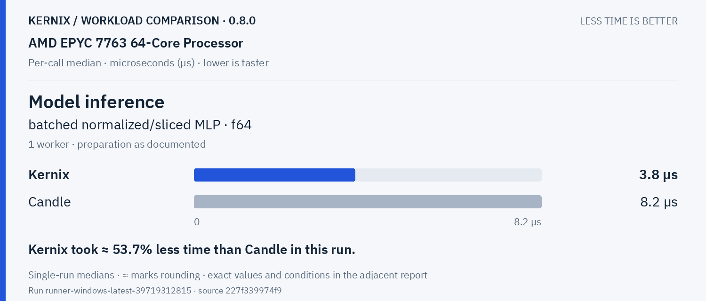

Kernix: **3.8 µs**. Kernix took ≈ 53.7% less time than Candle in this run.

**Model recording + forward · batched normalized/sliced MLP · f64**

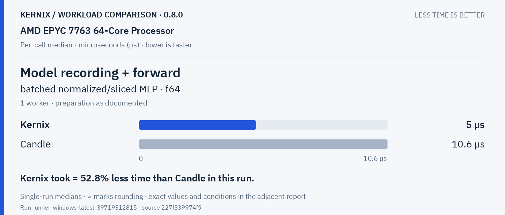

Kernix: **5 µs**. Kernix took ≈ 52.8% less time than Candle in this run.

**Model backward · prepared graph → fresh gradients · f64**

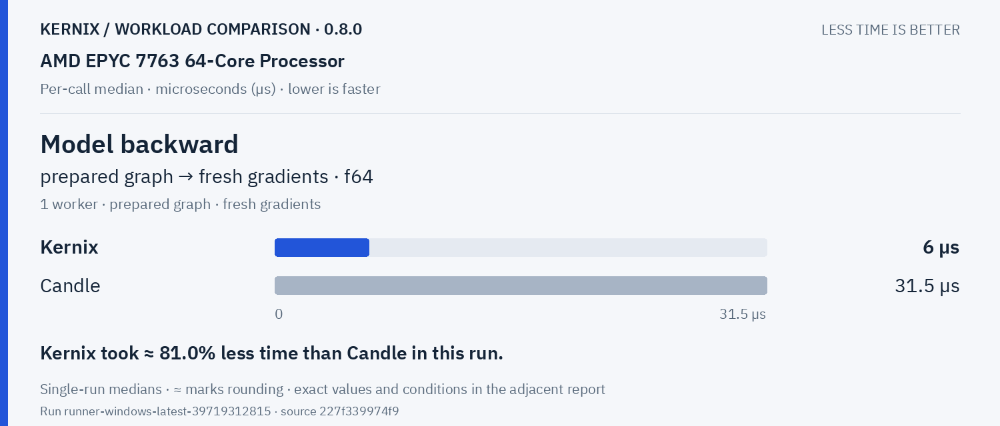

Kernix: **6 µs**. Kernix took ≈ 81.0% less time than Candle in this run.

**Parameter update · transactional SGD, fixed gradients · f64**

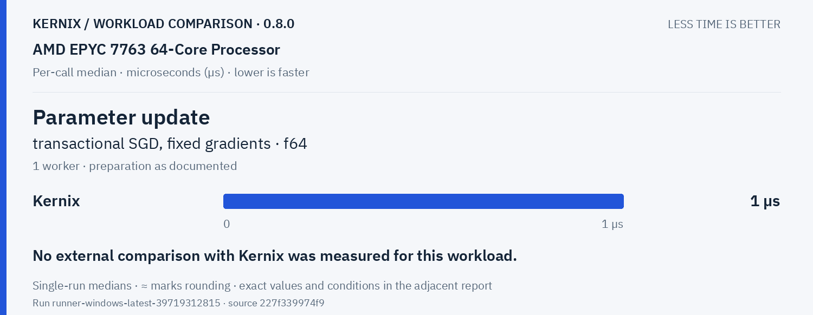

Kernix: **1 µs**. No external comparison with Kernix was measured for this workload.

Statistics & activations · 1 workloads

**Row softmax · 256 × 64 · f64**

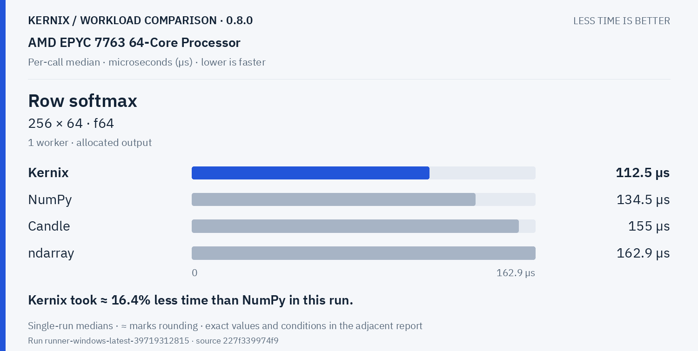

Kernix: **112.5 µs**. Kernix took ≈ 16.4% less time than NumPy in this run.

Tensor construction · 2 workloads

**Create zeros · 64 × 64 · f32**

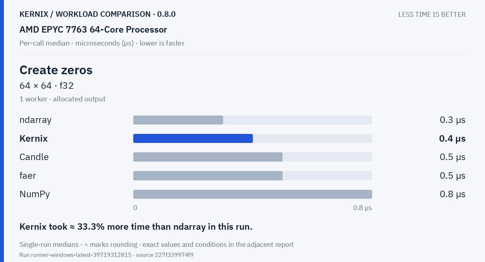

Kernix: **0.4 µs**. Kernix took ≈ 33.3% more time than ndarray in this run.

**Create ones · 64 × 64 · f32**

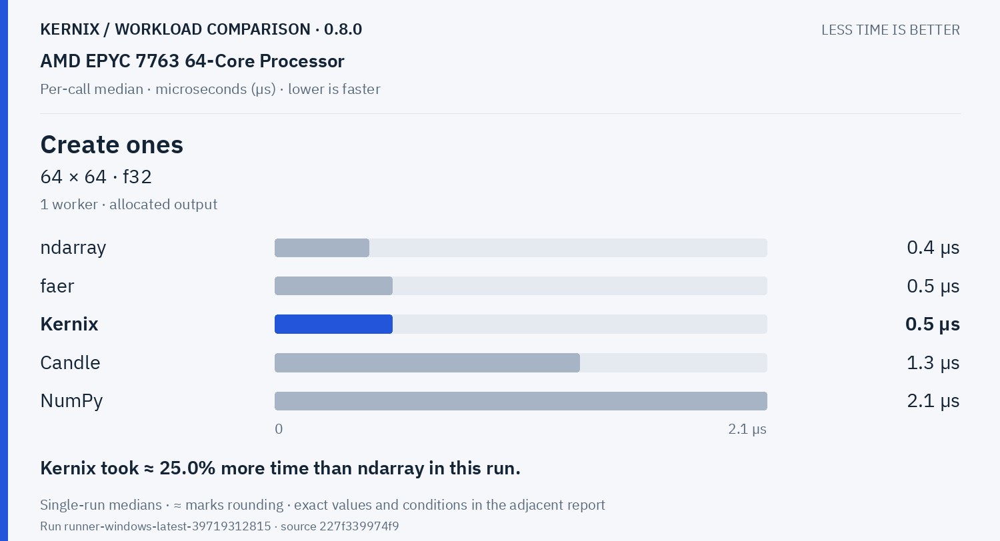

Kernix: **0.5 µs**. Kernix took ≈ 25.0% more time than ndarray in this run.

## Exact latency table

All values below are microseconds per operation. **Lower is faster.** Missing entries were not measured.

| Workload | Kernix | ndarray | nalgebra | faer | Candle | NumPy |
|---|---:|---:|---:|---:|---:|---:|
| Matrix multiplication · 32 × 32 · 32 × 32 · f64 | 2.8 | 2.4 | **2.3** | 2.5 | 2.8 | 4.2 |
| Matrix multiplication · 64 × 64 · 64 × 64 · f64 | **13.5** | 53.7 | 50.8 | 14.5 | 27.9 | 15.8 |
| Matrix multiplication · 128 × 128 · 128 × 128 · f64 | 137.7 | 115.3 | 115.9 | 116.7 | 136.9 | **100.8** |
| Matrix multiplication · 256 × 256 · 256 × 256 · f64 | 843.8 | 1164.6 | 908.2 | 1088.1 | 867.9 | **757.5** |
| Matrix multiplication · 64 × 64 · 64 × 64 · f32 | **7** | 7.900000000000001 | 27.3 | 7.1 | 7.5 | 10.4 |
| Matrix multiplication · 128 × 128 · 128 × 128 · f32 | 76 | 115.4 | 53.7 | **50.2** | 72.4 | 56.2 |
| Matrix multiplication · 256 × 256 · 256 × 256 · f32 | 440.4 | 397.5 | 399.7 | 424.9 | 432.3 | **391.5** |
| Batched multiplication · 4 × 16 × 32 · 1 × 32 × 16 · f64 | **3.4** | — | — | — | 4 | 5.1 |
| Thin QR · 96 × 32 · f64 | 105.2 | — | 79.6 | 83.7 | — | **77** |
| Thin QR · 256 × 64 · f64 | 810.1 | — | 564.8 | **439.4** | — | 552.6 |
| Cholesky factorization · 64 × 64 · f64 | 35.8 | — | 20.1 | **14.5** | — | 21.2 |
| Cholesky factorization · 128 × 128 · f64 | 221.7 | — | 112.5 | **59.2** | — | 113.7 |
| Cholesky factorization · 256 × 256 · f64 | 1012.9 | — | 859.8 | **313.5** | — | 948.8 |
| Record + backward · sum(A · W), 32 × 16 · 16 × 8 · f64 | **5.1** | — | — | — | 10.2 | — |
| Model inference · batched normalized/sliced MLP · f64 | **3.8** | — | — | — | 8.2 | — |
| Model recording + forward · batched normalized/sliced MLP · f64 | **5** | — | — | — | 10.6 | — |
| Model backward · prepared graph → fresh gradients · f64 | **6** | — | — | — | 31.5 | — |
| Parameter update · transactional SGD, fixed gradients · f64 | 1 | — | — | — | — | — |
| Row softmax · 256 × 64 · f64 | **112.5** | 162.9 | — | — | 155 | 134.5 |
| Create zeros · 64 × 64 · f32 | 0.4 | **0.3** | — | 0.5 | 0.5 | 0.8 |
| Create ones · 64 × 64 · f32 | 0.5 | **0.4** | — | 0.5 | 1.3 | 2.1 |

## Version comparison

0 of 21 workloads have paired evidence. Exploratory 95% intervals resample process pairs, not calls. No multiple-comparison adjustment.

| Workload | Current / baseline [95% interval] | Interpretation |
|---|---:|---|
| Matrix multiplication · 32 × 32 · 32 × 32 · f64 | — | No paired comparison |
| Matrix multiplication · 64 × 64 · 64 × 64 · f64 | — | No paired comparison |
| Matrix multiplication · 128 × 128 · 128 × 128 · f64 | — | No paired comparison |
| Matrix multiplication · 256 × 256 · 256 × 256 · f64 | — | No paired comparison |
| Matrix multiplication · 64 × 64 · 64 × 64 · f32 | — | No paired comparison |
| Matrix multiplication · 128 × 128 · 128 × 128 · f32 | — | No paired comparison |
| Matrix multiplication · 256 × 256 · 256 × 256 · f32 | — | No paired comparison |
| Batched multiplication · 4 × 16 × 32 · 1 × 32 × 16 · f64 | — | No paired comparison |
| Thin QR · 96 × 32 · f64 | — | No paired comparison |
| Thin QR · 256 × 64 · f64 | — | No paired comparison |
| Cholesky factorization · 64 × 64 · f64 | — | No paired comparison |
| Cholesky factorization · 128 × 128 · f64 | — | No paired comparison |
| Cholesky factorization · 256 × 256 · f64 | — | No paired comparison |
| Record + backward · sum(A · W), 32 × 16 · 16 × 8 · f64 | — | No paired comparison |
| Model inference · batched normalized/sliced MLP · f64 | — | No paired comparison |
| Model recording + forward · batched normalized/sliced MLP · f64 | — | No paired comparison |
| Model backward · prepared graph → fresh gradients · f64 | — | No paired comparison |
| Parameter update · transactional SGD, fixed gradients · f64 | — | No paired comparison |
| Row softmax · 256 × 64 · f64 | — | No paired comparison |
| Create zeros · 64 × 64 · f32 | — | No paired comparison |
| Create ones · 64 × 64 · f32 | — | No paired comparison |

## Method and provenance

CPU affinity was not pinned. Frequency and background load are uncontrolled.

Numbers retain source precision; recorded digits do not imply equivalent physical measurement accuracy. Lowest observed medians are bold only when peers were measured. No aggregate winner or universal ranking is inferred.

[Original report and commentary](original-report.txt) · [Raw measurements](raw.json)

Measured source `227f339974f9c31fcf6bd37ccccbda3eedc99591`. Run `runner-windows-latest-39719312815`. Rendering does not change measurements.
