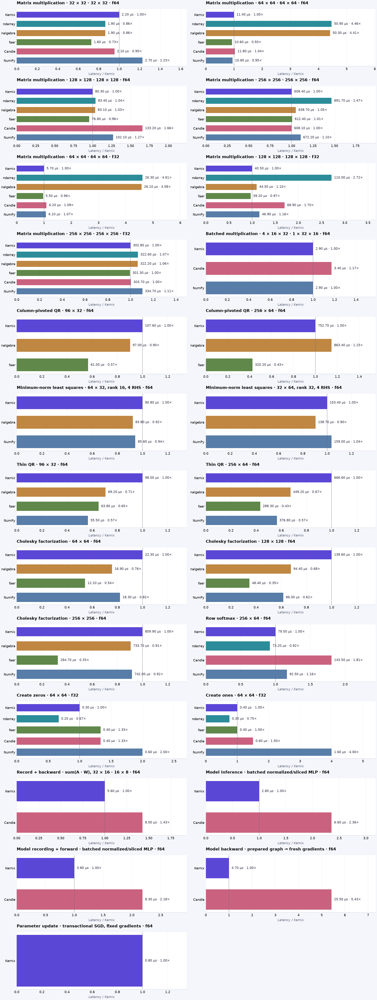

# Kernix 0.9.0 · CPU benchmarks

AMD EPYC 9V74 80-Core Processor · one BLAS/Rayon thread · allocation-inclusive · warmed individual calls

**Microseconds per call, median. Lower is faster; bold marks the lowest observed median in each row.**

No previous-version baseline is paired with this view.

| Workload | Kernix | ndarray | nalgebra | faer | Candle | NumPy |
|---|---:|---:|---:|---:|---:|---:|
| Matrix multiplication · 32 × 32 · 32 × 32 · f64 | 2.200 | 1.900 | 1.900 | **1.600** | 2.100 | 2.700 |
| Matrix multiplication · 64 × 64 · 64 × 64 · f64 | 11.400 | 50.900 | 50.300 | **10.600** | 11.800 | 10.800 |
| Matrix multiplication · 128 × 128 · 128 × 128 · f64 | 80.300 | 83.400 | 83.100 | **76.800** | 133.200 | 102.100 |
| Matrix multiplication · 256 × 256 · 256 × 256 · f64 | 608.400 | 891.700 | 638.700 | 612.400 | **608.100** | 672.200 |
| Matrix multiplication · 64 × 64 · 64 × 64 · f32 | 5.700 | 26.300 | 26.100 | **5.500** | 6.200 | 6.100 |
| Matrix multiplication · 128 × 128 · 128 × 128 · f32 | 40.500 | 110.000 | 44.500 | **39.200** | 68.900 | 46.900 |
| Matrix multiplication · 256 × 256 · 256 × 256 · f32 | 302.800 | 322.600 | 322.200 | **301.300** | 303.700 | 334.700 |
| Batched multiplication · 4 × 16 × 32 · 1 × 32 × 16 · f64 | **2.900** | — | — | — | 3.400 | **2.900** |
| Column-pivoted QR · 96 × 32 · f64 | 107.600 | — | 97.000 | **61.000** | — | — |
| Column-pivoted QR · 256 × 64 · f64 | 752.700 | — | 863.400 | **320.200** | — | — |
| Minimum-norm least squares · 64 × 32, rank 16, 4 RHS · f64 | 90.800 | — | **83.800** | — | — | 85.600 |
| Minimum-norm least squares · 32 × 64, rank 32, 4 RHS · f64 | 153.400 | — | **138.700** | — | — | 159.000 |
| Thin QR · 96 × 32 · f64 | 98.000 | — | 69.200 | 63.800 | — | **55.500** |
| Thin QR · 256 × 64 · f64 | 666.600 | — | 449.200 | **288.300** | — | 376.800 |
| Cholesky factorization · 64 × 64 · f64 | 22.300 | — | 16.900 | **12.100** | — | 18.300 |
| Cholesky factorization · 128 × 128 · f64 | 139.600 | — | 94.400 | **48.400** | — | 86.000 |
| Cholesky factorization · 256 × 256 · f64 | 809.900 | — | 733.700 | **264.700** | — | 742.000 |
| Row softmax · 256 × 64 · f64 | 79.500 | **73.200** | — | — | 143.500 | 92.500 |
| Create zeros · 64 × 64 · f32 | 0.300 | **0.200** | — | 0.400 | 0.400 | 0.600 |
| Create ones · 64 × 64 · f32 | 0.400 | **0.300** | — | 0.400 | 0.600 | 1.600 |
| Record + backward · sum(A · W), 32 × 16 · 16 × 8 · f64 | **5.600** | — | — | — | 8.000 | — |
| Model inference · batched normalized/sliced MLP · f64 | **2.800** | — | — | — | 6.600 | — |
| Model recording + forward · batched normalized/sliced MLP · f64 | **3.800** | — | — | — | 8.300 | — |
| Model backward · prepared graph → fresh gradients · f64 | **4.700** | — | — | — | 25.500 | — |
| Parameter update · transactional SGD, fixed gradients · f64 | **0.800** | — | — | — | — | — |

Each panel has its own scale. Ratios are library / Kernix median; below 1 means the comparator was faster.

## Reading these results

Minimum-norm rows include factorization and four RHS. Kernix uses pivoted/right QR; NumPy uses native lstsq; nalgebra uses native SVD/solve. Fixtures have a wide rank gap; null-space orthogonality and normal residual are validated independently. Algorithm costs and rank policies differ; see DETAILS.md for thresholds. These are not general SVD comparisons.

- One measured host and one BLAS/Rayon thread. CPU affinity was not pinned. Frequency and background load are uncontrolled; these observations establish no universal ranking.
- Timing includes output allocation and destruction. Inputs and imports are prepared outside timing. GEMM inputs are row-major; output layout and validation contracts can differ by library.
- Per-call p95 describes 256 individual warmed calls. The 15 batch means form a separate distribution; neither is a confidence interval.
- Rust allocation probes use a separate instrumented binary. Native engines may retain packing buffers; warmed probes exclude their first-use allocation and retention. NumPy native allocations are unavailable, never zero.

[Interactive report](report.html) · [Detailed measurements and method](DETAILS.md) · [Raw samples and provenance](raw.json) · [Printable chart](latency.pdf)

Measured source `9b7ef492c99bf2202e7eb3b07a79ef8f108991c7`. Run `runner-windows-latest-39980084433`. Rendering does not remeasure or modify raw evidence.
