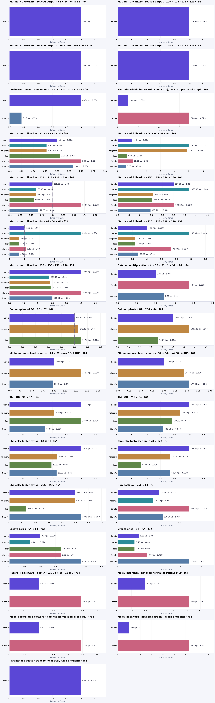

# Kernix 0.10.0 · CPU benchmarks

INTEL(R) XEON(R) PLATINUM 8573C · one BLAS/Rayon thread · allocating APIs unless marked reused · warmed individual calls · explicit 2-worker rows labelled

**Microseconds per call, median. Lower is faster; bold marks the lowest observed median in each row.**

No previous-version baseline is paired with this view.

| Workload | Kernix | ndarray | nalgebra | faer | Candle | NumPy |
|---|---:|---:|---:|---:|---:|---:|
| Matmul · 2 workers · reused output · 64 × 64 · 64 × 64 · f64 | **106.900** | — | — | — | — | — |
| Matmul · 2 workers · reused output · 128 × 128 · 128 × 128 · f64 | **114.900** | — | — | — | — | — |
| Matmul · 2 workers · reused output · 256 × 256 · 256 × 256 · f64 | **504.100** | — | — | — | — | — |
| Matmul · 2 workers · reused output · 128 × 128 · 128 × 128 · f32 | **77.800** | — | — | — | — | — |
| Coalesced tensor contraction · 16 × 32 × 8 · 32 × 8 × 16 · f64 | 48.500 | — | — | — | — | **8.100** |
| Shared-variable backward · sum(X * X), 64 × 32; prepared graph · f64 | **10.600** | — | — | — | 73.400 | — |
| Matrix multiplication · 32 × 32 · 32 × 32 · f64 | 1.800 | **1.400** | **1.400** | 1.900 | 2.700 | 2.400 |
| Matrix multiplication · 64 × 64 · 64 × 64 · f64 | 14.900 | 74.700 | 72.100 | 9.600 | 15.600 | **8.200** |
| Matrix multiplication · 128 × 128 · 128 × 128 · f64 | 106.900 | 66.900 | 66.100 | **60.600** | 178.000 | 72.200 |
| Matrix multiplication · 256 × 256 · 256 × 256 · f64 | 827.700 | 1056.900 | 524.200 | 511.300 | 833.200 | **485.700** |
| Matrix multiplication · 64 × 64 · 64 × 64 · f32 | 7.500 | 35.900 | 4.800 | **4.700** | 8.100 | **4.700** |
| Matrix multiplication · 128 × 128 · 128 × 128 · f32 | 54.200 | 132.000 | **31.200** | 31.800 | 98.800 | 38.200 |
| Matrix multiplication · 256 × 256 · 256 × 256 · f32 | 403.900 | **224.500** | 229.200 | 232.200 | 403.600 | 240.900 |
| Batched multiplication · 4 × 16 × 32 · 1 × 32 × 16 · f64 | **2.400** | — | — | — | 4.500 | 2.900 |
| Column-pivoted QR · 96 × 32 · f64 | **134.500** | — | 142.400 | 147.800 | — | — |
| Column-pivoted QR · 256 × 64 · f64 | 1042.100 | — | 1347.400 | **758.700** | — | — |
| Minimum-norm least squares · 64 × 32, rank 16, 4 RHS · f64 | 102.000 | — | 164.100 | — | — | **99.400** |
| Minimum-norm least squares · 32 × 64, rank 32, 4 RHS · f64 | **114.600** | — | 164.400 | — | — | 177.600 |
| Thin QR · 96 × 32 · f64 | 131.200 | — | 81.900 | 130.800 | — | **65.000** |
| Thin QR · 256 × 64 · f64 | 841.700 | — | 734.200 | 644.000 | — | **535.100** |
| Cholesky factorization · 64 × 64 · f64 | 29.300 | — | 19.400 | **17.200** | — | 19.300 |
| Cholesky factorization · 128 × 128 · f64 | 166.600 | — | 122.600 | **54.000** | — | 121.900 |
| Cholesky factorization · 256 × 256 · f64 | 928.100 | — | 919.200 | **235.600** | — | 1008.200 |
| Row softmax · 256 × 64 · f64 | 118.000 | **101.400** | — | — | 205.500 | 129.200 |
| Create zeros · 64 × 64 · f32 | 0.300 | **0.200** | — | 0.500 | 0.500 | 0.700 |
| Create ones · 64 × 64 · f32 | 0.500 | **0.400** | — | **0.400** | 0.700 | 1.700 |
| Record + backward · sum(A · W), 32 × 16 · 16 × 8 · f64 | **4.200** | — | — | — | 10.300 | — |
| Model inference · batched normalized/sliced MLP · f64 | **3.400** | — | — | — | 8.800 | — |
| Model recording + forward · batched normalized/sliced MLP · f64 | **4.700** | — | — | — | 11.500 | — |
| Model backward · prepared graph → fresh gradients · f64 | **5.600** | — | — | — | 35.300 | — |
| Parameter update · transactional SGD, fixed gradients · f64 | **0.900** | — | — | — | — | — |

Each panel has its own scale. Ratios are library / Kernix median; below 1 means the comparator was faster.

## Reading these results

Minimum-norm rows include factorization and four RHS. Kernix uses pivoted QR plus scaled implicit RZ; NumPy uses native lstsq; nalgebra uses native SVD/solve. Fixtures have a wide rank gap; null-space orthogonality and normal residual are validated independently. Algorithm costs and rank policies differ; see DETAILS.md for thresholds. These are not general SVD comparisons.

- One measured host and one BLAS/Rayon thread. CPU affinity was not pinned. Frequency and background load are uncontrolled; these observations establish no universal ranking. Rows marked 2 workers use a private two-thread executor and reusable output; their recorded CPU affinity can differ. They compare Kernix versions, not single-thread competitors.
- Timing includes output allocation and destruction except rows explicitly marked reused. Inputs and imports are prepared outside timing. GEMM inputs are row-major; output layout and validation contracts can differ by library.
- Per-call p95 describes 256 individual warmed calls. The 15 batch means form a separate distribution; neither is a confidence interval.
- Rust allocation probes use a separate instrumented binary. Native engines may retain packing buffers; warmed probes exclude their first-use allocation and retention. NumPy native allocations are unavailable, never zero.

[Interactive report](report.html) · [Detailed measurements and method](DETAILS.md) · [Raw samples and provenance](raw.json) · [Printable chart](latency.pdf)

Measured source `1c53d4663a48de5a588809c2b69c3a6a5bdad7b2`. Run `runner-windows-latest-40000558153`. Rendering does not remeasure or modify raw evidence.
