# Kernix 0.11.0 · performance brief

AMD EPYC 7763 64-Core Processor / Windows

**Per-call median, microseconds per operation. Lower is faster. All recorded digits retained.**

34 workloads · 116 observations

Baseline: baseline-windows-latest-40059566395. Sequential run changes are descriptive; paired process evidence is shown separately.

[Interactive HTML (open locally)](report.html) · [Vector PDF](latency.pdf) · [Raw measurements](raw.json)

[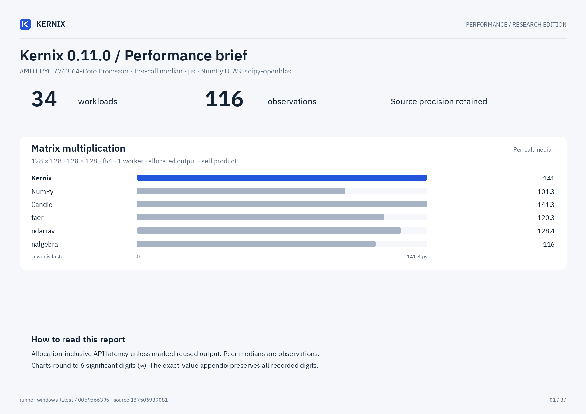](latency.pdf)

## Charts by workload

**Shorter bars mean less time.** Blue is Kernix; grey is a comparison implementation; teal is an explicitly selected Kernix backend. Entries are sorted by the recorded median, with a separate zero-based scale per chart. These point observations do not establish a statistical ranking.

Expand a group to see every chart here on GitHub. Click a chart to enlarge it. The exact table below keeps every source digit.

Matrix multiplication · 10 workloads

**Independent matrix operands · 128 × 128 · 128 × 128 · f64**

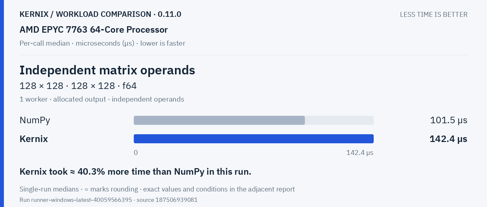

Kernix: **142.4 µs**. Kernix took ≈ 40.3% more time than NumPy in this run.

**Independent matrix operands · 128 × 128 · 128 × 128 · f32**

Kernix: **75.2 µs**. Kernix took ≈ 33.3% more time than NumPy in this run.

**Matrix multiplication · 32 × 32 · 32 × 32 · f64**

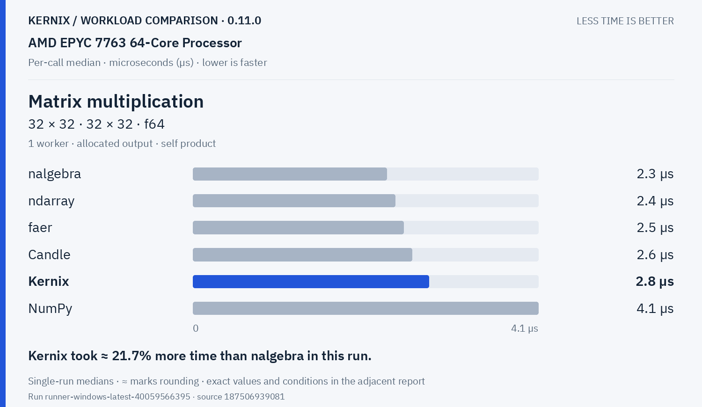

Kernix: **2.8 µs**. Kernix took ≈ 21.7% more time than nalgebra in this run.

**Matrix multiplication · 64 × 64 · 64 × 64 · f64**

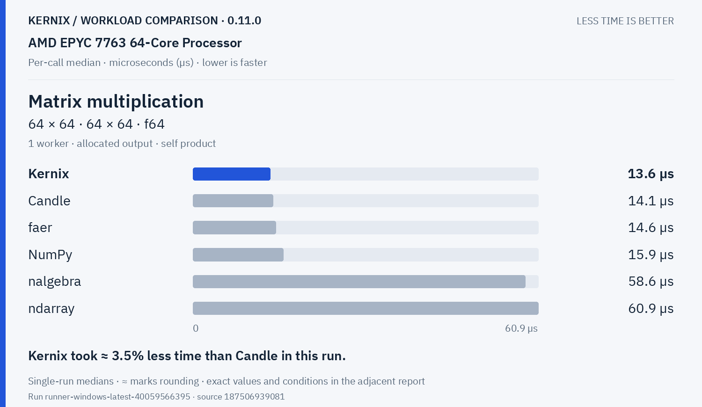

Kernix: **13.6 µs**. Kernix took ≈ 3.5% less time than Candle in this run.

**Matrix multiplication · 128 × 128 · 128 × 128 · f64**

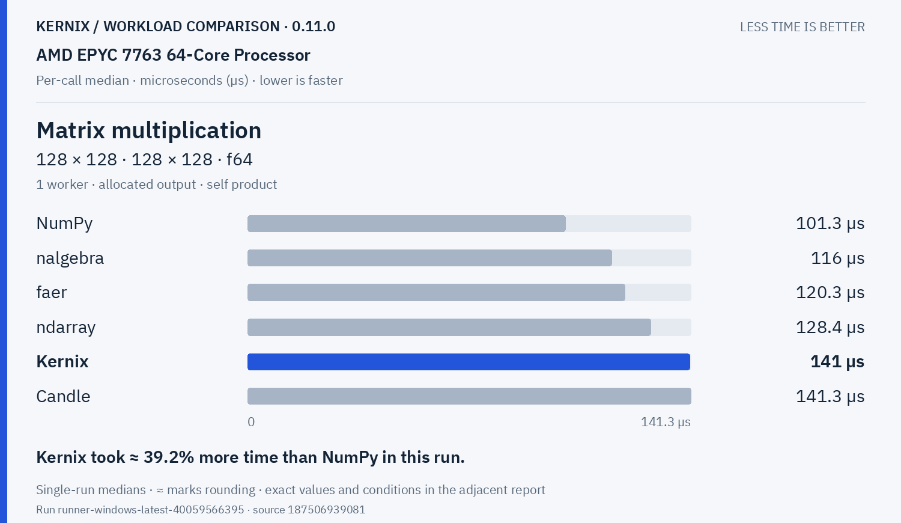

Kernix: **141 µs**. Kernix took ≈ 39.2% more time than NumPy in this run.

**Matrix multiplication · 256 × 256 · 256 × 256 · f64**

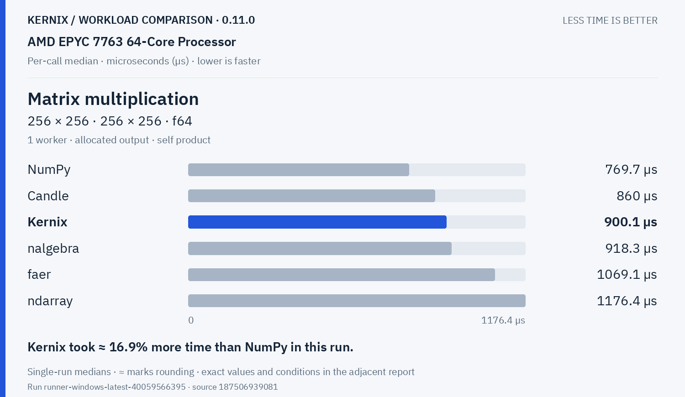

Kernix: **900.1 µs**. Kernix took ≈ 16.9% more time than NumPy in this run.

**Matrix multiplication · 64 × 64 · 64 × 64 · f32**

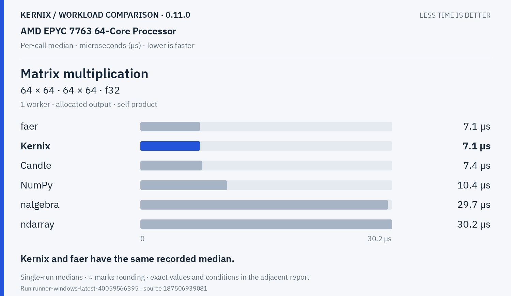

Kernix: **7.1 µs**. Kernix and faer have the same recorded median.

**Matrix multiplication · 128 × 128 · 128 × 128 · f32**

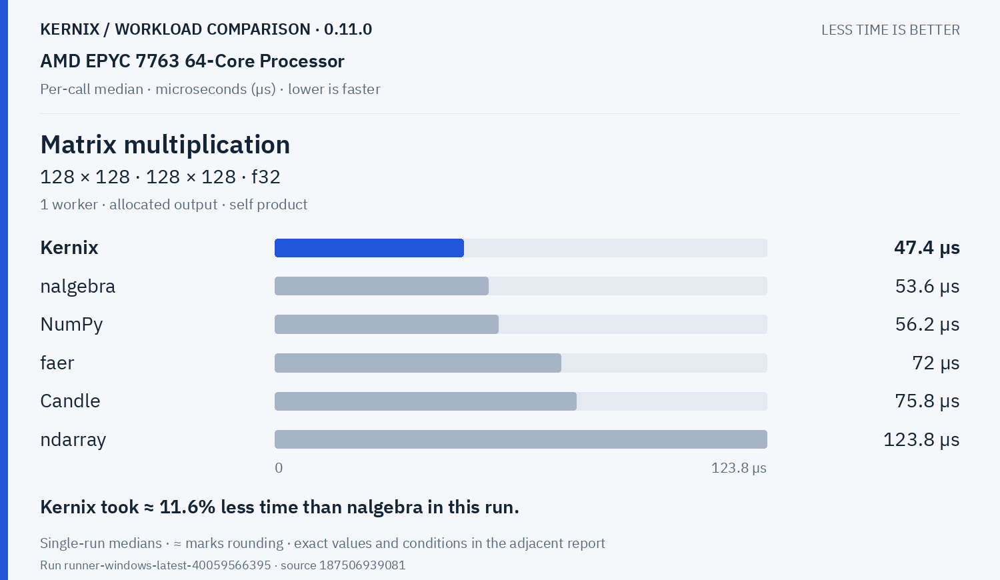

Kernix: **47.4 µs**. Kernix took ≈ 11.6% less time than nalgebra in this run.

**Matrix multiplication · 256 × 256 · 256 × 256 · f32**

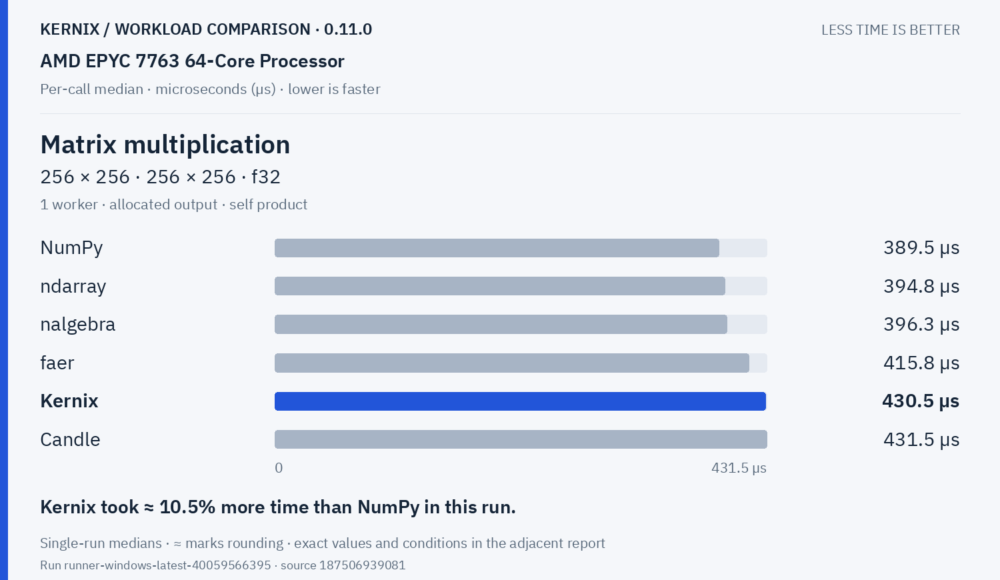

Kernix: **430.5 µs**. Kernix took ≈ 10.5% more time than NumPy in this run.

**Batched multiplication · 4 × 16 × 32 · 1 × 32 × 16 · f64**

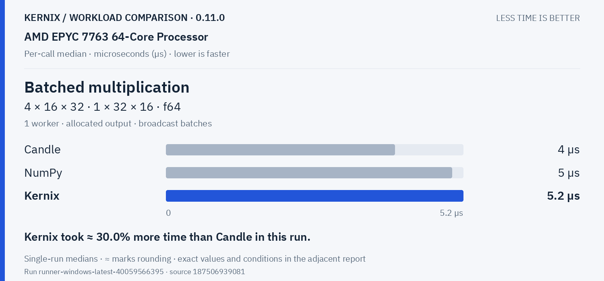

Kernix: **5.2 µs**. Kernix took ≈ 30.0% more time than Candle in this run.

Explicit parallel execution · 4 workloads

**Matmul · 2 workers · reused output · 64 × 64 · 64 × 64 · f64**

Kernix: **39.5 µs**. No external comparison with Kernix was measured for this workload.

**Matmul · 2 workers · reused output · 128 × 128 · 128 × 128 · f64**

Kernix: **84.1 µs**. No external comparison with Kernix was measured for this workload.

**Matmul · 2 workers · reused output · 256 × 256 · 256 × 256 · f64**

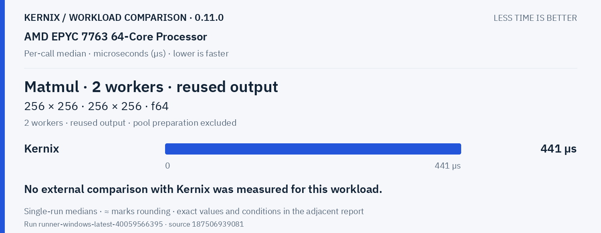

Kernix: **441 µs**. No external comparison with Kernix was measured for this workload.

**Matmul · 2 workers · reused output · 128 × 128 · 128 × 128 · f32**

Kernix: **57.5 µs**. No external comparison with Kernix was measured for this workload.

Decompositions & solvers · 10 workloads

**Cholesky factorization · 512 × 512 · f64**

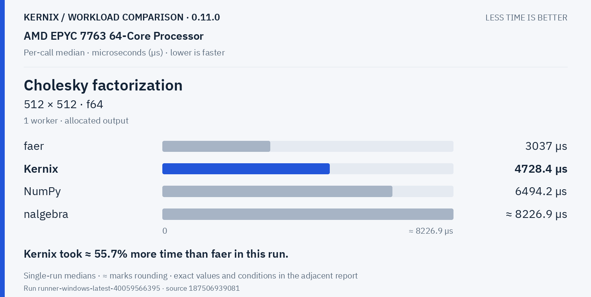

Kernix: **4728.4 µs**. Kernix took ≈ 55.7% more time than faer in this run.

**Column-pivoted QR · 96 × 32 · f64**

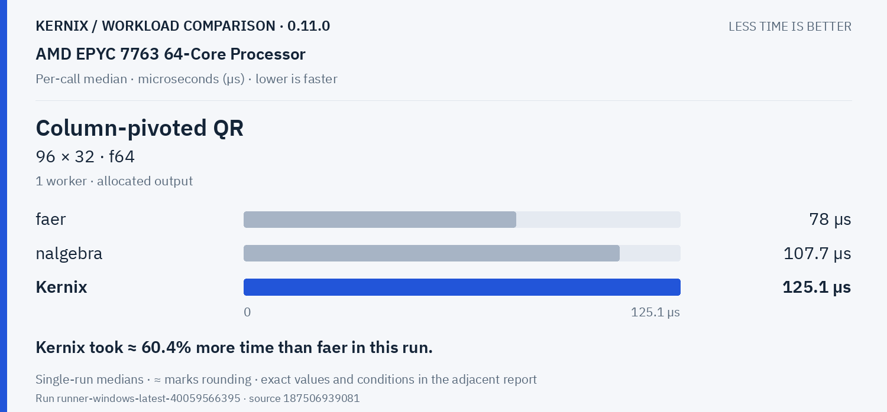

Kernix: **125.1 µs**. Kernix took ≈ 60.4% more time than faer in this run.

**Column-pivoted QR · 256 × 64 · f64**

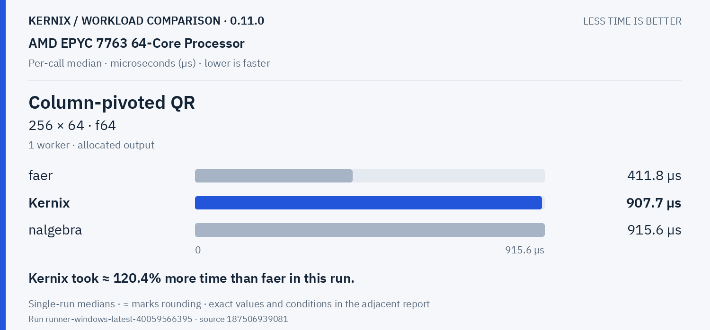

Kernix: **907.7 µs**. Kernix took ≈ 120.4% more time than faer in this run.

**Minimum-norm least squares · 64 × 32, rank 16, 4 RHS · f64**

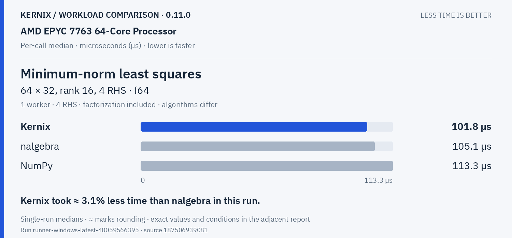

Kernix: **101.8 µs**. Kernix took ≈ 3.1% less time than nalgebra in this run.

**Minimum-norm least squares · 32 × 64, rank 32, 4 RHS · f64**

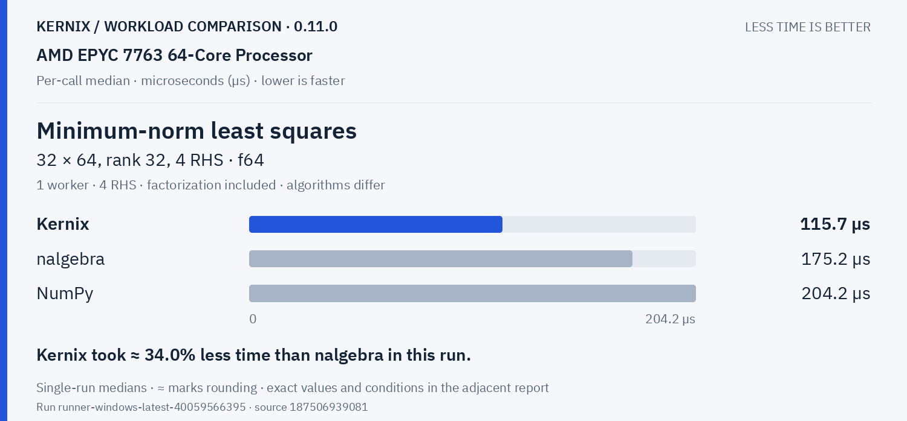

Kernix: **115.7 µs**. Kernix took ≈ 34.0% less time than nalgebra in this run.

**Thin QR · 96 × 32 · f64**

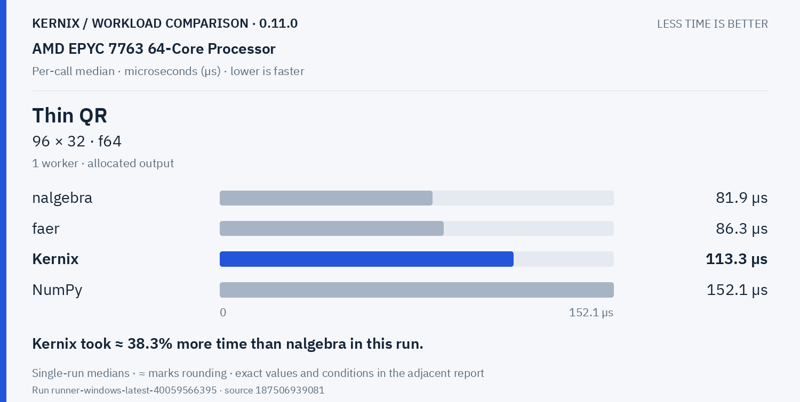

Kernix: **113.3 µs**. Kernix took ≈ 38.3% more time than nalgebra in this run.

**Thin QR · 256 × 64 · f64**

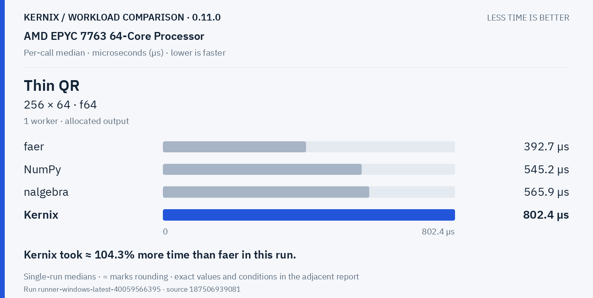

Kernix: **802.4 µs**. Kernix took ≈ 104.3% more time than faer in this run.

**Cholesky factorization · 64 × 64 · f64**

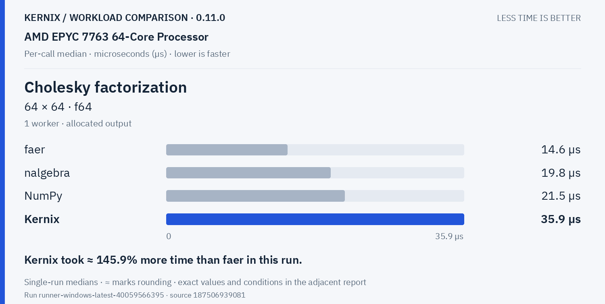

Kernix: **35.9 µs**. Kernix took ≈ 145.9% more time than faer in this run.

**Cholesky factorization · 128 × 128 · f64**

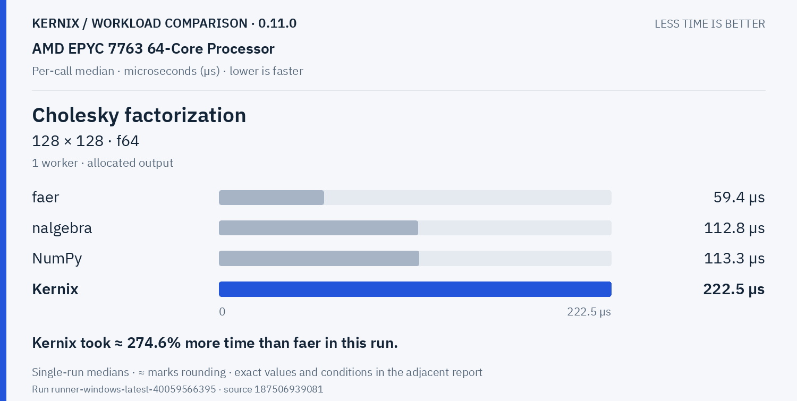

Kernix: **222.5 µs**. Kernix took ≈ 274.6% more time than faer in this run.

**Cholesky factorization · 256 × 256 · f64**

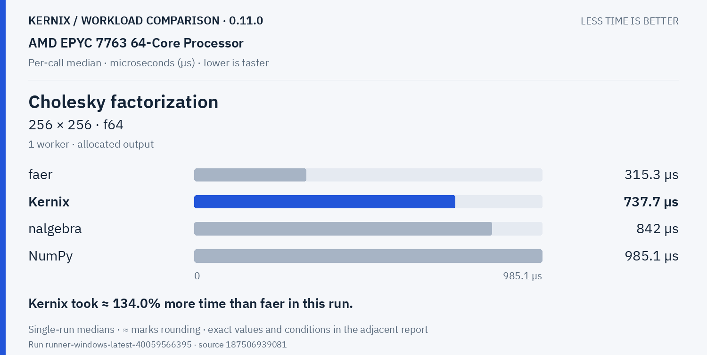

Kernix: **737.7 µs**. Kernix took ≈ 134.0% more time than faer in this run.

Training & autodiff · 6 workloads

**Shared-variable backward · sum(X * X), 64 × 32; prepared graph · f64**

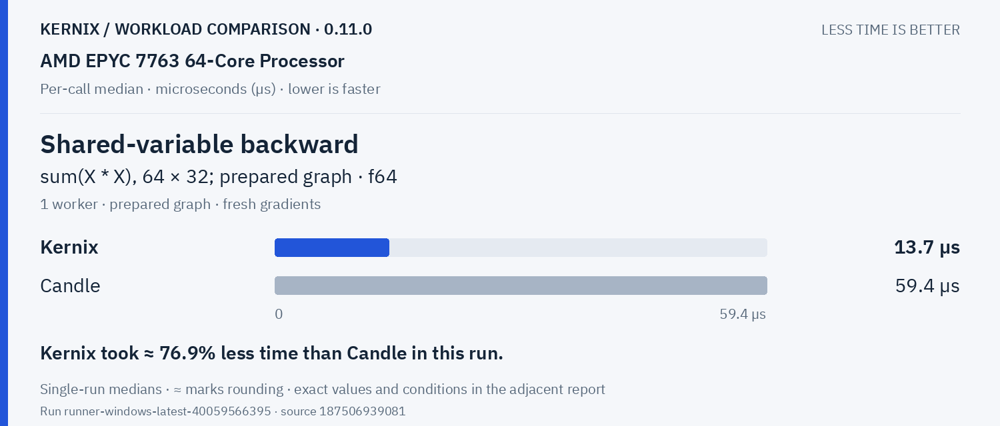

Kernix: **13.7 µs**. Kernix took ≈ 76.9% less time than Candle in this run.

**Record + backward · sum(A · W), 32 × 16 · 16 × 8 · f64**

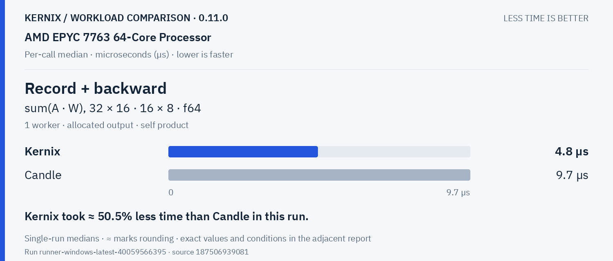

Kernix: **4.8 µs**. Kernix took ≈ 50.5% less time than Candle in this run.

**Model inference · batched normalized/sliced MLP · f64**

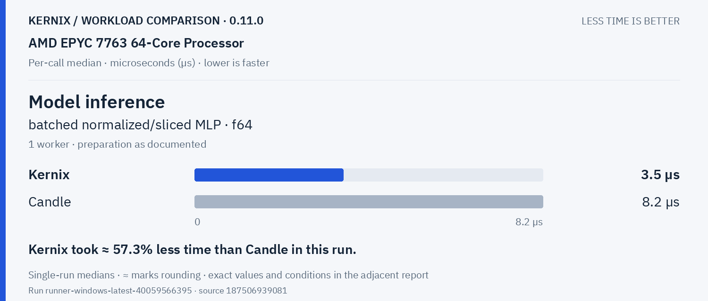

Kernix: **3.5 µs**. Kernix took ≈ 57.3% less time than Candle in this run.

**Model recording + forward · batched normalized/sliced MLP · f64**

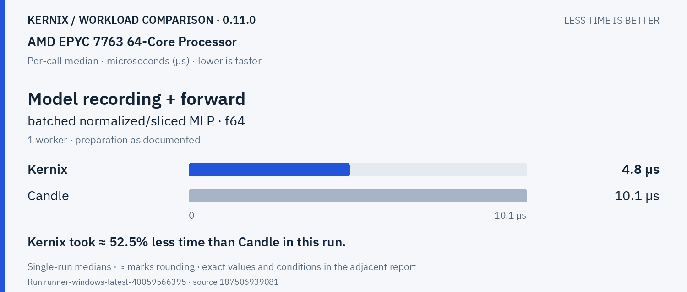

Kernix: **4.8 µs**. Kernix took ≈ 52.5% less time than Candle in this run.

**Model backward · prepared graph → fresh gradients · f64**

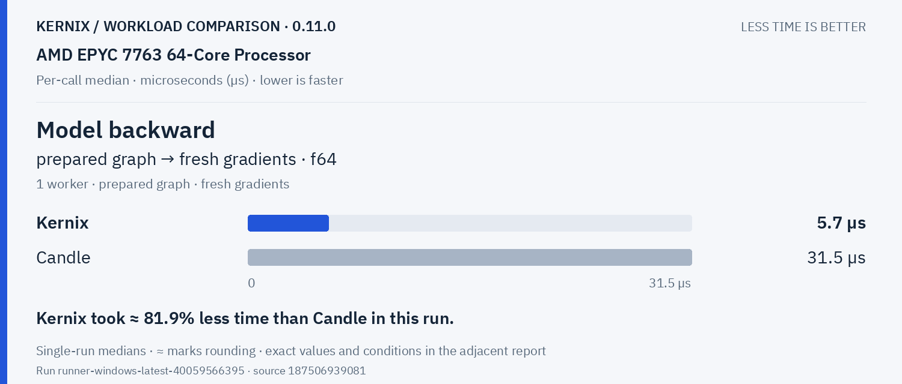

Kernix: **5.7 µs**. Kernix took ≈ 81.9% less time than Candle in this run.

**Parameter update · transactional SGD, fixed gradients · f64**

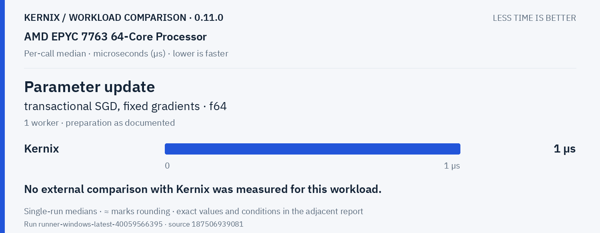

Kernix: **1 µs**. No external comparison with Kernix was measured for this workload.

Tensor contractions · 1 workloads

**Coalesced tensor contraction · 16 × 32 × 8 · 32 × 8 × 16 · f64**

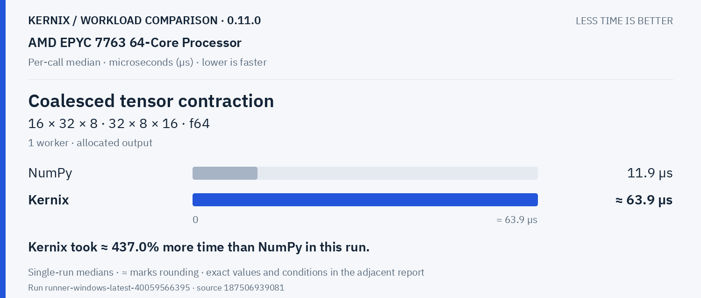

Kernix: **63.89999999999999 µs**. Kernix took ≈ 437.0% more time than NumPy in this run.

Statistics & activations · 1 workloads

**Row softmax · 256 × 64 · f64**

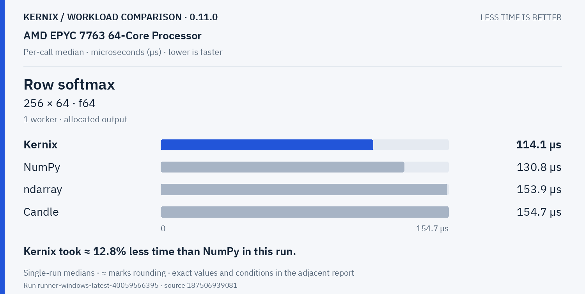

Kernix: **114.1 µs**. Kernix took ≈ 12.8% less time than NumPy in this run.

Tensor construction · 2 workloads

**Create zeros · 64 × 64 · f32**

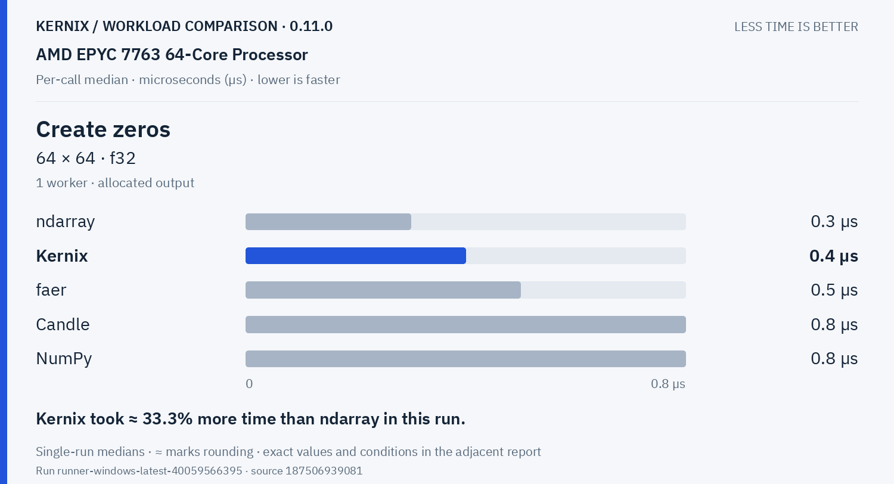

Kernix: **0.4 µs**. Kernix took ≈ 33.3% more time than ndarray in this run.

**Create ones · 64 × 64 · f32**

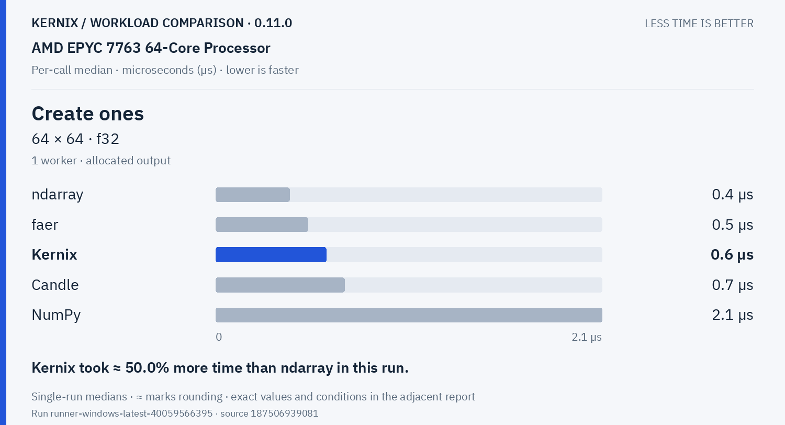

Kernix: **0.6 µs**. Kernix took ≈ 50.0% more time than ndarray in this run.

## Exact latency table

All values below are microseconds per operation. **Lower is faster.** Missing entries were not measured.

| Workload | Kernix | ndarray | nalgebra | faer | Candle | NumPy | Sequential run change |
|---|---:|---:|---:|---:|---:|---:|---:|
| Independent matrix operands · 128 × 128 · 128 × 128 · f64 | 142.4 | — | — | — | — | **101.5** | +0.7% |
| Independent matrix operands · 128 × 128 · 128 × 128 · f32 | 75.2 | — | — | — | — | **56.4** | +0.0% |
| Matrix multiplication · 32 × 32 · 32 × 32 · f64 | 2.8 | 2.4 | **2.3** | 2.5 | 2.6 | 4.1 | +0.0% |
| Matrix multiplication · 64 × 64 · 64 × 64 · f64 | **13.6** | 60.9 | 58.6 | 14.6 | 14.1 | 15.9 | +0.0% |
| Matrix multiplication · 128 × 128 · 128 × 128 · f64 | 141 | 128.4 | 116 | 120.3 | 141.3 | **101.3** | +0.7% |
| Matrix multiplication · 256 × 256 · 256 × 256 · f64 | 900.1 | 1176.4 | 918.3 | 1069.1 | 860 | **769.7** | +3.6% |
| Matrix multiplication · 64 × 64 · 64 × 64 · f32 | **7.1** | 30.2 | 29.7 | **7.1** | 7.4 | 10.4 | +2.9% |
| Matrix multiplication · 128 × 128 · 128 × 128 · f32 | **47.4** | 123.8 | 53.6 | 72 | 75.8 | 56.2 | -37.6% |
| Matrix multiplication · 256 × 256 · 256 × 256 · f32 | 430.5 | 394.8 | 396.3 | 415.8 | 431.5 | **389.5** | +21.0% |
| Batched multiplication · 4 × 16 × 32 · 1 × 32 × 16 · f64 | 5.2 | — | — | — | **4** | 5 | +52.9% |
| Matmul · 2 workers · reused output · 64 × 64 · 64 × 64 · f64 | 39.5 | — | — | — | — | — | -1.5% |
| Matmul · 2 workers · reused output · 128 × 128 · 128 × 128 · f64 | 84.1 | — | — | — | — | — | -4.9% |
| Matmul · 2 workers · reused output · 256 × 256 · 256 × 256 · f64 | 441 | — | — | — | — | — | +0.5% |
| Matmul · 2 workers · reused output · 128 × 128 · 128 × 128 · f32 | 57.5 | — | — | — | — | — | -2.5% |
| Cholesky factorization · 512 × 512 · f64 | 4728.4 | — | 8226.900000000001 | **3037** | — | 6494.2 | -44.9% |
| Column-pivoted QR · 96 × 32 · f64 | 125.1 | — | 107.7 | **78** | — | — | +0.1% |
| Column-pivoted QR · 256 × 64 · f64 | 907.7 | — | 915.6 | **411.8** | — | — | -3.1% |
| Minimum-norm least squares · 64 × 32, rank 16, 4 RHS · f64 | **101.8** | — | 105.1 | — | — | 113.3 | +1.2% |
| Minimum-norm least squares · 32 × 64, rank 32, 4 RHS · f64 | **115.7** | — | 175.2 | — | — | 204.2 | +0.7% |
| Thin QR · 96 × 32 · f64 | 113.3 | — | **81.9** | 86.3 | — | 152.1 | +8.4% |
| Thin QR · 256 × 64 · f64 | 802.4 | — | 565.9 | **392.7** | — | 545.2 | +2.4% |
| Cholesky factorization · 64 × 64 · f64 | 35.9 | — | 19.8 | **14.6** | — | 21.5 | +2.3% |
| Cholesky factorization · 128 × 128 · f64 | 222.5 | — | 112.8 | **59.4** | — | 113.3 | -3.0% |
| Cholesky factorization · 256 × 256 · f64 | 737.7 | — | 842 | **315.3** | — | 985.1 | -25.6% |
| Shared-variable backward · sum(X * X), 64 × 32; prepared graph · f64 | **13.7** | — | — | — | 59.4 | — | +42.7% |
| Record + backward · sum(A · W), 32 × 16 · 16 × 8 · f64 | **4.8** | — | — | — | 9.7 | — | +9.1% |
| Model inference · batched normalized/sliced MLP · f64 | **3.5** | — | — | — | 8.2 | — | +0.0% |
| Model recording + forward · batched normalized/sliced MLP · f64 | **4.8** | — | — | — | 10.1 | — | +0.0% |
| Model backward · prepared graph → fresh gradients · f64 | **5.7** | — | — | — | 31.5 | — | -1.7% |
| Parameter update · transactional SGD, fixed gradients · f64 | 1 | — | — | — | — | — | +0.0% |
| Coalesced tensor contraction · 16 × 32 × 8 · 32 × 8 × 16 · f64 | 63.89999999999999 | — | — | — | — | **11.9** | +0.3% |
| Row softmax · 256 × 64 · f64 | **114.1** | 153.9 | — | — | 154.7 | 130.8 | -0.3% |
| Create zeros · 64 × 64 · f32 | 0.4 | **0.3** | — | 0.5 | 0.8 | 0.8 | -33.3% |
| Create ones · 64 × 64 · f32 | 0.6 | **0.4** | — | 0.5 | 0.7 | 2.1 | +20.0% |

## Version comparison

12 of 34 workloads have paired evidence. Exploratory 95% intervals resample process pairs, not calls. No multiple-comparison adjustment.

### Version changes at a glance

The vertical line marks unchanged time. Left is faster; right is slower. Ranges are exploratory 95% intervals over fresh-process pairs. An interval crossing the line leaves direction unclear.

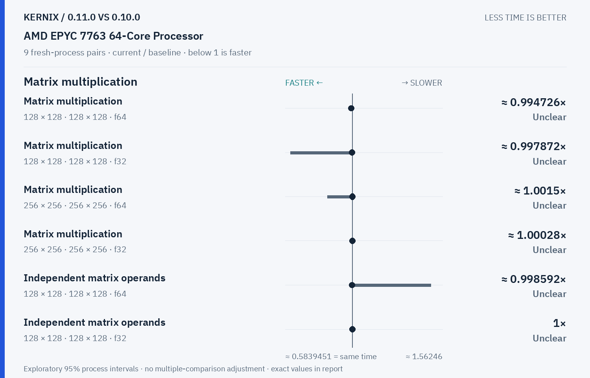

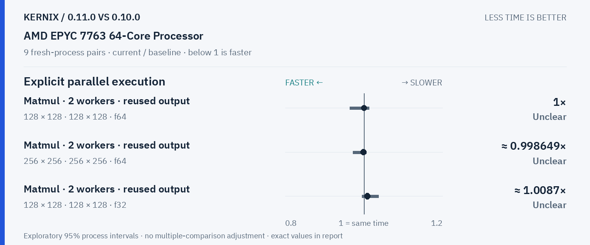

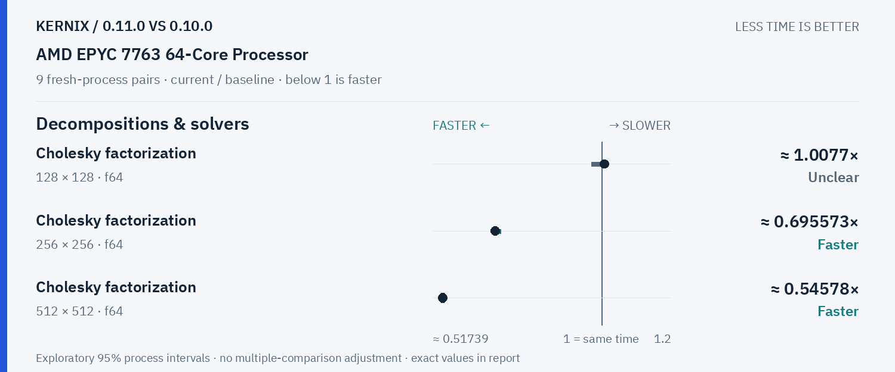

| Workload | Current / baseline [95% interval] | Interpretation |
|---|---:|---|
| Independent matrix operands · 128 × 128 · 128 × 128 · f64 | 0.9985915492957746× [0.9950980392156863, 1.4880581516095535] | Timing direction unclear |
| Independent matrix operands · 128 × 128 · 128 × 128 · f32 | 1× [0.9974059662775616, 1.0039011703511054] | Timing direction unclear |
| Matrix multiplication · 32 × 32 · 32 × 32 · f64 | — | No paired comparison |
| Matrix multiplication · 64 × 64 · 64 × 64 · f64 | — | No paired comparison |
| Matrix multiplication · 128 × 128 · 128 × 128 · f64 | 0.9947257383966245× [0.9851694915254238, 1.0042328042328041] | Timing direction unclear |
| Matrix multiplication · 256 × 256 · 256 × 256 · f64 | 1.0014998636487593× [0.8458338148618976, 1.0089151008092168] | Timing direction unclear |
| Matrix multiplication · 64 × 64 · 64 × 64 · f32 | — | No paired comparison |
| Matrix multiplication · 128 × 128 · 128 × 128 · f32 | 0.997872340425532× [0.6146788990825688, 1] | Timing direction unclear |
| Matrix multiplication · 256 × 256 · 256 × 256 · f32 | 1.0002831257078142× [0.9943804439449283, 1.0014124293785311] | Timing direction unclear |
| Batched multiplication · 4 × 16 × 32 · 1 × 32 × 16 · f64 | — | No paired comparison |
| Matmul · 2 workers · reused output · 64 × 64 · 64 × 64 · f64 | — | No paired comparison |
| Matmul · 2 workers · reused output · 128 × 128 · 128 × 128 · f64 | 1× [0.9640371229698376, 1.0133010882708586] | Timing direction unclear |
| Matmul · 2 workers · reused output · 256 × 256 · 256 × 256 · f64 | 0.9986489529385274× [0.9724872420678944, 1.0055121727147451] | Timing direction unclear |
| Matmul · 2 workers · reused output · 128 × 128 · 128 × 128 · f32 | 1.008695652173913× [0.9948186528497409, 1.0373001776198933] | Timing direction unclear |
| Cholesky factorization · 512 × 512 · f64 | 0.5457797784753895× [0.5446214676125131, 0.5541659264523006] | Observed time reduction |
| Column-pivoted QR · 96 × 32 · f64 | — | No paired comparison |
| Column-pivoted QR · 256 × 64 · f64 | — | No paired comparison |
| Minimum-norm least squares · 64 × 32, rank 16, 4 RHS · f64 | — | No paired comparison |
| Minimum-norm least squares · 32 × 64, rank 32, 4 RHS · f64 | — | No paired comparison |
| Thin QR · 96 × 32 · f64 | — | No paired comparison |
| Thin QR · 256 × 64 · f64 | — | No paired comparison |
| Cholesky factorization · 64 × 64 · f64 | — | No paired comparison |
| Cholesky factorization · 128 × 128 · f64 | 1.0076957899502037× [0.972101133391456, 1.0108790252393385] | Timing direction unclear |
| Cholesky factorization · 256 × 256 · f64 | 0.695573074590661× [0.6864988558352402, 0.7127808988764045] | Observed time reduction |
| Shared-variable backward · sum(X * X), 64 × 32; prepared graph · f64 | — | No paired comparison |
| Record + backward · sum(A · W), 32 × 16 · 16 × 8 · f64 | — | No paired comparison |
| Model inference · batched normalized/sliced MLP · f64 | — | No paired comparison |
| Model recording + forward · batched normalized/sliced MLP · f64 | — | No paired comparison |
| Model backward · prepared graph → fresh gradients · f64 | — | No paired comparison |
| Parameter update · transactional SGD, fixed gradients · f64 | — | No paired comparison |
| Coalesced tensor contraction · 16 × 32 × 8 · 32 × 8 × 16 · f64 | — | No paired comparison |
| Row softmax · 256 × 64 · f64 | — | No paired comparison |
| Create zeros · 64 × 64 · f32 | — | No paired comparison |
| Create ones · 64 × 64 · f32 | — | No paired comparison |

## Method and provenance

CPU affinity was not pinned. Frequency and background load are uncontrolled.

Minimum-norm rows use pivoted QR plus scaled implicit RZ in Kernix; NumPy native lstsq; nalgebra native SVD/solve. Algorithm costs and rank policies differ. See original method for thresholds.

Numbers retain source precision; recorded digits do not imply equivalent physical measurement accuracy. Lowest observed medians are bold only when peers were measured. No aggregate winner or universal ranking is inferred.

[Original report and commentary](original-report.txt) · [Raw measurements](raw.json)

Measured source `18750693908110110d85d02d0f11af8d58bfae8b`. Run `runner-windows-latest-40059566395`. Rendering does not change measurements.
