# Kernix 0.11.1 · performance brief

AMD EPYC 7763 64-Core Processor / Windows

**Per-call median, microseconds per operation. Lower is faster. All recorded digits retained.**

35 workloads · 119 observations

Baseline: baseline-windows-latest-40161751367. Sequential run changes are descriptive; paired process evidence is shown separately.

[Interactive HTML (open locally)](report.html) · [Vector PDF](latency.pdf) · [Raw measurements](raw.json)

[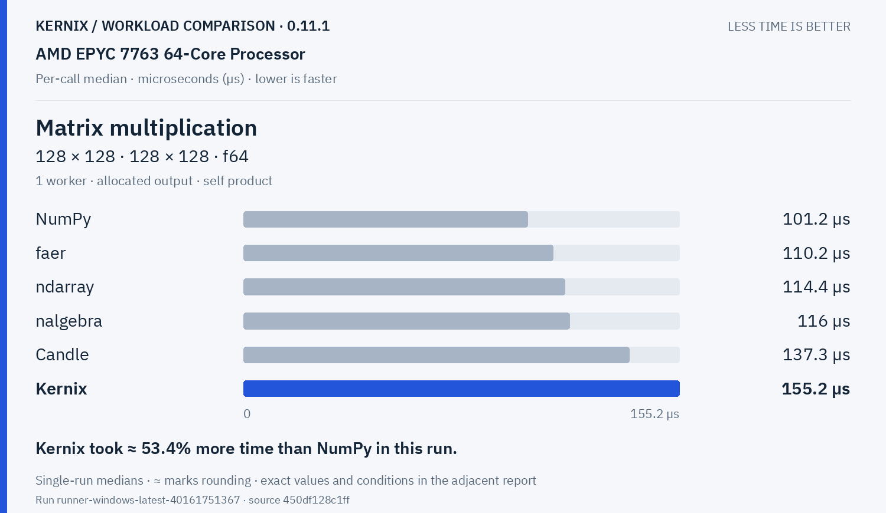](latency.pdf)

## Charts by workload

**Shorter bars mean less time.** Blue is Kernix; grey is another library; teal is an explicitly selected Kernix backend. Entries are sorted by the recorded median, with a separate zero-based scale per chart. These point observations do not establish a statistical ranking.

Expand a group to see every chart here on GitHub. Click a chart to enlarge it. The exact table below keeps every source digit.

Matrix multiplication · 11 workloads

**Independent matrix operands · 128 × 128 · 128 × 128 · f64**

Kernix: **141.8 µs**. Kernix took ≈ 36.0% more time than NumPy in this run.

**Independent matrix operands · 128 × 128 · 128 × 128 · f32**

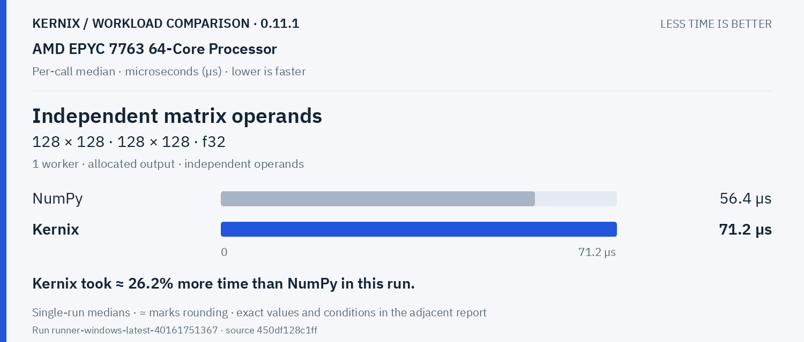

Kernix: **71.2 µs**. Kernix took ≈ 26.2% more time than NumPy in this run.

**Matrix multiplication · 32 × 32 · 32 × 32 · f64**

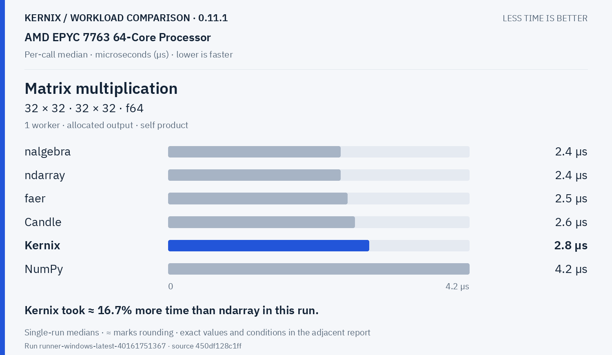

Kernix: **2.8 µs**. Kernix took ≈ 16.7% more time than ndarray in this run.

**Matrix multiplication · 64 × 64 · 64 × 64 · f64**

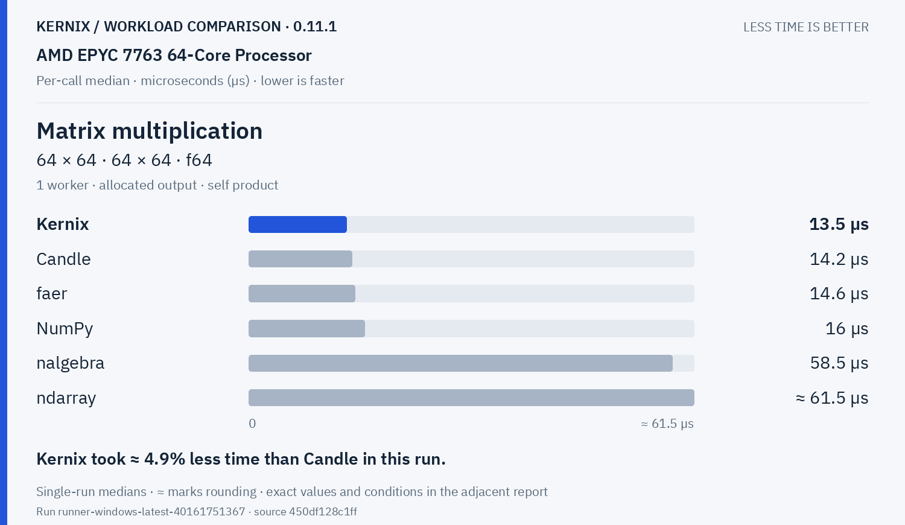

Kernix: **13.5 µs**. Kernix took ≈ 4.9% less time than Candle in this run.

**Matrix multiplication · 128 × 128 · 128 × 128 · f64**

Kernix: **155.2 µs**. Kernix took ≈ 53.4% more time than NumPy in this run.

**Matrix multiplication · 256 × 256 · 256 × 256 · f64**

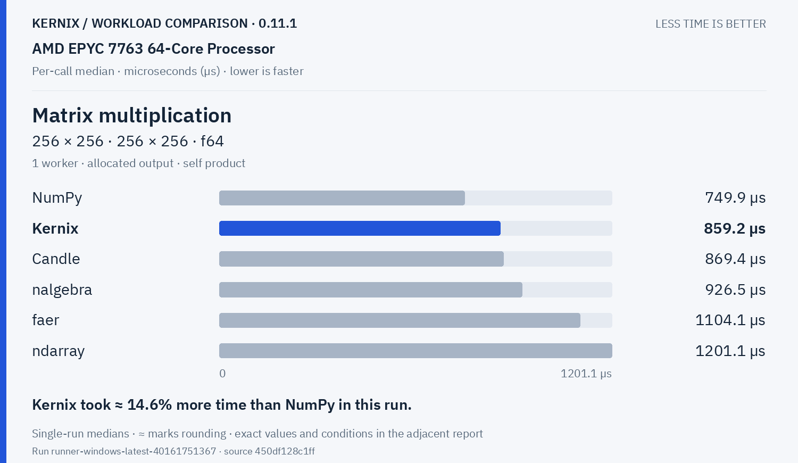

Kernix: **859.2 µs**. Kernix took ≈ 14.6% more time than NumPy in this run.

**Matrix multiplication · 64 × 64 · 64 × 64 · f32**

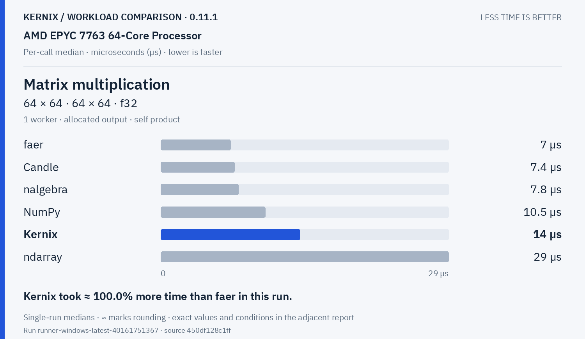

Kernix: **14 µs**. Kernix took ≈ 100.0% more time than faer in this run.

**Matrix multiplication · 128 × 128 · 128 × 128 · f32**

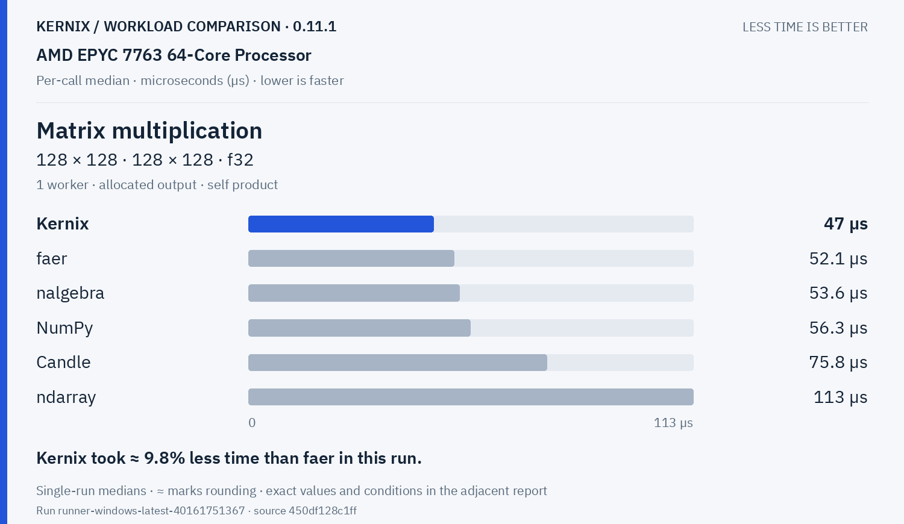

Kernix: **47 µs**. Kernix took ≈ 9.8% less time than faer in this run.

**Matrix multiplication · 256 × 256 · 256 × 256 · f32**

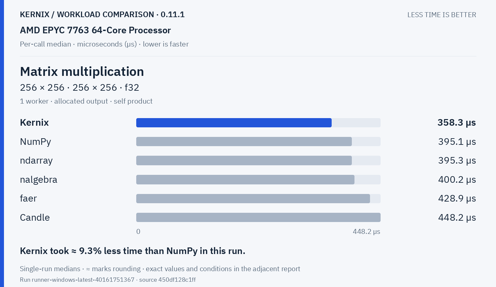

Kernix: **358.3 µs**. Kernix took ≈ 9.3% less time than NumPy in this run.

**Batched multiplication · 4 × 16 × 32 · 1 × 32 × 16 · f64**

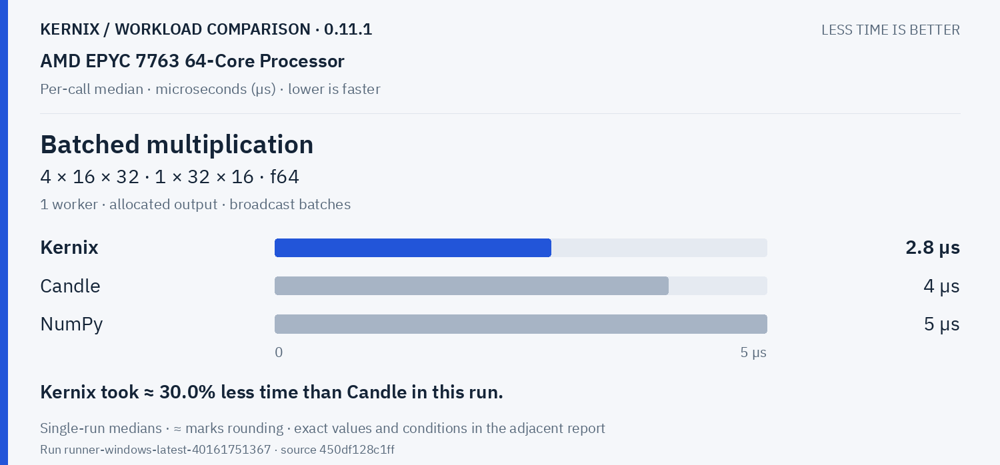

Kernix: **2.8 µs**. Kernix took ≈ 30.0% less time than Candle in this run.

**Batched multiplication · 4 × 16 × 32 · 1 × 32 × 16 · f32**

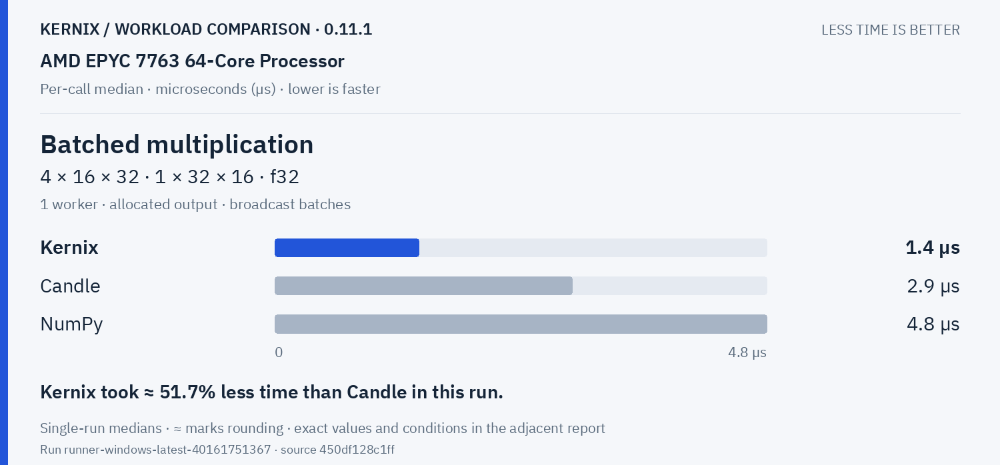

Kernix: **1.4 µs**. Kernix took ≈ 51.7% less time than Candle in this run.

Explicit parallel execution · 4 workloads

**Matmul · 2 workers · reused output · 64 × 64 · 64 × 64 · f64**

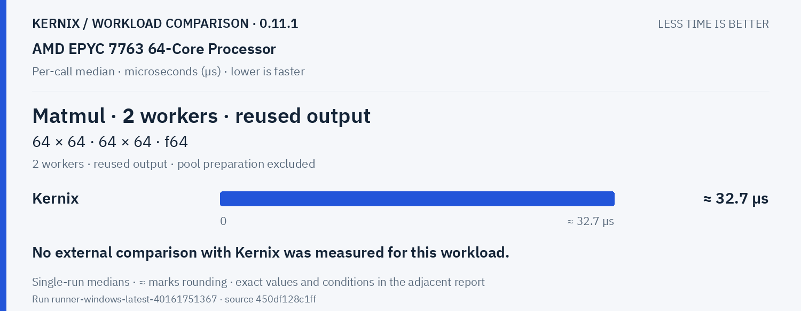

Kernix: **32.700000000000004 µs**. No external comparison with Kernix was measured for this workload.

**Matmul · 2 workers · reused output · 128 × 128 · 128 × 128 · f64**

Kernix: **85 µs**. No external comparison with Kernix was measured for this workload.

**Matmul · 2 workers · reused output · 256 × 256 · 256 × 256 · f64**

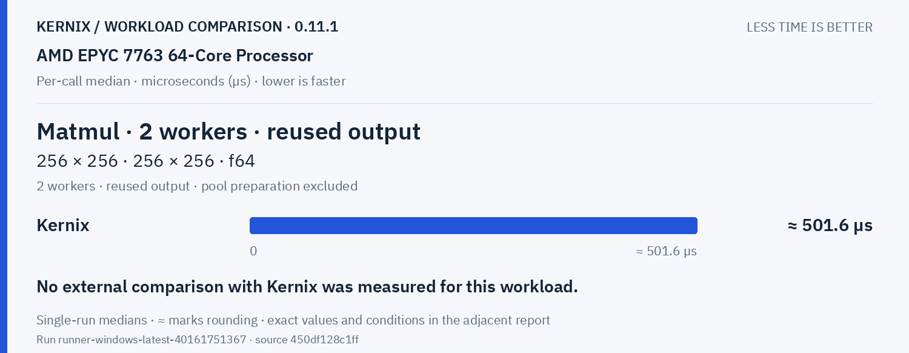

Kernix: **501.60000000000006 µs**. No external comparison with Kernix was measured for this workload.

**Matmul · 2 workers · reused output · 128 × 128 · 128 × 128 · f32**

Kernix: **58.6 µs**. No external comparison with Kernix was measured for this workload.

Decompositions & solvers · 10 workloads

**Cholesky factorization · 512 × 512 · f64**

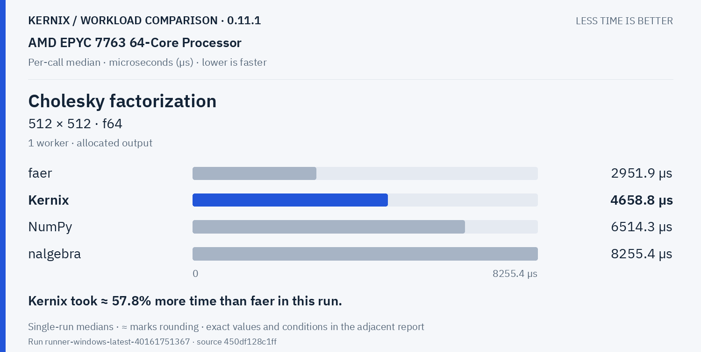

Kernix: **4658.8 µs**. Kernix took ≈ 57.8% more time than faer in this run.

**Column-pivoted QR · 96 × 32 · f64**

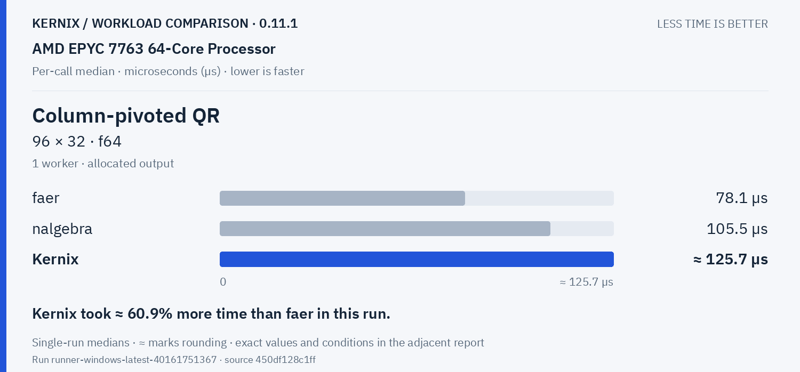

Kernix: **125.69999999999999 µs**. Kernix took ≈ 60.9% more time than faer in this run.

**Column-pivoted QR · 256 × 64 · f64**

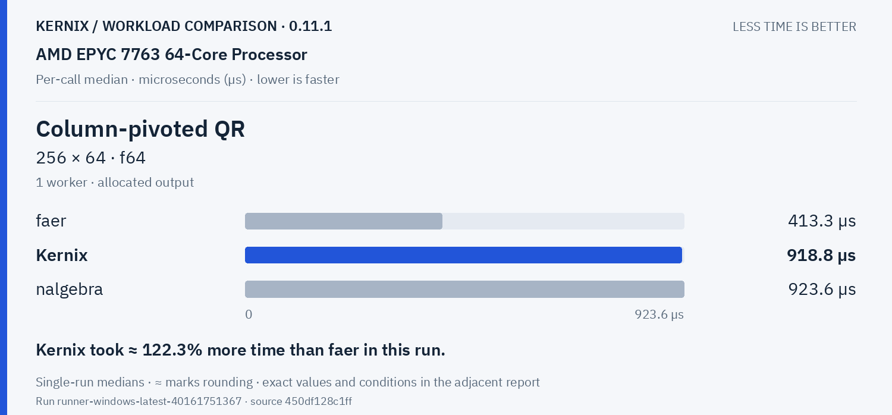

Kernix: **918.8 µs**. Kernix took ≈ 122.3% more time than faer in this run.

**Minimum-norm least squares · 64 × 32, rank 16, 4 RHS · f64**

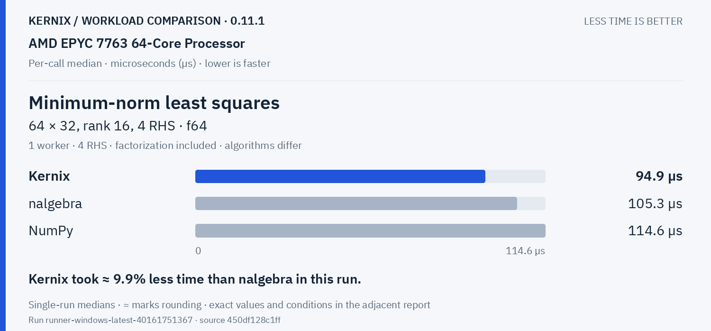

Kernix: **94.9 µs**. Kernix took ≈ 9.9% less time than nalgebra in this run.

**Minimum-norm least squares · 32 × 64, rank 32, 4 RHS · f64**

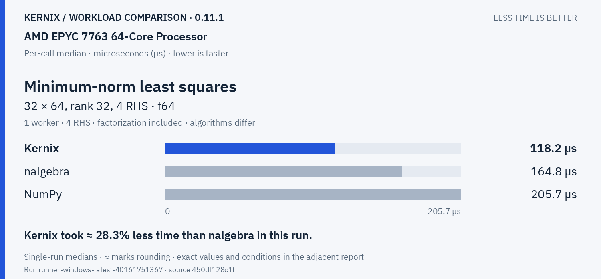

Kernix: **118.2 µs**. Kernix took ≈ 28.3% less time than nalgebra in this run.

**Thin QR · 96 × 32 · f64**

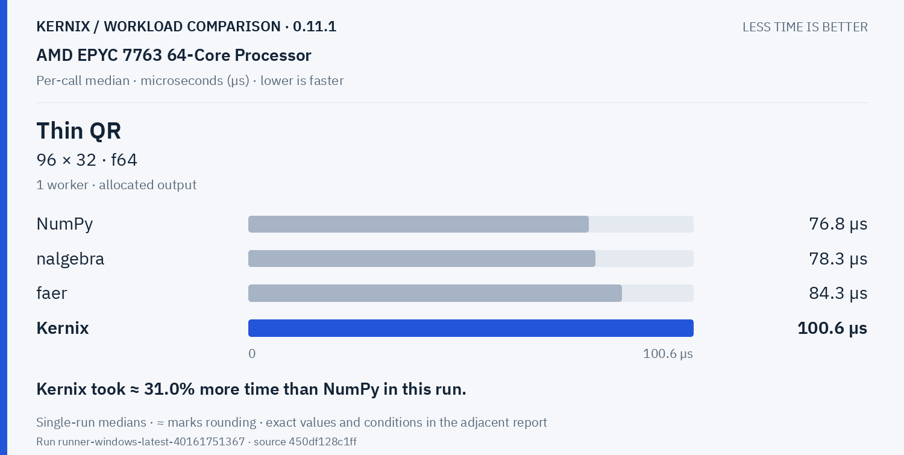

Kernix: **100.6 µs**. Kernix took ≈ 31.0% more time than NumPy in this run.

**Thin QR · 256 × 64 · f64**

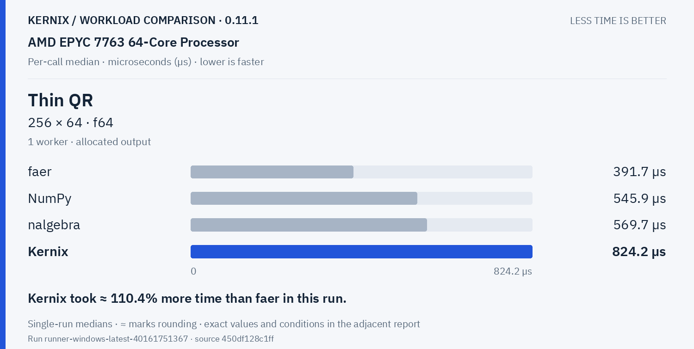

Kernix: **824.2 µs**. Kernix took ≈ 110.4% more time than faer in this run.

**Cholesky factorization · 64 × 64 · f64**

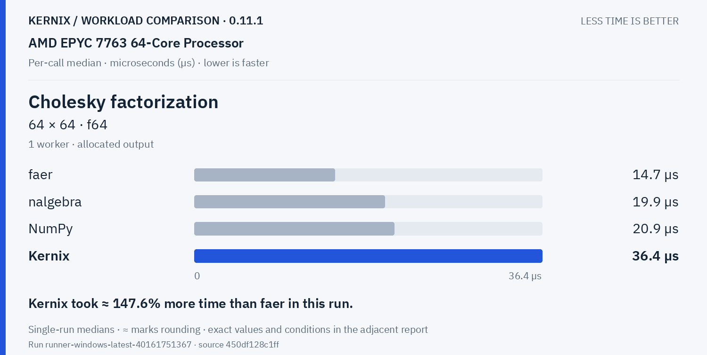

Kernix: **36.4 µs**. Kernix took ≈ 147.6% more time than faer in this run.

**Cholesky factorization · 128 × 128 · f64**

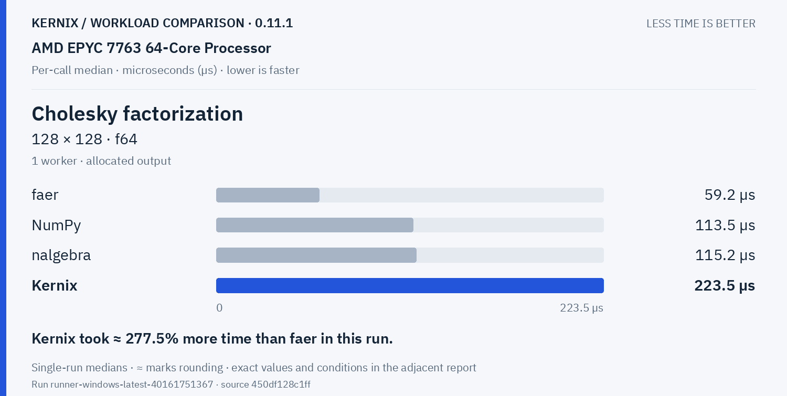

Kernix: **223.5 µs**. Kernix took ≈ 277.5% more time than faer in this run.

**Cholesky factorization · 256 × 256 · f64**

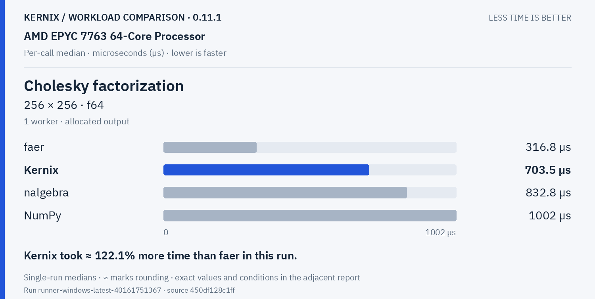

Kernix: **703.5 µs**. Kernix took ≈ 122.1% more time than faer in this run.

Training & autodiff · 6 workloads

**Shared-variable backward · sum(X * X), 64 × 32; prepared graph · f64**

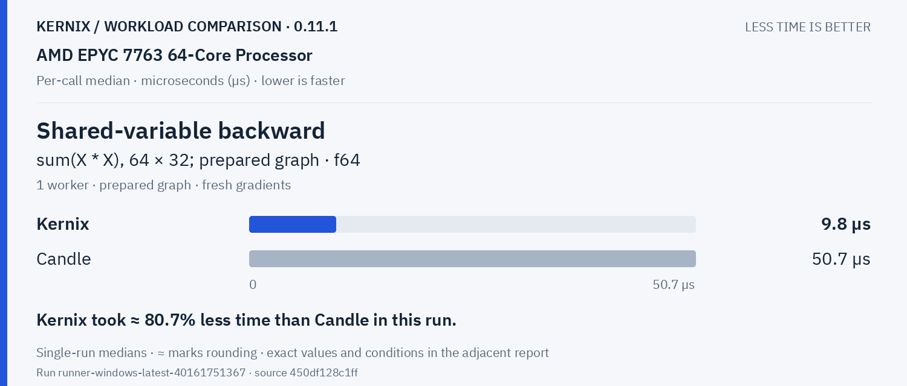

Kernix: **9.8 µs**. Kernix took ≈ 80.7% less time than Candle in this run.

**Record + backward · sum(A · W), 32 × 16 · 16 × 8 · f64**

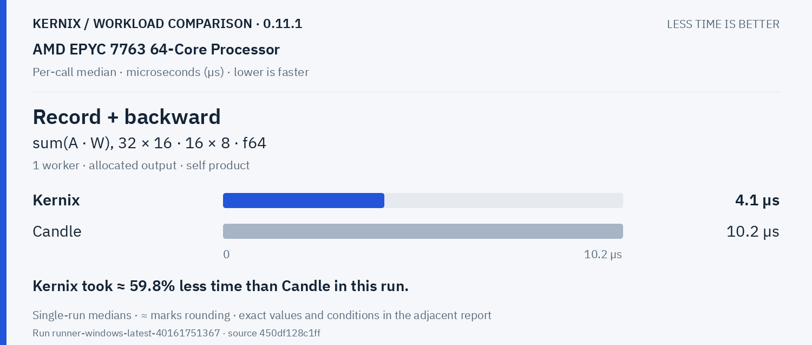

Kernix: **4.1 µs**. Kernix took ≈ 59.8% less time than Candle in this run.

**Model inference · batched normalized/sliced MLP · f64**

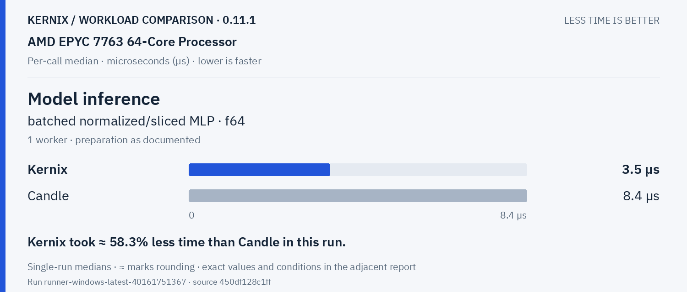

Kernix: **3.5 µs**. Kernix took ≈ 58.3% less time than Candle in this run.

**Model recording + forward · batched normalized/sliced MLP · f64**

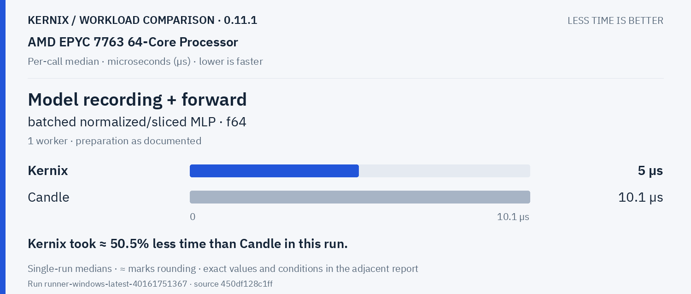

Kernix: **5 µs**. Kernix took ≈ 50.5% less time than Candle in this run.

**Model backward · prepared graph → fresh gradients · f64**

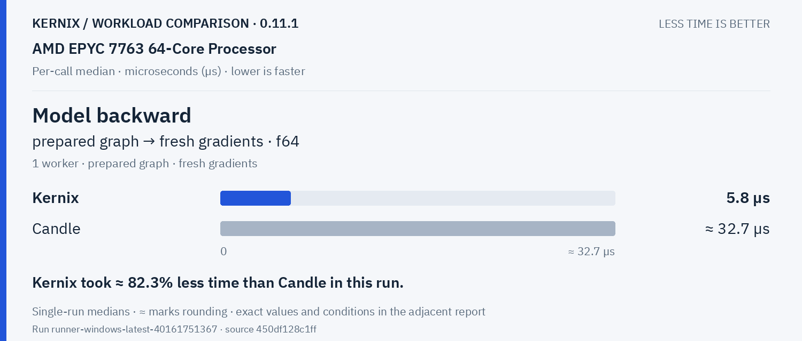

Kernix: **5.8 µs**. Kernix took ≈ 82.3% less time than Candle in this run.

**Parameter update · transactional SGD, fixed gradients · f64**

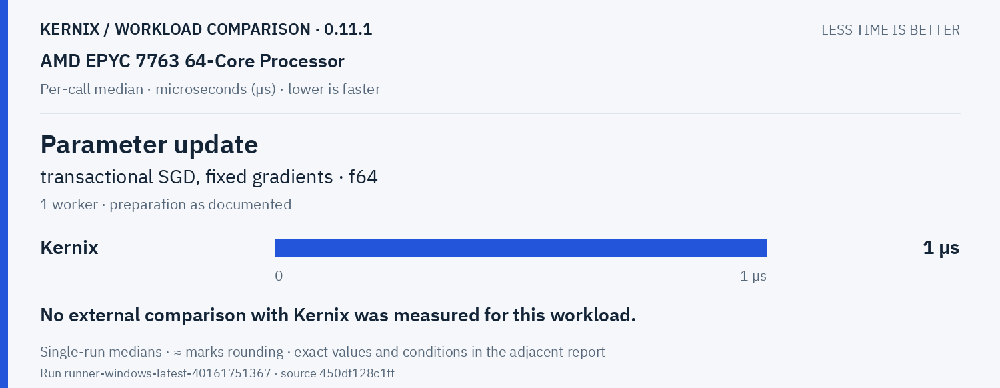

Kernix: **1 µs**. No external comparison with Kernix was measured for this workload.

Tensor contractions · 1 workloads

**Coalesced tensor contraction · 16 × 32 × 8 · 32 × 8 × 16 · f64**

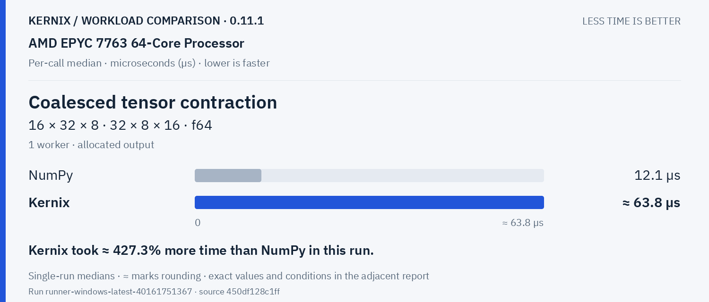

Kernix: **63.80000000000001 µs**. Kernix took ≈ 427.3% more time than NumPy in this run.

Statistics & activations · 1 workloads

**Row softmax · 256 × 64 · f64**

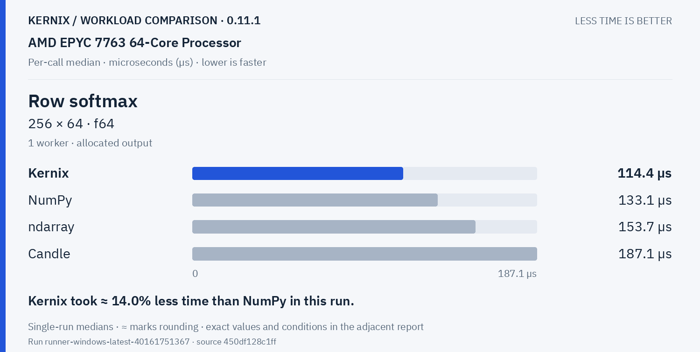

Kernix: **114.4 µs**. Kernix took ≈ 14.0% less time than NumPy in this run.

Tensor construction · 2 workloads

**Create zeros · 64 × 64 · f32**

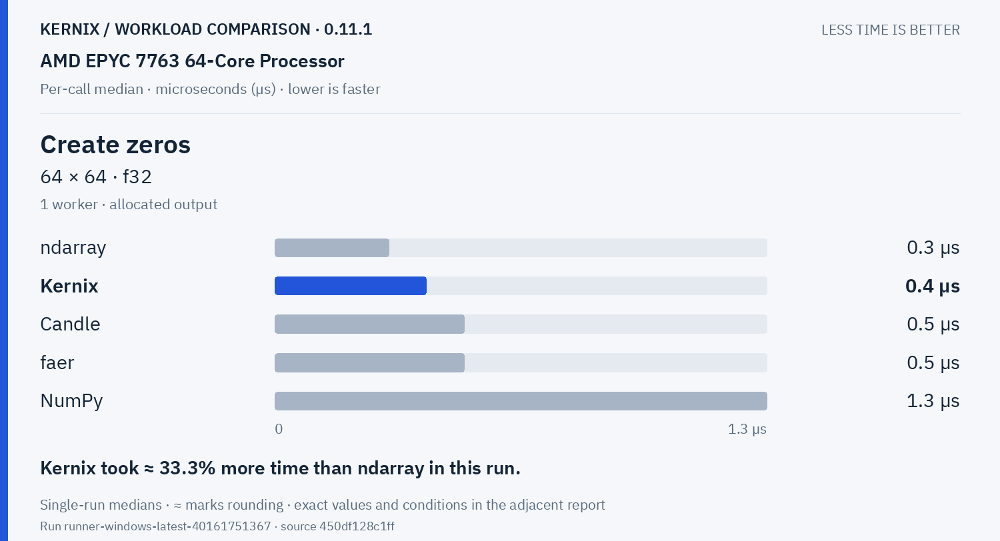

Kernix: **0.4 µs**. Kernix took ≈ 33.3% more time than ndarray in this run.

**Create ones · 64 × 64 · f32**

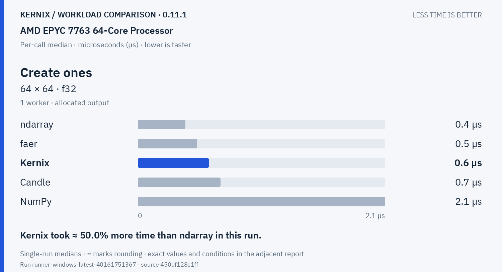

Kernix: **0.6 µs**. Kernix took ≈ 50.0% more time than ndarray in this run.

## Exact latency table

All values below are microseconds per operation. **Lower is faster.** Missing entries were not measured.

| Workload | Kernix | ndarray | nalgebra | faer | Candle | NumPy | Sequential run change |
|---|---:|---:|---:|---:|---:|---:|---:|
| Independent matrix operands · 128 × 128 · 128 × 128 · f64 | 141.8 | — | — | — | — | **104.3** | +1.3% |
| Independent matrix operands · 128 × 128 · 128 × 128 · f32 | 71.2 | — | — | — | — | **56.4** | -0.7% |
| Matrix multiplication · 32 × 32 · 32 × 32 · f64 | 2.8 | **2.4** | **2.4** | 2.5 | 2.6 | 4.2 | +0.0% |
| Matrix multiplication · 64 × 64 · 64 × 64 · f64 | **13.5** | 61.50000000000001 | 58.5 | 14.6 | 14.2 | 16 | +0.0% |
| Matrix multiplication · 128 × 128 · 128 × 128 · f64 | 155.2 | 114.4 | 116 | 110.2 | 137.3 | **101.2** | +5.2% |
| Matrix multiplication · 256 × 256 · 256 × 256 · f64 | 859.2 | 1201.1 | 926.5 | 1104.1 | 869.4 | **749.9** | +0.4% |
| Matrix multiplication · 64 × 64 · 64 × 64 · f32 | 14 | 29 | 7.8 | **7** | 7.4 | 10.5 | +102.9% |
| Matrix multiplication · 128 × 128 · 128 × 128 · f32 | **47** | 113 | 53.6 | 52.1 | 75.8 | 56.3 | -34.3% |
| Matrix multiplication · 256 × 256 · 256 × 256 · f32 | **358.3** | 395.3 | 400.2 | 428.9 | 448.2 | 395.1 | +0.4% |
| Batched multiplication · 4 × 16 × 32 · 1 × 32 × 16 · f64 | **2.8** | — | — | — | 4 | 5 | -17.6% |
| Batched multiplication · 4 × 16 × 32 · 1 × 32 × 16 · f32 | **1.4** | — | — | — | 2.9 | 4.8 | -36.4% |
| Matmul · 2 workers · reused output · 64 × 64 · 64 × 64 · f64 | 32.700000000000004 | — | — | — | — | — | -29.7% |
| Matmul · 2 workers · reused output · 128 × 128 · 128 × 128 · f64 | 85 | — | — | — | — | — | -32.2% |
| Matmul · 2 workers · reused output · 256 × 256 · 256 × 256 · f64 | 501.60000000000006 | — | — | — | — | — | -15.4% |
| Matmul · 2 workers · reused output · 128 × 128 · 128 × 128 · f32 | 58.6 | — | — | — | — | — | +2.1% |
| Cholesky factorization · 512 × 512 · f64 | 4658.8 | — | 8255.4 | **2951.9** | — | 6514.3 | -0.6% |
| Column-pivoted QR · 96 × 32 · f64 | 125.69999999999999 | — | 105.5 | **78.1** | — | — | +5.7% |
| Column-pivoted QR · 256 × 64 · f64 | 918.8 | — | 923.6 | **413.3** | — | — | +3.6% |
| Minimum-norm least squares · 64 × 32, rank 16, 4 RHS · f64 | **94.9** | — | 105.3 | — | — | 114.6 | +7.2% |
| Minimum-norm least squares · 32 × 64, rank 32, 4 RHS · f64 | **118.2** | — | 164.8 | — | — | 205.7 | +1.1% |
| Thin QR · 96 × 32 · f64 | 100.6 | — | 78.3 | 84.3 | — | **76.8** | -0.9% |
| Thin QR · 256 × 64 · f64 | 824.2 | — | 569.7 | **391.7** | — | 545.9 | +8.9% |
| Cholesky factorization · 64 × 64 · f64 | 36.4 | — | 19.9 | **14.7** | — | 20.9 | +1.1% |
| Cholesky factorization · 128 × 128 · f64 | 223.5 | — | 115.2 | **59.2** | — | 113.5 | -0.0% |
| Cholesky factorization · 256 × 256 · f64 | 703.5 | — | 832.8 | **316.8** | — | 1002 | +0.6% |
| Shared-variable backward · sum(X * X), 64 × 32; prepared graph · f64 | **9.8** | — | — | — | 50.7 | — | +0.0% |
| Record + backward · sum(A · W), 32 × 16 · 16 × 8 · f64 | **4.1** | — | — | — | 10.2 | — | -16.3% |
| Model inference · batched normalized/sliced MLP · f64 | **3.5** | — | — | — | 8.4 | — | +0.0% |
| Model recording + forward · batched normalized/sliced MLP · f64 | **5** | — | — | — | 10.1 | — | +2.0% |
| Model backward · prepared graph → fresh gradients · f64 | **5.8** | — | — | — | 32.700000000000004 | — | -1.7% |
| Parameter update · transactional SGD, fixed gradients · f64 | 1 | — | — | — | — | — | +0.0% |
| Coalesced tensor contraction · 16 × 32 × 8 · 32 × 8 × 16 · f64 | 63.80000000000001 | — | — | — | — | **12.1** | +0.2% |
| Row softmax · 256 × 64 · f64 | **114.4** | 153.7 | — | — | 187.1 | 133.1 | +0.2% |
| Create zeros · 64 × 64 · f32 | 0.4 | **0.3** | — | 0.5 | 0.5 | 1.3 | +0.0% |
| Create ones · 64 × 64 · f32 | 0.6 | **0.4** | — | 0.5 | 0.7 | 2.1 | +20.0% |

## Version comparison

16 of 35 workloads have paired evidence. Exploratory 95% intervals resample process pairs, not calls. No multiple-comparison adjustment.

### Version changes at a glance

The vertical line marks unchanged time. Left is faster; right is slower. Ranges are exploratory 95% intervals over fresh-process pairs. An interval crossing the line leaves direction unclear.

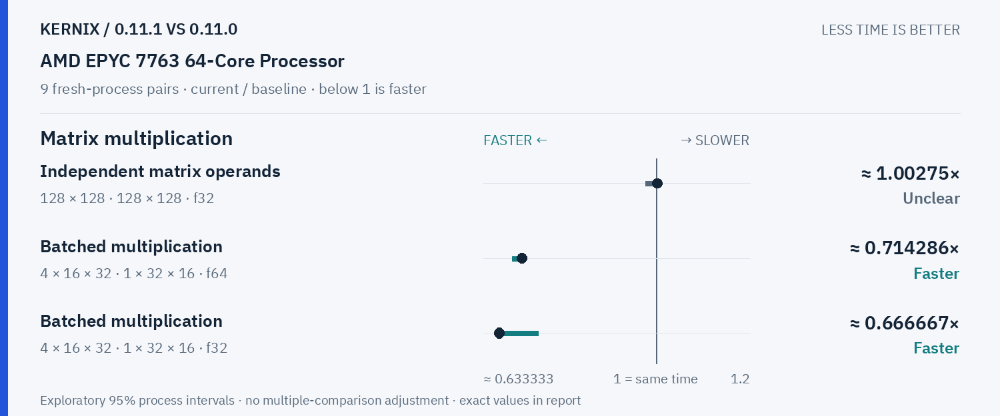

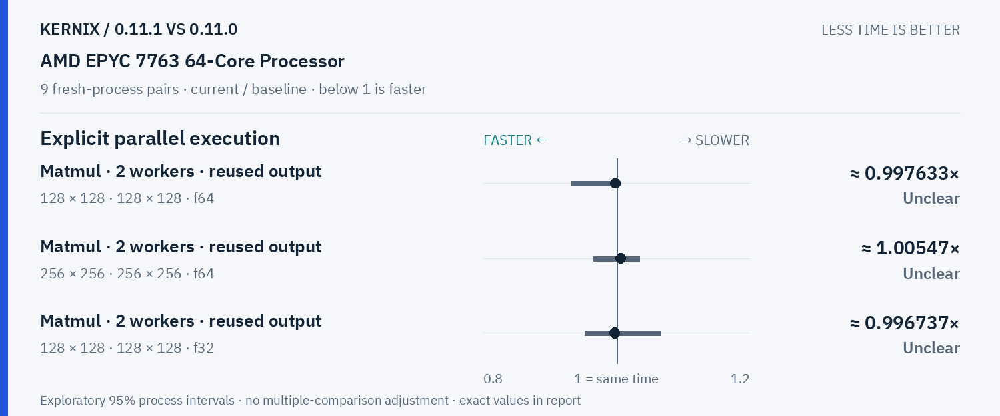

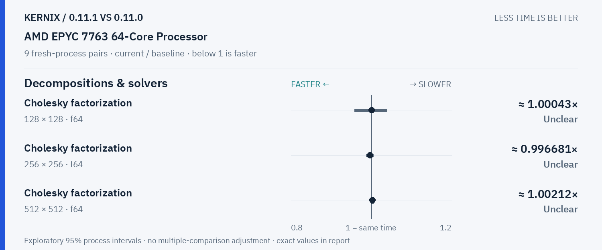

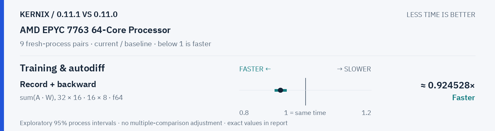

| Workload | Current / baseline [95% interval] | Interpretation |
|---|---:|---|
| Independent matrix operands · 128 × 128 · 128 × 128 · f64 | 1.0043859649122806× [0.6431924882629108, 1.1081277213352685] | Timing direction unclear |
| Independent matrix operands · 128 × 128 · 128 × 128 · f32 | 1.0027510316368637× [0.9773936170212766, 1.0097087378640777] | Timing direction unclear |
| Matrix multiplication · 32 × 32 · 32 × 32 · f64 | 1× [1, 1] | Timing direction unclear |
| Matrix multiplication · 64 × 64 · 64 × 64 · f64 | — | No paired comparison |
| Matrix multiplication · 128 × 128 · 128 × 128 · f64 | 1.0031813361611877× [0.9947478991596639, 1.4287222808870117] | Timing direction unclear |
| Matrix multiplication · 256 × 256 · 256 × 256 · f64 | 1.0005473453749316× [0.9873041599135602, 1.155377946356001] | Timing direction unclear |
| Matrix multiplication · 64 × 64 · 64 × 64 · f32 | — | No paired comparison |
| Matrix multiplication · 128 × 128 · 128 × 128 · f32 | 1.0021276595744681× [0.9978768577494692, 1.004255319148936] | Timing direction unclear |
| Matrix multiplication · 256 × 256 · 256 × 256 · f32 | 1.0005652911249294× [0.9435931601154786, 1.1982515510434293] | Timing direction unclear |
| Batched multiplication · 4 × 16 × 32 · 1 × 32 × 16 · f64 | 0.7142857142857143× [0.6944444444444444, 0.7222222222222222] | Observed time reduction |
| Batched multiplication · 4 × 16 × 32 · 1 × 32 × 16 · f32 | 0.6666666666666666× [0.6666666666666666, 0.75] | Observed time reduction |
| Matmul · 2 workers · reused output · 64 × 64 · 64 × 64 · f64 | — | No paired comparison |
| Matmul · 2 workers · reused output · 128 × 128 · 128 × 128 · f64 | 0.9976331360946745× [0.9316427783902976, 1.005966587112172] | Timing direction unclear |
| Matmul · 2 workers · reused output · 256 × 256 · 256 × 256 · f64 | 1.0054669703872436× [0.9654383154039826, 1.0339377033937704] | Timing direction unclear |
| Matmul · 2 workers · reused output · 128 × 128 · 128 × 128 · f32 | 0.99673735725938× [0.9522240527182867, 1.0662020905923344] | Timing direction unclear |
| Cholesky factorization · 512 × 512 · f64 | 1.0021162437741817× [0.9961633557848069, 1.0049226291120006] | Timing direction unclear |
| Column-pivoted QR · 96 × 32 · f64 | — | No paired comparison |
| Column-pivoted QR · 256 × 64 · f64 | — | No paired comparison |
| Minimum-norm least squares · 64 × 32, rank 16, 4 RHS · f64 | — | No paired comparison |
| Minimum-norm least squares · 32 × 64, rank 32, 4 RHS · f64 | — | No paired comparison |
| Thin QR · 96 × 32 · f64 | — | No paired comparison |
| Thin QR · 256 × 64 · f64 | — | No paired comparison |
| Cholesky factorization · 64 × 64 · f64 | — | No paired comparison |
| Cholesky factorization · 128 × 128 · f64 | 1.0004301075268818× [0.9575835475578406, 1.0379633765073693] | Timing direction unclear |
| Cholesky factorization · 256 × 256 · f64 | 0.9966810966810967× [0.9867199771526489, 1.0048934945308001] | Timing direction unclear |
| Shared-variable backward · sum(X * X), 64 × 32; prepared graph · f64 | — | No paired comparison |
| Record + backward · sum(A · W), 32 × 16 · 16 × 8 · f64 | 0.9245283018867925× [0.9074074074074074, 0.9433962264150944] | Observed time reduction |
| Model inference · batched normalized/sliced MLP · f64 | — | No paired comparison |
| Model recording + forward · batched normalized/sliced MLP · f64 | — | No paired comparison |
| Model backward · prepared graph → fresh gradients · f64 | — | No paired comparison |
| Parameter update · transactional SGD, fixed gradients · f64 | — | No paired comparison |
| Coalesced tensor contraction · 16 × 32 × 8 · 32 × 8 × 16 · f64 | — | No paired comparison |
| Row softmax · 256 × 64 · f64 | — | No paired comparison |
| Create zeros · 64 × 64 · f32 | — | No paired comparison |
| Create ones · 64 × 64 · f32 | — | No paired comparison |

## Method and provenance

CPU affinity was not pinned. Frequency and background load are uncontrolled.

Minimum-norm rows use pivoted QR plus scaled implicit RZ in Kernix; NumPy native lstsq; nalgebra native SVD/solve. Algorithm costs and rank policies differ. See original method for thresholds.

Numbers retain source precision; recorded digits do not imply equivalent physical measurement accuracy. Lowest observed medians are bold only when peers were measured. No aggregate winner or universal ranking is inferred.

[Original report and commentary](original-report.txt) · [Raw measurements](raw.json)

Measured source `450df128c1ffb55a9a861230edb6b9a5ac3ef5b4`. Run `runner-windows-latest-40161751367`. Rendering does not change measurements.
